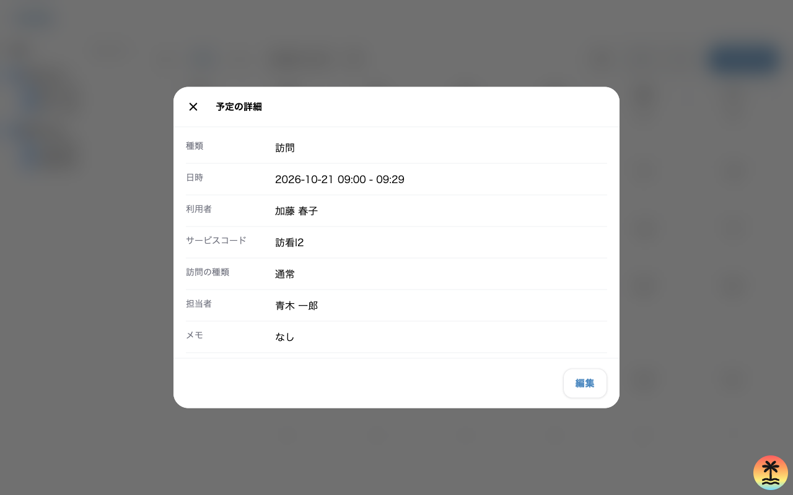
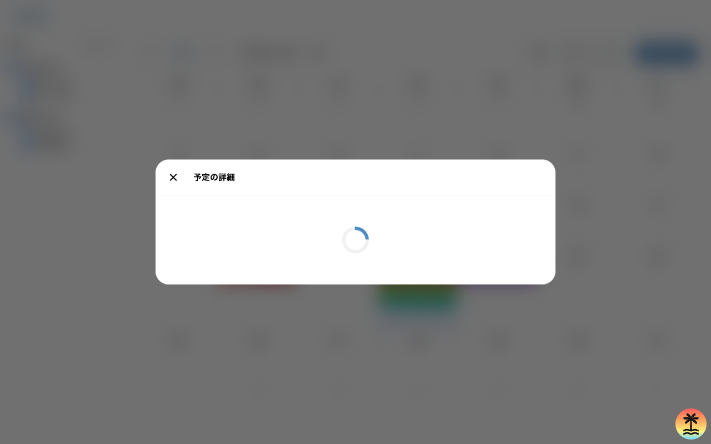
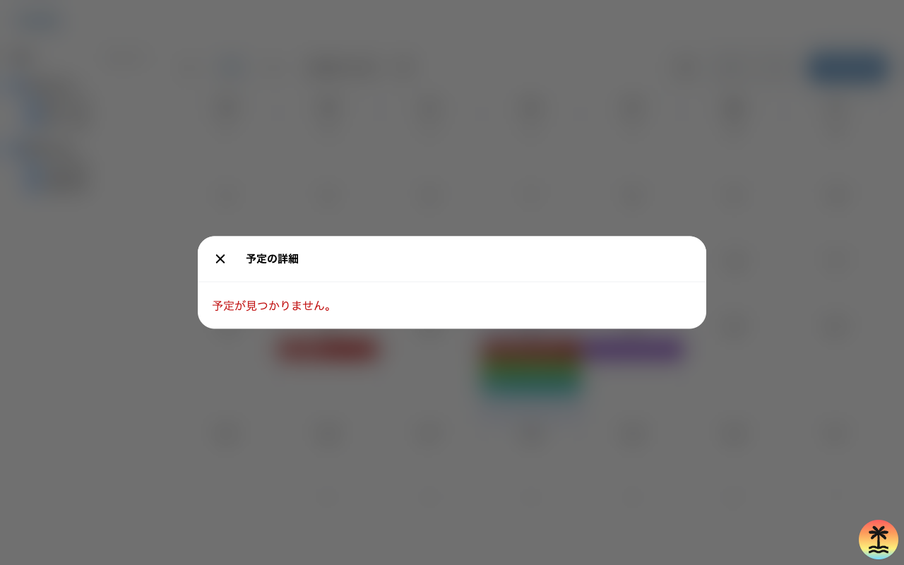

# 予定の詳細

職員が、カレンダーで押した予定 1 件の内容を見て、編集へ進む画面。  
予定のカレンダーの上にモーダルで重ねて出し、閉じるとカレンダーに戻る。

| 項目 | 値 |
| --- | --- |
| 画面の ID | `schedule-detail` |
| URL | `/schedule/$scheduleId`。`/schedule` の子で、カレンダーの search params を引き継ぐ |
| 使う人 | 予定を見る権限を持つ職員。自分の予定は全ての職員が見られる |
| 実装 | `apps/web/src/routes/schedule.$scheduleId.index.tsx`、`ScheduleDetailModalContainer`、`ScheduleDetailModal` |

## UI

モーダルは、上端に閉じるボタンと題、本文に項目の名前と値の行、下端に編集のボタンを置く。

```text
+------------------------------------------------------------+
| [x]  予定の詳細                                            |
+------------------------------------------------------------+
| 種類            訪問                                       |
| タイトル        （通常の予定だけ）                         |
| 日時            YYYY-MM-DD HH:mm - HH:mm                   |
| 利用者          （訪問の予定だけ）                         |
| サービスコード  （訪問の予定だけ）                         |
| 訪問の種類      （訪問の予定だけ）                         |
| 担当者 / 予定者 職員の名前                                 |
| メモ            メモか「なし」                             |
+------------------------------------------------------------+
|                                                    [編集]  |
+------------------------------------------------------------+
```

偽物の API につないだ状態で、開発サーバーから撮った画面は次のとおり。

訪問の予定（`/schedule/schedule-1?date=2026-10-21`）



読み込み中（予定の取得を取り直している間）



予定が見つからない（`/schedule/no-such-id?date=2026-10-21`）



## 状態ごとの UI

| 状態 | 条件 | 見えるもの |
| --- | --- | --- |
| 読み込み中 | 予定の取得が終わっていない | 題「予定の詳細」と `Loading`。閉じるボタンは押せる |
| 表示 | 予定の取得が成功した | 予定の項目の行と編集のボタン |
| 職員か利用者が分からない | 職員か利用者の一覧に、予定の職員か利用者が無い。一覧の取得が終わる前と、取得が失敗したときを含む | 担当者が「職員不明」、利用者が「利用者不明」 |
| 見つからない（404） | API が 404 を返した | 「予定が見つかりません。」（`role="alert"`）。編集のボタンは出さない |
| 取得の失敗 | 404 以外の失敗、または API に届かない | 「予定を取得できませんでした。」（`role="alert"`）。編集のボタンは出さない |
| 権限なし（403） | 見る権限の外の予定か、ほかの事業所の予定を指した | 取得の失敗と同じ文 |
| 未認証（401） | API が 401 を返す | 未実装。取得の失敗と同じ文になる |

- 取得の失敗は、TanStack Query の `retry` を設定していないため、3 回まで取り直してから表示する。404 も取り直すため、「予定が見つかりません。」が出るまで数秒かかる。

## 構成要素

API の列は、`getSchedule`（`GET /v1/schedules/{schedule_id}`）の `Schedule` の項目で書く。

| 構成要素 | 表示する値 | web の型の項目 | OpenAPI の項目 | `data-testid` |
| --- | --- | --- | --- | --- |
| `Modal` | 題「予定の詳細」 | なし | なし | `schedule-detail-modal` |
| 閉じるボタン | ×（`aria-label="閉じる"`） | なし | なし | `modal-close` |
| 種類の行 | 「通常」か「訪問」 | `Schedule.kind` | `schedule_type` | なし |
| タイトルの行 | タイトル | `Schedule.title` | `title` | なし |
| 日時の行 | `YYYY-MM-DD HH:mm - HH:mm` | `Schedule.startsAt`、`Schedule.endsAt` | `date`、`start_time`、`end_time` | `schedule-detail-datetime` |
| 利用者の行 | 利用者の名前 | `visit.patientId` を利用者の一覧で引く | `visit_info.patient_name` | なし |
| サービスコードの行 | サービスコード | `visit.serviceCode` | `visit_info.service_code` | なし |
| 訪問の種類の行 | 夜勤、緊急、入院を「、」でつなぐ。無ければ「通常」 | `visit.categories` | `visit_info.visit_categories[].name` | なし |
| 担当者、予定者の行 | 職員の名前 | `Schedule.staffId` を職員の一覧で引く | `staff_name` | なし |
| メモの行 | メモ。空なら「なし」 | `Schedule.description` | `description` | なし |
| 編集のボタン | 「編集」 | なし | なし | `schedule-detail-edit` |
| 失敗の文 | 「予定が見つかりません。」か「予定を取得できませんでした。」 | なし | なし | なし |

- 行の名前は、訪問の予定なら「担当者」、通常の予定なら「予定者」にする。
- 訪問の予定のタイトル（「訪問」）は出さない。

## 構成要素ごとの活性条件と表示条件

| 構成要素 | 表示する条件 | 押せる条件 |
| --- | --- | --- |
| タイトルの行 | 種類が通常 | なし |
| 利用者、サービスコード、訪問の種類の行 | 予定が訪問の情報を持つ | なし |
| 編集のボタン | 予定の取得が成功した | 常に。権限による出し分けは未決 |
| 閉じるボタン | 常に | 常に |

API につないだ後の権限による条件は次のとおり。

| 構成要素 | 条件 |
| --- | --- |
| 予定の全体 | 予定の担当の職員が自分か、閲覧か編集の権限の対象のときだけ出す。対象の外なら API が 403 を返す |
| 編集のボタン | 自分の予定なら自分の予定の編集、ほかの職員の予定なら、全ての予定の編集、指定した職員の予定の編集、指定したチームの職員の予定の編集のどれかで対象のときに出すかは未決 |

## インタラクション

| 操作 | 前提 | 結果 |
| --- | --- | --- |
| 編集を押す | 予定の取得が成功した | 予定の編集を開く。URL は `/schedule/{予定の id}/edit` に `view`、`date`、`staff` を引き継ぐ（履歴に積む） |
| 閉じるボタン、背景、Escape キー | なし | `/schedule` に `view`、`date`、`staff` を引き継いで戻る。確認は出さない |

## 初期状態でのインタラクション

| 時点 | できる操作 | できない操作 |
| --- | --- | --- |
| 予定の取得が終わる前 | 閉じる | 編集（ボタンを出していない） |
| 予定の取得が成功した後 | 閉じる、編集 | なし |
| 予定の取得が失敗した後 | 閉じる | 編集 |

- 開いた直後のフォーカスは `body` にあり、モーダルの中へ移さない。
- 背後のカレンダーは、`/schedule` の画面として描いたまま残る。
- URL の `scheduleId` で予定を取る。search params の `view`、`date`、`staff` は、閉じたときと編集へ進むときに引き継ぐ。読めない値は、予定のカレンダーと同じ規則で既定の値に置き換える。

## 未決

PRD と実装の食い違い

- PRD は、カレンダーから予定をキャンセルし、理由を残せるとしている。実装の詳細は、キャンセルのボタンを持たない。OpenAPI は `cancelSchedule` を持つ。
- PRD の同行者、時間外の勤務の印、キャンセルの理由を、詳細に出していない。OpenAPI の `visit_info.companion_name`、`is_over_time_work`、`cancel.reason` に当たる。
- web の `BuddyApi.schedules.get` は、事業所の ID と予定の ID を受ける。OpenAPI の `getSchedule` は `/v1/schedules/{schedule_id}` で、パスに事業所を持たない。

決まっていないこと

- 編集の権限が無い予定で、編集のボタンを隠すか、押せなくするか、出して API の 403 で止めるか。画面が権限をどこから読むかも決まっていない。
- 403 を、取得の失敗と同じ文で出すか、権限が無いことを示す文に分けるか。
- 404 と 403 を取り直さずにすぐ表示するか。
- 繰り返しの予定の 1 回を押したときに、どの URL で詳細を開くか。OpenAPI の繰り返しの予定は `getRecurringSchedule` で別に取る。
- 職員と利用者の一覧の取得が終わる前に、「職員不明」「利用者不明」を一時的に出してよいか。API につないだ後は `staff_name` と `visit_info.patient_name` を使えば一覧を待たずに済む。
- 開いたときのフォーカスの位置。
