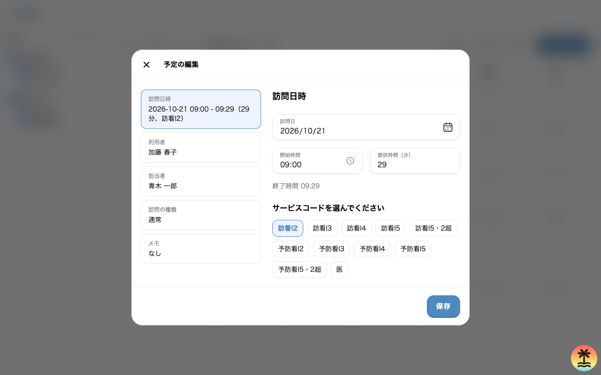
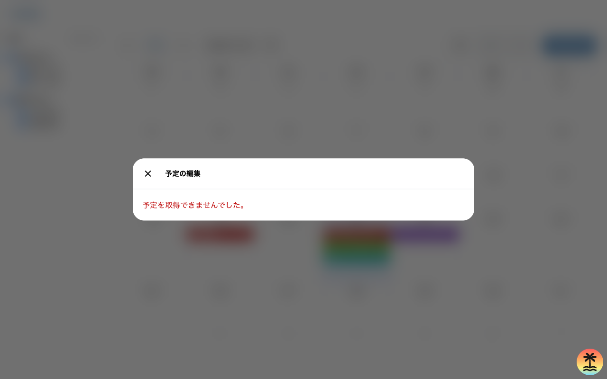

# 予定の編集

職員が、予定 1 件の日時、担当者、訪問の内容、メモを直す画面。  
予定の詳細の編集のボタンから開き、保存すると予定の詳細に戻る。

| 項目 | 値 |
| --- | --- |
| 画面の ID | `schedule-edit` |
| URL | `/schedule/$scheduleId/edit`。`/schedule` の子で、カレンダーの search params を引き継ぐ |
| 使う人 | 予定を編集する権限を持つ職員 |
| 実装 | `apps/web/src/routes/schedule.$scheduleId.edit.tsx`、`ScheduleEditModalContainer`、`ScheduleFormModal`、`ScheduleForm` |

フォームの構成要素は予定の作成と同じものを使う。  
この仕様書には、予定の作成との違いだけを書き、共通の部分は[予定の作成](schedule-new.md)を参照する。

## UI

配置は予定の作成と同じで、次の 3 点が違う。

- 上端に種類のタブを出さない。予定の種類は変えられない。
- 題は「予定の編集」、送信のボタンは「保存」。
- フォームの初期値は、取った予定の値。

```text
+------------------------------------------------------------+
| [x]  予定の編集                                            |
+----------------------+-------------------------------------+
| ScheduleFieldSummary | 右の入力（選んだ項目だけ）          |
| List                 |                                     |
| [訪問日時]           | ScheduleDateTimeEdit                |
| [利用者]             | PatientSelectList                   |
| [担当者]             | StaffSelectList                     |
| [訪問の種類]         | ScheduleCategoryCheckboxGroup       |
| [メモ]               | TextareaField                       |
+----------------------+-------------------------------------+
| （送信の失敗の文）                                  [保存] |
+------------------------------------------------------------+
```

偽物の API につないだ状態で、開発サーバーから撮った画面は次のとおり。

訪問の予定（`/schedule/schedule-1/edit?date=2026-10-21`）



予定を取れなかった（`/schedule/no-such-id/edit?date=2026-10-21`）



## 状態ごとの UI

| 状態 | 条件 | 見えるもの |
| --- | --- | --- |
| 読み込み中 | 予定、職員、利用者のどれかの取得が終わっていない | 題「予定の編集」と `Loading`。閉じるボタンは出るが、押しても閉じない |
| 取得の失敗 | 予定、職員、利用者のどれかの取得が失敗した。404 を含む | 「予定を取得できませんでした。」（`role="alert"`） |
| 初期表示 | 3 つの取得が成功した | 予定の値を初期値にしたフォーム。右の入力は「訪問日時」か「予定日時」 |
| 入力の誤り | 保存を押し、検証に通らない | 予定の作成と同じ文と見え方 |
| 送信中 | 検証に通り、API の応答を待っている | 保存のボタンに回転するインジケーター |
| 成功 | API が予定を返した | 予定の詳細に戻る。成功の文は出さない |
| 送信の失敗 | API が失敗を返した、または届かない | 下端に「予定を更新できませんでした。」（`role="alert"`）。入力は残す |
| 権限なし（403） | 編集の権限の外の予定を指した | 未実装。読み込みで失敗すれば取得の失敗と、保存で失敗すれば送信の失敗と同じ文になる |
| 未認証（401） | API が 401 を返す | 未実装。取得の失敗か送信の失敗と同じ文になる |

- 取得の失敗は、TanStack Query の `retry` を設定していないため、3 回まで取り直してから表示する。
- 予定の詳細と違い、404 を「予定が見つかりません。」に分けない。

## 構成要素

予定の作成と同じ構成要素のうち、違うものだけを挙げる。  
ほかの構成要素の表示する値、API の項目、`data-testid` は、予定の作成の構成要素の節と同じ。

| 構成要素 | 表示する値 | web の型の項目 | OpenAPI の項目 | `data-testid` |
| --- | --- | --- | --- | --- |
| `Modal` | 題「予定の編集」 | なし | なし | `schedule-form-modal` |
| 種類の `TextTab` | 出さない | なし | なし | なし |
| 保存のボタン | 「保存」 | なし | なし | `schedule-edit-submit` |
| 送信の失敗の文 | 「予定を更新できませんでした。」 | なし | なし | なし |
| 提供時間の `NumberPicker` の初期値 | 開始時間から終了時間までの分 | `startsAt`、`endsAt` | `start_time`、`end_time` | `schedule-form-service-time` |
| 読み込み中の `Loading` | インジケーターだけ | なし | なし | なし |
| 取得の失敗の文 | 「予定を取得できませんでした。」 | なし | なし | なし |

- 予定を取る API は `getSchedule`（`GET /v1/schedules/{schedule_id}`）である。予定を直す API は、OpenAPI に無い（未決の節）。

## 構成要素ごとの活性条件と表示条件

予定の作成の活性条件と表示条件に、次の違いがある。

| 構成要素 | 表示する条件 | 押せる（入力できる）条件 |
| --- | --- | --- |
| 種類の `TextTab` | 出さない | なし |
| フォームの全体 | 予定、職員、利用者の 3 つの取得が成功した | 常に |
| 閉じるボタン（読み込み中） | 常に | 押せるが、何も起きない |
| 保存のボタン | フォームを出している | 送信中でない。入力を変えていなくても押せる |

API につないだ後の権限による条件は、決まっていない。  
編集の権限の外の予定を URL で直接開いたときに、読み込みの時点で止めるか、保存の 403 で止めるかは未決の節に置く。

## インタラクション

予定の作成のインタラクションのうち、種類のタブの操作は無い。  
次の操作は、予定の作成と結果が違う。

| 操作 | 前提 | 結果 |
| --- | --- | --- |
| 保存を押す | 検証に通る | 予定を直す API を呼ぶ。成功したら予定の一覧の取得の結果を捨てて取り直し、`/schedule/{予定の id}` に `view`、`date`、`staff` を引き継いで戻る（履歴に積む） |
| 保存を押す | 送信が失敗する | 「予定を更新できませんでした。」を出し、モーダルを開いたままにする |
| 閉じるボタン、背景、Escape キー | フォームを出している。入力を変えていない | 予定の詳細に戻る |
| 閉じるボタン、背景、Escape キー | フォームを出している。入力を変えた | 「変更が破棄されますがよろしいですか？」の確認を出す。OK なら予定の詳細に戻る |
| 閉じるボタン、背景、Escape キー | 取得の失敗を出している | 予定の詳細ではなく、`/schedule` に `view`、`date`、`staff` を引き継いで戻る |
| 閉じるボタン、背景、Escape キー | 読み込み中 | 何も起きない |

- 予定を直した後のカレンダーは、予定の一覧を取り直した結果を出す。予定の日付を変えたときも、カレンダーの `date` は変えない。

## 初期状態でのインタラクション

| 時点 | できる操作 | できない操作 |
| --- | --- | --- |
| 3 つの取得が終わる前 | ブラウザの戻る | 閉じる、入力、保存 |
| 3 つの取得が成功した後 | 全ての操作 | 種類の切り替え |
| 取得が失敗した後 | 閉じる | 入力、保存 |

- 開いた直後のフォーカスは `body` にあり、モーダルの中へ移さない。
- URL の `scheduleId` で予定を取る。search params の `view`、`date`、`staff` は、閉じたときと保存した後に引き継ぐ。読めない値は、予定のカレンダーと同じ規則で既定の値に置き換える。
- フォームの初期値は、予定の取得の結果から作る。訪問の予定の提供時間は、開始時間から終了時間までの分にする。

## 未決

PRD と実装の食い違い

- OpenAPI は、単発の予定を直す API を持たない。予定を変える API は、キャンセルの `cancelSchedule` と、繰り返しの予定の 1 回を置き換える `changeOccurrence` だけである。web の `BuddyApi.schedules.update` に当たる API が無い。
- PRD の同行者、繰り返し、時間外の勤務の印を、予定の作成と同じく編集できない。

決まっていないこと

- 予定の種類（通常と訪問）を編集で変えられるようにするか。今は変えられない。
- 編集の権限の外の予定を URL で直接開いたときに、読み込みの時点で止めるか、保存の 403 で止めるか。
- 404 を「予定が見つかりません。」に分けるか。予定の詳細は分けている。
- 読み込み中に閉じるボタンを押しても閉じない。閉じられるようにするか。
- 取得の失敗から閉じたときの戻り先を、予定の詳細とカレンダーのどちらにするか。今はカレンダーに戻る。
- 繰り返しの予定の 1 回を直すときに、その回だけを直すか、繰り返しの全体を直すかを選ばせるか。
- 保存に成功したときに、成功の文を出すか。
- 開いたときのフォーカスの位置。
