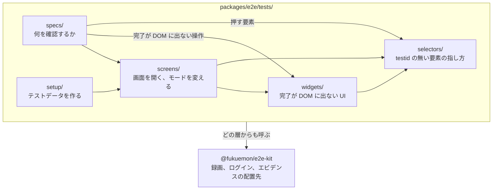
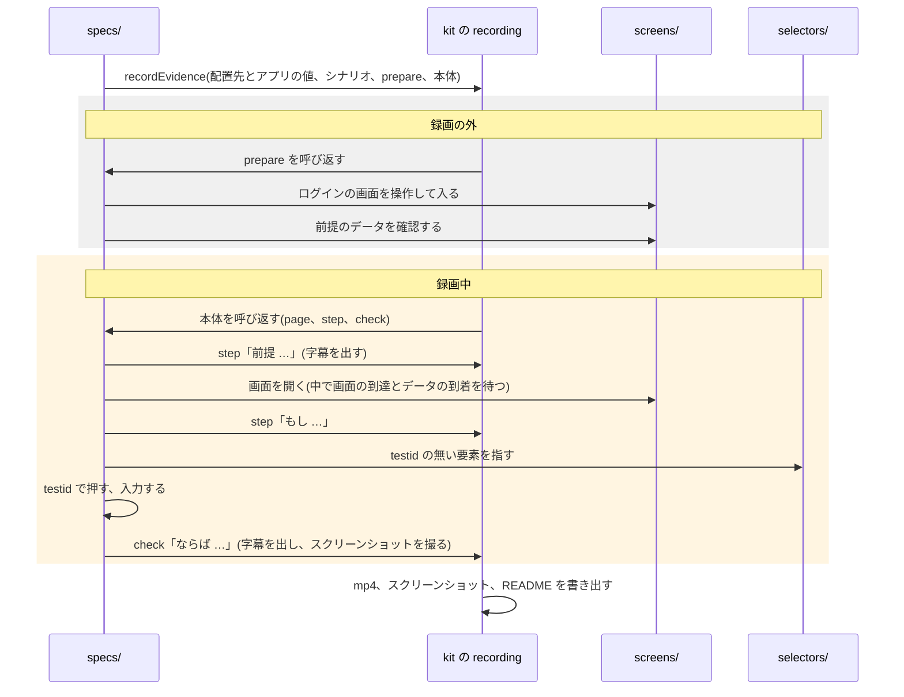
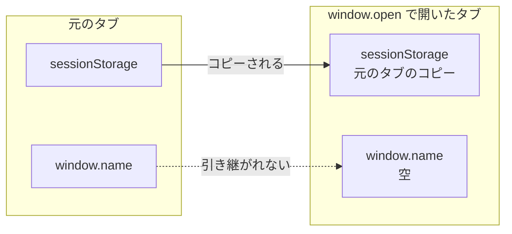

# E2E のテストのコードの設計

## Overview

プロダクトのチームの開発者が、Playwright の E2E のテストのコードを書くときの考え方と構成を示す。  
手動検証のエビデンスを撮る spec も、同じ考え方で書く。

E2E を足すたびに書き方が人によって変わると、失敗したときにどこを読めばよいかが分からなくなる。  
待ちの書き忘れは spec ごとに同じ形で起き、要素の指し方は画面の作りを変えるたびに使えなくなる。  
そこで、処理を置く層と待ち方を決め、機械で判定できるものは ESLint の規則（kit の `@fukuemon/e2e-kit/eslint`）で止める。

層、配置先、名前、待ち方、確認の方法の規則は、agent-harness のパッケージ e2e のスキル `write-e2e-test` が持つ。  
この文書は、buddy での構成と、規則の理由を示す。

- 出典: [スキル write-e2e-test](https://github.com/Fukuemon/agent-harness/blob/5560ae1e031686f5821ecac0d7c12d8fb6ea3499/packages/e2e/skills/write-e2e-test/SKILL.md)

エビデンスの録画の流れは [agent-harness の e2e の Design Doc](https://github.com/Fukuemon/agent-harness/blob/5560ae1e031686f5821ecac0d7c12d8fb6ea3499/packages/e2e/DesignDoc.md) にある。

## Scope

持つもの。

- 層の依存の向きと、処理をどの層に置くかの判断の流れ
- エビデンスの spec が層と kit を呼ぶ順
- 禁止する書き方と、ESLint の規則が止める範囲
- タイムアウトで落ちたときの読み方

持たないもの。

- 層の責務、名前、待ち方、確認の方法、新しいタブと時間で動く画面の扱い、testid の付け方の注意。スキル `write-e2e-test` が持つ
- testid の名前の規則、規則の options、流すコマンド、環境、テストデータの中身。`context/testing/e2e.md` が持つ
- リグレッションテストの寿命と、実行の契機。`context/testing.md` が持つ
- API の mock の置き方。デプロイ済みの環境に向けて流すテストでは使わない

## Design

### 層と依存の向き

次の図は、層の間で import してよい向きを示す。  
上の層は下の層を呼び、下の層は上の層を呼ばない。  
`fixtures/` はどの層からも使うので、矢印を省いた。

- `specs/<dir>/` に置く spec 以外のファイルは、値だけを持つ。要求ごとの値をどの要求にも使う `fixtures/` に置くと、要求に関わるものが複数の配置先に分かれるためである。
- `widgets/<UI>/` を操作しないテストは、spec から `waits/` を直接呼ぶ。

### 配置先の決め方

デフォルトでは spec に書く。  
ほかの層に置くのは、次の図の条件に当たるときだけである。

- 画面を開く手順は、待ちを多く含む。spec ごとに複製すると、待ちの書き忘れが spec の数だけ再発するので、3 本で共有する。
- 完了が DOM に出ない処理は、spec ごとに待つと固定の待ちと待ちの書き忘れが spec の数だけ生まれる。そこで `widgets/` に集め、直す場所を 1 か所にする。使う spec が 1 本でも `widgets/` に置く。

### 名前

アクターの違いは、機能の中の `describe` で表す。  
アクターでディレクトリを切ると、1 つの機能の確認が複数のディレクトリに散る。

### エビデンスの spec の流れ

次の図は、エビデンスの spec が、層と kit をどの順で呼ぶかを示す。  
spec が持つのは、操作の順、押す要素、字幕の文だけである。  
配置先とアプリの値(`recordEvidence` に渡す `RecordingTarget`)は、kit を呼ぶ薄い層(`tests/fixtures/evidence.ts`)が持つ。  
録画は、ログインを録画の外で済ませてから始まる。  
灰色の帯は録画に映らず、黄色の帯が録画に映る。  
`prepare` に渡るページは、`recordEvidence` が新しく作るコンテキストのページで、`setup` が保存したログインの状態を持たない。  
そのため、`prepare` の中でログインする。

エビデンスを撮らない E2E では、`recordEvidence` を通さず、spec が直接 `screens/` と kit を呼び、`expect` で確認する。

### 新しいタブをまたぐテスト

次の図は、元のタブから新しいタブへ、何が引き継がれるかを示す。

### 禁止する書き方

失敗の原因になりやすい書き方を禁じる。  
機械で判定できるものは、ESLint の規則(kit の `@fukuemon/e2e-kit/eslint`)が止める。  
「レビュー」のものは、書かれていないことや順番の判定で、コードの形からは決められない。

| 禁じること | 代わりに | なぜ | 止め方 |
| --- | --- | --- | --- |
| `screens/` と `widgets/` に `expect` を書く | 結果の確認は spec と setup だけで行う | 失敗したときに、どこで落ちたかを追えなくなる | 規則 |
| 固定の秒数で待つ(`waitForTimeout`、`setTimeout`) | 6 種類の待ち方から選ぶ | 遅い環境では足りず、速い環境では無駄になる | 規則。options で渡したファイルだけ許す |
| `selectors/` の外で、CSS や表示の文言で要素を指す(`locator`、`getByRole` など) | testid で指す | 画面の作りや文言を変えると、指せなくなる | 規則 |
| 「起きないこと」をそのまま確認する | 前後の確認を置く | まだ描かれていないだけでも通る | レビュー |
| 値を読んでから `expect` で比べる | locator をそのまま `expect` に渡す | 読んだ時点と比べる時点がずれ、自動の待ちが働かない | 規則とレビュー |
| 読み込み表示が消えるのだけを待つ | 出てから消えるまでを待つ | 読み込みが始まる前の時点で条件を満たす | レビュー |
| spec に `timeout` を書く。待つ時間の数値を直に書く | Playwright の設定と、`fixtures/` の名前に集める | 値がばらつくと、全体を調整できない | 規則 |
| spec を import する。ほかの `specs/<dir>/` のファイルを import する。`specs/` の直下に spec 以外のファイルを置く。`specs/<dir>/` の値のファイルに画面の操作を書く | 共有する操作は `screens/` か `widgets/` に出す。`specs/<dir>/` には値だけを置く | `specs/` はテストの本体で、ほかの層から呼ばれる側ではない | 規則とレビュー。`screens/` の関数を値のファイルで呼ぶような、規則が拾わない操作はレビューで見る |
| `screens/` と `widgets/` で `route` を張る | `route` は spec に置く | 同じ関数を、どの環境に向けた spec からも使えなくなる | 規則 |
| `widgets/` に画面 ID を書く。画面へ `goto` する | testid の接頭辞は引数で受ける。画面を開く手順は `screens/` か spec に置く | 同じ UI が複数の画面に埋め込まれる。画面を知ると、画面ごとに複製が要る | 規則。options で渡した URL だけ許す |
| `networkidle` を待つ | API のレスポンスか、要素が出るのを待つ | 読み込みを続ける画面(取り直しを繰り返す画面)では、通信が止まらない | 規則 |
| ボタンを並びの位置で指す | 名前で指す | 並びが変わったときに、別のボタンを押す | レビュー |
| 確定や削除のダイアログを、文言を確認せずに押す | 文言を確認してから押す | 意図しないダイアログを押して、データを変える | レビュー |

値を読んでから比べることについて、規則が止める範囲と許す場面は次のとおり。

- 規則は、`innerText`、`textContent`、`inputValue`、`allInnerTexts`、`allTextContents` を `tests/` の全体で止め、`getAttribute` を spec だけで止める。
- `widgets/` の待ちが属性を読むことは許す。比べるのではなく、待つために読む。

### タイムアウトと失敗の読み方

内側から、`expect` の時間 < 操作の時間(`actionTimeout`)< 外部の読み込み(IdP のログインなど)< テストの全体の時間、の順に長くする。  
こうすると、どの層で落ちたかを失敗の形から見分けられる。  
値は、1 回の CI の実行では決めない。  
runner の状態で所要が振れ、実行の間で 2 倍近く違うことがある。

| 失敗の形 | どこで落ちたか | 見る場所 |
| --- | --- | --- |
| `expect` が時間切れ | 結果の確認。操作は終わっている | spec の該当の行と、trace の最後の画面 |
| `click` などの操作が時間切れ | 操作の対象が出ていない | その操作の直前の待ち。`screens/` か `widgets/` の関数の中 |
| IdP の画面の読み込みが時間切れ | 外部の読み込み | compose の IdP の状態 |
| テストの全体が時間切れ | 上のどれにも当たらない待ち | 操作の時間が当たらない待ち(API のレスポンスの待ちなど) |

### テストの関数と待ちの組み立て

テスト用のクラスは作らず、`page` を引数に取る関数を並べる。
locator は spec に書き、`screens/` には共有する「開く、モードを変える」だけを置く。
待ちは、テストの側で観測できるもの（API のレスポンス、ライブラリが作る DOM）で組み立て、描画の完了を示す属性をアプリに足さない。

- ADR-0020: [E2E のテストのコードを、Page Object を使わず page を受け取る関数で書き、描画の完了の信号をアプリに足さない](https://github.com/Fukuemon/buddy/blob/develop/docs/adr/0020-e2e-functions-without-page-object.md)

## Interface

ESLint の規則は、`packages/e2e/eslint.config.mjs` で `tests/**/*.ts` に適用する。  
options の値と、流すディレクトリは、[E2E のテスト](https://github.com/Fukuemon/buddy/blob/develop/context/testing/e2e.md) の Lint Rule Options にある。
