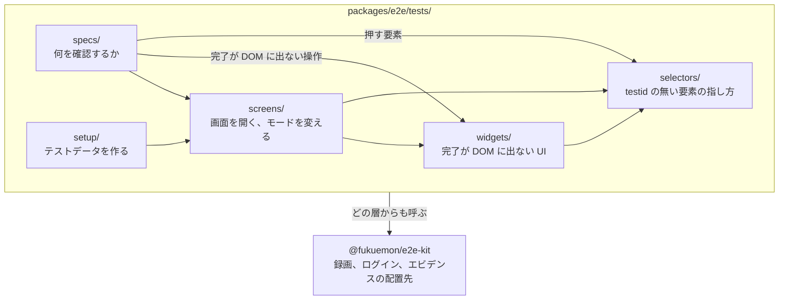
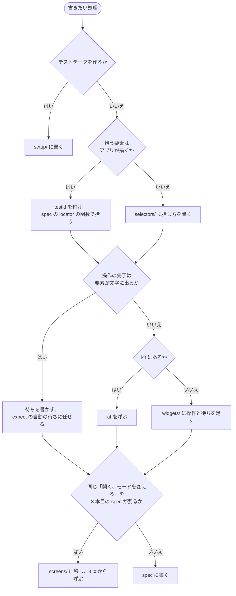
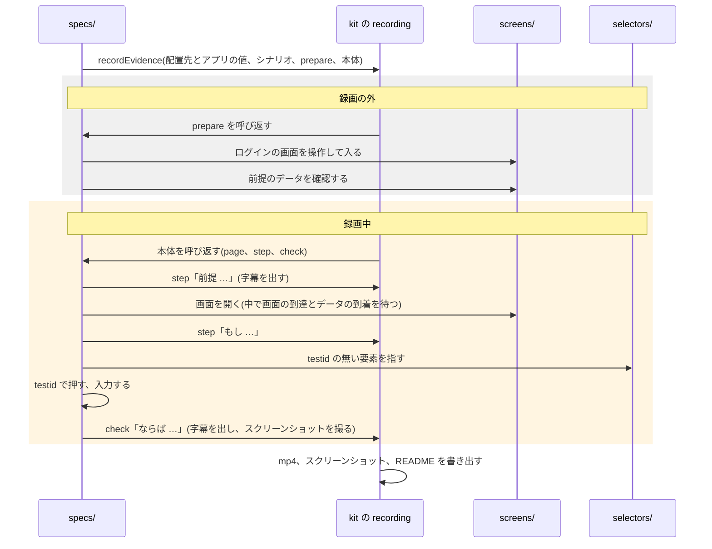
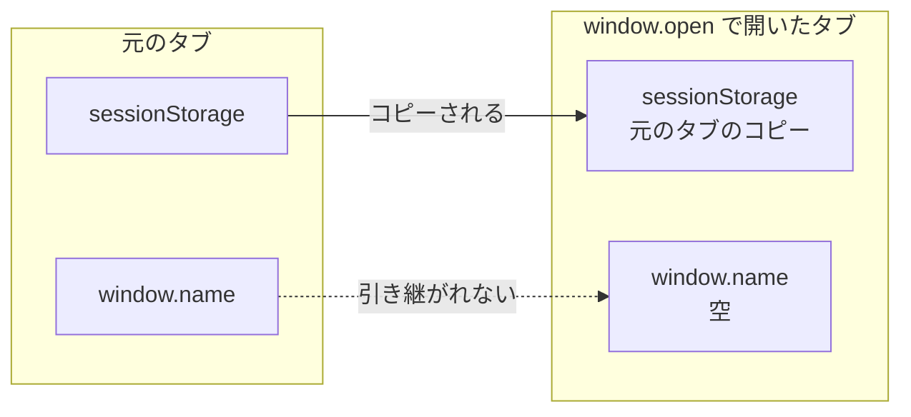

# E2E のテストのコードの設計

## Overview

プロダクトのチームの開発者が、Playwright の E2E のテストのコードを書くときの考え方と構成を示す。手動検証のエビデンスを撮る spec も、同じ考え方で書く。

E2E を足すたびに書き方が人によって変わると、失敗したときにどこを読めばよいかが分からなくなる。待ちの書き忘れは spec ごとに同じ形で起き、要素の指し方は画面の作りを変えるたびに使えなくなる。  
そこで、処理を置く層と待ち方を決め、機械で判定できるものは ESLint の規則（kit の `@fukuemon/e2e-kit/eslint`）で止める。

エビデンスの録画の流れは [agent-harness の e2e の Design Doc](https://github.com/Fukuemon/agent-harness/blob/5560ae1e031686f5821ecac0d7c12d8fb6ea3499/packages/e2e/DesignDoc.md) にある。  
この文書は、元のリポジトリ（非公開）からコピーし、buddy で使いながら直した。kit と規則は、npm の `@fukuemon/e2e-kit` を使う。  
AI が書くときの手順は、agent-harness のパッケージ e2e のスキル `write-e2e-test` が持つ。この文書は、その手順の理由と構成を人に向けて示す。

## Scope

持つもの。

- 層の責務と依存の向き
- 処理をどの層に置くかの決め方と、spec の配置先とテストの名前
- 待ち方と確認の方法。新しいタブ、時間で動く画面の扱い
- testid の付け方の注意
- 禁止する書き方と、ESLint の規則が止める範囲
- タイムアウトの組み立てと、失敗したときの読み方

持たないもの。

- testid の名前の規則、流すコマンド、環境、テストデータの中身。`context/testing/e2e.md` が持つ
- リグレッションテストの寿命と、実行の契機。`context/testing.md` が持つ
- API の mock の置き方。デプロイ済みの環境に向けて流すテストでは使わない

## Design

### 層と依存の向き

テストのコードは、次の 6 つの層に分ける。

| 層 | 持つもの | 持たないもの |
| --- | --- | --- |
| `specs/` | 何を確認するか。`expect` を書く。locator の関数と、1 から 2 本の spec しか使わない操作。`specs/<dir>/` には、その下の spec だけが共有する値(シナリオの備考の文など)も置く | ほかの `specs/<dir>/` からの import。値のファイルの中の画面の操作 |
| `setup/` | テストデータを作る手順。作る前に同じデータがあるかを確認し、あれば作らずに使う。作った結果を `expect` で確認する | 画面の操作の本体 |
| `screens/` | 3 本以上の spec が使う「画面を開く、モードを変える」。中で待ち切る | `expect`、`route`、複数の画面をまたぐ手順 |
| `widgets/` | 処理の完了が DOM に出ない UI(canvas など)の操作と待ち | `expect`、`route`、画面 ID と URL |
| `selectors/` | testid を付けられない要素の指し方。外部のライブラリが作る DOM と、表示の文言 | 操作、待ち、`expect` |
| `fixtures/` | 環境変数の読み取り、作るデータの名前、待つ時間の名前、テストデータの API、アプリの URL の形と URL から値を読む関数 | 画面の操作 |

次の図は、層の間で import してよい向きを示す。上の層は下の層を呼び、下の層は上の層を呼ばない。`fixtures/` はどの層からも使うので、矢印を省いた。

- spec を import しない。`specs/<dir>/` から import できるのは、同じ `specs/<dir>/` の値のファイルだけである。共有する操作は `screens/` か `widgets/` に出す。
- `specs/<dir>/` に置く spec 以外のファイルは、値だけを持つ。要求ごとの値をどの要求にも使う `fixtures/` に置くと、要求に関わるものが複数の配置先に分かれるためである。エビデンスの spec の例は、改修前と違ってよい差の文(`specs/<issue>/differences.ts`)である。
- `screens/` と `widgets/` は `route` を持たない。同じ関数を、どの環境に向けた spec からも使える。
- `widgets/` は画面を知らない。URL と画面 ID を持たず、testid の接頭辞は引数で受け取る。同じ UI が複数の画面に埋め込まれるためである。
- ログインと録画は kit が持つ。`widgets/` と `screens/` には、buddy の画面に固有の操作と待ちだけを置く。
- `widgets/<UI>/` の中は、操作(`actions/`)と待ち(`waits/`)のディレクトリに分ける。依存は `actions/` から `waits/` の向きだけにする。操作は中で待ち切るので、呼ぶ側は待ちを書かない。操作しないテストは、spec から `waits/` を直接呼ぶ。

### 配置先の決め方

デフォルトでは spec に書く。ほかの層に置くのは、次の図の条件に当たるときだけである。

- `screens/` に移すかは、3 本目の spec が同じ操作を要した時点で 1 回だけ判断する。数えるのは export ごとである。1 本の spec だけのために共有の関数を作ると、使われない関数が増える。
- 画面を開く手順は、待ちを多く含む。spec ごとに複製すると、待ちの書き忘れが spec の数だけ再発するので、3 本で共有する。
- 複数の画面をまたぐ手順は、spec に書く。`screens/` に書くと、ある画面のファイルが別の画面を知る。
- DOM に完了が出る共通の UI(表、日付の選択)は `widgets/` にしない。`expect` が待てるので、spec から testid で操作する。
- 完了が DOM に出ない処理は、spec ごとに待つと固定の待ちと待ちの書き忘れが spec の数だけ生まれる。そこで `widgets/` に集め、直す場所を 1 か所にする。使う spec が 1 本でも `widgets/` に置く。

### 名前

spec の配置先とテストの名前は、テストが守る振る舞いで付ける。要求や改修の issue は閉じるが、テストが守る振る舞いは製品に残るためである。

| 対象 | 付け方 | 使わない名前 |
| --- | --- | --- |
| `specs/` の下のディレクトリ | 機能の名前(例: 予定の `schedule`、照合の `receipt`) | アクターの名前、検証の観点の名前、issue の番号、変更の向きを表す名前(新しい挙動、移した後) |
| ファイル | 機能の中の振る舞い(例: 予定の作成の `create.e2e.ts`、照合の `check.e2e.ts`) | 画面の名前。同じ振る舞いを複数の画面で確認するなら 1 つのファイルにまとめ、同じ画面でも振る舞いが違えば分ける |
| `describe` | 外側を画面、内側を機能の 2 段にする | — |
| テストの名前 | 「{条件}の場合、{期待}であること」 | 観点の ID と規約の ID。対応は設計書と issue が持つ |

アクターの違いは、機能の中の `describe` で表す。アクターでディレクトリを切ると、1 つの機能の確認が複数のディレクトリに散る。  
手動検証のエビデンスを撮る spec は、検証シナリオに合わせて配置先と名前を決める。決め方は `context/testing/evidence.md` が持つ。

### エビデンスの spec の流れ

次の図は、エビデンスの spec が、層と kit をどの順で呼ぶかを示す。spec が持つのは、操作の順、押す要素、字幕の文だけである。  
配置先とアプリの値(`recordEvidence` に渡す `RecordingTarget`)は、kit を呼ぶ薄い層(`tests/fixtures/evidence.ts`)が持つ。薄い層を通さない spec は、この値も持つ。  
録画は、ログインを録画の外で済ませてから始まる。灰色の帯は録画に映らず、黄色の帯が録画に映る。  
`prepare` に渡るページは、`recordEvidence` が新しく作るコンテキストのページで、`setup` が保存したログインの状態を持たない。そのため、`prepare` の中でログインする。

エビデンスを撮らない E2E では、`recordEvidence` を通さず、spec が直接 `screens/` と kit を呼び、`expect` で確認する。

### 待ち方

固定の秒数で待たない。遅い環境では足りず、速い環境では無駄になる。何が終わったかを条件にする。

`expect` は、指定した要素を評価し直して再試行する。そのため、処理の完了が要素か文字に出るなら、待ちを書かずに `expect` に任せる。  
完了が要素に出ない処理だけ、次の 6 種類から待ち方を選ぶ。

| 待ち方 | いつ | 何を待つか |
| --- | --- | --- |
| 読み込み表示の出現と消滅 | 読み込み表示が出る画面を開いた直後 | 表示が出てから消えるまで |
| 取り直しのレスポンス | 表示の条件を切り替えた後 | データを取り直す API のレスポンス |
| 選択の状態 | 状態が変わるボタンを押した後 | ボタンが選択の状態(`aria-pressed="true"` など)になったこと |
| 前後の確認 | 「起きないこと」を確認するとき | 判定の前に描画が終わったことを示す要素を待ち、後に「起きる」側の確認を置く |
| データの到着 | データが要る操作の前 | そのデータを返す API のレスポンス |
| 画面の到達 | 画面を開くとき | 画面が出たことを確認してから、次の準備を待つ |

待ち方を間違えても、エラーにならずにそのまま通り過ぎる。

- 読み込み表示が消えるのだけを待つと、読み込みが始まる前の時点で条件を満たす。
- 通信が 2 つある画面で片方だけを待つと、もう一方のデータが届く前に操作へ進む。
- 「起きないこと」をそのまま確認すると、まだ描かれていないだけでも通る。

### 確認の方法

テストは、誤った実装で落ちなければ役に立たない。次の書き方は、誤った実装でも通ってしまう。

| 通ってしまう書き方 | なぜ通るか | 代わりに |
| --- | --- | --- |
| 「起きないこと」を `expect.poll` で、変わらないことを待って確認する | 初回の評価で条件を満たし、すぐに通る | 後に起きる別の実際の出来事(別の行を開く、次のレスポンスが届く)を待ち、その後で回数や状態を確認する。順序を作るのは、ポーリングではなく実際の出来事にする |
| ラジオとチェックボックスを、あることと初期値だけで確認する | 選び直しても前の選択が外れず、複数を選べる実装でも、どちらも通る | ラジオは選び直すと前の選択が外れることを、複数選択は選んだ値がリクエストに全部載ることを確認する |
| 既にあるテストから操作の列をコピーする | 初めから選ばれている項目を押すと、選択を外す動きになる。条件と期待がずれたまま通る | コピーする前に、その操作が初期値に対して何をするかを確認する。レスポンスが条件によらず同じなら、リクエストの中身を確認する |
| 共通のコンポーネントに渡した testid で、入力の値を確認する | testid が入力の要素でなく外側の要素に付き、値の確認が落ちるか、別の要素を見る | testid を起点に、中の `input` か `select` に辿ってから確認する。`select` の「空であること」は、文字ではなく値で確認する |

書いたテストは、期待を一時的に逆にして、落ちることを確認してから確定する。上の「通ってしまう書き方」は、この確認で見つかる。

### 新しいタブをまたぐテスト

画面が `window.open` で新しいタブを開くときは、ブラウザの API を差し替えずに確認できる。新しいタブは、`context.waitForEvent('page')` で受け取る。  
次の図は、元のタブから新しいタブへ、何が引き継がれるかを示す。

- タブをまたいで引き継がれるはずの値を確認するときは、値を元のタブにだけ入れる。両方に入れると、引き継がれたかを確認できない。
- 画面の中の移動は、`page.goto` で path を開いて作る。buddy の画面は path で route を分ける。
- 新しいタブを開く観点は、遷移先の画面の既存の spec に足す。別のファイルに切ると、遷移先の画面を描くための準備を作り直すことになる。
- ローカルの dev サーバに向けて並べて流すと、画面のコンパイルが詰まり、画面を開く操作が時間切れになる。`playwright.config.ts` は worker を 1 つにしているので、`--workers` で増やさない。

### 時間で動く画面

一定の間隔で取り直す画面(`setInterval`)は、実際の時間を待たずに、`page.clock` で時計を進めて確認する。

- 時計を差し替えるのは、要るテストだけにする。差し替えると、アプリのほかの遅らせる処理も止まる。
- 日付だけを固定したいときは、時計を進めずに `page.clock.setFixedTime` で固定する。
- 固定する時刻は、UTC でも日本時間でも同じ日付になる時刻(例: `06:00:00Z`)にする。テストを流すマシンのタイムゾーンで、日付が変わらないようにする。

### testid の付け方の注意

testid は、テストのコードではなくアプリのコンポーネントに付ける。共通のコンポーネントに付けるときは、付けた先が思った要素にならないことがある。

| 場面 | 起きること | 付け方 |
| --- | --- | --- |
| 画面の接頭辞を自分で決める共通の枠を、入れ子で使う | 同じ testid が 2 つ出て、`getByTestId` が複数の要素に当たって落ちる | 外側の枠が印を渡し、内側の枠は、明示で渡されたときだけ付ける |
| 一覧の見出しに付ける | 表示の文言から作ると、文言を変えたときに指せなくなる | 列のキーから作る |
| コンポーネントの中のボタンや入力欄に付ける | 渡した属性は、コンポーネントの外側の要素にしか付かない | コンポーネントに、中の要素へ付けるための引数を足す |
| アプリのフレームワークが描かない DOM(FullCalendar が描く予定や日の枠など) | 属性を宣言では付けられない | その DOM を作る処理の中で付けるか、`selectors/` に指し方を置く |
| 選ばれているかが変わるボタン | 見た目の違いしか無いと、テストが待てない | 選ばれているかを `aria-pressed` で出す。選ばれていないときも `"false"` を出す |

### 禁止する書き方

失敗の原因になりやすい書き方を禁じる。機械で判定できるものは、ESLint の規則(kit の `@fukuemon/e2e-kit/eslint`)が止める。「レビュー」のものは、書かれていないことや順番の判定で、コードの形からは決められない。

| 禁じること | 代わりに | なぜ | 止め方 |
| --- | --- | --- | --- |
| `screens/` と `widgets/` に `expect` を書く | 結果の確認は spec と setup だけで行う | 失敗したときに、どこで落ちたかを追えなくなる | 規則 |
| 固定の秒数で待つ(`waitForTimeout`、`setTimeout`) | 6 種類の待ち方から選ぶ | 遅い環境では足りず、速い環境では無駄になる | 規則。options で渡したファイルだけ許す |
| `selectors/` の外で、CSS や表示の文言で要素を指す(`locator`、`getByRole` など) | testid で指す | 画面の作りや文言を変えると、指せなくなる | 規則 |
| 「起きないこと」をそのまま確認する | 前後の確認を置く | まだ描かれていないだけでも通る | レビュー |
| 値を読んでから `expect` で比べる | locator をそのまま `expect` に渡す | 読んだ時点と比べる時点がずれ、自動の待ちが働かない | 規則とレビュー |
| 読み込み表示が消えるのだけを待つ | 出てから消えるまでを待つ | 読み込みが始まる前の時点で条件を満たす | レビュー |
| spec に `timeout` を書く。待つ時間の数値を直に書く | Playwright の設定と、`fixtures/` の名前に集める | 値がばらつくと、全体を調整できない | 規則 |
| spec を import する。ほかの `specs/<dir>/` のファイルを import する。`specs/` の直下に spec 以外のファイルを置く。`specs/<dir>/` の値のファイルに画面の操作を書く | 共有する操作は `screens/` か `widgets/` に出す。`specs/<dir>/` には値だけを置く | `specs/` はテストの本体で、ほかの層から呼ばれる側ではない | 規則とレビュー。規則は、`page` という名前か `Page`、`Locator`、`BrowserContext`、`Browser` の型の引数を持つ関数と、`@playwright/test` からの型でない import を止める。`screens/` の関数を値のファイルで呼ぶような、規則が拾わない操作はレビューで見る |
| `screens/` と `widgets/` で `route` を張る | `route` は spec に置く | 同じ関数を、どの環境に向けた spec からも使えなくなる | 規則 |
| `widgets/` に画面 ID を書く。画面へ `goto` する | testid の接頭辞は引数で受ける。画面を開く手順は `screens/` か spec に置く | 同じ UI が複数の画面に埋め込まれる。画面を知ると、画面ごとに複製が要る | 規則。options で渡した URL だけ許す |
| `networkidle` を待つ | API のレスポンスか、要素が出るのを待つ | 読み込みを続ける画面(取り直しを繰り返す画面)では、通信が止まらない | 規則 |
| ボタンを並びの位置で指す | 名前で指す | 並びが変わったときに、別のボタンを押す | レビュー |
| 確定や削除のダイアログを、文言を確認せずに押す | 文言を確認してから押す | 意図しないダイアログを押して、データを変える | レビュー |

値を読んでから比べることについて、規則が止める範囲と許す場面は次のとおり。

- 規則は、`innerText`、`textContent`、`inputValue`、`allInnerTexts`、`allTextContents` を `tests/` の全体で止め、`getAttribute` を spec だけで止める。
- `count()` や `isVisible()` のような、規則が拾わない読み方はレビューで見る。
- `widgets/` の待ちが属性を読むことは許す。比べるのではなく、待つために読む。
- リクエストの中身や URL のように、locator で表せない値は、読んでから比べてよい。

### タイムアウトと失敗の読み方

spec に時間を書かない。全体と project の時間は Playwright の設定に、個別の時間は `fixtures/` の名前で置く。  
内側から、`expect` の時間 < 操作の時間(`actionTimeout`)< 外部の読み込み(IdP のログインなど)< テストの全体の時間、の順に長くする。こうすると、どの層で落ちたかを失敗の形から見分けられる。

値は `tests/fixtures/timeouts.ts` に置く。勘で決めず、成功したテストの所要時間を測って決める。

1. CI のテストごとの所要時間を集める。Playwright の JUnit か JSON のレポートが、テストごとの所要時間を持つ。CI の成果物に残せば、ジョブが失敗していても取れる。
2. 1 回の CI の実行では決めない。runner の状態で所要が振れ、実行の間で 2 倍近く違うことがある。複数の実行の値を集める。
3. テストの全体の時間は、成功したテストの最大の所要に、振れの倍率を見込んで余裕を持たせる。`expect` の時間は、時間切れが起きていなければデフォルトのままにし、伸ばす根拠ができてから伸ばす。

| 失敗の形 | どこで落ちたか | 見る場所 |
| --- | --- | --- |
| `expect` が時間切れ | 結果の確認。操作は終わっている | spec の該当の行と、trace の最後の画面 |
| `click` などの操作が時間切れ | 操作の対象が出ていない | その操作の直前の待ち。`screens/` か `widgets/` の関数の中 |
| IdP の画面の読み込みが時間切れ | 外部の読み込み | compose の IdP の状態 |
| テストの全体が時間切れ | 上のどれにも当たらない待ち | 操作の時間が当たらない待ち(API のレスポンスの待ちなど) |

### 設計の背景

#### Page Object を使わず、page を受け取る関数にする

テスト用のクラスは作らず、`page` を引数に取る関数を並べる。locator は spec に書き、`screens/` には共有する「開く、モードを変える」だけを置く。

| 観点 | Page Object | page を取る関数 |
| --- | --- | --- |
| 共有の粒度 | クラスの全体。1 本の spec しか使わないメソッドも、同じクラスに入る | export した関数 1 つずつ。3 本以上が使うものだけを置き、残りは spec に書ける |
| 依存の見え方 | spec はクラスを import する。どのメソッドを使うかは、中を読まないと分からない | spec の import の行に、使う名前だけが並ぶ |
| 待ちの責任 | 曖昧になりやすい | 操作する関数が、中で待ち切る。呼ぶ側は待ちを書かない |
| 失敗したときに読む場所 | spec、クラス、継承元 | spec、`screens/`、`widgets/`、`selectors/` の最大 3 段 |

Page Object は、要素の取得と待ちを自前で書くための書き方だった。locator が自動の待ちを持つ Playwright では、要素を 1 つのオブジェクトに集める利点が小さい。

#### アプリに完了の信号を足さない

描画の完了をアプリに出させる(`data-render-state` などの属性を足す)案は採らない。アプリのコードに手を入れると、描画のライブラリを置き換える改修で、改修の前と後が同じ振る舞いだと示せなくなる。待ちは、テストの側で観測できるもの(API のレスポンス、ライブラリが作る DOM)で組み立てる。

## Interface

### ESLint の規則

`packages/e2e/eslint.config.mjs` で、規則を `tests/**/*.ts` に適用する。規則は、ESLint の cwd から見た `tests/` の下だけを見る。cwd が `packages/e2e` でないと、違反があっても何も言わずに通るので、`packages/e2e` で流す。

`eslint.config.mjs` は、規則の options で次の値を渡す。

| option | 渡す値 | buddy の値 |
| --- | --- | --- |
| `fixedWaitAllowedFiles` | 固定の待ちを許すファイル。人の入力を待つときのように、画面の状態を条件にできないものだけ | なし |
| `timeoutDefinitionFile` | 待つ時間の名前を定めるファイル。無ければ、待つ時間の数値を確認しない | `tests/fixtures/timeouts.ts` |
| `screenIdPattern` | `widgets/` に書いてはいけない画面 ID の形。無ければ確認しない | `docs/screens/index.md` のドメインと種類の組（`<ドメイン>-<種類>`） |
| `widgetGotoAllowedUrl` | `widgets/` が `goto` で開いてよい URL。デフォルトは `/` | `/` |

### スキル

スキル `write-e2e-test` は、この文書を参照させ、書くときの要点だけを持つ。
