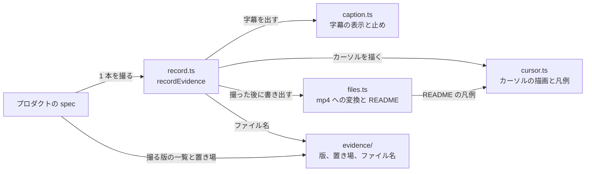
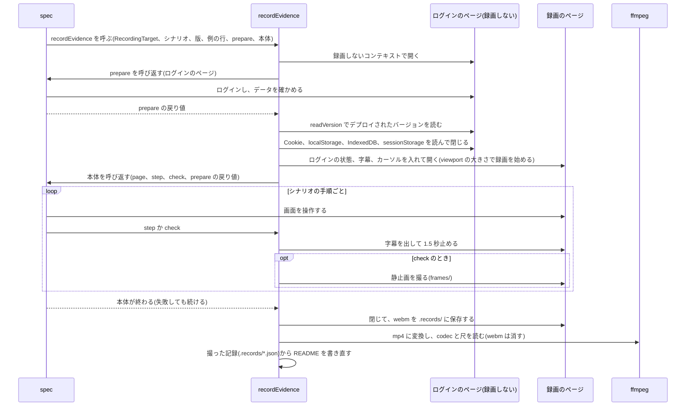

# 証跡の録画

## Overview

人手検証のシナリオの「例」の行ごとに 1 本ずつ録画し、mp4、判定の静止画、README を置き場へ書き出す。  
ふつうは、デプロイされた 1 つのバージョンだけを撮る。振る舞いを変えない改修を確かめる要求では、改修前のバージョンも同じ操作で撮り、判定の静止画を並べて比べる。  
プロダクトの spec は、シナリオの手順の操作と、字幕に出す文だけを持つ。録画の開始と終了、ログインの状態の持ち込み、字幕とカーソルの描画、形式の変換、README の書き出しは、`packages/e2e/kit/recording/` が持つ。置き場とファイル名は `packages/e2e/kit/evidence/` が決める。

E2E のテストのコードの層の中での位置づけは、[E2E のテストのコードの設計](https://github.com/Fukuemon/buddy/blob/develop/packages/e2e/DesignDoc.md) にある。

## Scope

持つもの。

- 録画のコンテキストの作成と、ログインの状態の持ち込み
- 字幕の 2 段の表示と、字幕を読ませるための止め
- カーソルの位置と押下の描画
- 判定の字幕を出し終えた時点の静止画
- webm から H.264 の mp4 への変換と、README の書き出し
- 撮る版の一覧と、置き場とファイル名の決定

持たないもの。

- 画面の操作と待ち。`packages/e2e/tests/` が持つ
- 環境変数を読むこと。プロダクトが読んで、引数で渡す
- 判定。見た目と操作感の判定は、人が動画を見て行う
- 証跡の格納先への登録。担当者が行う

## Design

### 構成

矢印は、呼ぶ側から呼ばれる側への向きで、ラベルは何のために呼ぶかである。



### 1 本を撮る流れ

`recordEvidence` は、ログインを録画の外で済ませ、録画のコンテキストを作り直してから spec の本体を呼ぶ。  
`prepare` と本体は spec の関数で、`recordEvidence` が受け取って呼び返す。



- 録画のコンテキストへ持ち越すのは、Cookie、localStorage、IndexedDB と、`prepare` が最後に開いていた画面の origin の `sessionStorage` である。ほかの origin の `sessionStorage` は持ち越さない。
- `sessionStorage` は、録画のコンテキストでタブを最初に開いたときだけ入れ直し、画面が書き換えた値を読み直しで戻さない。
- ログインの方法は `prepare` が決めるので、この持ち越しはログインの方式に依らない。
- `prepare` が失敗したら、ログインのコンテキストを閉じてから例外を投げ直す。録画は始めない。
- 本体が失敗しても、そこまでの録画を mp4 にし、README に失敗の文を書いてから、例外を投げ直す。

### 字幕

録画の上端に、全幅の帯で字幕を出す。

- 1 段目: 「シナリオ ID / 例の列=値 / 改修前か改修後か(比べるときだけ) / 撮った環境 デプロイされたバージョン」と、カーソルの凡例
  - 撮った環境の呼び名とバージョンの読み方は、プロダクトが `RecordingTarget` で渡す。README にも、版ごとの URL と一緒に書く
- 2 段目から下: `step` と `check` に渡した文。`\n` で改行する

字幕の文は `sessionStorage` に置き、画面を読み直しても同じ文を出し続ける。  
字幕を変えるたびに 1.5 秒止める。この止めは画面の状態を待つのではないので、固定の時間で止める。

### 静止画と時刻

`check` は、字幕を出して止め終えた時点で `page.screenshot` を撮り、`frames/<ファイル名>-<連番>.png` に置く。  
録画は、ページを開いた直後の何も描いていない間を持たないので、動画の尺は操作の時間より 1 秒ほど短い。静止画は mp4 から時刻で抜かない。README の時刻は、操作の時間と動画の尺の差を引いて、動画の時刻に寄せる。

### 改修前と改修後の比較

改修前のバージョンを撮ったときだけ、比べる。同じ例の行の改修前と改修後がそろうと、判定の静止画を字幕の順に左右に並べて、`compare/<例の連番>_<例の値>-<連番>.png` に 1 枚ずつ書き出す。シナリオアウトラインでないシナリオは `compare/実施-<連番>.png` にする。  
判定の場面が、改修前と改修後でずれていないかを見るためである。README の「改修前と改修後の比較」の表に、例の行、判定の字幕、画像、違ってよい差を並べる。片方しか撮っていない例の行は飛ばす。

比較の画像に差が映ったとき、それが検証シナリオの備考で許された差かを、README の上で見分けられるようにする。

- その静止画だけで違ってよい差は、`check` の 2 つ目の引数に渡し、比較の表の「違ってよい差」の列に出す。
- どの静止画にも映りうる差は、`Scenario` の `differences` に書き、README の「改修前と違ってよい差」の節に出す。この節は、改修前を撮ったときだけ出す。

### 置き場と名前

証跡は、次の形で置く。`<アクター>/` から下は、証跡の格納先のフォルダと同じ形である。

```text
<root>/<issue 番号>/evidence/<環境>/<実施日>/<アクター>/S<n>_<シナリオ名>/
├── README.md                    # 撮った条件、例の行とファイルの対応、字幕の時刻と静止画
├── 01_<例の値>.mp4               # 比べるときは 01_<例の値>_改修前.mp4 と 01_<例の値>_改修後.mp4
├── frames/                      # 判定の字幕を出し終えた時点の静止画
├── compare/                     # 比べるときだけ。同じ例の行の改修前(左)と改修後(右)の静止画を並べた 1 枚
└── .records/                    # 撮った記録(json)。README と比較の画像を作り直すのに使う。格納先へは上げない
```

- `<root>`、`<環境>`、`<実施日>` は、証跡の spec が `evidenceDir` に渡す。buddy の値は、`context/testing/evidence.md` にある。
- `<issue 番号>` は要求の issue 番号で、証跡の格納先の要求のフォルダと同じ番号にする。検証シナリオのファイルの番号とは違うことがある。
- S 番号とシナリオ名は、検証シナリオの pull request の証跡のフォルダの名前から写す。S 番号はアクターをまたいだ通し番号である。
- ファイル名の「例の値」は、検証シナリオの pull request のチェックの「<列>=<値>」の値である。比べるときは末尾に版の名前を付け、名前の順で改修前と改修後が隣り合う。シナリオアウトラインでないシナリオは `実施.mp4` にし、比べるときは `改修前.mp4` と `改修後.mp4` にする。
- README の例の行の表は、比べないときは「証跡」の 1 列、比べるときは「改修前」「改修後」の 2 列にする。
- README は、撮るたびに `.records/` の撮った記録の全部から書き直す。同じ例の行を撮り直しても、行が重ならない。人が書き足した文は、次に撮ったときに消える。
- 撮り直すときは、撮り始める前に、同じファイル名の前の撮影の記録、動画、静止画を消す。ほかのファイル名の撮影は残すので、改修前と改修後を別の回に撮れる。比較の画像は、残っている記録から作り直す。

## Interface

### プロダクトから呼ぶもの

| 名前 | subpath | 役割 |
| --- | --- | --- |
| `recordEvidence(browser, target, { scenario, variant, example? }, prepare, body)` | `kit/recording` | 1 本を撮る。`prepare(page)` は録画の外で動き、戻り値を `body` の 2 つ目の引数に渡す |
| `RecordingTarget`(`dir`、`appName`、`envLabel`、`readVersion`) | `kit/recording` | 置き場、README に出すアプリの名前、環境の呼び名、デプロイされたバージョンの読み方 |
| `Recording`(`page`、`step(text)`、`check(text, allowed?)`) | `kit/recording` | `body` の 1 つ目の引数。`step` は前提と操作の字幕、`check` は判定の字幕と静止画 |
| `variants({ baseUrl, beforeBaseUrl?, only? })` | `kit/evidence` | 撮る版の一覧。既定は名前の無い 1 つの版。`beforeBaseUrl` があれば改修後と改修前、`only` があればその版だけ |
| `evidenceDir({ root, envName, date, scenario })`、`evidenceDate(given?)` | `kit/evidence` | 1 つのシナリオの置き場と、実施日 |
| `Scenario`(`issue`、`id`、`actor`、`no`、`title`、`differences?`) | `kit/evidence` | シナリオ。`id` は検証シナリオの `@scenario-id` |
| `Example`(`no`、`column`、`value`) | `kit/evidence` | 例の行。ファイル名と字幕の 1 段目に使う |

`recordEvidence` の契約は次のとおり。spec は、この契約だけを前提に書く。

| 項目 | 契約 |
| --- | --- |
| 受け付ける入力 | `RecordingTarget` の `viewport` は、画面と録画の大きさである。渡さなければ 1920x1200 にする |
| | `prepare(page)` は、録画しないページでログインとデータの確かめを済ませ、本体に渡す値を返す。ログインした後のアプリを開いたまま返す |
| | 本体は、録画するページで操作し、前提と操作の文を `step` で、その時点の画面で判定できる文を `check` で出す。字幕は次に変えるまで残るので、操作の間に見る判定の文は、操作の前に `step` で出す |
| | 同じシナリオの改修前と改修後では、`check` を同じ順に同じ数だけ呼ぶ。比較の画像は、`check` の順に組にする |
| 成功したとき | 置き場に mp4、`frames/` の静止画、README を書き出す。改修前と改修後を撮り、同じ例の行の両方がそろえば、`compare/` の比較の画像も書き出す |
| 失敗したとき | そこまでの録画を mp4 にし、README に失敗の文を書いてから、本体が投げた例外を投げ直す |

### 実行に要るもの

ffmpeg と ffprobe が要る。無ければ、mp4 への変換で止まる。

### 改修前と改修後の撮り方

改修前と比べる要求だけが使う。比べない要求は、`variants` に `baseUrl` だけを渡す。

| 撮り方 | 向く改修 | 渡し方 |
| --- | --- | --- |
| 1 回で両方 | frontend だけの改修。backend と DB は 1 つを共有する | 改修後と改修前の frontend を別の URL で開き、`variants` に `beforeBaseUrl` を渡す |
| 1 回ずつ | backend も変わる改修と、1 つの URL に 1 つのバージョンしか置けない検証環境 | 改修前のバージョンの間に `only: 'before'`、改修後にした後に `only: 'after'` を渡す |

1 回ずつ撮るときは、次をそろえる。

- 同じ置き場に書き出す。2 回目は、1 回目と同じ環境の名前と実施日を `evidenceDir` に渡す。違うと改修前と改修後が別のフォルダに分かれ、比較の画像ができない。
- 2 回の間で spec を変えない。比較の画像は、改修前と改修後の静止画を `check` の順に組にする。
- 2 回の間で DB の状態をそろえる。改修後の backend が DB を変えると、改修前の backend をつなげないことがあるので、改修前を先に撮る。
