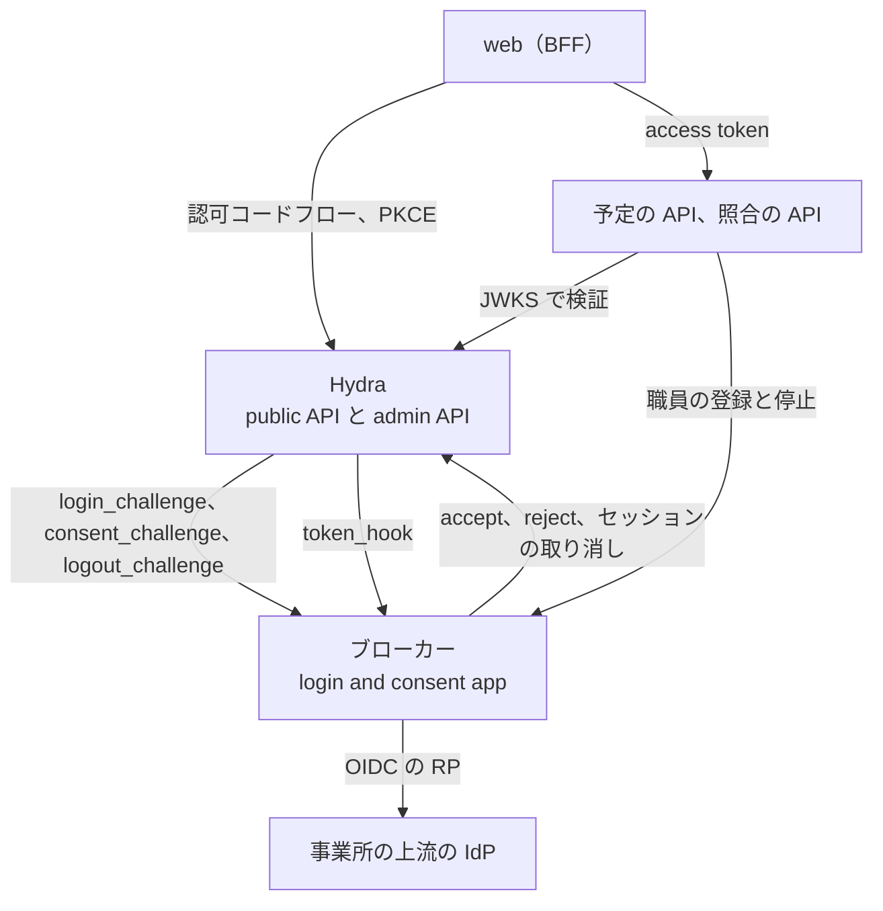
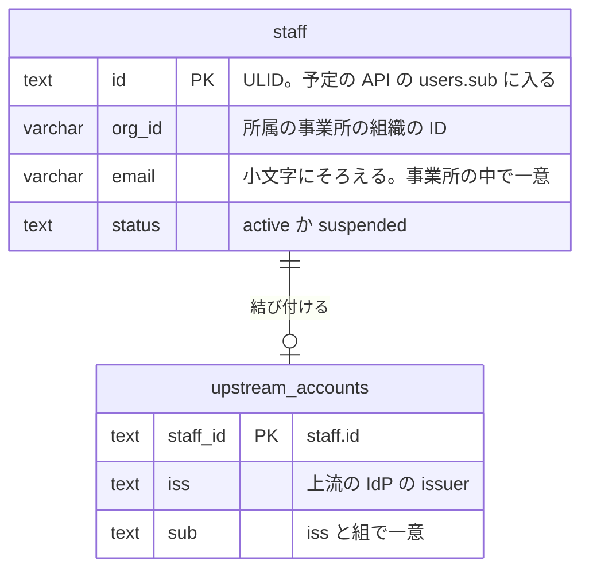
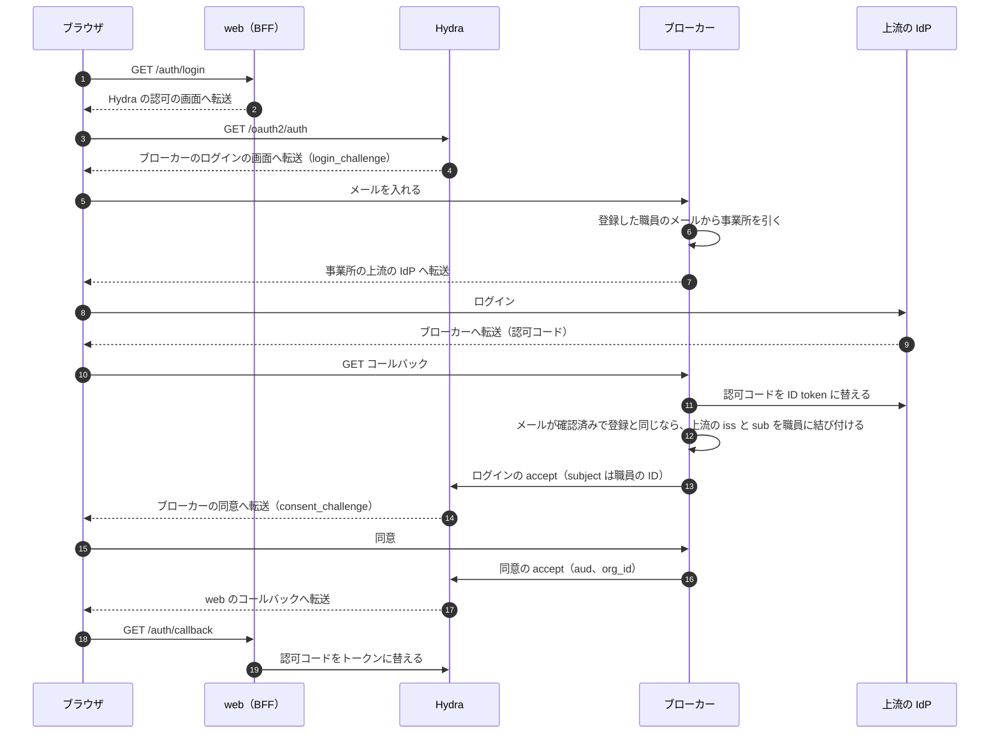
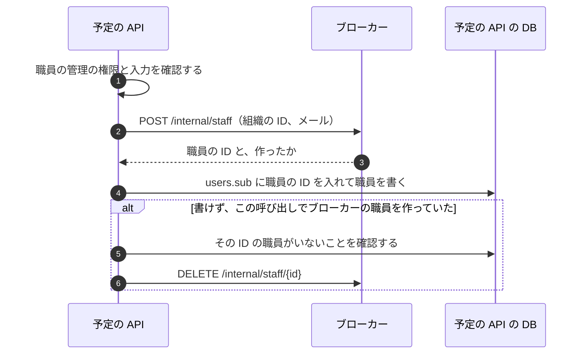

# 認証のブローカー

## Overview

ブローカーは、事業所ごとに違う上流の IdP の前に立ち、職員の身元を持つ。トークンを発行するのは Ory Hydra で、ブローカーは Hydra の login and consent app として、ログインと同意とログアウトを判断する。web と 2 つの API から見える Issuer は Hydra だけである。

- 全体の責務と依存は [buddy Design Doc](https://github.com/Fukuemon/buddy/blob/develop/docs/design/DesignDoc.md) にある。
- ADR-0016: [OIDC のブローカーを、Ory Hydra と、自作の login and consent app で作る](https://github.com/Fukuemon/buddy/blob/develop/docs/adr/0016-id-broker-hydra.md)
- ADR-0017: [職員の身元をブローカーが持ち、権限と業務のデータは予定の API が持つ](https://github.com/Fukuemon/buddy/blob/develop/docs/adr/0017-identity-boundary.md)

## Scope

| 部分 | 持つ者 |
| --- | --- |
| 事業所の組織の ID と、上流の IdP の設定 | ブローカー（設定はインフラからファイルで受ける） |
| 職員の ID、メール、所属の事業所、有効か停止か、上流のアカウント（`iss` と `sub`） | ブローカー |
| ログイン、同意、ログアウトの画面と判断。上流の IdP への RP の処理 | ブローカー |
| 認可コード、トークンの発行、JWKS、refresh token の回転、失効、ログインのセッション | Hydra |
| 職員の名前、役職、チーム、権限と、権限の判定 | 予定の API |

ブローカーは、権限を持たず、職員のパスワードを持たない。

## Design

### 構成

ブローカーと Hydra と上流の IdP の関係を示す。

- ブローカーの DB は、ブローカーの職員と上流のアカウントを持つ。Hydra の DB とは分ける。
- access token は JWT で、期限は 5 分である。`org_id` は `oauth2.allowed_top_level_claims` で JWT の top level に出す。
- Hydra の web のクライアントは `skip_consent` を持ち、許す audience は `schedule` と `receipt` である。

### 職員の身元のテーブル

ブローカーの DB のテーブルを示す。名前、役職、権限などの業務のデータは予定の API が持ち、ここには置かない（ADR-0017）。

- 職員の ID は、ブローカーが登録のときに発行する。
- 事業所のテーブルは持たない。`org_id` は、上流の IdP の設定のファイルの `org_id` と同じ値で、access token の `org_id` にもなる。
- メールは小文字にそろえて入れ、事業所の中で一意にする。予定の API の職員のメールと同じ規則である。
- 1 人の職員は、上流のアカウントを 1 つだけ持つ。同じ `iss` と `sub` を 2 人の職員に結び付けられない。

### ログイン

職員が初めてログインするときの流れを示す。2 回目からは、上流のアカウントの `iss` と `sub` で職員を探し、結び付けの手順を通らない。

- 登録されていないメール、止めた職員、2 つの事業所に同じメールがある職員は、上流の IdP へ転送せずにログインの reject で返す。web はログインの失敗の画面を出すので、事業所を示さず、ログインの失敗と同じ文言になる。
- メールを受けたら、職員を引く前に、Hydra の admin API で `login_challenge` のログインの要求を読む。読めなければ、職員を引かずにログインの失敗の画面を出す。
- メールの有無を確かめる試行は、送り手のアドレスごとと、入れたメールごとに数える。超えた試行は reject で返す。数えるのはプロセスの中だけである。
  - 送り手のアドレスごとには、続けて 20 回、以後は 10 秒に 1 回までにする。
  - メールごとには、続けて 10 回、以後は 30 秒に 1 回までにする。送り手のアドレスを替えて 1 つのメールを試す操作を止める。その代わり、他人がそのメールを入れ続けると、その職員も上限まで待たされる。
  - 送り手のアドレスは、デフォルトでは接続の相手のアドレスである。前段のプロキシの後ろに置くと、全ての利用者がプロキシのアドレスで 1 つの上限を共有する。
  - 前段のプロキシの後ろに置くときは、`CLIENT_IP_HEADER` に、プロキシが送り手のアドレスを書くヘッダーの名前を渡す。ブローカーは、そのヘッダーの最後の値を送り手とみなす。`X-Forwarded-For` のように値を足していくヘッダーでも、最後の値はプロキシが足した値で、ブラウザが書いた値ではない。
  - `CLIENT_IP_HEADER` は、ブローカーにプロキシを通らずに届かない構成でだけ渡す。直接届くと、ブラウザがヘッダーを書いて上限を外せる。
- `POST /login` は、ほかのサイトから送られたものを 403 で拒む。`Sec-Fetch-Site` が `same-origin` でないか、`Sec-Fetch-Site` が無く `Origin` がブローカーの origin（`Host` か `PUBLIC_URL`）と違えば拒む。どちらのヘッダーも無いリクエスト（ブラウザでないクライアント）は受ける。
- ブローカーの画面は `Content-Security-Policy: frame-ancestors 'none'` を返し、ほかのサイトの frame に入らない。
- 上流のメールが確認済みでない職員、登録のメールと上流のメールが違う職員、結び付けた上流のアカウントと違うアカウントで入った職員は、ログインの reject で返す。
- 同じ上流のアカウントで同時に初めてログインすると、先に結び付けたログインのほかは、結び付けが一意の制約で失敗する。ブローカーは職員を読み直し、同じ上流のアカウントが結び付いていれば accept する。
- 上流の IdP の認可レスポンスに `iss` のパラメーター（RFC 9207）があれば、認可コードを替える前に、事業所の上流の IdP の設定の issuer と比べる。違えば reject で返す。
- 上流の IdP の discovery の文書は、事業所ごとに初めて使うときに読み、覚える。1 つの事業所の IdP が応答しなくても、ほかの事業所のログインは待たない。読めなかった事業所は、その失敗を 30 秒覚えて返し、過ぎてから読み直す。
- 上流の IdP へ転送している間の値（ログインの要求、職員の ID、state、nonce、PKCE の code verifier）は、ブラウザの cookie に置き、コールバックの `state` と照らす。
  - cookie は署名しない。書き換えられるのはブラウザの利用者だけで、事業所と上流の IdP は職員の ID から DB で引き直すので、別のメールを入れたのと同じ結果にしかならない。
- ブローカーの画面の文言は、web のログインの失敗の画面と同じにする。コールバックの値がこのブラウザで始めたログインのものと確かめられないときは、Hydra へ返さずにブローカーがログインの失敗の画面を出す。
- 同意の accept は、web のクライアントに許した audience を `aud` に、職員の事業所の組織の ID を `org_id` に入れる。Hydra は `skip_consent` のクライアントでも同意の画面を呼ぶので、ブローカーは画面を出さずに accept する。
  - 画面を出さずに accept するのは、`AUTO_CONSENT_CLIENTS` に挙げたクライアント（デフォルトは `web`）だけである。ほかのクライアントの同意は reject で返す。ブローカーは同意の画面を持たない。
- Hydra のログインのセッションは、12 時間で切れる。ログアウトで Hydra のログインのセッションを消せるようになるまで、ブローカーはログインの accept でセッションを覚えさせない。覚えると、web のセッションを消した後に、ログインの画面を通らずに入り直せる。

### トークンの発行の確認

Hydra は、トークンを発行するたびに `oauth2.token_hook` でブローカーの `POST /internal/token-hook` を呼ぶ。ブローカーは、職員が止まっているときと、上流でのログインから 12 時間を過ぎたときに 403 を返し、Hydra はトークンの要求に `access_denied` を返す。発行してよいときは 204 を返す。

- 上流でのログインの時刻には、Hydra が本文の `session.id_token.id_token_claims.auth_time` に入れる値を使う。ブローカーは時刻を DB に持たない。
  - `auth_time` は、Hydra がログインの accept を受けた時刻である。ブローカーは上流の IdP の ID token を受けた直後に accept するので、上流でのログインの時刻と同じとみなせる。
  - refresh でも、Hydra は最初のログインのセッションを読み直すので、`auth_time` は変わらない。ログインのたびに別の `auth_time` を持つので、ログインのセッションごとに 12 時間を数えられる。
  - ログインのセッションを覚えさせると、Hydra は覚えたセッションのログインの時刻を `auth_time` に入れる。覚えたセッションも 12 時間で切れるので、上流でのログインから 12 時間の判定は変わらない。
- 職員の ID は `session.id_token.subject` で読む。`auth_time` か職員の ID が無いトークンは拒む。
- client credentials のトークン（`request.grant_types` が `client_credentials` だけ）は、職員のものでないので、職員を見ずに 204 を返す。
- 200 を返すと、Hydra は access token の追加のクレームを本文の値で置き換え、同意で入れた `org_id` が消える。ブローカーは 200 を返さない。
- Hydra は、token_hook の設定のヘッダー `Token-Hook-Key` に、ブローカーと共有する値（`TOKEN_HOOK_KEY`）を入れて呼ぶ。値が違えば 401 を返す。
- 止めた職員の refresh token は、停止のときに取り消すので、token_hook より前に `invalid_grant` で拒まれる。web の BFF は、`invalid_grant` と `access_denied` のどちらでもセッションを消す。

### 職員の登録と停止

予定の API が職員の管理の権限を確認してから、ブローカーの内部の API を呼ぶ（ADR-0017）。内部の API は、Hydra の client credentials の access token（`aud` は `broker`）だけを受け、Hydra の JWKS で検証する。トークンが無いか検証できなければ 401 を返す。

| パス | 働き | 主な応答 |
| --- | --- | --- |
| `POST /internal/staff` | 組織の ID とメールで職員を登録し、職員の ID を発行する。同じ事業所に同じメールの職員がいれば、作らずにその職員を返す | 作れば 201、いれば 200、その職員が止められていれば 409、上流の IdP の設定に無い組織は 400 |
| `DELETE /internal/staff/{id}` | 上流のアカウントを結び付けていない職員を消す。予定の API が登録を戻すときに使う | 204、いなければ 404、結び付けていれば 409 |
| `POST /internal/staff/{id}/suspend` | 職員を止め、Hydra の admin API でログインのセッションと、全てのクライアントへの同意を取り消す。同意を取り消すと、Hydra はその同意から発行した access token と refresh token も取り消す | 204、いなければ 404、取り消しに失敗すれば 502 |

予定の API の職員の登録と停止は、ブローカーと予定の API の DB の 2 か所に書く。1 つのトランザクションにできないので、片方だけが書けたときは次のように戻す。

- 登録は、同じ事業所の同じメールで送り直しても、ブローカーの職員が 1 人にまとまる。予定の API の書き込みに失敗したら、同じ本文で送り直せる。
- 予定の API に書けなかったときは、この呼び出しでブローカーの職員を作っていて、その ID の職員が予定の API にまだいなければ、ブローカーの職員を消す。同じメールの登録を同時に受けて、ほかの登録が同じ ID で書き終えていれば消さない。
- ブローカーの職員を消せなかったときは、職員がブローカーにだけ残る。この職員はログインでき、予定の API では 403 になる。同じメールで登録し直すと、残った職員の ID で予定の API に書く。
- 停止は、ブローカーを先に止めてから、予定の API に止めた時刻を書く。予定の API に書けなければ、送り直すとブローカーの停止と取り消しをやり直してから書く。ブローカーの停止は何度呼んでも成功する。
- ブローカーで止めた後に Hydra の取り消しに失敗したときは、502 を返す。職員は止めたままなので、token_hook がトークンを拒む。

### ログアウト

web は BFF のセッションを消した後に、ブラウザを Hydra の RP-Initiated Logout へ、ID token を添えて転送する。Hydra はブローカーのログアウトの画面を呼び、ブローカーが accept すると、Hydra のログインのセッションが消える。上流の IdP のセッションは消さない。

### ローカル環境

compose は、開発用の IdP（mock-oauth2-server）を、上流の IdP のフェイクとして置く。mock-oauth2-server はパスの最初の部分を issuer にするので、1 つのコンテナで 2 つの事業所の IdP（`/office-a`、`/office-b`）を立てる。

- Hydra は、同じ PostgreSQL の別のデータベースを使う。
- 初期化のコンテナが、Hydra に web と予定の API のクライアントを登録する。予定の API のクライアントは、client credentials で `aud` が `broker` の access token だけを取れる。
- Hydra の `oauth2.token_hook` は、コンテナの間の名前でブローカー（`http://broker:8080/internal/token-hook`）を呼ぶ。
- 上流の IdP ごとの違い（署名の方式、Google の `hd`）は、フェイクで確かめず、ブローカーの単体のテストで確かめる。
- フェイクは、ログインの画面で入れた名前を `sub` に、クレームの欄の JSON を ID token のクレームにする。
- コンテナは、Hydra の discovery の文書と上流の IdP の discovery の文書を、コンテナの間の名前（`hydra`、`idp`）で読む。
  - ブラウザはこの名前を引けない。Hydra は、認可のエンドポイントを `urls.self.public` のローカルのポートで示す。
  - ブローカーは、上流の IdP の認可の画面の origin を `UPSTREAM_IDP_BROWSER_ORIGIN` に替えて転送する。
- ブローカーと予定の API のシードは、同じ職員の ID を持つ。2 つの事業所（`org-sample`、`org-sample-b`）の職員がいる。

## Interface

- 置く場所: `services/broker`
- 読む設定
  - Hydra の admin API の URL（`HYDRA_ADMIN_URL`）
  - ブラウザが開くブローカーの URL（`PUBLIC_URL`）。上流の IdP のコールバックの URL を作る
  - 事業所の組織の ID と、上流の IdP の issuer と client ID の対応のファイル（`UPSTREAM_IDPS_FILE`）
  - 組織の ID と、上流の IdP の client secret の対応のファイル（`UPSTREAM_IDP_CLIENT_SECRETS_FILE`）。シークレットとして渡す
  - 前段のプロキシが送り手のアドレスを書くヘッダーの名前（`CLIENT_IP_HEADER`）。前段のプロキシの後ろに置くときだけ渡す
  - 同意の画面を出さずに accept するクライアントの ID（`AUTO_CONSENT_CLIENTS`）
  - Hydra のトークンの `iss`（`HYDRA_ISSUER`）。内部の API は、この discovery の文書の JWKS で access token を検証する
  - 内部の API が access token の `aud` に求める値（`INTERNAL_API_AUDIENCE`、デフォルトは `broker`）
  - Hydra が token_hook を呼ぶときのヘッダーの値（`TOKEN_HOOK_KEY`）。シークレットとして渡す
  - ブローカーの DB の接続先（`DB_HOST`、`DB_PORT`、`DB_USER`、`DB_PASSWORD`、`DB_NAME`）
  - 2 つのファイルに必須の値が無いか、client secret の無い上流の IdP があれば、ブローカーは起動しない。値の一覧と形は [README](https://github.com/Fukuemon/buddy/blob/develop/services/broker/README.md#起動する) にある。
- ヘルスチェック: `GET /healthz`（依存先を確かめない）、`GET /readyz`（DB に届かなければ 503）、`broker healthcheck` のサブコマンド
- 公開する画面: ログイン（`GET` と `POST /login`）、上流の IdP のコールバック（`GET /login/callback`）、同意（`GET /consent`）、ログアウト（未実装）
- 内部の API: 職員の登録、削除、停止と、Hydra の `oauth2.token_hook`（`POST /internal/token-hook`）。パスは [職員の登録と停止](#職員の登録と停止) の表にある
- マイグレーションとシード: `migrate up`、`migrate down [N]`、`migrate seed`。シードは職員がいない DB にだけ入る
