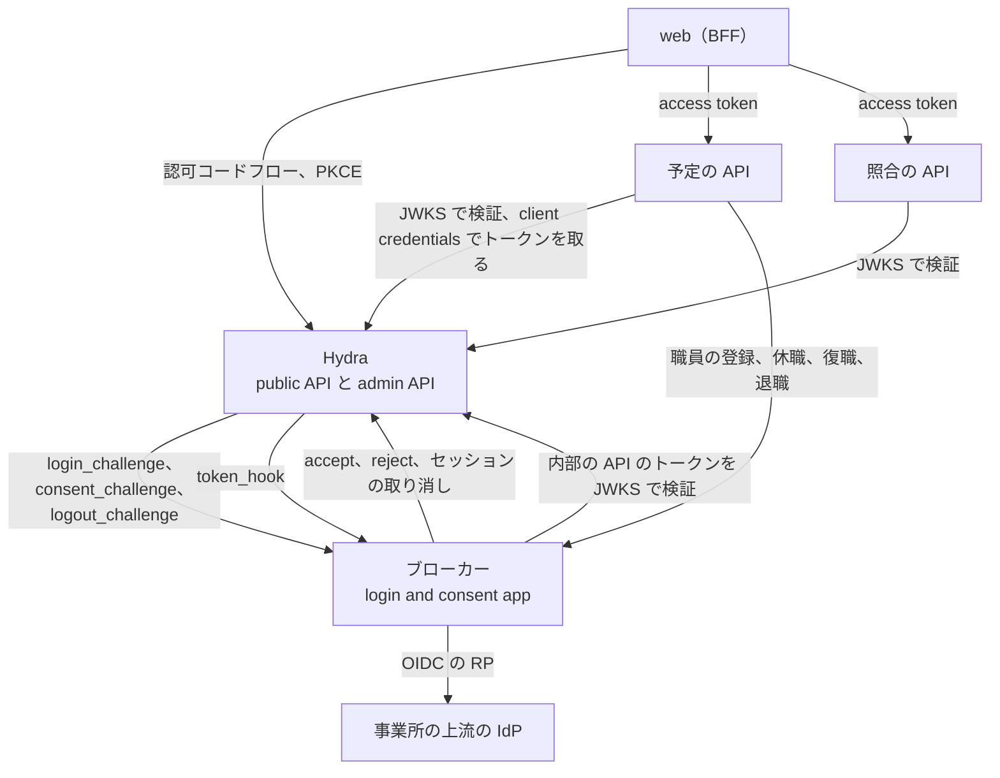
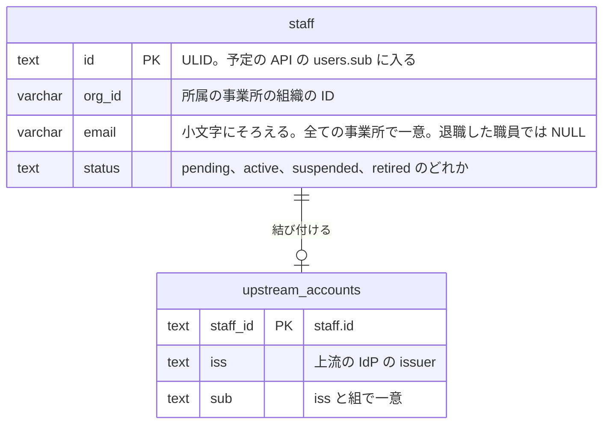
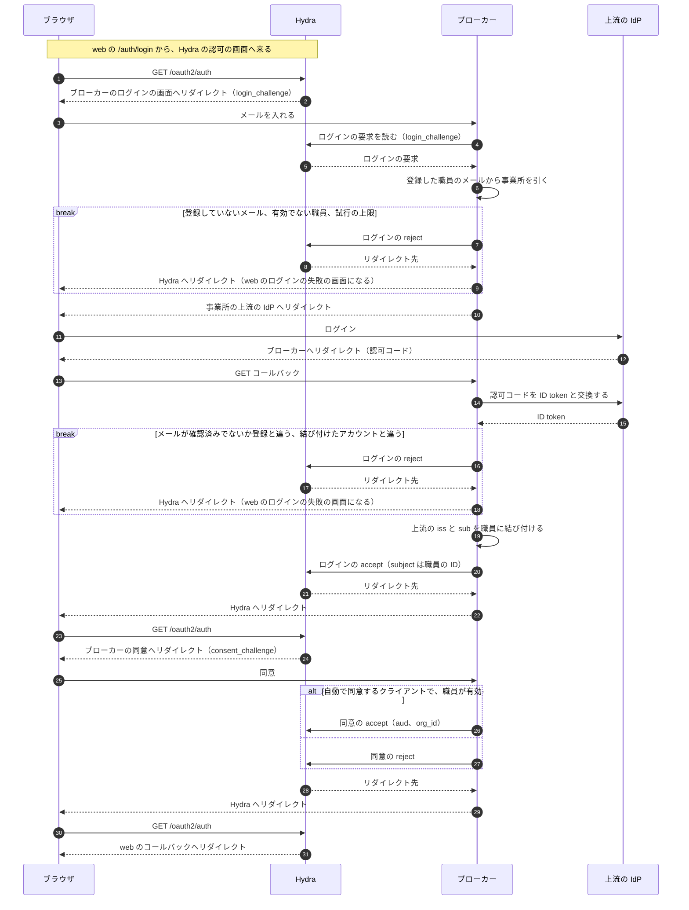
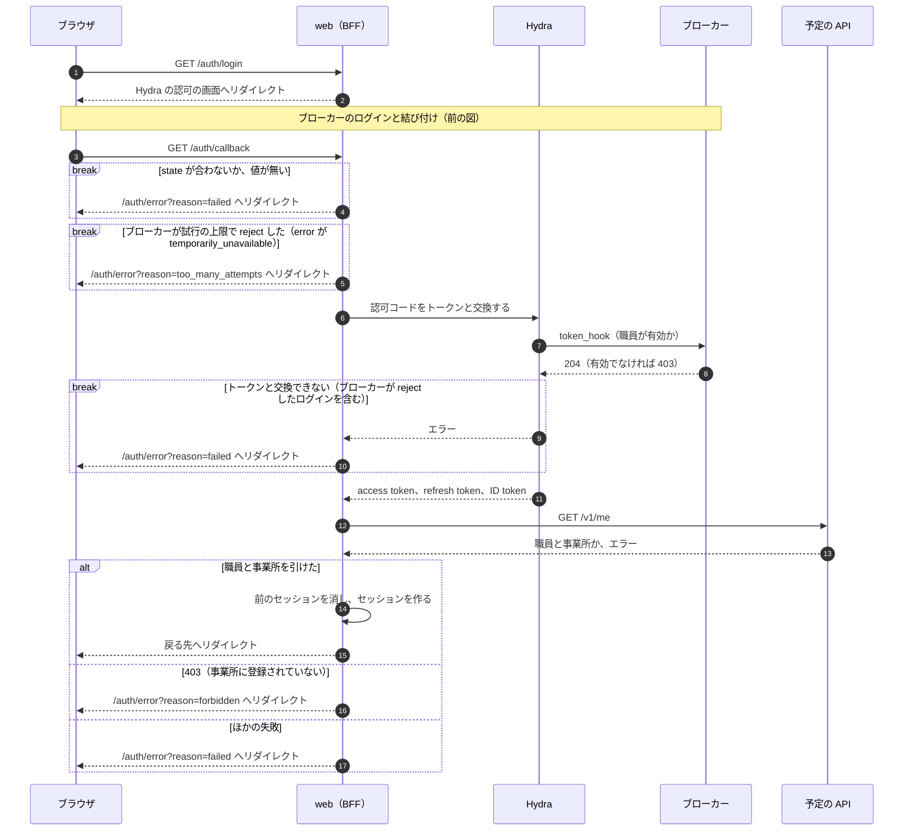
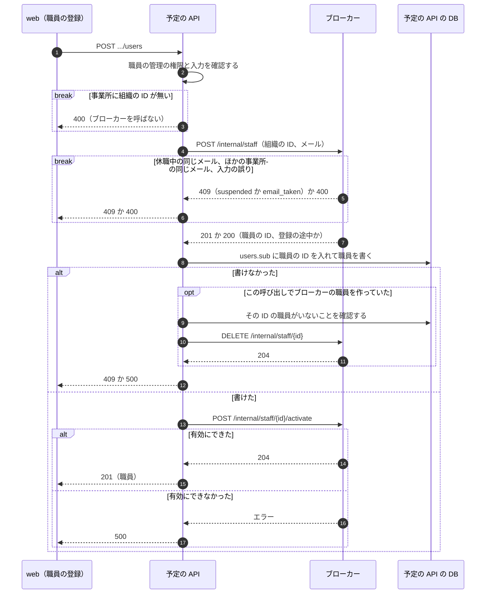
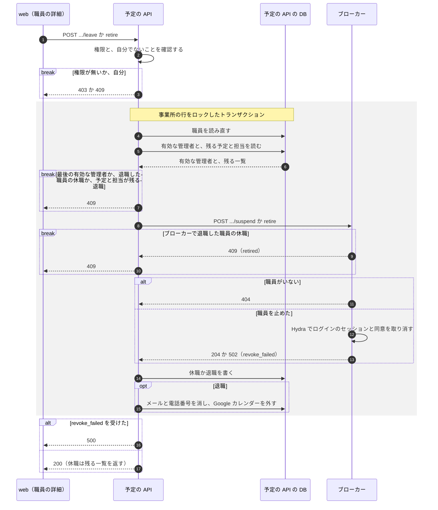
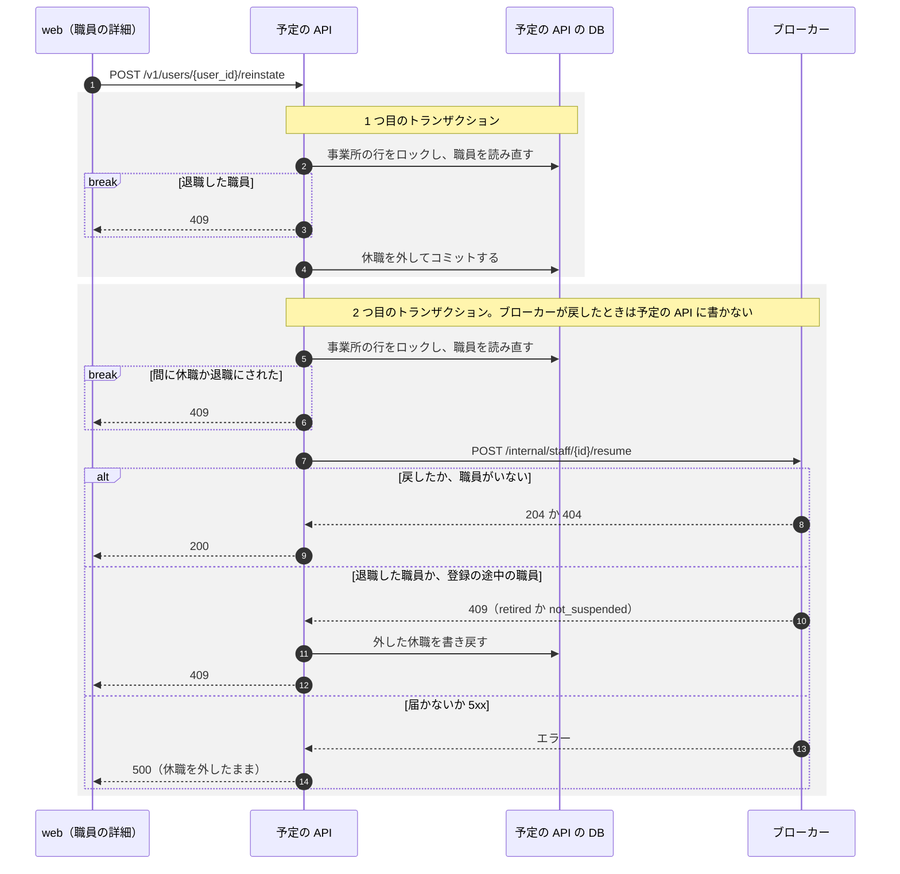
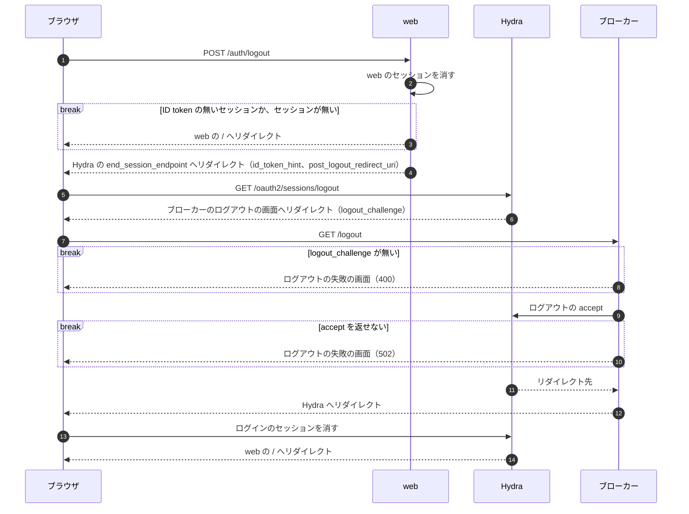

# ID ブローカー

## Overview

ID ブローカー（`services/broker`、以下ブローカー）は、事業所ごとに違う上流の IdP の前に立ち、職員の身元を持つ。  
トークンを発行するのは Ory Hydra で、ブローカーは Hydra の login and consent app として、ログインと同意とログアウトを判断する。  
web と 2 つの API から見える Issuer は Hydra だけである。

- 全体の責務と依存は [buddy Design Doc](https://github.com/Fukuemon/buddy/blob/develop/docs/design/DesignDoc.md) にある。
- ADR-0016: [OIDC のブローカーを、Ory Hydra と、自作の login and consent app で作る](https://github.com/Fukuemon/buddy/blob/develop/docs/adr/0016-id-broker-hydra.md)
- ADR-0017: [職員の身元をブローカーが持ち、権限と業務のデータは予定の API が持つ](https://github.com/Fukuemon/buddy/blob/develop/docs/adr/0017-identity-boundary.md)

## Scope

| 部分 | 持つ者 |
| --- | --- |
| 事業所の組織の ID と、上流の IdP の設定 | ブローカー（設定はインフラからファイルで受ける） |
| 職員の ID、メール、所属の事業所、有効か休職か退職か、上流のアカウント（`iss` と `sub`） | ブローカー |
| ログイン、同意、ログアウトの画面と判断。上流の IdP への RP の処理 | ブローカー |
| 認可コード、トークンの発行、JWKS、refresh token のローテーション、失効、ログインのセッション | Hydra |
| 職員の名前、役職、チーム、権限と、権限の判定 | 予定の API |

ブローカーは、権限を持たず、職員のパスワードを持たない。

## Design

### 構成

ブローカーと Hydra と上流の IdP の関係を示す。

- ブローカーの内部の API を呼ぶのは予定の API だけである。照合の API は、ブローカーを呼ばない。
- ブローカーの DB は、ブローカーの職員と上流のアカウントを持つ。Hydra の DB とは分ける。
- access token は JWT で、期限は 5 分である。`org_id` は `oauth2.allowed_top_level_claims` で JWT の top level に出す。
- Hydra の web のクライアントは `skip_consent` を持ち、許す audience は `schedule` と `receipt` である。

### 職員の身元のテーブル

ブローカーの DB のテーブルを示す。  
名前、役職、権限などの業務のデータは予定の API が持ち、ここには置かない（ADR-0017）。

- 事業所のテーブルは持たない。`org_id` は、上流の IdP の設定のファイルの `org_id` と同じ値で、access token の `org_id` にもなる。
- メールを全ての事業所で一意にする。
  - 事業所の中だけで一意にすると、ほかの事業所の管理者が同じメールの職員を登録でき、ログインで事業所を 1 つに決められなくなる。もとの職員もログインできなくなる。
- 職員の状態の意味と移り方、メールと上流のアカウントの不変条件は、[職員とログイン](https://github.com/Fukuemon/buddy/blob/develop/context/domain/staff-login.md) にある。
  - ADR-0018: [職員の停止を、戻せる休職と、戻せない退職に分ける](https://github.com/Fukuemon/buddy/blob/develop/docs/adr/0018-staff-leave-and-retirement.md)

### ログイン

職員が初めてログインするときの流れを、ブローカーのログインと結び付け、web のトークンの交換の 2 つの図で示す。  
2 回目からは、結び付けた `iss` と `sub` が上流の ID token と同じかを比べ、結び付けの手順を通らない。

ブローカーのログインと結び付けでは、ブローカーがメールで職員を引き、上流の IdP の ID token で職員を確認してから、Hydra へ accept か reject を返す。

web のトークンの交換では、web が認可コードをトークンと交換し、予定の API で職員と事業所を引いてからセッションを作る。

- web は、`/auth/login` で state、nonce、PKCE の code verifier、戻る先を Valkey に 10 分置き、署名した state だけを cookie に入れる。`/auth/callback` は、state が合わないか、値が無いか、トークンと交換できなければ `reason=failed` へリダイレクトする。ブローカーが reject したログインは、トークンと交換できずに `reason=failed` になる。
  - ブローカーが試行の上限で reject したログインでは、`/auth/callback` の `error` が `temporarily_unavailable` になる。web は、トークンと交換せずに `reason=too_many_attempts` へリダイレクトする。
- 図の token_hook は、[トークンの発行の確認](#トークンの発行の確認) にある。
- 登録されていないメールと、有効でない職員（休職と退職の職員、登録の途中の職員）は、上流の IdP へリダイレクトせずにログインの reject で返す。web はログインの失敗の画面を出すので、事業所を示さず、ログインの失敗と同じ文言になる。
  - メールに当たる有効な職員が 2 人以上いるとき（2 つの事業所に同じメールがあるとき）も、どちらの上流の IdP へリダイレクトするかを決められないので、reject で返す。DB はメールを全ての事業所で一意にする（`000002_staff_email_pending`）ので、今の登録の手順ではこの状態は作れない。守りの分岐として残す。
- メールを受けたら、職員を引く前に、Hydra の admin API で `login_challenge` のログインの要求を読む。読めなければ、職員を引かずにログインの失敗の画面を出す。
- メールの有無を確認する試行は、送信元の IP アドレスごとと、入れたメールごとに数える。数えるのはプロセスの中だけである。
  - 超えた試行は、ほかの理由と分けた reject（`hydra.TooManyAttempts`。OAuth 2.0 の `error` は `temporarily_unavailable`）で返す。Hydra は `error` を web の `/auth/callback` に渡し、web はログインの失敗の画面に、時間をおいてから試すよう伝える文を出す。
  - 上限は、メールで職員を引く前に確認する。上限を超えたことを分けて返しても、登録の有無は伝わらない。
  - 送信元の IP アドレスごとには、続けて 20 回、以後は 10 秒に 1 回までにする。
  - メールごとには、続けて 10 回、以後は 30 秒に 1 回までにする。送信元の IP アドレスを替えて 1 つのメールを試す操作を止める。その代わり、他人がそのメールを入れ続けると、その職員も上限まで待たされる。
  - 送信元の IP アドレスは、デフォルトでは接続の相手のアドレスである。リバースプロキシの後ろに置くと、全ての利用者がプロキシのアドレスで 1 つの上限を共有する。
  - リバースプロキシの後ろに置くときは、`CLIENT_IP_HEADER` に、プロキシが送信元の IP アドレスを書くヘッダーの名前を渡す。ブローカーは、そのヘッダーの最後の値を送信元とみなす。`X-Forwarded-For` のように値を足していくヘッダーでも、最後の値はプロキシが足した値で、ブラウザが書いた値ではない。
  - `CLIENT_IP_HEADER` は、ブローカーにプロキシを通らずに届かない構成でだけ渡す。直接届くと、ブラウザがヘッダーを書いて上限を外せる。
- `POST /login` は、ほかのサイトから送られたものを 403 で拒み、ログインの失敗の画面を出す。判定は Go の `http.CrossOriginProtection` に任せ、`PUBLIC_URL` の origin を信頼する origin に足す。
  - `Origin` が `PUBLIC_URL` の origin なら受ける。リバースプロキシの後ろで `Host` がブラウザの開いた origin と違っても受けるためである。
  - `Sec-Fetch-Site` が `same-origin` か `none`（利用者が直接始めた遷移）なら受け、ほかの値なら拒む。
  - `Sec-Fetch-Site` が無ければ、`Origin` の host を `Host` と比べ、違えば拒む。scheme は比べない。
  - どちらのヘッダーも無いリクエスト（ブラウザでないクライアント）は受ける。
- ブローカーの画面は `Content-Security-Policy: frame-ancestors 'none'` を返し、ほかのサイトの frame に入らない。
- 上流のメールが確認済みでない職員、登録のメールと上流のメールが違う職員、結び付けた上流のアカウントと違うアカウントで入った職員は、ログインの reject で返す。
- 同じ上流のアカウントで同時に初めてログインすると、先に結び付けたログインのほかは、結び付けが一意の制約で失敗する。ブローカーは職員を読み直し、同じ上流のアカウントが結び付いていれば accept する。
- 結び付けは、職員の行を `FOR SHARE` で読み、有効な職員にだけ書く。ログインの途中に休職か退職になった職員には結び付けず、ログインを reject で返す。退職で消した上流のアカウントが、退職した職員に戻らないためである。
- 上流の IdP の認可レスポンスに `iss` のパラメーター（RFC 9207）があれば、認可コードを交換する前に、事業所の上流の IdP の設定の issuer と比べる。違えば reject で返す。
- 上流の IdP の discovery の文書は、事業所ごとに初めて使うときに読み、覚える。1 つの事業所の IdP が応答しなくても、ほかの事業所のログインは待たない。読めなかった事業所は、その失敗を 30 秒覚えて返し、過ぎてから読み直す。
- 上流の IdP へリダイレクトしている間の値（ログインの要求、職員の ID、state、nonce、PKCE の code verifier）は、ブラウザの cookie に置き、コールバックの `state` と照合する。
  - cookie は署名しない。書き換えられるのはブラウザの利用者だけで、事業所と上流の IdP は職員の ID から DB で引き直すので、別のメールを入れたのと同じ結果にしかならない。
- ログインを拒むとき（登録していないメール、有効でない職員、上流のメールの違い、試行の上限）は、ブローカーは Hydra へ reject を返し、web がログインの失敗の画面（account-error）を出す。試行の上限だけは、ほかの理由と分けた文を出す。
- ブローカーの画面の文言は、web のログインの失敗の画面と同じにする。ブローカーは、Hydra へ結果を返さずに終えるときに、自分のログインの失敗の画面（account-login の「ログインの失敗」の状態）を出す。この画面には、もう一度ログインするリンクが無い。
  - `login_challenge` か `consent_challenge` が無いか、Hydra の admin API で読めないとき
  - コールバックの値が、このブラウザで始めたログインのものと確認できないとき
  - 上流の IdP の discovery の文書を読めず、リダイレクト先を作れないとき（502）
  - `POST /login` で、メールから職員を DB で引けないとき（500）。コールバック、保ったセッション、同意で職員を引けないときは reject で返す
  - `POST /login` で、ログインの途中の値を cookie に書けないとき（500）
  - ほかのサイトから `POST /login` が送られたとき（403）
  - Hydra へ accept か reject を返せないとき（502）
- ブローカーの画面の色と書体は、web と同じ packages/ui のトークンの値にする。画面の背景の中央に白いカードを置き、上端にロゴを出す。
  - ブローカーは web のビルドを読まないので、画面が使うトークンだけを `scripts/build-broker-tokens.mjs` が値に解いて `internal/login/tokens.css` に書き、画面に埋め込む。`pnpm check:generated` が、トークンとの食い違いを見つける。
  - 書体は Noto Sans JP を名指すだけで、ブローカーは書体のファイルを配らない。入っていない端末では、ブラウザの sans-serif で出る。
- 同意の accept は、web のクライアントに許した audience を `aud` に、職員の事業所の組織の ID を `org_id` に入れる。Hydra は `skip_consent` のクライアントでも同意の画面を呼ぶので、ブローカーは画面を出さずに accept する。
  - 画面を出さずに accept するのは、`AUTO_CONSENT_CLIENTS` に挙げたクライアント（デフォルトは `web`）だけである。ほかのクライアントの同意は reject で返す。ブローカーは同意の画面を持たない。
  - 同意の要求の `subject` の職員がいないか、有効でなければ、同意を reject で返す。ログインの accept の後に休職か退職にした職員に、トークンを出さないためである。
- ブローカーは、ログインの accept で、Hydra にログインのセッションを 12 時間保たせる（`remember`、`remember_for` は 43200 秒）。保っている間、Hydra はブローカーのログインの画面を出させずに accept させる（SSO）。ブローカーは、休職と退職の職員と登録の途中の職員を、保ったセッションでも reject で返す。
  - web のログアウトは、Hydra のログインのセッションを消す。ログアウトの後のログインは、ブローカーのメールの入力の画面を通る。
  - Hydra は、web がトークンを受け取れなかったログイン（事業所に登録されていない職員）のセッションも保つ。web のログインの失敗の画面は、`prompt=login` を付けて入り直させ、Hydra にブローカーのログインの画面を出させる。

### トークンの発行の確認

Hydra は、トークンを発行するたびに `oauth2.token_hook` でブローカーの `POST /internal/token-hook` を呼ぶ。  
ブローカーは、職員が有効でないとき（休職と退職の職員と登録の途中の職員）と、上流でのログインから 12 時間を過ぎたときに 403 を返し、Hydra はトークンの要求に `access_denied` を返す。  
発行してよいときは 204 を返す。

- 上流でのログインの時刻には、Hydra が本文の `session.id_token.id_token_claims.auth_time` に入れる値を使う。ブローカーは時刻を DB に持たない。
  - `auth_time` は、Hydra がログインの accept を受けた時刻である。ブローカーは上流の IdP の ID token を受けた直後に accept するので、上流でのログインの時刻と同じとみなせる。
  - refresh でも、Hydra は最初のログインのセッションを読み直すので、`auth_time` は変わらない。ログインのたびに別の `auth_time` を持つので、ログインのセッションごとに 12 時間を数えられる。
  - ログインのセッションを保たせると、Hydra は保ったセッションのログインの時刻を `auth_time` に入れる。保ったセッションも 12 時間で切れるので、上流でのログインから 12 時間の判定は変わらない。
- 職員の ID は `session.id_token.subject` で読む。`auth_time` か職員の ID が無いトークンは拒む。
- client credentials のトークン（`request.grant_types` が `client_credentials` だけ）は、職員のものでないので、職員を見ない。`request.client_id` が内部の API を呼んでよいクライアント（`INTERNAL_API_CLIENTS`）にあれば 204 を、無ければ 403 を返す。
- 200 を返すと、Hydra は access token の追加のクレームを本文の値で置き換え、同意で入れた `org_id` が消える。ブローカーは 200 を返さない。
- Hydra は、token_hook の設定のヘッダー `Token-Hook-Key` に、ブローカーと共有する値（`TOKEN_HOOK_KEY`）を入れて呼ぶ。値が違えば 401 を返す。
- 休職と退職の職員の refresh token は、休職と退職のときに取り消すので、token_hook より前に `invalid_grant` で拒まれる。web の BFF は、`invalid_grant` と `access_denied` のどちらでもセッションを消す。

### 職員の登録、休職、復職、退職

予定の API が職員の管理の権限を確認してから、ブローカーの内部の API を呼ぶ（ADR-0017）。

- 内部の API と token_hook は、ログインの画面（`PORT`）と別のポート（`INTERNAL_PORT`、デフォルトは 8081）で待ち受ける。ログインの画面のポートは `/internal/` の下に 404 を返す。
  - 内部のポートは、ブラウザとリバースプロキシに開かず、予定の API と Hydra だけが届くようにする。
- 内部の API は、Hydra の client credentials の access token（`aud` は `broker`）だけを受け、Hydra の JWKS で検証する。トークンが無いか検証できなければ 401 を返す。
- 検証できても、トークンの `sub`（client credentials ではクライアントの ID）が `INTERNAL_API_CLIENTS`（デフォルトは `schedule`）に無いか、トークンが `org_id` を持てば 403 を返す。`org_id` は同意で職員のトークンにだけ入る。

| パス | 働き | 主な応答 |
| --- | --- | --- |
| `POST /internal/staff` | 組織の ID とメールで、登録の途中の職員を登録し、職員の ID を発行する。同じ事業所に同じメールの職員がいれば、作らずにその職員を返す | 作れば 201、いれば 200、その職員が休職していれば 409（`suspended`）、ほかの事業所にいれば 409（`email_taken`）、上流の IdP の設定に無い組織は 400。退職した職員はメールを持たないので、同じメールで新しい職員を作る |
| `POST /internal/staff/{id}/activate` | 登録の途中の職員を有効にする。有効な職員を有効にしても成功する | 204、いなければ 404、休職の職員なら 409（`suspended`）、退職した職員なら 409（`retired`） |
| `DELETE /internal/staff/{id}` | 登録の途中の職員を消す。予定の API が登録を戻すときに使う | 204、いなければ 404、登録の途中でなければ 409 |
| `POST /internal/staff/{id}/suspend` | 職員を休職にし、Hydra の admin API でログインのセッションと、全てのクライアントへの同意を取り消す。同意を取り消すと、Hydra はその同意から発行した access token と refresh token も取り消す。休職の職員を休職にしても成功する | 204、いなければ 404、退職した職員なら 409（`retired`）、休職にしたが取り消しに失敗すれば 502（`revoke_failed`） |
| `POST /internal/staff/{id}/resume` | 休職の職員を有効に戻す。上流のアカウントの結び付けは残すので、職員は同じ上流のアカウントでログインできる。有効な職員を戻しても成功する | 204、いなければ 404、退職した職員なら 409（`retired`）、登録の途中の職員なら 409（`not_suspended`） |
| `POST /internal/staff/{id}/retire` | 職員を退職にし、メールと上流のアカウントを消してから、`suspend` と同じく取り消す。退職した職員を退職にしても成功し、取り消しをやり直す | 204、いなければ 404、退職にしたが取り消しに失敗すれば 502（`revoke_failed`） |

予定の API の職員の登録、休職、復職、退職は、ブローカーと予定の API の DB の 2 か所に書く。1 つのトランザクションにできないので、片方だけが書けたときに、ログインできる職員が予定の API で有効でない状態に残らない順に書く。  
ログインを許す書き込み（登録の有効化、復職）は最後にし、ログインを止める書き込み（休職、退職）はブローカーを先にする。  
登録では、ブローカーの職員を登録の途中の状態で作り、予定の API が書き終えてから有効にする。

- 登録の途中の職員は、ログインの画面と token_hook で拒まれる。予定の API に書けずにブローカーにだけ残った職員は、ログインできず、照合の API も使えない。
- 登録は、同じ事業所の同じメールで送り直しても、ブローカーの職員が 1 人にまとまる。予定の API の書き込みに失敗したら、同じ本文で送り直せる。
  - ブローカーにだけ残った登録の途中の職員は、送り直すと、その ID で予定の API に書いてから有効にする。
  - 予定の API に書いた後に有効にできなかったときは、予定の API は 500 を返す。送り直すと、予定の API に同じ ID の職員がいるので、書かずに有効にしてから返す。
- 予定の API に書けなかったときは、この呼び出しでブローカーの職員を作っていて、その ID の職員が予定の API にまだいなければ、ブローカーの職員を消す。消せなくても、職員は登録の途中のままでログインできない。
- ほかの事業所に同じメールの職員がいるときは、予定の API は事業所を示さない 409 を返す。メールが登録済みかを試す手段になるが、事業所の名前と職員は示さない。
- 同じメールの登録を同時に受けたときの戻しの競合は、登録の途中の状態で害が無くなる。
  - ブローカーは登録の途中の職員だけを消す。ほかの登録が書き終えて有効にした職員は、戻しで消えない。
  - 戻しが、予定の API にその ID の職員がいないことを確認してから消すまでの間に、ほかの登録が書くと、ほかの登録の有効化は 404 で失敗し、予定の API は 500 を返す。
  - このとき予定の API に書いた職員は、ブローカーにいないのでログインできない。ほかの職員として入る手段はできない。

休職と退職の流れを示す。  
予定の API は、事業所の行をロックしたトランザクションの中で、確認からブローカーの書き込みと予定の API の書き込みまでを行う。

- 休職と退職は、ブローカーを先に書いてから、予定の API に書く。ブローカーの休職と退職は何度呼んでも成功する。
  - 予定の API に書けなければ、トランザクションを戻す。職員はブローカーで止めたままなのでログインできず、送り直すとブローカーの書き込みと取り消しをやり直してから書く。
  - ブローカーで書いた後に Hydra の取り消しに失敗したときは、ブローカーは `revoke_failed` の 502 を返す。予定の API は休職か退職を書いてから 500 を返し、送り直しで取り消しをやり直させる。職員は止めたままなので、その間も token_hook がトークンを拒む。
  - ブローカーにいない職員（404）は、ログインできないので、予定の API でだけ休職か退職にする。
  - ブローカーで退職した職員を休職にしようとしたとき（`retired` の 409）は、予定の API は 409 を返す。予定の API への退職の書き込みが残っていないので、退職を送り直す。
  - 事業所の行のロックで、同じ事業所の休職と退職を 1 つずつにする。管理者どうしが同時に休職にし合っても、後の操作は最後の有効な管理者を見つけて 409 になる。ロックはブローカーを呼ぶ間も持つ。

復職の流れを示す。  
予定の API は、事業所の行をロックしたトランザクションを 2 つに分け、1 つ目で休職を外し、2 つ目でブローカーを呼ぶ。

- 復職は、予定の API で休職を外してコミットしてから、ブローカーの職員を戻す。ログインを許す書き込みを最後にするためである。
  - ブローカーは、事業所の行をロックした 2 つ目のトランザクションの中で、職員を読み直して有効なままのときだけ呼ぶ。間に休職にし直されていれば、戻さずに 409 を返す。
  - 2 つ目のトランザクションは、ブローカーが戻したときに予定の API に書かない。ブローカーが戻した後に接続が切れても、状態は食い違わない。
  - ブローカーが `retired` か `not_suspended` の 409 を返したときは、予定の API で外した休職を書き戻して 409 を返す。
  - ブローカーに届かないか 5xx を返したときは、予定の API で外した休職を残して 500 を返す。職員はブローカーで止めたままなのでログインできず、送り直すと、予定の API で有効な職員でもブローカーの職員を戻し直す。

### ログアウト

web は自分のセッションを消した後に、ブラウザを Hydra の RP-Initiated Logout へ、ID token を添えてリダイレクトする。  
Hydra はブローカーのログアウトの画面を呼び、ブローカーが accept すると、Hydra のログインのセッションが消える。  
上流の IdP のセッションは消さない。

- ブローカーは、ログアウトの確認の画面を出さずに accept する。職員は web のログアウトのボタンでログアウトを選んでいる。
- `logout_challenge` が無いとき（400）と、Hydra へ accept を返せないとき（502）は、ブローカーはログアウトの失敗の画面を出す。
- web は、ID token をセッションに置く。refresh で Hydra が ID token を返さなければ、前の ID token を使う。Hydra は、期限の切れた ID token もログアウトの `id_token_hint` として受ける。
- ID token の無いセッション（ID token を置く前に作ったセッション）と、セッションの無いログアウトは、web の / へリダイレクトする。ID token を置く前のログインは、Hydra にセッションを保たせていない。
- Hydra の web のクライアントは、ログアウトの後に戻る先（`post_logout_redirect_uris`）に web の / を持つ。

### ローカル環境

compose は、開発用の IdP（mock-oauth2-server）を、上流の IdP のフェイクとして置く。  
mock-oauth2-server はパスの最初の部分を issuer にするので、1 つのコンテナで 2 つの事業所の IdP（`/office-a`、`/office-b`）を立てる。

- compose は、E2E がトークンなしの呼び出しを試せるよう、内部のポートを `127.0.0.1` の 8101 に公開する。
- 上流の IdP ごとの違い（署名の方式、Google の `hd`）は、フェイクで確認せず、ブローカーの単体テストで確認する。
- ブローカーと予定の API のシードは、同じ職員の ID を持つ。2 つの事業所（`org-sample`、`org-sample-b`）の職員がいる。
  - `org-sample-b` には、両方で休職にした職員もいる。E2E は、この職員のログインが拒まれることを確認する。

## Interface

- 読む設定と、起動しない条件は [README](https://github.com/Fukuemon/buddy/blob/develop/services/broker/README.md#configuration) にある
- ヘルスチェック: `GET /healthz`（依存先を確認しない）、`GET /readyz`（DB に届かなければ 503）、`broker healthcheck` のサブコマンド
- 公開する画面: ログイン（`GET` と `POST /login`）、上流の IdP のコールバック（`GET /login/callback`）、同意（`GET /consent`）、ログアウト（`GET /logout`）
- 内部の API: 職員の登録、有効化、削除、休職、復職、退職と、Hydra の `oauth2.token_hook`（`POST /internal/token-hook`）。`INTERNAL_PORT` で待ち受ける。パスは [職員の登録、休職、復職、退職](#職員の登録休職復職退職) の表にある
- マイグレーションとシード: `migrate up`、`migrate down [N]`、`migrate seed`。シードは職員がいない DB にだけ入る
