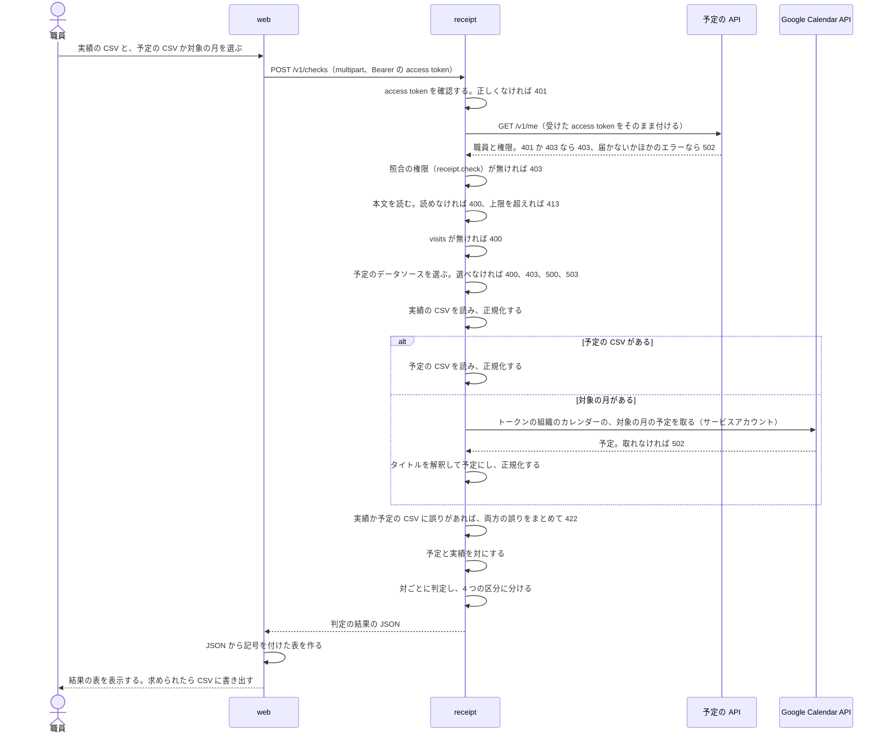

# レセプトの照合

## Overview

照合の API は、訪問の予定と電子カルテ（iBow）の実績を比べ、食い違いを 4 つの区分に分けて JSON で返す。  
照合の規則は、以前に使っていた照合のツール（Python、pandas）と、予定の CSV を作る GAS から移植した。  
全体の中での責務と依存は [buddy Design Doc](https://github.com/Fukuemon/buddy/blob/develop/docs/design/DesignDoc.md) にある。  
起動と API の使い方は [README.md](https://github.com/Fukuemon/buddy/blob/develop/services/receipt/README.md) にある。

## Scope

持つもの

- 実績の CSV と予定の CSV の読み込み
- Google カレンダーからの予定の取得
- 正規化、予定と実績の対の作り方、判定、結果の並べ方
- 判定の結果の JSON

持たないもの

- 予定と職員のデータ。予定は職員が Google カレンダーに入れる
- 職員の権限。照合の権限は予定の API が持ち、照合の API は照合のたびに問い合わせる
- 結果の記号、区分の区切りの行、結果の CSV の書き出し。画面（apps/web）が JSON から作る
- 上げた CSV と結果の保存
- 電子カルテへの書き戻し

## Design

### パッケージは正規化、対の作成、判定の段ごとに分ける

- `internal/normalize`、`internal/match`、`internal/judge` を、`internal/check` がつなぐ
- access token の検証は、共有の module の `packages/go/oidc` を使う
- 照合の権限の確認は、`internal/permission` が予定の API の `GET /v1/me` を呼んで行う
  - ADR-0007: [2 つの Go の API が共有するコードを、別の module にまとめる](https://github.com/Fukuemon/buddy/blob/develop/docs/adr/0007-go-shared-module.md)
- タイトルの解釈と、利用者名とサービス内容の表記をそろえる処理は、予定の API と共有する `packages/go/gcaltitle` を使う
- 組織ごとのサービスアカウントで Calendar API を呼ぶクライアントは、予定の API と共有する `packages/go/gcalauth` を使う

### 処理の流れ

次の図は、職員が実績の CSV を上げてから結果の表を見るまでの流れを示す。

予定のデータソースは、予定の CSV を読む `CSVSchedules` と、Google カレンダーを読む `internal/gcal` の 2 つである。  
2 つは、同じインターフェイス（`ScheduleSource`）で差し替える。  
Google カレンダーの予定も、予定の CSV と同じ正規化と照合を通す。

### 予定のデータソース: Google カレンダー

Google カレンダーは、今も職員が予定を入れる場所なので、照合の予定のデータソースとして残す。  
照合の API は、Google Calendar API を直接呼ぶ。

- 認証は Application Default Credentials で、カレンダーの組織のサービスアカウントになりすました token で読む。スコープは `calendar.readonly` だけにする。
  - ADR-0012: [Google カレンダーのサービスアカウントを事業所ごとに分け、buddy は IAM の権限借用で切り替える](https://github.com/Fukuemon/buddy/blob/876381365355f7e4dab03f6dfdb3d6fb8a9f6947/docs/adr/0012-google-calendar-facility-service-accounts.md)
  - Application Default Credentials が事業所のサービスアカウントそのものとして動くとき（そのアカウントになりすました認証情報か、そのアカウントのキー）は、重ねてなりすまさない。サービスアカウント自身へのトークン作成者のロールを求めないためである。見分けは、認証情報のファイルの `client_email` か、なりすます先の URL のメールアドレスで行う。
  - `GOOGLE_CALENDAR_ENDPOINT` で Calendar API の代わりにフェイク（ローカル環境の calendarpit）を呼ぶときは、なりすまさない。フェイクはなりすましの token を出せないためである。
    - `GOOGLE_APPLICATION_CREDENTIALS` を渡したときだけ、その認証情報を全ての事業所で使い、渡さなければ認証をしない。開発者の Application Default Credentials をフェイクに送らないためである。
- ドメイン全体の委任は使わない。職員が、自分の事業所のサービスアカウントにカレンダーを共有する。サービスアカウントが読めるカレンダーを、共有されたものだけに絞るためである。
  - 共有の権限は、予定の API の書き出しと同じアカウントなので、[基盤と運用の事業所を足す手順](https://github.com/Fukuemon/buddy/blob/develop/context/operations.md#adding-a-facility) にある。
- 組織とサービスアカウントの対応は、カレンダーの設定と別のファイル（`GOOGLE_CALENDAR_SERVICE_ACCOUNTS_FILE`）に置く。形は予定の API と同じにする。
  - 対応は事業所ごとに 1 行で、運営側がアカウントを作るときに足す。カレンダーの設定は職員ごとの行で、職員が入れ替わるたびに変わる。更新する人と頻度が違うので、分ける。
  - 予定の API はカレンダーの設定のファイルを持たず、対応のファイルだけを読む。同じファイルを 2 つの API に渡せる。
  - カレンダーの設定の組織に対応が無いときは、起動しない。
- 照合の対象のカレンダーは、サーバーの設定のファイル（`GOOGLE_CALENDARS_FILE`）に置き、リクエストで受けない。任意のカレンダーを読ませないためである。
- 設定のカレンダーごとに、使う事業所の組織の ID（`org_id`）を持たせる。リクエストの access token の組織と同じ `org_id` のカレンダーだけを読む。1 つの照合の API を複数の事業所で使っても、別の事業所の職員の予定を読ませないためである。

カレンダーの予定は、次の規則で照合の予定にする。

- 期間は、リクエストの `month` の 1 日 00:00 から月末 24:00（Asia/Tokyo）。開始が期間の外の予定は使わない。
- 繰り返しの予定は、1 回ずつに展開する（events.list の `singleEvents=true`）。
- 終日の予定と、取り消された予定は除く。
- タイトルに `【` と `】` の両方を含む予定だけを訪問の予定にする。ほかのタイトルの予定は、警告にせずに除く。
- タイトルを正規表現 `【(.*?)】[\s\p{Zs}]*(.*)` で分ける。最初の `【…】` の中をサービス内容に、`】` の後の空白を飛ばした残り全部を利用者名にする。
  - 例: `【訪看I３】架空太郎` は、サービス内容が 訪看I３、利用者名が 架空太郎
  - Go の `\s` は ASCII の空白だけに当たるので、全角の空白は `\p{Zs}` で飛ばす。GAS の `\s` は全角の空白にも当たっていた。
- 主訪問者は、設定の `staff_name` にする。`staff_name` がなければ、カレンダーの表示名にする。どちらも電子カルテの職員名と同じ表記にしておく。
- 訪問日は予定の開始の日付、開始時間と終了時間は予定の開始と終了の Asia/Tokyo の時刻にする。
- 終了が開始の翌日で、長さが 24 時間未満の予定も使う。翌日の 0:00 に終わる予定も同じである。この予定の終了時間は開始時間より前になり、正規化が翌日に終わる訪問として読む（[ADR-0023](https://github.com/Fukuemon/buddy/blob/develop/docs/adr/0023-overnight-schedule.md#照合の訪問日仮の決定)）。
- 提供時間は、終了の日時から開始の日時を引いた分にする。

次の予定は、解釈できない予定として照合に混ぜず、結果の `warnings` に入れる。

- タイトルに `【…】` の組が無い予定（`】` が `【` より前にあるだけのタイトルなど）。`】メモ【訪看I３】架空太郎` のように、後ろに組があれば普通の予定として使う
- サービス内容か利用者名が空か、空白だけの予定
- 終了が開始の翌日より後の予定と、24 時間以上の予定
- 開始と終了の日時を読めない予定と、正規化でエラーになる予定

`warnings` の 1 件は、カレンダー ID、予定の ID、開始の日時、理由のコードと、値の誤りなら列の名前だけを持つ。タイトルは利用者名を含むので返さない。  
正規化で 2 つ以上の誤りが出た予定は、最初の誤りだけを返す。直して照合し直せば、残りの誤りも次の `warnings` に出る。

### 予定のデータソース: 予定の CSV

予定の CSV は、Google カレンダーを使わずに照合するときと、テストのときに使う。  
カラムは [入力の CSV](#入力の-csv) の表にある。

### 入力の CSV

実績の CSV は、電子カルテが書き出した CSV をそのまま受ける。

- 文字コードは UTF-8（BOM の有無を問わない）と CP932 を受ける。
- 1 行目をカラム名として読み、次のカラムだけを使う。ほかのカラムは読み捨てる。
- 次のカラムのどれかがないときは、入力のエラーとして、足りないカラムごとに名前を返す。

| カラム | 実績の CSV | 予定の CSV | 値の例 |
| --- | --- | --- | --- |
| 訪問日 | 必須 | 必須 | 2026/10/1、2026-10-01 |
| 利用者名 | 必須 | 必須 | 架空 太郎 |
| 主訪問者 | 必須 | 必須 | 架空 花子 |
| 開始時間 | 必須 | 必須 | 9:00、09:00 |
| 終了時間 | 必須 | 必須 | 09:30 |
| 提供時間 | 必須 | 必須 | 30（分） |
| サービス内容 | 必須 | 必須 | 訪看Ⅰ3 |
| 加算①から加算⑤ | 必須 | 使わない | 通常 |

- 訪問日は、`/` と `-` を区切りとして、年、月、日の 3 つの数に分けて読む（例: `2026/10/1`、`2026-10-01`）。
  - 年は 4 桁、月と日は 4 桁までの数で、0 埋めは問わない。暦に無い日付はエラーにする。
  - 1 つの日付に `/` と `-` の両方があっても（`2026-10/1`）、区切りが続いても（`2026//10/1`）読む。
  - 後ろに半角の空白で区切った時刻があれば無視する。
- 提供時間の値は空でもよい。空の提供時間は、判定で規則に合わないとする。
- 実績の加算は、加算①から加算⑤のうち空でない値を「, 」でつないだ 1 つの値にする。
- 照合に使うカラムが全て空の行は読み飛ばす。
- 次の行は照合に混ぜず、入力のエラーとして行番号つきで返す。
  - 訪問日、利用者名、主訪問者、サービス内容のどれかが空の行
  - 訪問日、開始時間、終了時間を読めない行と、提供時間が 0 以上の整数でない行
- 入力のエラーは、実績と予定の両方の行を集めてから、まとめて返す。

### 正規化

予定と実績の両方に、次を適用する。

1. 開始時間と終了時間を時刻として読む（例: 9:00 と 09:00 は同じ時刻）。結果の JSON では `HH:MM` で返す。
2. 主訪問者、利用者名、サービス内容の全角の空白を半角の空白にする。
3. サービス内容の「Ⅰ」「１」「1」を「I」にし、半角の「･」を全角の「・」にし、残りの半角の数字を全角にする（例: 訪看Ⅰ3 は 訪看I３）。
4. 訪問日を日付にする。
5. 利用者名の空白を全て除く。主訪問者の空白は残す。

終了時間が開始時間より前の行は、訪問日の翌日のその時刻に終わる訪問として読む。訪問日は開始の日のままにする（[ADR-0023](https://github.com/Fukuemon/buddy/blob/develop/docs/adr/0023-overnight-schedule.md#照合の訪問日仮の決定)）。  
開始時間と終了時間が同じ行は、日をまたがない 0 分の行として読む。

予定だけに、次を適用する。

- サービス内容から末尾の「・夜」「・深」を外した値が、`訪看I２` から `予防訪看I４` の 12 種類（下の許容範囲の表の 20〜29、30〜59、60〜89 の行）のとき、終了時間と提供時間を 1 分減らす。
  - 「・夜」と「・深」は、夜間・早朝と深夜の加算が付いたサービスコードを表す。提供時間の区分は付かないサービスコードと同じなので、同じに扱う（例: 訪看I２・夜 も 1 分減らす）。
  - 終了時間は、開始時間と違うときだけ減らす。開始時間と同じなら、そのままにする。
  - 翌日に終わる行も減らす。翌日の 0:00 に終わる行は、終了時間を開始の日の 23:59 にする。終了時間から開始時間を引いた分は、減らす前より 1 分少なくなり、日をまたがない行と同じに判定できる。
  - 提供時間は、1 以上のときだけ減らす。0 なら、0 のままにする。範囲の判定で外れとして出る。

### 対の作り方

予定と実績を、訪問日、利用者名、主訪問者の 3 つが同じものどうしで対にする。

- 3 つが同じ予定と実績が 1 件ずつなら、その 2 件を対にする。
- 同じ利用者を同じ職員が 1 日に 2 回以上訪問すると、3 つが同じ予定と実績が複数になる。このときは、開始時間が最も近いものどうしを対にする。
  1. 同じ 3 つを持つ予定と実績の全ての組について、開始時間の差の絶対値を求める。
  2. 差が最も小さい組を対にし、その予定と実績を候補から除く。差が同じ組が複数あれば、予定が先に並ぶ組を先にし、予定が同じなら実績が先に並ぶ組を先にする。予定と実績は、それぞれ開始時間、終了時間、入力の行番号の順に並べる。
  3. 予定か実績のどちらかがなくなるまで 2 を繰り返す。
- 対にならなかった予定は予定のみに、対にならなかった実績は実績のみに入れる。

開始時間が最も近いものどうしを対にするのは、同じ日の 2 回の訪問は開始時間が数時間離れるのが普通で、近いものどうしが同じ訪問を指すためである。  
3 つのキーで全ての組を作る結合では、2 回の訪問が 4 行になり、存在しない食い違いが出る。

### 判定

対になった予定と実績ごとに、次の項目を確認する。

| 項目 | 規則に合う条件 |
| --- | --- |
| 開始時間 | 予定と実績が同じ |
| サービス内容 | 末尾の「・夜」「・深」を外した値が、予定と実績で同じ。または、予定が「医」で、実績が「基本療養費」か「難病等複数回訪問」を含む |
| 提供時間（予定） | 予定の提供時間が、予定のサービス内容の許容範囲に入る |
| 提供時間（実績） | 実績の提供時間が、実績のサービス内容の許容範囲に入る |
| 終了時間（予定） | 予定の終了の日時から開始の日時を引いた分が、予定のサービス内容の許容範囲に入る |
| 終了時間（実績） | 実績の終了の日時から開始の日時を引いた分が、実績のサービス内容の許容範囲に入る |
| 加算 | 実績の加算①から加算⑤に「通常」の 1 つだけが入っている。または、予定の開始時間が入る時間帯の加算（「早朝」「夜間」「深夜」）の 1 つだけが入っている |

- 1 つでも規則に合わない項目があれば不整合、全て合えば整合にする。
- 時間帯は、早朝が 6:00 以上 8:00 未満、夜間が 18:00 以上 22:00 未満、深夜が 22:00 以上か 6:00 未満である。8:00 ちょうどの開始はどの時間帯にも入らず、22:00 ちょうどの開始は深夜に入る。
  - 時間帯は予定の開始時間で決める。加算は計画の上の開始の時刻で決まるためである（[訪問看護の報酬](https://github.com/Fukuemon/buddy/blob/develop/context/domain/visiting-nursing-fee.md)）。
  - 実績のみの行は予定の開始時間が無いので、加算を判定しない。
- 実績の加算の値は、電子カルテの実績の書き方に合わせて「早朝」「夜間」「深夜」と完全に一致するときだけ時間帯の加算とする。「深夜」は実績の CSV で確認していない値で、名前は推測である。
- 次の行は不整合になる。人が見直す。
  - 緊急時の訪問の加算（緊急（イ）など）を含む行。月の 1 回目の緊急時の訪問には時間帯の加算を付けず、照合では 1 回目かを決められないためである。
  - 「通常」と時間帯の加算が並ぶ行と、時間帯の加算が 2 つ並ぶ行。1 回の訪問の時間帯は計画の開始の時刻で 1 つに決まるので、どちらかの値が誤っている。
  - 「通常」と別の加算が並ぶ行と、加算が空の行。
- 予定の開始時間が時間帯に入るのに、実績の加算が「通常」だけの行は整合にする。加算の付け忘れは、照合では見つけない。
- サービス内容の末尾の「・夜」「・深」と、実績の加算の値が対応するかは確認しない（例: 訪看I２・深 で加算が夜間の行も、予定の開始が夜間なら整合になる）。
- 予定と実績の提供時間の値、終了時間の値が同じかどうかは、区分を決めない。両方が許容範囲に入るが値が違うときは、整合のまま注意の印を付ける。
- サービス内容が許容範囲の表にないときは、提供時間と終了時間の項目を規則に合わないとし、許容範囲を空にする。

### サービスごとの許容範囲

サービス内容を、次の順で許容範囲の表の行に当てる。

1. 「基本療養費」を含むなら、基本療養費の行
2. 「難病等複数回訪問」を含むなら、難病等複数回訪問加算(２回) の行
3. ほかは、正規化した後のサービス内容から末尾の「・夜」「・深」を外した値と同じ名前の行（例: 訪看I２・夜 は 訪看I２ の行）

| サービス内容（正規化の後） | 下限（分） | 上限（分） |
| --- | --- | --- |
| 訪看I２、予防看I２、予訪看I２、予防訪看I２ | 20 | 29 |
| 訪看I３、予防看I３、予訪看I３、予防訪看I３ | 30 | 59 |
| 訪看I４、予防看I４、予訪看I４、予防訪看I４ | 60 | 89 |
| 訪看I５、予防看I５、予訪看I５、予防訪看I５ | 21 | 40 |
| 訪看I５・２超、訪看I５２超、予防看I５・２超、予訪看I５・２超、予防訪看I５・２超、予防訪看I５２超 | 41 | 60 |
| 基本療養費 | 30 | 90 |
| 医 | 30 | 90 |
| 難病等複数回訪問加算(２回) | 30 | 90 |

下限と上限は、両端を含む。

### 結果の JSON

API は、判定の結果だけを JSON で返す。記号と CSV は返さない。  
記号は元の Python のデスクトップのツール（tkinter）の表示の名残で、表示を変えるたびに API を変えないためである。  
結果の項目と並び順は [openapi.yaml](https://github.com/Fukuemon/buddy/blob/develop/services/receipt/openapi.yaml) の `Report` にある。

### 画面が JSON から作る表示

画面（apps/web）は、結果の JSON から次の表示を作る。  
記号の規則は API ではなく画面が持ち、[reportCells.ts](https://github.com/Fukuemon/buddy/blob/develop/apps/web/src/features/receipt/lib/reportCells.ts) が作る。

- 不整合の行では、次の値の後ろに不一致の印を付ける。
  - 開始時間かサービス内容の判定が規則に合わないときは、その項目の両側の値
  - 提供時間の値が両側で違うときは、両側の提供時間。許容範囲に入っていても付ける
  - 許容範囲に入らない終了時間と提供時間。許容範囲があれば「 (20~29)」を続ける
- 不整合の行で、加算が規則に合わないときは、加算の後ろに「 ※」を付ける。
- 整合の行で、提供時間の値が両側で違うときは、両側の提供時間に注意の印「 ※」と許容範囲を付ける。終了時間の値が両側で違うときは、両側の終了時間に「 ※」を付ける。
- 片側がない欄と、提供時間が空の欄は「データなし」と表示する。
- 結果の CSV では、区分ごとに、区分の名前と `---` を並べた区切りの行を区分の行の前に置く。行の無い区分にも置く。
- 結果の CSV は、画面が同じ表示を書き出す。
- 不一致の印は、元のツールに合わせて「 ❌」にする。

### 画面の照合の流れ

照合の画面（`/receipt`）と結果の画面（`/receipt/result`）は、次の順に照合の API を呼び、結果を渡す。  
画面の状態と文は、[照合の画面仕様書](https://github.com/Fukuemon/buddy/blob/develop/docs/screens/receipt-upload_照合/index.md) と [照合の結果の画面仕様書](https://github.com/Fukuemon/buddy/blob/develop/docs/screens/receipt-result_照合の結果/index.md) にある。

- 照合の権限は、画面を読み込むときに予定の API の `GET /v1/me` で読んだ値（`policies[].code` に `receipt.check` があるか）で出し分ける。
  - 権限を足すか外したときは、画面を読み込み直すまで前の値のままである。
  - 画面の出し分けだけで、照合を拒むのは照合の API である。権限を外された職員が画面を開いたままでも、照合の API が 403 を返す。
- 2 つの画面は、サーバーで描画しない。
  - 照合の画面は、対象の月のデフォルトを、職員のデバイスの日付の前の月で決めるためである。
  - 結果の画面は、結果がブラウザの query の cache にだけあるためである。
- ファイルの合計の上限は、照合の API の `MAX_UPLOAD_BYTES` のデフォルト（10 MiB）から、multipart の境界と見出しの分の 64 KiB を引いた値にする。
  - 照合の API の上限は multipart の本文の全体に掛かるためである。
  - 画面は、上限を超えたら送らずに止める。BFF の server function も、同じ上限で入力を確認する。
- 照合するを押すと、画面は BFF の server function（`checkReceiptFn`）に、実績の CSV と、対象の月か予定の CSV を送る。BFF は、セッションの access token を付けて `POST /v1/checks` を呼ぶ。
  - セッションが無ければ、BFF が 401 を返す。照合の API が 401 を返したときも、その status を返す。ブラウザは、照合の画面に戻るログインへ移す。入力は残らない。
  - 照合の API のほかの失敗は、status、`Error.code`、入力の CSV の誤りを値にして画面へ返す。画面が、それらから職員に見せる文を選ぶ。status と文の対応は、照合の画面の [API との対応の状態と失敗の要因](https://github.com/Fukuemon/buddy/blob/develop/docs/screens/receipt-upload_照合/api.md#状態と失敗の要因) にある。
- 照合が終わったら、結果を、対象の月と照合した日時と一緒に query の cache に置き、結果の画面へ移る。
  - 結果は照合の API から取り直せないので、cache から消さない。画面を読み直すと消える。
  - 結果を保存しないのは、PRD の Non-Goals の「照合の結果の保存」に従うためである。

## Interface

API の定義の正本は [openapi.yaml](https://github.com/Fukuemon/buddy/blob/develop/services/receipt/openapi.yaml) である。

- `POST /v1/checks`
  - `Authorization: Bearer` の access token を求める。署名、`iss`、`aud`、`exp`、`nbf` を JWKS で確認し、`sub` の無いトークンも拒む。`/healthz` と `/readyz` のほかは、定義に無いパスにもトークンを求める。
  - 署名のアルゴリズムは RS256 と ES256 だけを受け付ける。
  - 照合の権限（`receipt.check`）を持つ職員だけに許す。確認の仕方は [権限の Design Doc の照合の API の権限の確認](https://github.com/Fukuemon/buddy/blob/develop/services/schedule/internal/access/DesignDoc.md#照合の-api-の権限の確認) にある。
- エラーは `{"code","message"}` の JSON で返す。`code` ごとの意味は openapi.yaml にある。
  - 定義に無いパスかメソッド: 404 の `not_found`
  - 照合の権限が無いか、予定の API が 401 か 403 を返した: 403 の `forbidden`。理由は [権限の Design Doc の照合の API の権限の確認](https://github.com/Fukuemon/buddy/blob/develop/services/schedule/internal/access/DesignDoc.md#照合の-api-の権限の確認) にある
  - `month` で呼ばれたが、トークンに組織がない: 403 の `forbidden`。読むカレンダーを決められないためである
  - 予定の API に届かないか、予定の API が 401 と 403 のほかのエラーを返した: 502 の `permission_check_failed`。理由は [権限の Design Doc の照合の API の権限の確認](https://github.com/Fukuemon/buddy/blob/develop/services/schedule/internal/access/DesignDoc.md#照合の-api-の権限の確認) にある
  - 入力の CSV のエラー: 422 の `invalid_csv`。誤りごとに、理由のコード（`reason`）、CSV の種類、分かれば行と列を `errors` に入れる
    - 画面は `reason` と行と列から職員に見せる文を作り、`message` を出さない。`message` は、CSV の形の誤り（引用符の閉じ忘れなど）では Go の encoding/csv の英語の文になる
    - ファイルの全体の誤り（文字コード、空、足りないカラム）は行を持たない。CSV の形の誤りは、列を決められないので `column` を持たない
    - 照合に使わなかった予定の `warnings` も、同じ理由のコードを使う
  - Google カレンダーの設定がないか、トークンの組織のカレンダーがないのに `month` で呼ばれた: 503 の `calendar_not_configured`。リクエストの形は正しく、照合できない原因がサーバーの設定にあるので、400 にしない
- CORS は、`CORS_ALLOW_ORIGINS` に並べた Origin だけに許す。空なら CORS のヘッダーを返さない。
  - 許す Origin の事前のリクエスト（OPTIONS で `Access-Control-Request-Method` を持つ）には、トークンを求めずに 204 を返す。許すメソッドは GET、POST、OPTIONS、ヘッダーは `Authorization` と `Content-Type` にする。
  - 許さない Origin のリクエストは、CORS のヘッダーを付けずに通す。ブラウザは、ヘッダーの無いレスポンスを画面に読ませない。
- 照合に固有の環境変数は [README.md](https://github.com/Fukuemon/buddy/blob/develop/services/receipt/README.md) にあり、全体で共通の環境変数は [buddy Design Doc のインフラとの約束](https://github.com/Fukuemon/buddy/blob/develop/docs/design/DesignDoc.md#インフラとの約束) にある。

## Verification

元の Python との比較（`tools/parity`）は、Python の結果とセルごとに比べるため、記号つきの CSV を `tools/parity/report` で書く。API はこのパッケージを使わない。  
次の点は、元の Python と GAS の実装から挙動を変えたので、比べるときに差分として扱う。

- 予定のデータソースに、アップロードする予定の CSV を足した。Google カレンダーからは、GAS を経由せずに取る。
- 結果を、記号を付けた CSV ではなく、判定の値を持つ JSON で返す。
- 同じキーの行が 1 日に 2 回以上あるときは、開始時間の差が最小の組から対にする。Python の外部結合は直積を作り、1 つの訪問が複数の行に出ていた。
- 次の行は、照合に混ぜずに入力のエラーにする。
  - 訪問日、利用者名、主訪問者、サービス内容のどれかが空の行。Python では空のサービス内容は不整合として出ていた。
  - 訪問日、開始時間、終了時間、提供時間が読めない行。Python では pandas の例外で全体が止まっていた。
- 照合に使うカラムが全て空の行は読み飛ばす。
- 1 分減らす予定の行で、開始時間と同じ終了時間と、0 の提供時間は減らさない。
- 結果は、区分ごとに訪問日、開始時間、利用者名、主訪問者の順に並べる。Python では結合の結果の順だった。
- 訪問日は、年月日を `/` か `-` で区切った形だけを読む。Python は pandas が読める形を全て受けていた。
- Google カレンダーの期間は、リクエストの `month` にする。GAS は実行日の 2 か月前の月を取り、月末に実行すると月がずれていた。
- 終日の予定は除く。GAS は提供時間 1440 分の行にしていた。
- 取り消された予定は除く。GAS は取り消しの状態を見ていなかった。
- 解釈できない予定は `warnings` に入れる。
- 照合の対象のカレンダーは、サーバーの設定に置く。GAS はカレンダー ID をリクエストで受けていた。
- 予定の開始時間が早朝、夜間、深夜に入り、実績の加算がその時間帯の加算の 1 つだけの行を、整合にする。Python は「通常」の 1 つだけの行を整合にしていたので、正しく算定した時間帯の加算の行も不整合に出ていた。
- サービス内容の末尾の「・夜」「・深」を外して、許容範囲の表と 1 分を引く処理を引き、予定と実績のサービス内容を比べる。Python は 訪看I２・夜 のような値を表に持たず、提供時間と終了時間を必ず不整合にしていた。予定が 訪看I２、実績が 訪看I２・夜 の行も、Python ではサービス内容の不一致になっていた。
- 予防訪看I５・２超 を、41〜60 分の許容範囲の行に足した。Python は表に持たず、提供時間と終了時間を必ず不整合にしていた。
