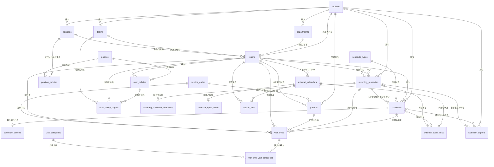
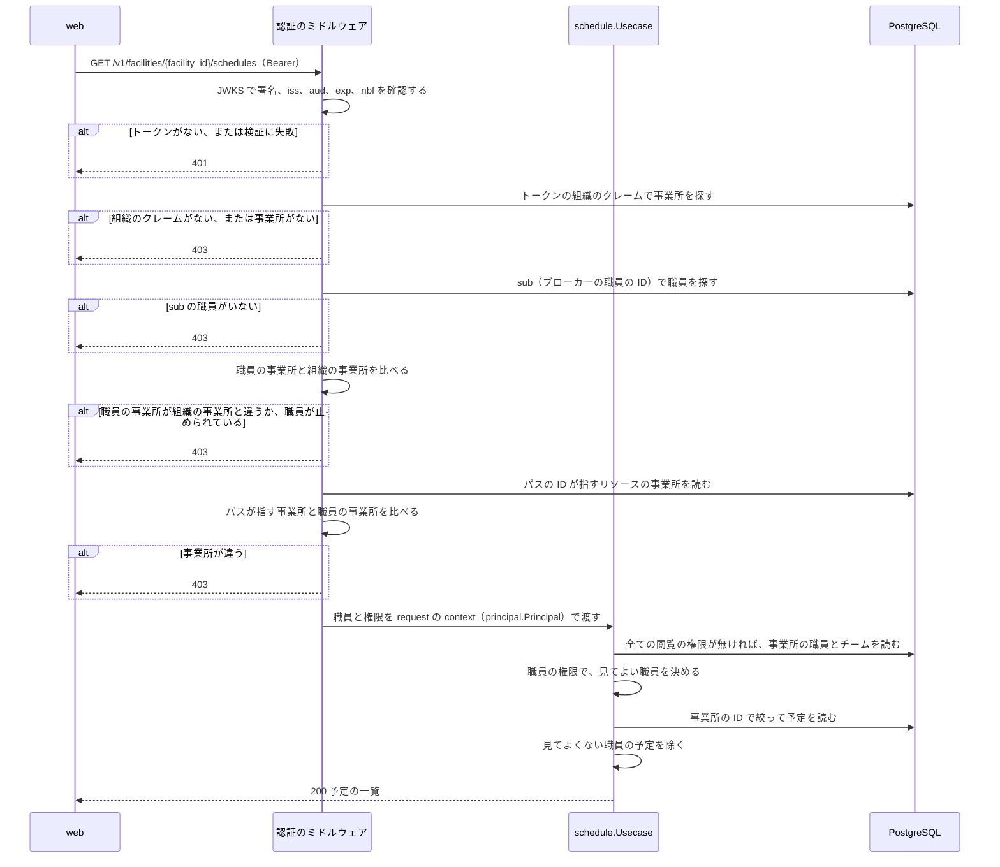
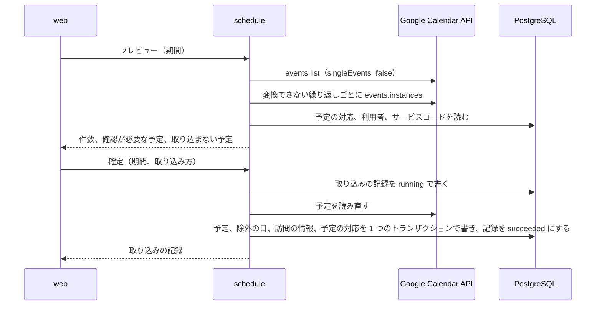
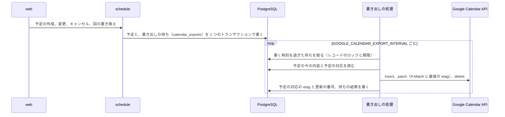
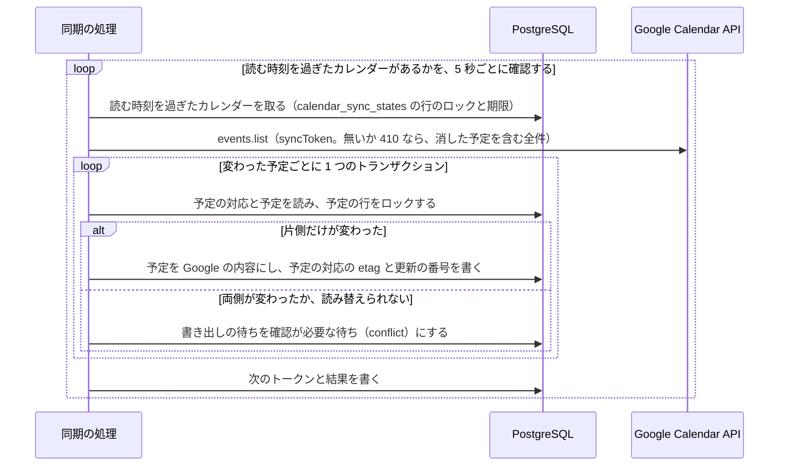
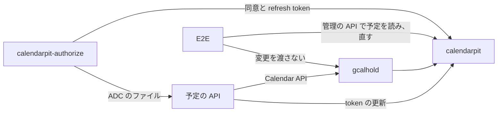

# 予定の管理

## Overview

予定の API は、事業所ごとの予定、職員、利用者、権限を持ち、web に API で渡す。  
全体の中での責務と依存は [buddy Design Doc](https://github.com/Fukuemon/buddy/blob/develop/docs/design/DesignDoc.md) にある。

## Scope

持つもの

- 事業所、部署、チーム、役職と、職員、利用者
- 権限、役職のデフォルトの権限、職員ごとの権限とその対象
- 単発の予定、繰り返しの予定と繰り返しの規則、予定のキャンセル
- 職員と Google カレンダーの結び付けと、Google カレンダーの予定の取り込み、buddy の予定の Google カレンダーへの書き出し、Google カレンダーの変更の buddy の予定への反映
- 訪問の情報、サービスコード、訪問の区分
- access token の検証から事業所の確認までのミドルウェア

持たないもの

- 住所とエリア、訪問の順路、経営数値、月の稼働時間の集計の表
- ログインとパスワード。ブローカーが持つ
- 照合の規則。照合の API が持つ

## Design

### コードの構成

規則と手順は機能ごとのパッケージに置き、DB と HTTP のアダプタは 1 つずつ置く。機能のパッケージの中は、手順（`Usecase`）、規則（状態を持たない関数かエンティティのメソッド）、集約の単位のリポジトリに分ける。決めた理由は ADR-0005 と ADR-0010 にあり、依存してよい向きは [コードベースの構造](https://github.com/Fukuemon/buddy/blob/develop/context/codebase.md) にある。

- ADR-0005: [予定の API の規則と手順を機能ごとのパッケージにまとめる](https://github.com/Fukuemon/buddy/blob/develop/docs/adr/0005-schedule-api-packages.md)
- ADR-0010: [予定の API の機能のパッケージで、手順を usecase、規則を関数、リポジトリを集約の単位に分ける](https://github.com/Fukuemon/buddy/blob/develop/docs/adr/0010-schedule-api-usecase-boundaries.md)

| 種類 | パッケージ | 持つもの |
| --- | --- | --- |
| 共通 | `internal/apperr`、`internal/tx`、`internal/kernel`、`internal/civil` | 共通のエラーと検証のエラー、`Transactor`、文字の検証と並べ替えと `IDGenerator` と 1 件を読む `Finder`、日付と時刻の値 |
| 機能 | `internal/organization`、`internal/staff`、`internal/patient`、`internal/visit`、`internal/schedule` | エンティティ、規則の関数、自分の集約のリポジトリのインターフェイス、ほかの機能のデータを読む小さなインターフェイス、手順（`Usecase`）とトランザクションの範囲。予定の閲覧と編集の判定は `schedule` の `permission.go` に置く |
| 機能 | `internal/calendar` | 外部のカレンダーの予定（`Event`）と、予定を読む `EventSource`。予定を訪問、通常、取り込まないに分ける `Classify` と、RRULE を繰り返しの規則に変換する `RuleFromRecurrence`。結び付けと取り込みと確認が必要な書き出しの手順（`Usecase`）、プレビューの読み替え（`plan.go`）、書き出しの待ちを積む `Outbox` と、待ちを書く `Exporter`、予定を外部の予定の内容にする `ScheduleBody` と `RecurrenceOf`。結び付けたカレンダーと取り込みの記録と予定の対応のリポジトリ、書き出しの待ちのリポジトリ。タイトルは `packages/go/gcaltitle` で読み書きする（ADR-0009） |
| 認可 | `internal/principal` | トークンの主張（`Identity`）、職員（`Principal`）、職員の管理の判定 |
| 認証 | `internal/access` | トークンから職員を特定する手順と、パスが指すリソースの事業所を引く手順 |
| テスト | `internal/inmem` | 機能のパッケージのテストが共有する、メモリ上のリポジトリ |
| アダプタ | `internal/postgres` | 機能のパッケージのリポジトリを、pgx/v5 の接続のプールと sqlc の生成コード（`sqlcgen`）で実装する |
| アダプタ | `internal/broker` | `staff.Identities` を、認証のブローカーの内部の API で実装する。Hydra の client credentials の access token（`aud` は `broker`）で呼ぶ |
| アダプタ | `internal/ulid` | `IDGenerator` を ULID で実装し、ID の形を確認する |
| アダプタ | `internal/gcal` | `calendar.EventSource`（`Reader`）と `calendar.EventWriter`（`Writer`）を Google Calendar API で実装する。繰り返しの予定を展開せずに、親の予定と例外の回を読み、回ごとにする繰り返しだけを events.instances で回に展開する。`calendar.Accounts` の実装（`Accounts`）は、事業所の組織のサービスアカウントで `Reader` と `Writer` を作る。テストのフェイクの API は `internal/gcal/gcaltest` に置く |
| 設定 | `internal/config` | 環境変数から API とマイグレーションの設定を読む。DB の接続の値は自分の型で持ち、`cmd` がアダプタの設定にコピーする |
| 共有 | `packages/go/oidc`、`packages/go/healthcheck`、`packages/go/gcaltitle`、`packages/go/gcalauth`（別の module） | access token の JWKS での検証、テストと `cmd/devissuer` が使うフェイクの Issuer（`oidctest`）、`api healthcheck`、Google カレンダーの予定のタイトルの解釈、組織ごとのサービスアカウントで Google Calendar API を呼ぶクライアント（ADR-0012）。照合の API と共有する（ADR-0007） |
| アダプタ | `internal/httpapi/openapi` | `openapi.yaml` から生成した型と strict server のインターフェイス |
| アダプタ | `internal/httpapi` | 生成したインターフェイスを実装するハンドラと、gin のミドルウェア。リクエストは、埋め込んだ `openapi.yaml` の定義で確認する |
| cmd | `cmd/api`、`cmd/migrate`、`cmd/devissuer`、`cmd/gcalhold` | 起動、マイグレーションとシード、ローカルで試すためのフェイクの Issuer、compose の calendarpit の前に置く中継（本番のイメージに入れない） |

- `kernel` は、ADR-0010 の「`apperr` と同じ段の小さなパッケージ」に当たる。`kernel.Finder[T]` は ID で 1 件を読む 1 つのメソッドのインターフェイスで、機能のパッケージは、ほかの機能のエンティティをこの形で受ける。同じ形のインターフェイスを機能ごとに書かずに済ませるためである。
- `access` は機能のパッケージではないので、型の名前を `Service` のままにし、`Usecase` への改名と「1〜2 のメソッド」の規則の対象から外す。
- `access.Staff` は、`FindIDBySub` と `Get` の 2 つのメソッドを持つ。sub で職員を探し、職員と権限を読むために、2 つともが要る。

### テーブルの構成

次の図は、予定の API の全てのテーブルと、その間の関係を示す。カラム、制約、インデックスは、マイグレーションから生成した[テーブル定義書](https://github.com/Fukuemon/buddy/blob/develop/docs/db/schedule/README.md)（文書のサイトでは「DB の設計」の「テーブルの一覧」）にある。テーブル定義書の Viewpoints は、事業所と組織、職員と権限、利用者、予定と訪問、繰り返しの予定、外部のカレンダーの取り込みと書き出しの観点ごとに、テーブルを絞った ER 図を持つ。  
DB は PostgreSQL 18 で、見直したテーブルは初期のマイグレーションで作り、書き出しと同期のカラムとテーブルは段階ごとのマイグレーションで足す（ADR-0011）。テーブルとカラムの説明は、マイグレーションの `COMMENT ON` に書く。

- ADR-0011: [予定の API の DB を PostgreSQL にし、見直したテーブルでマイグレーションを作り直す](https://github.com/Fukuemon/buddy/blob/develop/docs/adr/0011-schedule-api-postgresql.md)

- 主キーは、多くのテーブルが ULID の `id`（`text COLLATE "C"`）である。ULID の形の CHECK は、テーブルが振る `id` の主キーにだけ付ける。
- `position_policies` と `visit_info_visit_categories` は、2 つの外部キーの組を主キーにする。
- `recurring_schedule_exclusions` は、`recurring_schedule_id` と `date` の組を主キーにする。
- `user_policy_targets` は、`id` を主キーにする。対象のカラム（`target_user_id` と `target_team_id`）のどちらかが NULL になり、主キーに入れられないためである。

- 事業所の中のレコードを指す外部キーは、`(facility_id, id)` の組で指す。別の事業所の職員や利用者を指すレコードは、アプリの確認に加えて DB も拒む。
- 名前のカラムはデフォルトの決定的な照合順序のままにし、完全に一致する値だけを同じとみなす。清音と濁音、全角と半角、大文字と小文字は別の名前である。メモリ上のリポジトリ（`inmem`）も同じ比べ方をする。
- 日時の監査のカラムは `timestamptz` にし、`updated_at` はトリガーで付ける。予定の日付と時刻は、事業所の現地の時刻として `date` と `time` で持つ。
- 区分値（`frequency`、`preferred_time` など）は `text` と CHECK で持つ。名前の付いた CHECK と一意の制約は `<テーブル>_<意味>_{key,fkey,check}` の名前にする。
- `departments`、`teams`、`positions` は事業所ごとに持つ。名前が同じ部署でも、事業所が違えば別のレコードにする。事業所の間で部署を共有すると、事業所が部署の名前を変えたときにほかの事業所に波及するためである。
- `facilities.org_id` は、認証の基盤の組織の ID を持つ。NULL を許し、値があれば一意にする。認証のミドルウェアは、トークンの組織のクレームでこのカラムを探す。
- `users.sub` は、ブローカーの職員の ID を持つ。職員の登録のときにブローカーが発行した値を入れ、全ての事業所を通じて一意にする。ブローカーで職員を作る前に登録した職員では NULL のことがあり、その職員はログインできない。
- `users.email` は、事業所の中で一意にする（`facility_id` と `email` の組）。ブローカーは職員のメールを全ての事業所で一意にするので、ほかの事業所と重なるメールの登録はブローカーが拒む。予定の API は、メールを小文字にそろえてから保存し、比べる。そろえ忘れた書き込みは CHECK が拒む。`users.username` は表示名で、一意にしない。
- `users.suspended_at` は、職員を止めた時刻を持つ。止めていなければ NULL である。止め直しても、最初に止めた時刻を残す。
- 訪問の区分は、`visit_info_visit_categories` で 1 件の訪問に複数を付けられる。
- 予定の種類の規則（通常はタイトルが必須、訪問は訪問の情報が必須）は、`schedule_types.code`（`normal`、`visit`）で読む。`name` は表示と一覧の絞り込みに使う。
- 1 つの訪問の情報は、1 つの予定か 1 つの繰り返しの予定だけが指す（`visit_info_id` の一意の制約）。
- `is_over_time_work` は、開始の時刻から DB が生成するカラムである。書き込みには含めない。
- 外部キーのカラムには、引く向きに使うものにインデックスを置く。行を消さない固定のマスタ（権限、サービスコード、訪問の区分、予定の種類）を指すカラムには置かない。
- 監査の日時は UTC で読み、レスポンスはマイクロ秒までの RFC 3339 の形で返す。
- `external_calendars`、`external_event_links`、`import_runs` は、Google カレンダーの取り込み（ADR-0009 の段階 1）で使う。`calendar_sync_states` は、同期（段階 3）がカレンダーごとの増分の取得のトークンと読む時刻を持つ。`calendar_exports` は、書き出し（段階 2）の待ちを持ち、予定ごとに終わっていない行を 1 つだけ持つ。外部の予定のタイトルと本文は、利用者の名前を含むので保存しない。カレンダーを外すときは行を消さずに `external_calendars.disabled_at` を入れ、外部の予定との対応を残す。結び付け直して同じ期間を取り込んでも、予定が重ならないためである。外していないカレンダーは、職員ごとに 1 つにする（部分の一意のインデックス）。
- 一覧の読み出しには、予定と訪問の情報と名前を結合したビュー（`schedule_details`、`recurring_schedule_details`、`visit_info_details`）を使う。
- `schedule_types`、`service_codes`、`visit_categories` のレコードは、マイグレーションで入れる。事業所ごとには持たない。サービスコードの提供時間の範囲は、照合の許容範囲と同じ値にする。
- `policies` の 8 件のレコードは、マイグレーションで入れる。事業所ごとには持たず、API では作らない。認可は `code` で権限を読むので、レコードが環境ごとに違うと判定がずれるためである。
- `user_policy_targets` は、`target_user_id` と `target_team_id` のどちらか 1 つだけを持つ。DB の CHECK 制約で確認する。

### 権限のレコード

`policies` は、PRD の 8 つの権限（予定の 7 つと職員の管理）を次の `code` で持つ。`needs_target` が true の権限は、対象の職員かチームを `user_policy_targets` に持つ。

| `code` | 権限 | `needs_target` |
| --- | --- | --- |
| `schedule.self.edit` | 自分の予定の編集 | false |
| `schedule.user.read` | 指定した職員の予定の閲覧 | true |
| `schedule.user.edit` | 指定した職員の予定の編集 | true |
| `schedule.team.read` | 指定したチームの職員の予定の閲覧 | true |
| `schedule.team.edit` | 指定したチームの職員の予定の編集 | true |
| `schedule.all.read` | 事業所の全ての予定の閲覧 | false |
| `schedule.all.edit` | 事業所の全ての予定の編集 | false |
| `staff.manage` | 職員の管理 | false |

役職のデフォルトの権限をコピーする規則、役職を変えたときにコピーし直す規則、`staff.manage` の扱いは [権限](https://github.com/Fukuemon/buddy/blob/develop/context/domain/permission.md) にある。  
職員の権限（`schedule.user.*`）は、コピーするときに対象を決められないので、役職のデフォルトの権限にできない。

- ADR-0002: [権限を役職のデフォルトと職員ごとの上書きで持つ（PBAC）](https://github.com/Fukuemon/buddy/blob/develop/docs/adr/0002-pbac.md)

職員の役職は `PUT /v1/users/{user_id}/position` で変える。  
職員ごとに権限を足す（`POST /v1/users/{user_id}/policies`）ときは、`needs_target` が true の権限に、code に合わせて職員かチームの対象を 1 つ以上付ける。対象は同じ事業所のものに限る。外す（`DELETE /v1/users/{user_id}/policies/{user_policy_id}`）と、対象も消える。

職員と利用者の登録、職員の停止、役職の作成、役職を変える操作、権限を足し外す操作は、`staff.manage` を持つ職員だけに許す。

- ADR-0006: [職員と利用者の登録と、職員の権限と役職を変える操作を、職員の管理の権限で許す](https://github.com/Fukuemon/buddy/blob/develop/docs/adr/0006-staff-manage-policy.md)

### 認証から事業所の確認までの流れ

次の図は、web が予定の一覧を求めたときに、予定の API が職員を特定し、事業所を確認し、権限で予定を絞るまでの流れを示す。

- `/v1` の全ての API は、`Authorization: Bearer` の access token を求める。`/healthz` と `/readyz` は認証を求めない。
- 署名のアルゴリズムは RS256 と ES256 だけを受け付ける。JWKS は、起動のときに discovery の文書から場所を読み、1 時間ごとに取り直す。知らない `kid` のトークンが来たときも取り直すが、間隔は 1 分以上あける。
- トークンが無いときは `WWW-Authenticate: Bearer` を、検証に失敗したときは `WWW-Authenticate: Bearer error="invalid_token"` を付けて、401 を返す。
- 組織の ID を持つクレームの名前は `OIDC_ORG_CLAIM` で決め、デフォルトは `org_id` にする。ブローカーごとにクレームの名前が違うためである。
- 予定の API は、職員を sub だけで探し、トークンのメールを見ない。sub は登録のときに入れるので、初回のログインで職員を結び付ける処理を持たない（ADR-0017）。
- 止めた職員のリクエストは、web が持つ access token の期限（5 分）を待たずに 403 で拒む。
- ミドルウェアは、パスの引数ごとに、指すリソースの事業所を職員の事業所と比べる。
  - `facility_id` は、値をそのまま職員の事業所と比べる。
  - `department_id`、`team_id`、`position_id`、`user_id`、`schedule_id`、`recurring_schedule_id` は、リソースを読んでその事業所と比べる。
  - `policy_id` は、事業所に属さないので確認しない。`user_policy_id` は、同じパスの `user_id` で事業所を確認し、`staff.Usecase` が職員の権限かを確認する。
  - この一覧に無い引数を持つパスは、事業所を確認できないので 500 を返す。
- パスの ID が ULID でないときと、リソースが見つからないときは、ミドルウェアは通す。ULID でない ID は次のミドルウェアが 400 を返し、見つからないリソースはハンドラが 404 を返す。
- `/v1` のリクエストは、次の順に確認する。先に失敗した段のレスポンスを返すので、トークンの 401 と事業所の 403 は、パスの ID と定義の 400 より先に返る。
  1. Origin を許すか（403）。`CORS_ALLOW_ORIGINS` を設定したときだけ適用する。規則は [Interface](#interface) の CORS にある
  2. クエリを読めるか（400）。`/v1` 以外のパスにも適用する
  3. トークン（401）と、職員と組織の事業所（403）
  4. パスが指す事業所（403）
  5. パスの ID が ULID か（400）
  6. リクエストが `openapi.yaml` の定義に合うか（400）

### 職員の登録と停止

職員の身元はブローカーが持ち、名前、役職、権限は予定の API が持つ（ADR-0017）。  
職員の登録（`POST /v1/facilities/{facility_id}/users`）と停止（`POST /v1/users/{user_id}/suspend`）は、`staff.Usecase` が職員の管理の権限を確認してから行う。  
ブローカーは、`staff.Identities`（`internal/broker`）で内部の API を呼んで書く。

- 登録は、入力と部署、チーム、役職を確認してから、事業所の組織の ID とメールでブローカーに登録の途中の職員を登録させ、返った職員の ID を `users.sub` に入れて書く。書けたら、ブローカーの職員を有効にする。事業所に組織の ID が無ければ、ブローカーを呼ばずに 400 を返す。
- 同じメールの職員がブローカーで止められていれば、409 を返す。ほかの事業所に同じメールの職員がいれば、事業所を示さない 409（「メール … の職員は登録できません」）を返す。
- ブローカーが入力を 400 で拒めば、ブローカーの文を付けて 400 を返す。
- 予定の API に書けなかったときは、この呼び出しでブローカーの職員を作っていて、その ID の職員がまだいなければ、ブローカーの職員を消して戻す。
- 停止は、ブローカーの職員を先に止めてから、`users.suspended_at` を書く。ブローカーで止められなければ、予定の API にも書かない。止めた職員を止めても成功する。
  - ブローカーが止めた後に Hydra の取り消しに失敗したときは、`users.suspended_at` を書いてから 500 を返す。送り直すと取り消しをやり直す。
  - ブローカーにいない職員は、予定の API でだけ止める。
- 職員は自分を止められない。409 を返す。
- 2 か所の書き込みの片方だけが残ったときの扱いは、[認証のブローカーの Design Doc の職員の登録と停止](https://github.com/Fukuemon/buddy/blob/develop/services/broker/DesignDoc.md#職員の登録と停止) にある。
- ADR-0017: [職員の身元をブローカーが持ち、権限と業務のデータは予定の API が持つ](https://github.com/Fukuemon/buddy/blob/develop/docs/adr/0017-identity-boundary.md)

### 予定の認可

予定の操作は、`schedule.Usecase` が、ミドルウェアが context に入れた職員（`principal.Principal`）の `user_policies` で判定する。判定の規則は `schedule` の `permission.go` の関数にある。役職は見ない。編集の権限は、同じ範囲の閲覧を含む。

1. 自分の予定は、権限によらず見てよい。自分の予定の編集には `schedule.self.edit` が要る。
2. `schedule.all.read` があれば、事業所の全ての職員の予定を見てよい。`schedule.all.edit` があれば、編集もしてよい。
3. `schedule.user.*` は、対象の職員の予定に及ぶ。
4. `schedule.team.*` は、対象のチームに属する職員の予定に及ぶ。

- 一覧は、見てよくない職員の予定を除いて返す。1 件を指す操作（取得、変更、キャンセル、回の置き換え）は 403 を返す。
- 作成と変更は、予定の職員の予定を編集する権限を求める。変更と回の置き換えは、元の予定の職員と、新しい予定の職員の両方の編集の権限を求める。
- 権限の判定は、事業所の分離の後に行う。事業所が違えば、ミドルウェアが先に 403 を返す。
- 職員と利用者の登録、役職の作成、職員の権限と役職を変える操作は `staff.manage` で判定する（[権限のレコード](#権限のレコード)）。それ以外の職員、利用者、訪問の情報、組織の API は、権限で判定せず、事業所の分離だけを確認する。

### 繰り返しの予定

- 繰り返しの予定は、最初の回の日付（`recurring_schedules.date`）と、同じレコードの規則のカラム（`frequency` から `end_date`）で回を決める。回は保存しない。頻度ごとのカラムの組み合わせは CHECK で確認する。
- 繰り返しの規則は次の 3 つ。規則に値が無いときは、最初の回の日付から曜日か日を決める。
  - `weekly`: `day_of_week` の曜日ごと
  - `monthly` で `day_of_month` がある: 毎月のその日。その日がない月は回にしない
  - `monthly` で `week_of_month` と `day_of_week` がある: 毎月の n 回目のその曜日。n は日から `(日 - 1) / 7 + 1` で決め、1 から 5 を受ける。5 回目のない月は回にしない
- 最初の回の日付より前と、`end_date` より後は回にしない。最初の回の日付は、規則の回に当たらなければならない。
- 繰り返しの 1 回だけを変えるときは、その日を `recurring_schedule_exclusions` に足し、`recurring_schedule_id` と元の回の日付（`original_date`）で元を指す単発の予定を作る。2 つは 1 つのトランザクションで行う。2 つのカラムは組で持ち、同じ回は 1 度だけ置き換えられる（一意の制約）。
- 予定の一覧の API は、単発の予定と繰り返しの予定を別々に返す。繰り返しの予定を期間の回に展開しない。`date_from` と `date_to` は単発の予定だけを絞る。

### 予定の変更

- 単発の予定の変更は、予定の枠を本文の内容に置き換える。部分の更新は持たない。画面のフォームは予定の全ての項目を送るためである。
- 訪問の情報は、予定ごとに 1 レコードを持つ。変更では本文の内容で新しいレコードを作り、どの予定も指さなくなった前のレコードを消す。
- 繰り返しの回を置き換えた予定は、変更しても `recurring_schedule_id` を保つ。
- キャンセルした予定は変更できず、409 を返す。
- 変更は、最初に予定のレコードに排他のロックを取る。同時の変更とキャンセルが、読んだ後の訪問の情報とキャンセルの有無を食い違わせないためである。同時の変更は、後に来た方の内容になる。

### キャンセル

- 予定をキャンセルすると、`schedule_cancels` に理由とともに 1 レコードを足す。予定のレコードは消さない。
- キャンセルした予定は、API のレスポンスの `cancel` に理由を持つ。画面は、キャンセルした予定を予定の表示から除く。

### Google カレンダーは事業所のサービスアカウントで読み書きする

予定の API は、Google Calendar API を、事業所ごとのサービスアカウントになりすました token で呼ぶ。  
職員は自分の事業所のアカウントにカレンダーを共有するので、ほかの事業所の職員が共有したカレンダーは、ID を入れても読めず、結び付けられない。

- ADR-0012: [Google カレンダーのサービスアカウントを事業所ごとに分け、buddy は IAM の権限借用で切り替える](https://github.com/Fukuemon/buddy/blob/876381365355f7e4dab03f6dfdb3d6fb8a9f6947/docs/adr/0012-google-calendar-facility-service-accounts.md)

- 組織の ID とサービスアカウントの対応は、運営側が設定のファイル（`GOOGLE_CALENDAR_SERVICE_ACCOUNTS_FILE`）で渡す。予定の API は、事業所の `facilities.org_id` で対応を引く。形は照合の API と同じで、同じファイルを渡せる。
- 事業所は、リクエストを受ける操作では、パスの事業所（認証のミドルウェアがトークンの職員の事業所と一致することを確認する）か、結び付けたカレンダーのレコードの事業所で決める。リクエストを受けない書き出しと増分の取得は、カレンダーのレコードの事業所（`external_calendars.facility_id`）で決める。リクエストの本文からは受けない。
- 対応の無い事業所と、組織に結び付けていない事業所のカレンダーの操作は、503 の `calendar_not_configured` を返す。書き出しは、書き直しの回数の上限まで待ちを残す。
- サービスアカウントごとの Calendar API のクライアントを起動のときに作り、token は有効期限まで使い回す。共有のコードは `packages/go/gcalauth` にある。
- Application Default Credentials が事業所のサービスアカウントそのものとして動くときは、重ねてなりすまさず、その token を使う。ローカルで検証の事業所のアカウントになりすました Application Default Credentials を使うと、サービスアカウント自身へのトークン作成者のロールが要るためである。見分けは、認証情報のファイルの `client_email`（キー）か、なりすます先の URL（なりすましと Workload Identity Federation）のメールアドレスで行う。メタデータサーバーの認証情報は、別のアカウントとみなす。
- 実際の Google Calendar API では、サービスアカウントが持つカレンダーに対して、取り込み、書き出し、増分の取得、確認が必要な予定の解き方が動く。職員が共有したカレンダーに「予定の変更」の権限で書けるかは、未確認である。確認するまで、本番で書き出しを有効にしない。
  - 出典: [#180 の実際の API での確認](https://github.com/Fukuemon/buddy/issues/180#issuecomment-6333280999)
  - ADR-0012: [承認の条件](https://github.com/Fukuemon/buddy/blob/876381365355f7e4dab03f6dfdb3d6fb8a9f6947/docs/adr/0012-google-calendar-facility-service-accounts.md#承認の条件)
- token を作れないときのエラーの文は、状態コードだけを持つ。IAM のレスポンスはなりすます先のリソースの名前を含むことがあり、サービスアカウントのメールアドレスをログに出さないためである。

### Google カレンダーの取り込み

職員の管理の権限を持つ職員が、職員に Google カレンダーを結び付け、期間を選んでプレビューし、確定して予定に取り込む（ADR-0009 の段階 1）。読み替えの規則と画面の動きは、画面仕様書の [予定の取り込み](https://github.com/Fukuemon/buddy/blob/develop/docs/screens/schedule-import_予定の取り込み/index.md) と [カレンダーの連携](https://github.com/Fukuemon/buddy/blob/develop/docs/screens/schedule-link_カレンダーの連携/index.md) にある。

- ADR-0009: [Google カレンダーとの連携を、buddy をマスターにする段階の同期にし、サービスアカウントとカレンダーの共有で認証する](https://github.com/Fukuemon/buddy/blob/develop/docs/adr/0009-google-calendar-sync.md)

- プレビューの結果は保存しない。確定は Google の予定を読み直し、プレビューと同じ規則で読み替える。確認が必要な予定の集合かバージョン（まとめた予定の ID と etag から作る）が、送られた取り込み方と違えば、何も書かずに 409 を返す。
- 同じカレンダーの取り込みは、1 つずつ行う。確定の始めにカレンダーのレコードに排他のロックを取り、10 分以内に始めた `running` の記録があれば 409 を返す。止まった取り込みが次の取り込みを止め続けないよう、10 分より前の `running` は数えない。
- 取り込んだ Google の予定は、`external_event_links` の対応を持つ。対応のある予定は取り込み済みに数え、もう一度は書かない。
- 繰り返しは、親の予定の RRULE を buddy の規則に変換できれば、規則ごと取り込む。期間の外の回も繰り返しの予定に含まれる。Google が返した取り消した回は除外の日に、期間の中の変えた回は除外の日と、元の回の日付を持つ単発の予定にする。前の取り込みで取り込んだ繰り返しにも、後の期間の取り消しと変更を反映する。
- 前の取り込みで回か例外の回だけを取り込んだ繰り返しは、規則に変換できる形でも回ごとにする。規則ごと作ると、前に取り込んだ回と重なるためである。
- Google が変えた回を、元の日時と今の日時のどちらで期間に絞るかは、未確認である。今の日時で絞るとみなし、期間の前後 31 日を広げて例外の回を読み直し、元の日付が期間の中の回も読み替える。期間の中の回を期間の外へ動かしても、元の日に回が残らない。31 日より遠くへ動かした回は読めず、元の日に回が残る。Calendar API は元の日時で予定を絞れず、上限なしに探すと回ごとに API を呼ぶことになるためである。
- 変換できない繰り返しは、events.instances で期間の中の回を読み、回ごとに単発の予定にする。回の対応は、回の ID で持つ。
- タイトルのサービス内容と利用者名は、照合の API と同じ規則で表記をそろえ、サービスコードと事業所の利用者を引く。利用者を 1 人に決められない予定は、プレビューで取り込み方を選ばせる。取り込んだ訪問の予定の主訪問者は、カレンダーを結び付けた職員である。
- 予定のタイトル、利用者名、カレンダーの ID は、取り込まない予定の一覧、エラーのメッセージ、ログに出さない。確認が必要な予定だけは、タイトルから読んだ利用者名とサービス内容を返す。
- 空き時間だけの共有（`freeBusyReader`）のカレンダーは、読めないとみなす（422 `calendar_unreadable`）。公式の文書は、空き時間だけの共有の `events.list` が `singleEvents=true` のように動き、繰り返しの親を返さないと書く。予定のタイトルを返さないことと、実際の API での振る舞いは未確認である。
  - 出典: [Recurring events](https://developers.google.com/workspace/calendar/api/guides/recurringevents)
- カレンダーを外しても、レコードと予定の対応は消さない。同じ職員に結び付け直すと、外したレコードを使い直す。

### Google カレンダーへの書き出し

buddy で作り、変え、キャンセルした予定を、予定の職員が結び付けた Google カレンダーに書く（ADR-0009 の段階 2）。Google カレンダーで直された予定は、書き出しでは buddy に当てず、確認が必要な予定に出す。Google カレンダーだけで変わった予定を buddy に当てるのは、[Google カレンダーとの同期](#google-カレンダーとの同期) である。

- 書き出しは、`GOOGLE_CALENDAR_EXPORT_ENABLED` が `true` のときだけ動く。デフォルトは `false` で、そのときは待ちを積まず、書き出しの処理も動かさない。サービスアカウントが「予定の変更」の共有だけで書けるかを確認するまで（ADR-0012 の承認の条件）、本番では有効にしない。
- 待ちを積む: 予定の操作（`schedule.Usecase`）は、予定を書くのと同じトランザクションで `Outbox` に積む。積むのは、予定の職員に外していないカレンダーがあるときと、予定の対応のカレンダーを外していないとき（職員を替えて、前のカレンダーの予定を消すとき）だけである。取り込みで書いた予定は積まない。
- 待ちは予定ごとに終わっていないものを 1 つだけ持ち、積み直すと `revision` が増える。書くときは、積んだ時点ではなく書く時点の予定の内容を書く。書いている間に積み直されたら、結果によらず待ちを pending に戻して数え直し、もう一度書く。
- 書き出しの処理は、API と同じプロセスのゴルーチンで動く。待ちは `FOR UPDATE SKIP LOCKED` と期限（`locked_until`、2 分）で 5 件ずつ取り、1 件を 20 秒で打ち切るので、期限のうちに書き終える。結果は、取ったときの回数（`attempts`）と比べて書き、期限が切れた後にほかのレプリカが取り直した待ちを変えない。外部の API はトランザクションの外で呼ぶ。
- 止める合図で書けなかった待ちは、書こうとした回数に数えずに返す。
- 予定の更新の番号（`version`）は、単発の予定の変更とキャンセル、繰り返しの予定の回の除外のたびに 1 つ増える。書いた後に、予定の対応（`external_event_links`）に Google の etag と更新の番号（`synced_version`）を書く。同期が、どちらの側が変わったかを比べるのに使う。
- 書く先は、予定の職員（`staff_id`）が結び付けたカレンダーである。訪問の予定では、画面が主訪問者を予定の職員と同じにする。
- 書く先
  - 予定の対応があり、職員のカレンダーが対応のカレンダーと同じなら、Google の予定を部分更新する。取り込んだ予定もこの形で更新する。
  - キャンセルした予定と、職員を替えた予定は、対応の Google の予定を消し、対応も消す。職員を替えた予定は、新しい職員のカレンダーに作る。
  - 対応のカレンダーを外していれば、そのカレンダーには書かない。職員に今のカレンダーがあれば、対応を消してそのカレンダーに作る。外したカレンダーの予定は残る。対応が無く、職員にカレンダーがあれば作る。
  - 作る予定の ID は、buddy の予定の ULID を base32hex にした値にする。作った後に対応を書けずに書き直しても、Google の予定は 2 つにならない。同じ ID の予定があれば（409）、buddy の内容で更新する。
- 内容
  - Google の予定のタイトルは、訪問の予定なら `【サービス内容】利用者名`（`packages/go/gcaltitle.Format`）、通常の予定なら buddy の予定のタイトルである。照合の API が同じタイトルを読む。
  - 日時は、タイムゾーン `Asia/Tokyo` とオフセットの無い日時で書く。`extendedProperties.private` に buddy の予定の ID だけを置く。
  - 説明は、buddy の予定に説明があるときだけ書く。取り込んだ予定の Google の説明を消さないためである。buddy で説明を消しても、Google の説明は残る。
  - 参加者は書かず、通知を送らない（`sendUpdates=none`）。
- 繰り返し: buddy の繰り返しの規則は、全て RRULE に変換できる（`RecurrenceOf`、取り込みの `RuleFromRecurrence` の逆）。規則に無い曜日と日は最初の回の日付から決め、終了日はその日の 23:59:59（Asia/Tokyo）を UTC にした `UNTIL` にする。除外の日は `EXDATE;TZID=Asia/Tokyo` にする。
  - 回の置き換えは、Google の例外の回にせず、親の予定の `EXDATE` と、別の単発の予定にする。buddy が持つ形（除外の日と、元の回を指す単発の予定）と同じである。
  - 取り込んだ Google の例外の回が置き換えた日は、`EXDATE` にしない。`EXDATE` にすると、Google の例外の回が消えるためである。
- 衝突とエラー
  - 更新と削除には、予定の対応の etag を `If-Match` に付ける。412 は Google カレンダーで予定が変わったとみなし、書かずに待ちを `conflict`（`precondition_failed`）にする。更新で、Google で消された予定（410 か、次の項目の 412）を受けたときと、更新と削除で、Google が予定かカレンダーを見つけられないとき（404）は `conflict`（`not_found`）にする。削除で 410 を受けたときは、消し終えたものとして、予定の対応を消す。
  - Google は、消された予定に、消す前の etag を `If-Match` に付けた更新と削除を、410 でなく 412 で返す。412 を受けたら `events.get` で予定を読み、`status` が `cancelled` なら 410 と同じく消された予定として扱う。キャンセルと職員を替えたときの削除なら、予定の対応を消し、職員を替えたときは新しいカレンダーに作る。更新なら `conflict`（`not_found`）にする。読むのが一時的なエラー（429、5xx、通信のエラー）で失敗したら書き直す。それ以外で読めないときは、412 のまま `precondition_failed` にする。
  - `conflict` の待ちは、buddy で予定を変えても書かない。職員の管理の権限を持つ職員が、確認が必要な予定の一覧から「buddy の内容で書き直す」を選ぶと、`If-Match` を付けずに書き直す。消された予定は、`status` を `confirmed` にした部分更新で戻す。実際の API は、`If-Match` の無い patch を、消された予定にも 200 で返す。410 を受けたときは、予定の対応を消して作り直す。単発の予定では「Google の内容に合わせる」も選べる（[Google カレンダーとの同期](#google-カレンダーとの同期)）。
  - 404 では予定の対応を消さない。カレンダーの共有が外れたときの 404 と、予定が無いときの 404 を見分けられないとみなし、対応を消すと、共有を戻した後に予定が 2 つになるためである。キャンセルの削除が 404 でも、対応を消さずに `conflict` にする。共有が外れたカレンダーの予定の更新と削除が 404 を返すかは、未確認である。
    - 出典（消された予定への patch、update、delete、get の応答）: [#180 の実際の API での確認](https://github.com/Fukuemon/buddy/issues/180#issuecomment-6332187503)
  - 429、5xx、通信のエラー、403 の上限のエラーは、30 秒から倍にしながら書き直し、5 回で `failed`（`unavailable`）にする。403 は書き直さずに `failed`（`forbidden`）に、400 は `failed`（`rejected`）にする。`failed` の待ちは、buddy で予定を変えると数え直して書く。
  - 待ちのエラーは決まった値（`error_code`）だけを持ち、確認が必要な予定の一覧とログに、予定のタイトル、利用者名、カレンダーの ID を出さない。
- カレンダーを結び付ける前に作った予定は書き出さない。結び付けた後にその予定を変えると書く。

### Google カレンダーとの同期

職員が Google カレンダーで変えた予定を、buddy の予定に当てる（ADR-0009 の段階 3）。buddy と Google の両方で変わった予定は当てず、確認が必要な予定に出す。

- 同期は、`GOOGLE_CALENDAR_SYNC_ENABLED` が `true` のときだけ動く。デフォルトは `false` である。書き出し（`GOOGLE_CALENDAR_EXPORT_ENABLED`）を有効にしないと有効にできない。buddy の変更を書き出さずに Google の変更だけを当てると、buddy で変えた予定が全て両側の変更になるためである。
- 同期の処理は、書き出しと同じく API のプロセスのゴルーチンで動く。読む時刻（`next_sync_at`）を過ぎたカレンダーがあるかを 5 秒（間隔がそれより短ければ間隔）ごとに確認する。読み終えたカレンダーの読む時刻は、`GOOGLE_CALENDAR_SYNC_INTERVAL` の後である。外していないカレンダーを、`FOR UPDATE SKIP LOCKED` と期限（`locked_until`、6 分）で 5 件ずつ取り、1 件を 1 分で打ち切る。結果は、取ったときの期限と比べて書き、期限が切れた後にほかのレプリカが取り直したカレンダーを変えない。
- 増分の取得: `events.list` に `syncToken` を付けて、前の後に変わった予定を、消した予定と繰り返しの例外の回を含めて読む。トークンが無いときと、Google が 410 を返したときは、`showDeleted=true` で全ての予定を読み直す。`syncToken` と期間は一緒に渡せないので、カレンダー全体を読む。
- 予定を当てられなかったときは、トークンを進めずに返し、次に同じ予定から読み直す。同期の状態は `failed`（`apply`）にする。予定の対応の etag と比べるので、読み直しても同じ変更を 2 回は当てない。
- 当て方（`calendar.applier`）
  - 予定の対応の etag が Google の予定と同じなら、何もしない。buddy が書いた変更が増分に戻ってきたとき（エコー）もこれに当たる。
  - Google の予定の内容（タイトル、日付、時刻と、予定の職員のカレンダー）が buddy の予定を書き出した内容と同じなら、予定の対応を今の etag と更新の番号にするだけにし、確認が必要な待ちがあれば終える。buddy の更新の番号が対応と違えば、比べない項目（説明、繰り返しの除外の日）に書き出していない buddy の変更があるので、etag だけを進め、確認が必要な待ちを書き直す待ちにする。
  - 予定の書き出しの待ちを書き出しの処理が持っている間（`locked_until` の前）は、カレンダーを 5 秒後に読み直す。etag を書く前のエコーを、両側の変更と見誤らないためである。
  - buddy の予定の更新の番号が予定の対応の `synced_version` と同じなら、Google だけが変わったので、Google の内容を buddy に当てる。当てた予定は書き出しの待ちに積まない。
  - 両方が変わったときは、書き出しの待ちを `conflict`（`precondition_failed`、消された予定は `not_found`）にする。待ちが無ければ足す。書いている処理の結果を捨てさせるため、`revision` を 1 つ増やす。
  - 読み替えられないときは、`conflict`（`unappliable`）にする。職員が Google で読み替えられる形に直すと、次の同期で当てて、待ちを終える。
- 単発の予定に当てる内容
  - 日付と時刻は、取り込みと同じ規則（`Classify`）で読む。終日の予定、日をまたぐ予定、長さが 0 の予定は読み替えられない。職員、説明、予定の種類は変えない。訪問の予定と通常の予定は入れ替えない。
  - 通常の予定は、Google の予定のタイトルを buddy の予定のタイトルにする。訪問の予定は、Google の予定のタイトルのサービス内容と利用者名が前と同じなら訪問の情報を残し、違えば取り込みと同じ規則でサービスコードと利用者を引いて、訪問の情報を作り直す。主訪問者、同行者、訪問の区分は前のままにする。利用者を 1 人に引けなければ読み替えられない。
  - Google で消された予定は、理由を「Google カレンダーで消されました」にしてキャンセルする。buddy でキャンセルした予定を Google で戻しても、buddy には戻さない（読み替えられない）。
- 繰り返しの予定
  - 予定の対応が無く、親の予定の対応が繰り返しの予定を指す例外の回は、buddy の回の変更として当てる。元の日付が規則の回に当たらない取り消しは何もせず、変更は `conflict`（`unappliable`）にする。取り消した回は除外の日にする。変えた回は、元の回を除外し、元の回の日付を持つ単発の予定を作って、例外の回との対応を書く。当てる前に親の予定の対応が buddy と同じ（`synced_version` が更新の番号と同じ）なら、対応の `synced_version` も進め、当てた変更を buddy の変更と見誤らないようにする。
  - buddy でもその回を除外していれば、変えた回は両方が変わったので、繰り返しの予定の待ちを `conflict`（`precondition_failed`）にする。取り消した回は、buddy がその回を置き換え、親の予定の `EXDATE` をまだ書き出していない（親の対応の `synced_version` が更新の番号と違う）ときだけ `conflict` にし、書き出した後なら何もしない。書き出した親の `EXDATE` が、取り消した回として戻ってくることがあるためである。
  - 親の予定そのもの（規則、時刻、タイトル）の変更と削除は、buddy に当てない。書き出した内容と同じでなければ、`conflict`（`unappliable`、消されたときは `not_found`。buddy でも変えていれば `precondition_failed`）にする。規則は、両方を `RecurrenceOf` で同じ形にしてから比べる。`EXDATE` は比べない。Google で取り消した回は親の `EXDATE` ではなく例外の回で来るので、buddy の除外の日と親の `EXDATE` は一致しないためである。
- 予定の対応の無い予定は当てない。Google で新しく作った予定は、取り込みで buddy に移す。
- 確認が必要な待ちの解き方
  - 「buddy の内容で書き直す」（`createCalendarExportRetry`）は、書き出しと同じく `If-Match` を付けずに書き直す。
  - 「Google の内容に合わせる」（`createCalendarExportAcceptance`）は、単発の予定で、理由が `precondition_failed` か `not_found` の待ちだけに使える。buddy でキャンセルした予定には使えない（`acceptable` が false）。Google の今の予定を `events.get` で読み、buddy の予定に当てて、待ちを終える（`succeeded`）。読み替えられなければ 409（`external_change_unappliable`）を返す。
  - Google が予定を `status` が `cancelled` で返したときと、予定に 404 か 410 を返し、カレンダーは読めるときは、予定が消されたとみなしてキャンセルする。実際の API は、消された予定の `events.get` に 200 と `cancelled` を返す。403 は消されたとみなさない。キャンセルした予定は、職員を替えていても書き出し直さない。Google を読む時間の上限は 20 秒である。
  - 予定の行をロックしてから Google の予定を読む。同期の処理も同じ行をロックするので、読んだ後に Google で変わった予定は、同期が後で比べて当てるか、確認が必要な待ちにする。
  - buddy で職員を替えた予定は、合わせた後に書き出しの待ちを積み直し、今の職員のカレンダーへ移させる。
- カレンダーの同期の状態（`calendar_sync_states`）は、最後の結果（`never`、`succeeded`、`failed`）と、失敗の理由を決まった値（`unreadable`、`unavailable`、`apply`）で持つ。ログと理由に、予定のタイトル、利用者名、カレンダーの ID を出さない。

### ローカル環境と E2E の Google カレンダー

compose と E2E では、Google Calendar API の代わりに [calendarpit](https://calendarpit.dev/ja/)（MIT）を動かす。イメージは版と digest で固定する。職員のカレンダーと予定は `compose/calendarpit/fixture.json` にある。

- calendarpit は、全ての Calendar API の要求に bearer token を求め、token の利用者が持つカレンダーだけを読ませる。サービスアカウントの token は出さない。
  - compose の `calendarpit-authorize` が、fixture の利用者 `schedule` として同意を通す。取った refresh token を、`authorized_user` の Application Default Credentials のファイルに書く。
  - 予定の API は、`GOOGLE_CALENDAR_ENDPOINT` を渡したとき、`GOOGLE_APPLICATION_CREDENTIALS` のファイルだけで認証する。
- E2E は、calendarpit の管理の API（`/__calendarpit/calendars/{id}/events`）で、予定の API が書いた予定を読む。職員が Google で予定を直したときの代わりに、同じ API で予定を直す。手で確認するときは、calendarpit の管理の画面を使う。

calendarpit 0.9.5 と本物の振る舞いの比べ方は、次のとおり。

| 振る舞い | 本物の側 | calendarpit の側 |
| --- | --- | --- |
| events の list、get、insert、patch、delete、instances の、予定の API が使う項目 | 公式の文書。予定の API の実装が出典に従う | 予定の API のクライアントを向けて、期待どおりに動いた。公式の文書と直接は並べていない |
| 期間に回の無い繰り返しの親を `singleEvents=false` の list が返さない | 実際の API | 同じ |
| `syncToken` の増分で、回の変更、親の除外の日、親の削除のときに返る予定 | 実際の API | 未確認。増分が、作った予定、変えた予定、消した回を返すことだけを見た |
| `syncToken` が切れたときの 410 | 公式の文書 | 同じ |
| 消した予定に、消す前の etag を `If-Match` に付けた patch、update、delete の 412。`If-Match` の無い delete の 410。消した予定の get の `cancelled` | 実際の API | 同じ |
| 消した予定と同じ ID の insert の 409 | 公式の文書。実際の API では未確認 | 同じ |
| `fields` の指定と、知らない query の項目 | 公式の文書 | 400 で拒む。予定の API は `fields` を付けない |

- 出典（実際の API）: [#180 の実際の API での確認](https://github.com/Fukuemon/buddy/issues/180#issuecomment-6332187503)

calendarpit で足りない振る舞いと、その扱い

| 足りない振る舞い | 扱い |
| --- | --- |
| Google の変更を、増分の取得に渡さずに止める操作 | 中継の `cmd/gcalhold` で補う。E2E が `POST /hold` で止めている間は、`syncToken` を付けた `events.list` に、変わった予定が無いと答える。calendarpit のトークンは使っても消えないので、止めるのをやめた後に止めていた間の変更が返る。ただし、止めている間にトークンが 100 個を超えて出ると、古いトークンが消え、全ての予定を読み直す。buddy と Google の両方で変わった予定を、決まった順で作るために要る |
| サービスアカウント、カレンダーの共有と、共有の権限（閲覧だけ、空き時間だけ） | 残す。fixture の利用者 1 人が職員のカレンダーを全て持つ。書けないカレンダーと `freeBusyReader` は、`gcaltest` のユニットテストで確認する |
| 事業所ごとのサービスアカウントのなりすまし（ADR-0012） | 残す。なりすましを作るときは、`GOOGLE_CALENDAR_ENDPOINT` のときになりすまさず、ADC のファイルの token を全ての事業所に使う |
| 403 の rate limit と 5xx | 残す。`gcaltest` の `Failures` と `Status` で確認する |

- Go のユニットテストは、`gcaltest` のフェイクのまま置き換えない。テストの中で誤りの応答とトークンの切れを作れ、Docker が要らないためである。
- calendarpit の `syncToken` は、workspace 全体で 100 個までで、古いものから消える。消えたトークンには 410 を返すので、予定の API は全ての予定を読み直す。

## Interface

- 事業所に属する一覧と作成のパスは `/v1/facilities/{facility_id}/<リソース>` の形にする。1 件を指すパスは `/v1/<リソース>/{<リソース>_id}` の形にする。主なものは `schedules`、`schedules/recurring`、`users`、`patients`、`departments`、`teams`、`positions` である。Google カレンダーの連携のものは `external_calendars`、`calendar_exports`、`calendar_export_issues`、`calendar_service_account` である。リソースごとにどのパスを持つかは `openapi.yaml` にある。
- 事業所に属さないマスタは `/v1/policies`、`/v1/schedule_types`、`/v1/visit_infos/service_codes`、`/v1/visit_infos/visit_categories` で読む。
- 一覧の並べ替えは、許可したカラムの名前だけを受け、それ以外は 400 を返す。
- `GET /v1/me` は、トークンの職員と権限を返す。画面は、ログインの後にこれを呼んで事業所を決める。
- エラーは `{"code","message"}` の JSON で返す。`message` は人が読む説明で、文言は変わることがあるので、利用者は `code` で分岐する。
  - 400 の `invalid_input`: クエリを読めない、パスの ID が ULID でない、リクエストが `openapi.yaml` の定義に合わない、本文の値が規則に合わない、本文が指す参照が見つからないか別の事業所のもの
  - 401 の `unauthenticated`: トークンが無いか、検証に失敗した
  - 403 の `forbidden`: 職員を特定できない、職員が止められている、事業所が違う、権限で許されない
  - 404 の `not_found`: パスで指したリソースが無い
  - 409 の `conflict`: 一意の値が重なる、同じメールの職員がブローカーで止められているかほかの事業所にいる、自分を止める、キャンセル済みの予定を変えるかキャンセルする、繰り返しの回をすでに置き換えた
  - 409 の `calendar_taken`、`calendar_already_linked`、`staff_has_calendar`: カレンダーを結び付けられない原因
  - 409 の `import_running`、`import_preview_changed`: 取り込みを確定できない原因
  - 409 の `export_not_in_review`、`export_not_acceptable`、`external_change_unappliable`: 確認が必要な書き出しを解けない原因
  - 422 の `calendar_unreadable`: Google カレンダーが無いか、事業所のサービスアカウントに共有されていない
  - 500 の `internal`: サーバーのエラー。ブローカーに届かないときも含む
  - 502 の `calendar_unavailable`: Google に届かないか、Google がエラーを返した
  - 503 の `calendar_not_configured`: 事業所のサービスアカウントが設定されていない
- CORS は、`CORS_ALLOW_ORIGINS` に並べた Origin だけに許す。空なら CORS のヘッダーを返さない。
  - 許す Origin の事前のリクエストには、トークンを求めずに 204 を返す。許すメソッドは GET、POST、PUT、DELETE、OPTIONS、ヘッダーは `Content-Type` と `Authorization` にする。
  - 許さない Origin のリクエストは、本文を持たない 403 で止める。Origin がリクエストの Host と同じリクエストは、CORS のリクエストとして扱わずに通す。
- 環境変数とマイグレーションのコマンドは [README](https://github.com/Fukuemon/buddy/blob/develop/services/schedule/README.md) に、インフラとの約束は [buddy Design Doc のインフラとの約束](https://github.com/Fukuemon/buddy/blob/develop/docs/design/DesignDoc.md#インフラとの約束) にある。
