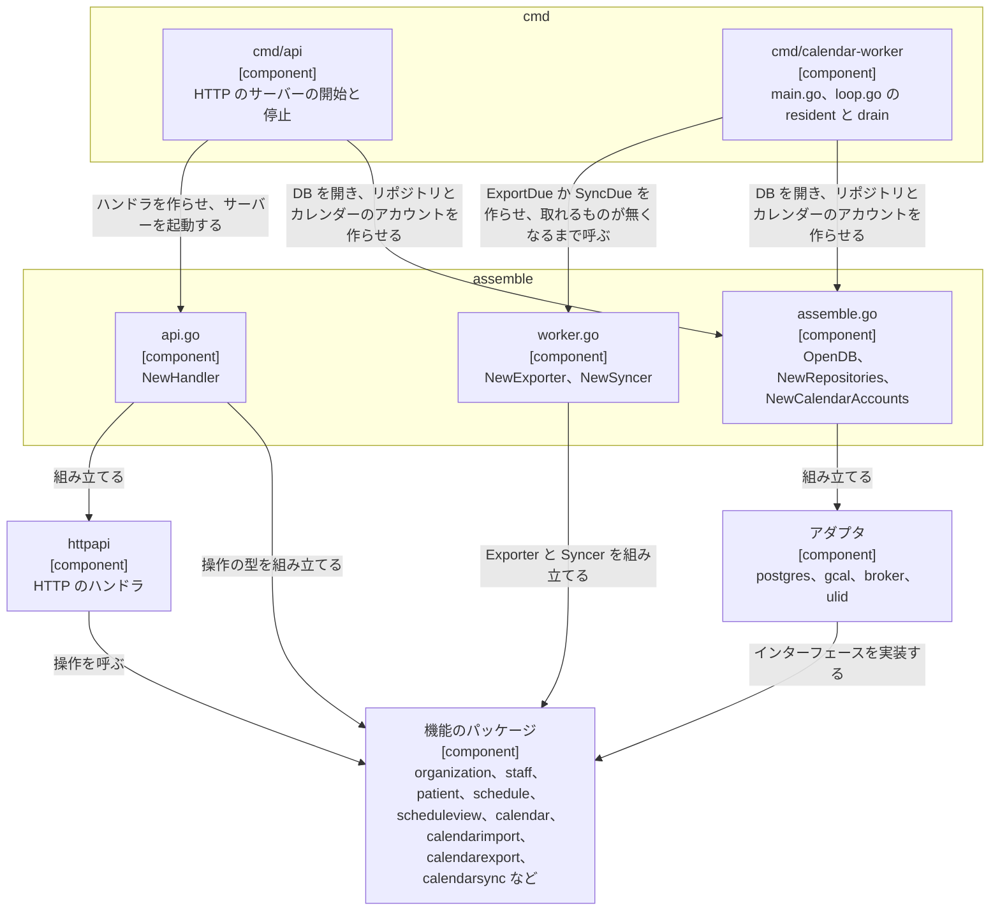
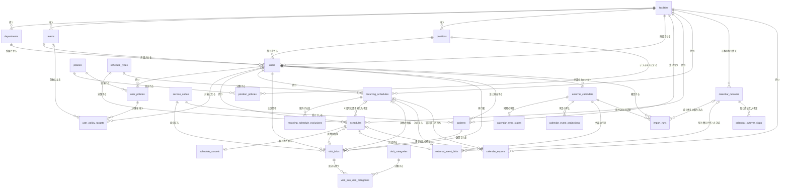
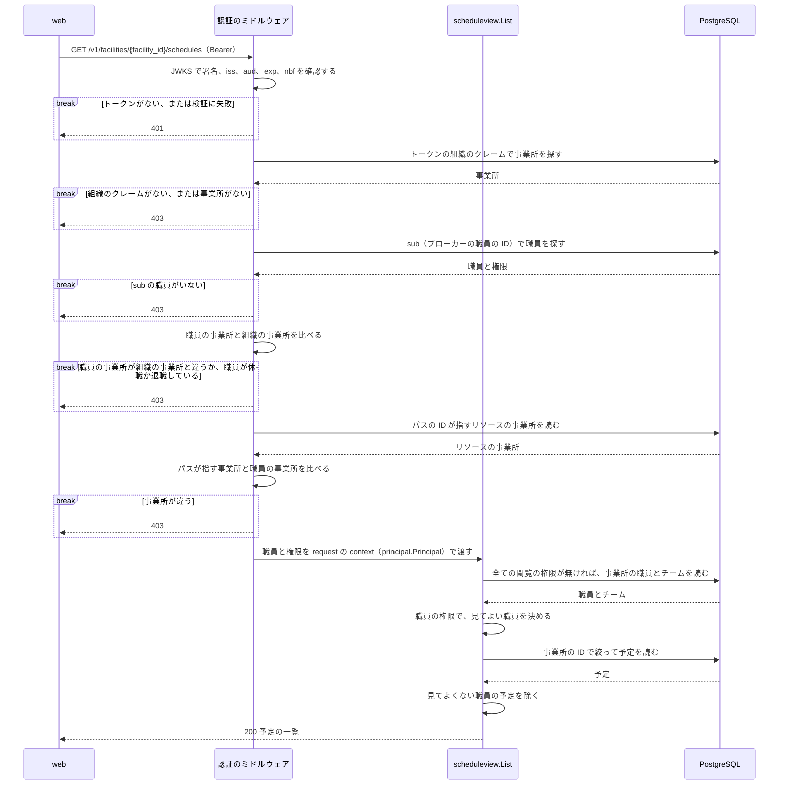

| 503 | `google_write_unknown`、`google_unavailable` | `google_primary` の事業所で、Google が書き込みを受けたかが分からないか、一時的に拒んだ | [Google カレンダーとの連携の Design Doc の Google カレンダーへの書き込み](https://github.com/Fukuemon/buddy/blob/develop/services/schedule/internal/features/calendar/DesignDoc.md#google-カレンダーへの書き込み) |
| 409 | `calendar_not_linked`、`google_write_pending`、`google_event_changed`、`google_event_not_found`、`google_calendar_unwritable`、`google_event_rejected` | `google_primary` の事業所で、予定を Google カレンダーに書けない原因 | [Google カレンダーとの連携の Design Doc の Google カレンダーへの書き込み](https://github.com/Fukuemon/buddy/blob/develop/services/schedule/internal/features/calendar/DesignDoc.md#google-カレンダーへの書き込み) |
---
type: feature-design
title: 予定の管理
description: 予定の API のコードの構成、テーブルの構成（ER）、認証から事業所の確認までの流れ、繰り返しの予定、予定の変更とキャンセル。職員の管理、権限、Google カレンダーとの連携は別の Design Doc にある
status: stable
governs: services/schedule
verified_commit: 4e53ca5
---

# 予定の管理

## Overview

予定の API は、事業所ごとの予定、職員、利用者、権限を持ち、web に API で渡す。  
全体の中での責務と依存は [buddy Design Doc](https://github.com/Fukuemon/buddy/blob/develop/docs/design/DesignDoc.md) にある。

## Scope

持つもの

- 事業所、部署、チーム、役職と、職員、利用者
  - 職員の登録、休職、復職、退職の設計は [職員の管理の Design Doc](https://github.com/Fukuemon/buddy/blob/develop/services/schedule/internal/features/staff/DesignDoc.md) にある
- 権限、役職のデフォルトの権限、職員ごとの権限とその対象
  - 設計は [権限の Design Doc](https://github.com/Fukuemon/buddy/blob/develop/services/schedule/internal/access/DesignDoc.md) にある
- 単発の予定、繰り返しの予定と繰り返しの規則、予定のキャンセル
- 職員と Google カレンダーの結び付けと、Google カレンダーの予定の取り込み、buddy の予定の Google カレンダーへの書き出し、Google カレンダーの変更の buddy の予定への反映
  - 設計は [Google カレンダーとの連携の Design Doc](https://github.com/Fukuemon/buddy/blob/develop/services/schedule/internal/features/calendar/DesignDoc.md) にある
- 訪問の情報、サービスコード、訪問の区分
- access token の検証から事業所の確認までのミドルウェア

持たないもの

- 住所とエリア、訪問の順路、経営数値、月の稼働時間の集計の表
- ログインとパスワード。
  - ブローカーが持つ
- 照合の規則。
  - 照合の API が持つ

## Design

### コードの構成

パッケージの分け方は ADR-0018 と ADR-0023 で決めた。  
依存してよい向きは [コードベースの構造](https://github.com/Fukuemon/buddy/blob/develop/context/codebase.md) にある。

- ADR-0018: [予定の API を機能ごとのパッケージに分ける](https://github.com/Fukuemon/buddy/blob/develop/docs/adr/0018-schedule-api-packages.md)
- ADR-0023: [予定の書き込みのモデルを schedule に、読み取りのモデルを scheduleview に置く](https://github.com/Fukuemon/buddy/blob/develop/docs/adr/0023-schedule-write-read-models.md)

- `internal/features/` には、次の機能のパッケージを置く。
  - `organization`、`staff`、`servicecode`、`patient`、`visit`、`schedule`、`scheduleview`
  - Google カレンダーとの連携: `calendar`、`calendarimport`、`calendarsync`、`calendarexport`
- `internal/` の直下には、アダプタ（`httpapi`、`postgres`、`gcal`、`broker`、`ulid`）と共通のパッケージ（`apperr`、`tx`、`kernel`、`civil`）を置く。
  - `access`、`principal`、`config`、`assemble`、テストの `inmem` も、`internal/` の直下に置く。
- `assemble` は、リポジトリ、HTTP のハンドラ、書き出しの `Exporter`、同期の `Syncer` を組み立てる。
  - `cmd/api` は、`assemble` が作った値で、HTTP のサーバーを起動する。
  - ADR-0018: [予定の API を機能ごとのパッケージに分ける](https://github.com/Fukuemon/buddy/blob/develop/docs/adr/0018-schedule-api-packages.md)
  - `cmd/calendar-worker` は、`assemble` が作った `Exporter` の `ExportDue` か `Syncer` の `SyncDue` を、役割（`export`、`sync`）ごとのプロセスで、常駐か 1 回の形で繰り返し呼ぶ。
    - 常駐も 1 回の形も、取れるものが無くなるまで呼ぶ。常駐は、その後に間隔を待つ。
    - `cmd/api` と同じイメージに入れ、HTTP のポートを持たない。
    - ADR-0029: [Google カレンダーの書き出しと同期を、予定の API と同じイメージの Worker のコマンドで役割ごとに動かし、繰り返しを Worker のコマンドに集める](https://github.com/Fukuemon/buddy/blob/develop/docs/adr/0029-calendar-worker.md)

次の図は、2 つのコマンドが `assemble` を通して機能のパッケージとアダプタを使う構成を示す。  
矢印は、呼ぶ向きか、組み立てる向きである。  
依存してよい向きの規則は、[コードベースの構造](https://github.com/Fukuemon/buddy/blob/develop/context/codebase.md) にある。

`kernel` は、ADR-0018 の「`apperr` と同じ段の小さなパッケージ」に当たる。  
`kernel.Finder[T]` は、ID で 1 件を読むメソッドを 1 つだけ持つインターフェースである。  
機能のパッケージは、ほかの機能のエンティティをこの形で受ける。  
同じ形のインターフェースを機能ごとに書かずに済ませるためである。

`access` は機能のパッケージではないので、型の名前を `Service` のままにし、`App` の名前と「1〜2 のメソッド」の規則の対象から外す。

### テーブルの構成

カラム、制約、インデックスは、マイグレーションから生成した[テーブル定義書](https://github.com/Fukuemon/buddy/blob/develop/docs/db/schedule/README.md)にある。  
DB は PostgreSQL 18 で、マイグレーションの作り方は ADR-0019 で決めた。  
テーブルとカラムの説明は、マイグレーションの `COMMENT ON` に書く。

- ADR-0019: [予定の API の DB を PostgreSQL にし、見直したテーブルでマイグレーションを作り直す](https://github.com/Fukuemon/buddy/blob/develop/docs/adr/0019-schedule-api-postgresql.md)

次の図は、予定の API の全てのテーブルと、その間の関係を示す。

#### 全てのテーブルの規則

- 事業所の中のレコードを指す外部キーは、`(facility_id, id)` の組で指す。
  - 別の事業所の職員や利用者を指すレコードは、アプリの確認に加えて DB も拒む。
- 外部キーのカラムには、引く向きに使うものにインデックスを置く。
  - 行を消さない固定のマスタ（権限、サービスコード、訪問の区分、予定の種類）を指すカラムには置かない。
- 名前のカラムはデフォルトの決定的な照合順序のままにし、完全に一致する値だけを同じとみなす。
  - 清音と濁音、全角と半角、大文字と小文字は別の名前である。メモリ上のリポジトリ（`inmem`）も同じ比べ方をする。
- 名前の付いた CHECK と一意の制約は `<テーブル>_<意味>_{key,fkey,check}` の名前にする。
- 監査の日時は UTC で読み、レスポンスはマイクロ秒までの RFC 3339 の形で返す。

#### 予定のカラム

予定の日付と時刻は、事業所の現地の時刻として `date` と `time` で持つ。  
予定と繰り返しの予定の `date` は開始の日で、翌日に終わる予定は `ends_next_day` を true にする。  
日付で絞る一覧、インデックス（`facility_id`、`date`、`start_time`）、繰り返しの規則は、開始の日のまま使う。

- ADR-0030: [日をまたぐ予定を、開始の日の予定に「終了が翌日か」の印を付けて持つ](https://github.com/Fukuemon/buddy/blob/develop/docs/adr/0030-overnight-schedule.md)

時刻の CHECK は、`ends_next_day` が false なら `start_time < end_time` を、true なら `end_time < start_time` を求める。  
開始と終了の時刻が同じ予定は、どちらでも拒む。

予定の種類の規則（通常はタイトルが必須、訪問は訪問の情報が必須）は、`schedule_types.code`（`normal`、`visit`）で読む。  
`name` は表示と一覧の絞り込みに使う。

`is_over_time_work` は、開始の時刻から DB が生成するカラムで、書き込みには含めない。

#### 事業所と組織のカラム

`departments`、`teams`、`positions` は事業所ごとに持つ。  
名前が同じ部署でも、事業所が違えば別のレコードにする。  
事業所の間で部署を共有すると、事業所が部署の名前を変えたときにほかの事業所に波及するためである。

`facilities.org_id` は、ID ブローカーの組織の ID を持つ。  
NULL を許し、値があれば一意にする。  
認証のミドルウェアは、トークンの組織のクレームでこのカラムを探す。

`facilities.source_mode` は、予定の正本のモード（`google_primary` か `buddy_primary`）を持つ。  
マイグレーションで足したときに今ある事業所を `buddy_primary` にし、後から足す事業所のデフォルトを `google_primary` にする。  
値による書き込みの制限は [事業所の正本のモードと予定の書き込み](#事業所の正本のモードと予定の書き込み) にある。

- ADR-0026: [Google カレンダーとの連携を、事業所ごとの正本のモードで分ける](https://github.com/Fukuemon/buddy/blob/develop/docs/adr/0026-google-calendar-sync.md)

`teams.color` は、チームの色を持つ。  
値と選び方は [チームの色](#チームの色) にある。

#### 職員のカラム

`users.sub` は、ブローカーの職員の ID を持つ。  
職員の登録のときにブローカーが発行した値を入れ、全ての事業所を通じて一意にする。

`users.email` は、事業所の中で一意にする（`facility_id` と `email` の組）。  
ブローカーは職員のメールを全ての事業所で一意にするので、ほかの事業所と重なるメールの登録はブローカーが拒む。  
予定の API は、メールを小文字にそろえてから保存し、比べる。  
そろえ忘れた書き込みは CHECK が拒む。

`users.username` は表示名で、一意にしない。

休職と退職の状態は、`users.leave_started_at`、`users.leave_return_date`、`users.retired_at` の 3 つのカラムで持つ。  
どれも、その状態でなければ NULL である。  
職員の状態ごとの、3 つのカラムと `email`、`phone_number` の値は次のとおり。

| 状態 | `leave_started_at` | `leave_return_date` | `retired_at` | `email` | `phone_number` |
| --- | --- | --- | --- | --- | --- |
| 有効 | NULL | NULL | NULL | 値を持つ | 値か NULL |
| 休職 | 職員を休職にした時刻 | 戻る予定の日のメモか NULL | NULL | 値を持つ | 値か NULL |
| 退職 | NULL | NULL | 退職にした時刻 | NULL | NULL |

休職と退職にし直しても、最初の時刻を残す。  
退職した職員は、`email` と `phone_number` が NULL で、休職の 2 つのカラムも NULL である。  
CHECK がこの組み合わせを確認する。

#### マスタのカラム

サービスコードの提供時間の範囲は、照合の許容範囲と同じ値にする。

`policies` のレコードは、API では作らない。  
認可は `code` で権限を読むので、レコードが環境ごとに違うと判定がずれるためである。

#### Google カレンダーのカラム

外部の予定のタイトルと本文は、利用者の名前を含むので保存しない。

カレンダーを外すときは行を消さずに `external_calendars.disabled_at` を入れ、外部の予定との対応を残す。  
結び付け直して同じ期間を取り込んでも、予定が重ならないためである。  
外していないカレンダーは、職員ごとに 1 つにする（部分の一意のインデックス）。

### チームの色

チームは、職員と利用者の一覧と、カレンダーの職員の絞り込みの見出しで、名前の横の点の色を持つ。  
部署は色を持たない。  
`teams.color` には、色のコードではなく、デザインシステムのチームの色のトークンの名前（`team-` の後ろ）を入れる。  
色の値を API に持たせると、デザインシステムで色を直したときに、全てのチームのレコードを書き換えることになるためである。

値は次の 8 つで、表の順は、色を省いて作ったチームに選ぶ順である。  
CHECK が 8 つ以外を拒み、API は 400 を返す。

| 順 | 値 |
| --- | --- |
| 1 | `blue` |
| 2 | `orange` |
| 3 | `magenta` |
| 4 | `cyan` |
| 5 | `yellow` |
| 6 | `purple` |
| 7 | `green` |
| 8 | `lime` |

- 同じ事業所のチームの色は重なってよい。
  - チームが 9 個を超えると、8 色では分けられないためである。
- チームを作る（`POST /v1/facilities/{facility_id}/teams`）ときに色を省くと、事業所のチームが使っているチームが最も少ない色を、同じ数なら表の順の先の色を入れる。
  - 事業所でまだ使っていない色があれば、その先頭になる。
- チームの名前と色は `PUT /v1/teams/{team_id}` で変える。
  - `staff.manage` を持つ職員だけが呼べる。
- 色を足す前からあるチームには、マイグレーションで、事業所ごとに名前の順で表の順に入れた。
  - 9 個目からは表の先頭に戻る。
- 色の選び方とコントラストは、[デザインシステム](https://github.com/Fukuemon/buddy/blob/develop/packages/ui/DESIGN.md) のチームの色にある。

### 権限のレコード

権限のレコード、照合の権限を足したマイグレーション、職員ごとの権限の足し外しは、[権限の Design Doc の権限のレコード](https://github.com/Fukuemon/buddy/blob/develop/services/schedule/internal/access/DesignDoc.md#権限のレコード) にある。

### 認証から事業所の確認までの流れ

次の図は、web が予定の一覧を求めたときに、予定の API が職員を特定し、事業所を確認し、権限で予定を絞るまでの流れを示す。

- `/v1` の全ての API は、`Authorization: Bearer` の access token を求める。
- 署名のアルゴリズムは RS256 と ES256 だけを受け付ける。
- JWKS は、起動のときに discovery の文書から場所を読み、1 時間ごとに取り直す。
  - 読んだ JWKS に無い `kid` のトークンが来たときも取り直すが、間隔は 1 分以上あける。
- トークンが無いときは `WWW-Authenticate: Bearer` を、検証に失敗したときは `WWW-Authenticate: Bearer error="invalid_token"` を付けて、401 を返す。

ミドルウェアは、パスの引数ごとに、指すリソースの事業所を職員の事業所と比べる。  
パスの引数ごとの、事業所の確認の仕方は次のとおり。

| 引数 | 指すもの | 事業所の確認の仕方 |
| --- | --- | --- |
| `facility_id` | 事業所 | 値をそのまま職員の事業所と比べる |
| `department_id`、`team_id`、`position_id`、`user_id`、`patient_id` | 組織、職員、利用者 | リソースを読んでその事業所と比べる |
| `schedule_id`、`recurring_schedule_id`、`external_calendar_id`、`calendar_export_id` | 予定とカレンダー | リソースを読んでその事業所と比べる |
| `policy_id` | 権限 | 事業所に属さないので確認しない |
| `user_policy_id` | 職員の権限 | 同じパスの `user_id` で事業所を確認し、`staff` の `RemoveGrant` が職員の権限かを確認する |

表に無い引数を持つパスは、事業所を確認できないので 500 を返す。

- パスの ID が ULID でないときと、リソースが見つからないときは、ミドルウェアは通す。
  - ULID でない ID は次のミドルウェアが 400 を返し、見つからないリソースはハンドラが 404 を返す。
- `/v1` のリクエストは、次の順に確認する。
  - 先に失敗した段のレスポンスを返すので、トークンの 401 と事業所の 403 は、パスの ID と定義の 400 より先に返る。
  1. Origin を許すか（403）。
     - `CORS_ALLOW_ORIGINS` を設定したときだけ適用する。規則は [Interface](#interface) の CORS にある
  2. クエリを読めるか（400）。`/v1` 以外のパスにも適用する
  3. トークン（401）と、職員と組織の事業所（403）
  4. パスが指す事業所（403）
  5. パスの ID が ULID か（400）
  6. リクエストが `openapi.yaml` の定義に合うか（400）

### 職員の管理

職員の登録、休職、復職、退職の手順と、休職と退職の前の残る一覧は、[職員の管理の Design Doc の職員の登録、休職、復職、退職](https://github.com/Fukuemon/buddy/blob/develop/services/schedule/internal/features/staff/DesignDoc.md#職員の登録休職復職退職) にある。

### 利用者の変更、利用の終了、利用の再開

利用者の変更は `PUT /v1/patients/{patient_id}`、利用の終了と利用の再開は `POST /v1/patients/{patient_id}/` の下の `end_service` と `resume_service` で行う。  
どれも、`patient` の操作が職員の管理の権限を確認してから行う。  
利用の終了の規則は [利用者](https://github.com/Fukuemon/buddy/blob/develop/context/domain/patient.md) にある。

利用者の変更は、名前、希望、サービスコード、担当の職員を本文の値に置き換え、部分の更新は持たない。  
利用の終了の利用者も変えられる。  
利用の終了は戻せる状態で、利用の終了の利用者のレコードも名前とサービスを残して読まれ続ける。  
名前の誤りを直すために、再開と終了をやり直させないためである。

担当の職員を変えないときは、今の担当が休職か退職でも 400 にしない。  
予定に既に割り振った職員を、職員を変えずに保存できるのと同じ扱いにし、担当の職員の休職と退職で、名前やサービスの変更ができなくならないようにするためである。  
担当を別の職員に変えるときは、予定の作成と同じく、事業所の行に共有のロックを取ってから職員の状態を読む。

利用の終了と利用の再開は、事業所の行に排他のロックを取ってから利用者を読み直す。  
このロックは、職員の休職と退職と同じロック（`patient.FacilityLock` の `Lock`、`postgres.FacilityRepository`）である。  
利用の終了は、ロックの後にその日以降の予定を数える。  
予定の作成は共有のロックを取ってから利用者を読むので、数えた後に、利用の終了の利用者へ予定ができることは無い。  
残る予定があれば、書かずに 409（`patient_has_schedules`）で残る一覧を返す。  
一覧は `PatientSchedules` の形にする。

利用の再開は、担当の職員の状態を同じロックの中で読む。  
職員の退職の確認と行き違わず、退職した職員が利用中の利用者の担当に残らない。

利用の終了を確定する前の残る一覧は、`GET /v1/patients/{patient_id}/remaining_schedules` で返す。  
何も書かない。  
一覧は、利用の終了と同じ `patient` の関数（`remaining`）で作り、同じ規則の一覧を同じ形（`PatientSchedules`）で返す。

利用者を 1 人読むのは `GET /v1/patients/{patient_id}` で、利用の終了の利用者も `ended_at` と一緒に返す。  
2 つの読み取りも、`patient` の操作が職員の管理の権限を確認してから行う。  
ほかの事業所の利用者は、職員と同じく、ミドルウェアがパスの `patient_id` の事業所で 403 にする。

利用の終了の利用者は、`patients.ended_at` に利用の終了にした時刻を持つ。  
利用の再開で NULL に戻す。

職員の退職の確認と、休職、退職、`remaining_assignments` が返す担当の利用者は、利用の終了の利用者を数えない。  
休職の一覧に、退職の確認が数えない利用者を出すと、管理者が割り振り直さなくてよい利用者まで割り振り直すためである。  
3 つは同じクエリ（`ListStaffAssignedPatients`）で一覧を作る。

- ADR-0004: [職員の停止を、戻せる休職と、戻せない退職に分ける](https://github.com/Fukuemon/buddy/blob/develop/docs/adr/0004-staff-leave-and-retirement.md)
- ADR-0005: [利用者を、戻せる利用の終了にでき、終了の利用者を予定の候補と職員の退職の確認から外す](https://github.com/Fukuemon/buddy/blob/develop/docs/adr/0005-patient-service-end.md)

### 予定の認可

予定の操作と、職員の管理の権限で判定する操作は、[権限の Design Doc の予定の認可](https://github.com/Fukuemon/buddy/blob/develop/services/schedule/internal/access/DesignDoc.md#予定の認可) にある。

### 繰り返しの予定

- 繰り返しの予定は、最初の回の日付（`recurring_schedules.date`）と、同じレコードの規則のカラム（`frequency` から `end_date`）で回を決める。
  - 頻度ごとのカラムの組み合わせは CHECK で確認する。
- 繰り返しの規則は次の 3 つ。
  - `weekly`: `day_of_week` の曜日ごと
  - `monthly` で `day_of_month` がある: 毎月のその日。その日がない月は回にしない
  - `monthly` で `week_of_month` と `day_of_week` がある: 毎月の n 回目のその曜日。
    - n は日から `(日 - 1) / 7 + 1` で決め、1 から 5 を受ける。5 回目のない月は回にしない
- 繰り返しの 1 回だけを変えるときは、その日を `recurring_schedule_exclusions` に足し、`recurring_schedule_id` と元の回の日付（`original_date`）で元を指す単発の予定を作る。
  - 2 つのカラムは組で持ち、同じ回は 1 度だけ置き換えられる（一意の制約）。
- 予定の一覧の API は、単発の予定と繰り返しの予定を別々に返す。
  - 繰り返しの予定を期間の回に展開しない。
  - `date_from` と `date_to` は単発の予定だけを、予定の日付で絞る。
  - `date_from` の前の日に始まり、`ends_next_day` が true の単発の予定も返す。期間の初日に、前の日の夜から続く予定があるためである。
- 繰り返しの予定の `ends_next_day` は、全ての回に当たる。
  - 回の置き換えで作った単発の予定は、自分の `ends_next_day` を持つ。

### 予定の変更

単発の予定の変更は、予定の枠を本文の内容に置き換え、部分の更新は持たない。  
画面のフォームは予定の全ての項目を送るためである。

変更は、最初に予定のレコードに排他のロックを取る。  
読んだ後の訪問の情報とキャンセルの有無が、同時の変更とキャンセルで食い違わないためである。  
同時の変更は、後に来た方の内容になる。  
キャンセルも、同じロックを取ってから予定を読む。  
繰り返しの回の置き換えは、最初に繰り返しの予定のレコードに排他のロックを取ってから、権限と回の日付を確認する。

ロックを取って読む予定（`GetForUpdate`）は、書き込みのモデル（`schedule.Stored`、`schedule.StoredRecurring`）である。  
書き込みのモデルは、予定の枠、訪問の情報の ID、キャンセルの有無、更新の番号を持ち、種類、職員、訪問の情報の名前を結合しない。  
名前を結合した予定（`scheduleview.Detail`、`scheduleview.RecurringDetail`）は、`scheduleview` だけが読み取りのモデルとして返す。

- ADR-0023: [予定の書き込みのモデルを schedule に、読み取りのモデルを scheduleview に置く](https://github.com/Fukuemon/buddy/blob/develop/docs/adr/0023-schedule-write-read-models.md)

予定の作成、変更、繰り返しの予定の作成、回の置き換えの操作は、書いた予定を名前を結合しない形（`schedule.Schedule`、`schedule.RecurringSchedule`）で返す。  
`httpapi` は、書いたトランザクションを終えた後に、`scheduleview` の `Get` か `GetRecurring` で予定を読み直し、レスポンスを作る。  
書き込みと読み出しは別のトランザクションになる。

### 事業所の正本のモードと予定の書き込み

予定の API が buddy の予定のテーブルに予定を書けるのは、予定の正本のモードが `buddy_primary` の事業所だけである。  
予定の作成、変更、キャンセル、繰り返しの予定の作成、回の置き換えの 5 つの操作は、トランザクションの中で事業所の行を共有のロックで読む（`schedule.FacilityLock` の `GetForShare`）。  
読んだ事業所のモードは、`schedule.RequireWritable` で確認する。  
`google_primary` の事業所では、何も書かずに 409（`google_primary`）を返す。  
Google カレンダーの手動の取り込みの確定も、同じ規則で拒む（[Google カレンダーとの連携の Design Doc](https://github.com/Fukuemon/buddy/blob/develop/services/schedule/internal/features/calendar/DesignDoc.md#google-カレンダーの取り込み)）。  
例外として、`open` の予定の正本の切り替えがある `google_primary` の事業所では、切り替えの取り込みだけを書ける（`calendarimport` の `requireImportable`）。  
`google_primary` の事業所の単発の予定の作成、変更、キャンセルは、`httpapi` が `schedule` でなく `calendarwrite` を呼び、Google カレンダーに書く。  
手順は [Google カレンダーとの連携の Design Doc の Google カレンダーへの書き込み](https://github.com/Fukuemon/buddy/blob/develop/services/schedule/internal/features/calendar/DesignDoc.md#google-カレンダーへの書き込み) にある。  
切り替えの手順は [Google カレンダーとの連携の Design Doc の予定の正本の切り替え](https://github.com/Fukuemon/buddy/blob/develop/services/schedule/internal/features/calendar/DesignDoc.md#予定の正本の切り替え) にある。

ロックは、事業所が決まった時点で最初に取る。  
予定の作成と繰り返しの予定の作成は、パスの事業所の行のロックから始める。  
予定の変更、キャンセル、回の置き換えは、予定か繰り返しの予定の行を排他のロックで読んでから、その事業所の行を共有のロックで読む。  
予定の行から事業所が決まるので、予定の行、事業所の行の順にする。  
モードを切り替える切り替えの完了は、ADR-0023 のとおり事業所の行に排他のロックを取るので、確認した後に書き終えるまでモードは変わらない。

- ADR-0023: [予定の書き込みのモデルを schedule に、読み取りのモデルを scheduleview に置く](https://github.com/Fukuemon/buddy/blob/develop/docs/adr/0023-schedule-write-read-models.md)

### 予定の一覧の読み元

予定の一覧（`scheduleview.List`、`listSchedules`）は、事業所の予定の正本のモードで読み元を選ぶ。  
`buddy_primary` の事業所では、buddy の予定のテーブルを読む。  
`google_primary` の事業所では、同期が写した Google カレンダーの予定（Projection、`calendar_event_projections`）を読む。  
どちらの読み元でも `scheduleview.Detail` の同じ型で返すので、画面と照合は読み元を知らずに予定を出せる。  
予定には読み元（`source`）を付け、画面は `google_calendar` の予定に変更の操作を出さない。

- ADR-0023: [予定の書き込みのモデルを schedule に、読み取りのモデルを scheduleview に置く](https://github.com/Fukuemon/buddy/blob/develop/docs/adr/0023-schedule-write-read-models.md)

`google_primary` の事業所の一覧は、次の順で Projection を読む。

1. 読む期間を決める。
   - `date_from` と `date_to` を使い、省いた端は、Projection を保持する期間（前々月の初日から 3 か月後の月末）の端にする。
2. 事業所の外していないカレンダーの行のうち、期間の初日の前の日より前に終わった行を除いて読む（`scheduleview.Projections` の `ListByFacility`）。
   - 外したカレンダーの行は読まない。退職はカレンダーを外すので、退職した職員の行もこれで除く。
3. 行の職員（写した時点のカレンダーの職員）を予定の職員とみなし、buddy の予定と同じ閲覧の判定（`schedule.Readable`）で絞る。
   - 行の事業所が一覧の事業所と違う行も除く。
4. 行を、取り込みと同じ読み替えの規則（`calendar.Classify`）で、buddy の予定の日付と時刻に読み替える。
   - 読み替えの規則は `calendar` にあり、`scheduleview` は `calendar` を import できない。組み立ての場所が、`calendar.ProjectionRules` を `scheduleview.EventRules` として渡す。
   - 終日の予定、日をまたぐ予定、時刻を読めない予定、長さが 0 以下の予定は、取り込みと同じく一覧に出さない。
5. 繰り返しの親の行は、取り込みと同じ規則（`calendar.RuleFromRecurrence`）で buddy の繰り返しの規則に写し、期間の回に展開する。
   - 除外する日（EXDATE）と、例外の回が置き換えた元の日の回は作らない。
   - 変えた回は、例外の回の行を単発の予定と同じく読み替える。取り消した回は出さない。
   - 規則に写せない親は、回に展開せず、最初の回の日時の 1 件にして、確認が必要な理由（`recurrence_unsupported`）を付ける。最初の回が期間の外でも、回が期間に重なりうるなら返す。
6. 訪問のタイトルの予定は、タイトルのサービス内容と利用者名で、サービスコードのマスタと事業所の利用者（利用の終了を除く）を引く。
   - 引けた予定は、利用者とサービスコードの訪問の情報を付けた訪問の予定にする。主訪問者は予定の職員にし、同行者と訪問の区分は付けない。
   - 引けない予定は、訪問の情報を付けず、Google のタイトルの通常の予定にして、理由（`service_code_not_found`、`patient_not_found`、`patient_ambiguous`）を付ける。タイトルを読めない予定には `title_unreadable` を付ける。
7. 期間で絞った予定を `sort_field` と `sort_order` の順に並べ、カレンダーごとの同期の状況（`calendar_syncs`）を付けて返す。
   - 同期の状況も、閲覧の判定で見てよい職員のカレンダーに絞る。

Projection の予定の `id` は、ULID の形の値で、一覧を読むたびに同じになる。  
buddy から書いた予定と buddy で変えた予定は、予定の API が書いた記録の予定の ID にし、ほかの予定はカレンダー、Google の予定の ID、回の日付から作る。  
単発の予定は、`getSchedule`（`scheduleview.GetProjected`）でこの `id` の 1 件を読める。  
決め方は [Google カレンダーとの連携の Design Doc の Projection の予定の ID](https://github.com/Fukuemon/buddy/blob/develop/services/schedule/internal/features/calendar/DesignDoc.md#projection-の予定の-id) にある。

一覧の応答は、事業所の正本のモード（`source_mode`）と、カレンダーごとの同期の状況（`calendar_syncs`）を持つ。  
同期の状況は、最後の結果、変わった予定を最後まで読んで写した最後の同期の時刻、最後の失敗の理由を持つ。  
最新でないとみなす時間は、画面が決める。  
`google_primary` の事業所の応答は、`open` の予定の正本の切り替え（`cutover`）も持つ。  
画面は「切り替え中」の表示を出す。  
切り替えの間も、一覧は Projection を読み、切り替えの取り込みで作った buddy の予定を読まない。

### 休職と退職の職員と、訪問しない職員への割り振り

予定の作成、予定の変更、繰り返しの予定の作成、繰り返しの回の置き換え、利用者の登録が、休職と退職の職員と、訪問しない職員への新しい割り振りを 400 で拒む規則は、[職員とログイン](https://github.com/Fukuemon/buddy/blob/develop/context/domain/staff-login.md) にある。

- 予定と繰り返しの予定に既に割り振った職員は、休職か退職か訪問しない職員でも、同じ役割のまま保存できる。
  - 予定の変更では元の予定の職員を、回の置き換えでは繰り返しの予定の職員を、役割ごとに比べる。同行者を主訪問者に移すのは、新しい割り振りである。
  - 退職した職員は、保存した後の日付が今日（事業所の現地の日付）より前の予定でだけ、割り振ったまま保存できる。
    - 退職は今日以降の予定が残ると拒むので、退職した職員の予定を今日以降に動かすと、誰も行かない予定が残るためである。

職員の状態を読む前に、`schedule.FacilityLock` の `GetForShare`（`postgres.FacilityRepository`）で事業所の行に共有のロックを取る。  
休職、復職、退職は、同じ行に排他のロックを取ってから職員を読み直す（[職員の管理の Design Doc の職員の登録、休職、復職、退職](https://github.com/Fukuemon/buddy/blob/develop/services/schedule/internal/features/staff/DesignDoc.md#職員の登録休職復職退職)）。  
そのため、割り振りと退職のどちらかが、もう片方のコミットを待ってから読む。  
退職の残る予定の確認の後に、退職した職員へ予定ができることは無い。  
訪問しない職員への変更も、職員の変更と同じく事業所の行に排他のロックを取ってから残る予定を数えるので、確認の後に訪問しない職員へ予定ができることは無い。  
割り振りどうしは、共有のロックなので互いを待たない。

Google カレンダーの取り込みの確定、同期の予定ごとのトランザクション、カレンダーの結び付けも、職員の状態かカレンダーを外したかを読む前に、同じ共有のロックを取る。  
そのため、退職がカレンダーを外した後に、退職した職員へ予定を取り込むことと、同期で外部の変更を参照のモデル（Projection）に写すことは無い。  
取り込みと同期での休職の職員の扱いは、[Google カレンダーの取り込み](https://github.com/Fukuemon/buddy/blob/develop/services/schedule/internal/features/calendar/DesignDoc.md#google-カレンダーの取り込み) と [Google カレンダーとの同期](https://github.com/Fukuemon/buddy/blob/develop/services/schedule/internal/features/calendar/DesignDoc.md#google-カレンダーとの同期) にある。

- ADR-0004: [職員の停止を、戻せる休職と、戻せない退職に分ける](https://github.com/Fukuemon/buddy/blob/develop/docs/adr/0004-staff-leave-and-retirement.md)

### 利用の終了の利用者への予定

予定の作成、予定の変更、繰り返しの予定の作成、繰り返しの回の置き換えは、利用の終了の利用者を予定の利用者に新しく指すと 400 で拒む。

- 確認は、訪問の情報を書く `visit.Writer` が行う。
  - `visit.Input.KeptPatientID` は、利用の終了のまま保存してよい利用者である。
  - `schedule` の操作は、保存した後の日付が今日より前の予定でだけ、元の予定か繰り返しの予定の利用者を `KeptPatientID` に入れる。退職した職員と同じく、利用の終了の利用者に今日以降の予定を残さないためである。
  - 取り込みがタイトルの利用者名で利用者を探すときは、利用中の利用者だけから探す。利用の終了の利用者の名前の予定は、利用者を 1 人に決められない予定として扱う。
- 利用者の状態は、予定の作成と同じ共有のロックを取った後に読む（[利用者の変更、利用の終了、利用の再開](#利用者の変更利用の終了利用の再開)）。

### キャンセル

予定をキャンセルすると、`schedule_cancels` に理由とともに 1 レコードを足す。  
キャンセルした予定は、API のレスポンスの `cancel` に理由を持つ。

予定のカレンダーは、職員が「キャンセルした予定を出す」を選んだときだけ、キャンセルした予定を出す。  
予定の詳細は、キャンセルの理由を出し、編集へ進ませない。  
予定の編集は、キャンセルした予定のフォームを出さない。  
キャンセルした予定を変えると、予定の API が 409 で拒むためである。

### 予定の画面の読み込みと保存

予定のカレンダー、予定の詳細、予定の作成、予定の編集の画面が予定の API を読み書きする流れは、[予定の画面の Design Doc](https://github.com/Fukuemon/buddy/blob/develop/apps/web/src/features/schedule/DesignDoc.md) にある。

### Google カレンダーとの連携

事業所のサービスアカウントでの読み書き、Google カレンダーの取り込み、書き出し、同期、ローカル環境と E2E の Google カレンダーは、[Google カレンダーとの連携の Design Doc](https://github.com/Fukuemon/buddy/blob/develop/services/schedule/internal/features/calendar/DesignDoc.md) にある。

## Interface

- 事業所に属する一覧と作成のパスは `/v1/facilities/{facility_id}/<リソース>` の形にする。
  - 1 件を指すパスは `/v1/<リソース>/{<リソース>_id}` の形にする。
  - リソースごとにどのパスを持つかは `openapi.yaml` にある。
- 事業所に属さないマスタは `/v1/policies`、`/v1/schedule_types`、`/v1/visit_infos/service_codes`、`/v1/visit_infos/visit_categories` で読む。
- 一覧の並べ替えは、許可したカラムの名前だけを受け、それ以外は 400 を返す。
- `GET /v1/me` は、トークンの職員と権限を返す。
  - 画面は、ログインの後にこれを呼んで事業所を決める。

エラーは `{"code","message"}` の JSON で返す。  
エラーの status と `code` ごとの、返すときの条件は次のとおり。

| status | `code` | 返すときの条件 | 詳しい文書 |
| --- | --- | --- | --- |
| 400 | `invalid_input` | クエリを読めない、パスの ID が ULID でない、リクエストが `openapi.yaml` の定義に合わない、本文の値が規則に合わない、本文が指す参照が見つからないか別の事業所のもの | - |
| 400 | `invalid_input` | 休職か退職の職員か、訪問しない職員に、予定か担当を新しく割り振った | [休職と退職の職員と、訪問しない職員への割り振り](#休職と退職の職員と訪問しない職員への割り振り) |
| 400 | `invalid_input` | 利用の終了の利用者を、予定の利用者に新しく指した | [利用の終了の利用者への予定](#利用の終了の利用者への予定) |
| 401 | `unauthenticated` | トークンが無いか、検証に失敗した | [認証から事業所の確認までの流れ](#認証から事業所の確認までの流れ) |
| 403 | `forbidden` | 職員を特定できない、職員が休職か退職している、事業所が違う、権限で許されない | [認証から事業所の確認までの流れ](#認証から事業所の確認までの流れ) |
| 404 | `not_found` | パスで指したリソースが無い | - |
| 409 | `conflict` | 一意の値が重なる、キャンセル済みの予定を変えるかキャンセルする、繰り返しの回をすでに置き換えた | - |
| 409 | `conflict`（職員）、`staff_has_assignments` | 職員の管理で拒む原因 | [職員の管理の Design Doc の Interface](https://github.com/Fukuemon/buddy/blob/develop/services/schedule/internal/features/staff/DesignDoc.md#interface) |
| 409 | `patient_has_schedules` | 利用の終了にする利用者に、その日以降の予定か繰り返しの予定が残る。本文の `schedules` に残る一覧を持つ | [利用者の変更、利用の終了、利用の再開](#利用者の変更利用の終了利用の再開) |
| 409 | `calendar_taken`、`calendar_already_linked`、`staff_has_calendar` | カレンダーを結び付けられない原因 | [Google カレンダーとの連携の Design Doc](https://github.com/Fukuemon/buddy/blob/develop/services/schedule/internal/features/calendar/DesignDoc.md) |
| 409 | `import_running`、`import_preview_changed` | 取り込みを確定できない原因 | [Google カレンダーとの連携の Design Doc](https://github.com/Fukuemon/buddy/blob/develop/services/schedule/internal/features/calendar/DesignDoc.md) |
| 409 | `export_not_in_review` | 確認が必要な書き出しを解けない原因 | [Google カレンダーとの連携の Design Doc](https://github.com/Fukuemon/buddy/blob/develop/services/schedule/internal/features/calendar/DesignDoc.md) |
| 409 | `cutover_open`、`cutover_not_google_primary`、`cutover_sync_not_ready`、`cutover_not_open`、`cutover_incomplete` | 予定の正本の切り替えを始められないか、完了できないか、やめられない原因。`cutover_incomplete` は本文の `items` に満たさない一覧を持つ | [Google カレンダーとの連携の Design Doc の予定の正本の切り替え](https://github.com/Fukuemon/buddy/blob/develop/services/schedule/internal/features/calendar/DesignDoc.md#予定の正本の切り替え) |
| 409 | `google_primary` | Google カレンダーを予定の正本にする事業所で、単発の予定の作成、変更、キャンセルのほかの予定を書くか、切り替えの無いときに取り込もうとした | [事業所の正本のモードと予定の書き込み](#事業所の正本のモードと予定の書き込み) |
| 422 | `calendar_unreadable` | Google カレンダーが無いか、事業所のサービスアカウントに共有されていない | [Google カレンダーとの連携の Design Doc](https://github.com/Fukuemon/buddy/blob/develop/services/schedule/internal/features/calendar/DesignDoc.md) |
| 500 | `internal` | サーバーのエラー。ブローカーに届かないときも含む | - |
| 502 | `calendar_unavailable` | Google に届かないか、Google がエラーを返した | [Google カレンダーとの連携の Design Doc](https://github.com/Fukuemon/buddy/blob/develop/services/schedule/internal/features/calendar/DesignDoc.md) |
| 503 | `calendar_not_configured` | 事業所のサービスアカウントが設定されていない | [Google カレンダーとの連携の Design Doc](https://github.com/Fukuemon/buddy/blob/develop/services/schedule/internal/features/calendar/DesignDoc.md) |

- CORS は、`CORS_ALLOW_ORIGINS` に並べた Origin だけに許す。
  - 空なら CORS のヘッダーを返さない。
  - 許す Origin の事前のリクエストには、トークンを求めずに 204 を返す。許すメソッドは GET、POST、PUT、DELETE、OPTIONS、ヘッダーは `Content-Type` と `Authorization` にする。
  - 許さない Origin のリクエストは、本文を持たない 403 で止める。Origin がリクエストの Host と同じリクエストは、CORS のリクエストとして扱わずに通す。
- 環境変数とマイグレーションのコマンドは [README](https://github.com/Fukuemon/buddy/blob/develop/services/schedule/README.md) に、デプロイの要件は [buddy Design Doc のデプロイの要件](https://github.com/Fukuemon/buddy/blob/develop/docs/design/DesignDoc.md#デプロイの要件) にある。
