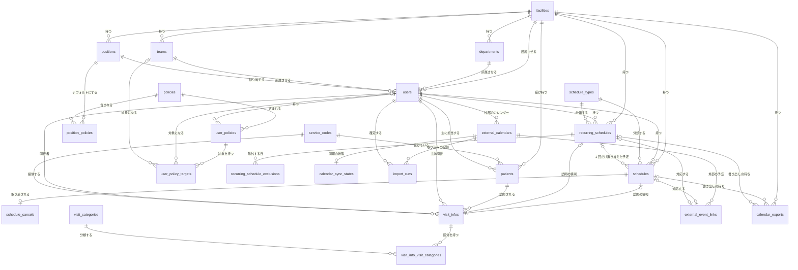
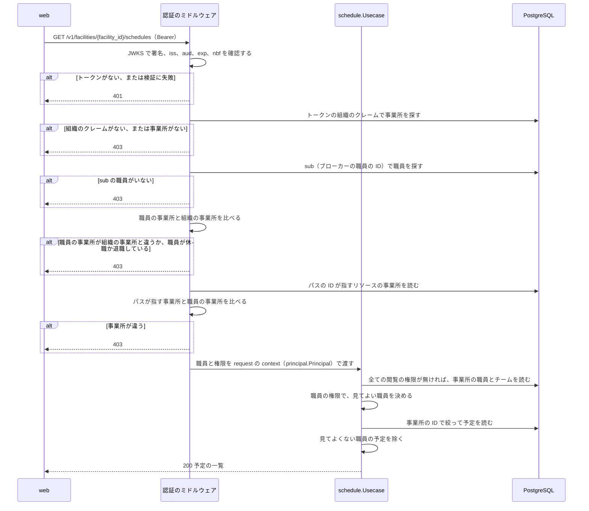

# 予定の管理

## Overview

予定の API は、事業所ごとの予定、職員、利用者、権限を持ち、web に API で渡す。  
全体の中での責務と依存は [buddy Design Doc](https://github.com/Fukuemon/buddy/blob/develop/docs/design/DesignDoc.md) にある。

## Scope

持つもの

- 事業所、部署、チーム、役職と、職員、利用者
- 権限、役職のデフォルトの権限、職員ごとの権限とその対象
- 単発の予定、繰り返しの予定と繰り返しの規則、予定のキャンセル
- 職員と Google カレンダーの結び付けと、Google カレンダーの予定の取り込み、buddy の予定の Google カレンダーへの書き出し、Google カレンダーの変更の buddy の予定への反映
  - 設計は [Google カレンダーとの連携の Design Doc](https://github.com/Fukuemon/buddy/blob/develop/services/schedule/internal/calendar/DesignDoc.md) にある
- 訪問の情報、サービスコード、訪問の区分
- access token の検証から事業所の確認までのミドルウェア

持たないもの

- 住所とエリア、訪問の順路、経営数値、月の稼働時間の集計の表
- ログインとパスワード。ブローカーが持つ
- 照合の規則。照合の API が持つ

## Design

### コードの構成

パッケージの分け方は ADR-0005 と ADR-0010 で決めた。  
依存してよい向きは [コードベースの構造](https://github.com/Fukuemon/buddy/blob/develop/context/codebase.md) にある。

- ADR-0005: [予定の API の規則と手順を機能ごとのパッケージにまとめる](https://github.com/Fukuemon/buddy/blob/develop/docs/adr/0005-schedule-api-packages.md)
- ADR-0010: [予定の API の機能のパッケージで、手順を usecase、規則を関数、リポジトリを集約の単位に分ける](https://github.com/Fukuemon/buddy/blob/develop/docs/adr/0010-schedule-api-usecase-boundaries.md)

- `kernel` は、ADR-0010 の「`apperr` と同じ段の小さなパッケージ」に当たる。
  - `kernel.Finder[T]` は、ID で 1 件を読むメソッドを 1 つだけ持つインターフェイスである。機能のパッケージは、ほかの機能のエンティティをこの形で受ける。同じ形のインターフェイスを機能ごとに書かずに済ませるためである。
- `access` は機能のパッケージではないので、型の名前を `Service` のままにし、`Usecase` への改名と「1〜2 のメソッド」の規則の対象から外す。

### テーブルの構成

カラム、制約、インデックスは、マイグレーションから生成した[テーブル定義書](https://github.com/Fukuemon/buddy/blob/develop/docs/db/schedule/README.md)にある。  
DB は PostgreSQL 18 で、マイグレーションの作り方は ADR-0011 で決めた。  
テーブルとカラムの説明は、マイグレーションの `COMMENT ON` に書く。

- ADR-0011: [予定の API の DB を PostgreSQL にし、見直したテーブルでマイグレーションを作り直す](https://github.com/Fukuemon/buddy/blob/develop/docs/adr/0011-schedule-api-postgresql.md)

次の図は、予定の API の全てのテーブルと、その間の関係を示す。

- 事業所の中のレコードを指す外部キーは、`(facility_id, id)` の組で指す。別の事業所の職員や利用者を指すレコードは、アプリの確認に加えて DB も拒む。
- 名前のカラムはデフォルトの決定的な照合順序のままにし、完全に一致する値だけを同じとみなす。清音と濁音、全角と半角、大文字と小文字は別の名前である。メモリ上のリポジトリ（`inmem`）も同じ比べ方をする。
- 予定の日付と時刻は、事業所の現地の時刻として `date` と `time` で持つ。
- 名前の付いた CHECK と一意の制約は `<テーブル>_<意味>_{key,fkey,check}` の名前にする。
- `departments`、`teams`、`positions` は事業所ごとに持つ。名前が同じ部署でも、事業所が違えば別のレコードにする。事業所の間で部署を共有すると、事業所が部署の名前を変えたときにほかの事業所に波及するためである。
- `facilities.org_id` は、ID ブローカーの組織の ID を持つ。NULL を許し、値があれば一意にする。認証のミドルウェアは、トークンの組織のクレームでこのカラムを探す。
- `users.sub` は、ブローカーの職員の ID を持つ。職員の登録のときにブローカーが発行した値を入れ、全ての事業所を通じて一意にする。
- `users.email` は、事業所の中で一意にする（`facility_id` と `email` の組）。
  - ブローカーは職員のメールを全ての事業所で一意にするので、ほかの事業所と重なるメールの登録はブローカーが拒む。
  - 予定の API は、メールを小文字にそろえてから保存し、比べる。そろえ忘れた書き込みは CHECK が拒む。
- `users.username` は表示名で、一意にしない。
- 休職と退職の状態は、次の 3 つのカラムで持つ。どれも、その状態でなければ NULL である。
  - `users.leave_started_at`: 職員を休職にした時刻
  - `users.leave_return_date`: 戻る予定の日のメモ
  - `users.retired_at`: 退職にした時刻
  - 休職と退職にし直しても、最初の時刻を残す。
  - 退職した職員は、`email` と `phone_number` が NULL で、休職の 2 つのカラムも NULL である。CHECK がこの組み合わせを確認する。
- 予定の種類の規則（通常はタイトルが必須、訪問は訪問の情報が必須）は、`schedule_types.code`（`normal`、`visit`）で読む。`name` は表示と一覧の絞り込みに使う。
- `is_over_time_work` は、開始の時刻から DB が生成するカラムである。書き込みには含めない。
- 外部キーのカラムには、引く向きに使うものにインデックスを置く。行を消さない固定のマスタ（権限、サービスコード、訪問の区分、予定の種類）を指すカラムには置かない。
- 監査の日時は UTC で読み、レスポンスはマイクロ秒までの RFC 3339 の形で返す。
- 外部の予定のタイトルと本文は、利用者の名前を含むので保存しない。
- カレンダーを外すときは行を消さずに `external_calendars.disabled_at` を入れ、外部の予定との対応を残す。結び付け直して同じ期間を取り込んでも、予定が重ならないためである。外していないカレンダーは、職員ごとに 1 つにする（部分の一意のインデックス）。
- サービスコードの提供時間の範囲は、照合の許容範囲と同じ値にする。
- `policies` のレコードは、API では作らない。認可は `code` で権限を読むので、レコードが環境ごとに違うと判定がずれるためである。

### 権限のレコード

`policies` は、PRD の 8 つの権限（予定の 7 つと職員の管理）を次の `code` で持つ。  
`needs_target` が true の権限は、対象の職員かチームを `user_policy_targets` に持つ。

| `code` | 権限 | `needs_target` |
| --- | --- | --- |
| `schedule.self.edit` | 自分の予定の編集 | false |
| `schedule.user.read` | 指定した職員の予定の閲覧 | true |
| `schedule.user.edit` | 指定した職員の予定の編集 | true |
| `schedule.team.read` | 指定したチームの職員の予定の閲覧 | true |
| `schedule.team.edit` | 指定したチームの職員の予定の編集 | true |
| `schedule.all.read` | 事業所の全ての予定の閲覧 | false |
| `schedule.all.edit` | 事業所の全ての予定の編集 | false |
| `staff.manage` | 職員の管理 | false |

役職のデフォルトの権限をコピーする規則、役職を変えたときにコピーし直す規則、`staff.manage` の扱いは [権限](https://github.com/Fukuemon/buddy/blob/develop/context/domain/permission.md) にある。  
職員の権限（`schedule.user.*`）は、コピーするときに対象を決められないので、役職のデフォルトの権限にできない。

- ADR-0002: [権限を役職のデフォルトと職員ごとの上書きで持つ（PBAC）](https://github.com/Fukuemon/buddy/blob/develop/docs/adr/0002-pbac.md)

職員の役職は `PUT /v1/users/{user_id}/position` で変える。  
職員の名前、電話番号、部署、チームは `PUT /v1/users/{user_id}` で変える。  
チームを変えると、同じトランザクションで、職員の権限のうち古いチームを指す対象を新しいチームに移す。  
ほかのチームの対象は残し、同じ権限が新しいチームを既に対象にしていれば、古いチームの対象を消す。

- 登録と役職の変更でコピーしたチームの対象は、所属のチームを指す。
- 一方で、[予定の認可](#予定の認可) は、保存した対象のチームと予定の職員の今のチームを比べるだけで、権限を持つ職員の所属のチームを読まない。
- 移さないと、異動した職員は古いチームの予定を見続け、新しいチームの予定を見られない。
- 職員ごとに足した権限の、古いチームを指す対象も移る。所属のチームのためにコピーした対象と、レコードで区別できないためである。

職員ごとに権限を足す（`POST /v1/users/{user_id}/policies`）ときは、`needs_target` が true の権限に、code に合わせて職員かチームの対象を 1 つ以上付ける。  
対象は同じ事業所のものに限る。  
外す（`DELETE /v1/users/{user_id}/policies/{user_policy_id}`）と、対象も消える。

事業所で `staff.manage` を持つ最後の有効な職員からその権限を外そうとしたときは、何も書かずに 409 を返す。  
権限を外す操作と、`staff.manage` を持たない役職に変える操作の両方が当たる。  
役職を変える操作と権限を外す操作は、休職と退職と同じく、`staff.Usecase` が事業所の行をロックしたトランザクションの中で、職員を読み直してから行う。  
同時に 2 人から外しても、後の操作は最後の有効な管理者を見つけて 409 になる。

- ADR-0006: [職員と利用者の登録と、職員の権限と役職を変える操作を、職員の管理の権限で許す](https://github.com/Fukuemon/buddy/blob/develop/docs/adr/0006-staff-manage-policy.md)

### 認証から事業所の確認までの流れ

次の図は、web が予定の一覧を求めたときに、予定の API が職員を特定し、事業所を確認し、権限で予定を絞るまでの流れを示す。

- `/v1` の全ての API は、`Authorization: Bearer` の access token を求める。
- 署名のアルゴリズムは RS256 と ES256 だけを受け付ける。JWKS は、起動のときに discovery の文書から場所を読み、1 時間ごとに取り直す。知らない `kid` のトークンが来たときも取り直すが、間隔は 1 分以上あける。
- トークンが無いときは `WWW-Authenticate: Bearer` を、検証に失敗したときは `WWW-Authenticate: Bearer error="invalid_token"` を付けて、401 を返す。
- ミドルウェアは、パスの引数ごとに、指すリソースの事業所を職員の事業所と比べる。
  - `facility_id` は、値をそのまま職員の事業所と比べる。
  - 次の引数は、リソースを読んでその事業所と比べる。`department_id`、`team_id`、`position_id`、`user_id`、`schedule_id`、`recurring_schedule_id`、`external_calendar_id`、`calendar_export_id`
  - `policy_id` は、事業所に属さないので確認しない。`user_policy_id` は、同じパスの `user_id` で事業所を確認し、`staff.Usecase` が職員の権限かを確認する。
  - この一覧に無い引数を持つパスは、事業所を確認できないので 500 を返す。
- パスの ID が ULID でないときと、リソースが見つからないときは、ミドルウェアは通す。ULID でない ID は次のミドルウェアが 400 を返し、見つからないリソースはハンドラが 404 を返す。
- `/v1` のリクエストは、次の順に確認する。先に失敗した段のレスポンスを返すので、トークンの 401 と事業所の 403 は、パスの ID と定義の 400 より先に返る。
  1. Origin を許すか（403）。`CORS_ALLOW_ORIGINS` を設定したときだけ適用する。規則は [Interface](#interface) の CORS にある
  2. クエリを読めるか（400）。`/v1` 以外のパスにも適用する
  3. トークン（401）と、職員と組織の事業所（403）
  4. パスが指す事業所（403）
  5. パスの ID が ULID か（400）
  6. リクエストが `openapi.yaml` の定義に合うか（400）

### 職員の登録、休職、復職、退職

職員の登録は `POST /v1/facilities/{facility_id}/users` で行う。  
休職、復職、退職は、`POST /v1/users/{user_id}/` の下の `leave`、`reinstate`、`retire` で行う。  
どれも、`staff.Usecase` が職員の管理の権限を確認してから行う。  
休職と退職の規則は [職員とログイン](https://github.com/Fukuemon/buddy/blob/develop/context/domain/staff-login.md) にある。

- 登録は、次の順に行う。
  1. 入力と部署、チーム、役職を確認する。
  2. 事業所の組織の ID とメールで、ブローカーに登録の途中の職員を登録させる。事業所に組織の ID が無ければ、ブローカーを呼ばずに 400 を返す。
  3. 返った職員の ID を `users.sub` に入れて書く。
  4. 書けたら、ブローカーの職員を有効にする。
- 同じメールの職員がブローカーで休職していれば、409 を返す。ほかの事業所に同じメールの職員がいれば、事業所を示さない 409（「メール … の職員は登録できません」）を返す。
- ブローカーが入力を 400 で拒めば、ブローカーの文を付けて 400 を返す。
- 予定の API に書けなかったときは、この呼び出しでブローカーの職員を作っていて、その ID の職員がまだいなければ、ブローカーの職員を消して戻す。
- 休職と退職は、`staff.Usecase` が事業所の行をロックしたトランザクションの中で、職員を読み直してから行う。
  - 自分と、事業所で職員の管理の権限を持つ最後の有効な職員は、409 で拒む。
  - 休職は一覧を `assignments` に入れて 200 を返す。退職は一覧が空でなければ、書かずに 409（`staff_has_assignments`）で一覧を返す。
  - ブローカーの職員を先に休職か退職にしてから、`users` を書く。ブローカーで書けなければ、予定の API にも書かない。休職と退職にし直しても成功する。
  - ブローカーが書いた後に Hydra の取り消しに失敗したときは、`users` を書いてから 500 を返す。送り直すと取り消しをやり直す。
  - ブローカーにいない職員は、予定の API でだけ休職か退職にする。
- 退職は、同じトランザクションで、職員の外していない Google カレンダーを外す。
- 復職は、事業所をロックしたトランザクションで `users` の休職を外してコミットしてから、ブローカーの職員を戻す。退職した職員は 409 で拒む。
  - ブローカーは、事業所をロックし直した 2 つ目のトランザクションで、職員が有効なままのときだけ呼ぶ。
- 2 か所の書き込みの順と、片方だけが残ったときの扱いは、[ID ブローカーの Design Doc の職員の登録、休職、復職、退職](https://github.com/Fukuemon/buddy/blob/develop/services/broker/DesignDoc.md#職員の登録休職復職退職) にある。
- ADR-0017: [職員の身元をブローカーが持ち、権限と業務のデータは予定の API が持つ](https://github.com/Fukuemon/buddy/blob/develop/docs/adr/0017-identity-boundary.md)
- ADR-0018: [職員の停止を、戻せる休職と、戻せない退職に分ける](https://github.com/Fukuemon/buddy/blob/develop/docs/adr/0018-staff-leave-and-retirement.md)

### 予定の認可

予定の操作は、`schedule.Usecase` が、ミドルウェアが context に入れた職員（`principal.Principal`）の `user_policies` で判定する。  
編集の権限は、同じ範囲の閲覧を含む。

1. 自分の予定は、権限によらず見てよい。自分の予定の編集には `schedule.self.edit` が要る。
2. `schedule.all.read` があれば、事業所の全ての職員の予定を見てよい。`schedule.all.edit` があれば、編集もしてよい。
3. `schedule.user.*` は、対象の職員の予定に及ぶ。
4. `schedule.team.*` は、対象のチームに属する職員の予定に及ぶ。

- 一覧は、見てよくない職員の予定を除いて返す。1 件を指す操作（取得、変更、キャンセル、回の置き換え）は 403 を返す。
- 作成と変更は、予定の職員の予定を編集する権限を求める。変更と回の置き換えは、元の予定の職員と、新しい予定の職員の両方の編集の権限を求める。
- 職員と利用者の登録、職員の休職、復職、退職、役職の作成、職員の名前、電話番号、部署、チーム、権限、役職を変える操作は `staff.manage` で判定する（[権限のレコード](#権限のレコード)）。それ以外の職員、利用者、訪問の情報、組織の API は、権限で判定せず、事業所の分離だけを確認する。

### 繰り返しの予定

- 繰り返しの予定は、最初の回の日付（`recurring_schedules.date`）と、同じレコードの規則のカラム（`frequency` から `end_date`）で回を決める。頻度ごとのカラムの組み合わせは CHECK で確認する。
- 繰り返しの規則は次の 3 つ。
  - `weekly`: `day_of_week` の曜日ごと
  - `monthly` で `day_of_month` がある: 毎月のその日。その日がない月は回にしない
  - `monthly` で `week_of_month` と `day_of_week` がある: 毎月の n 回目のその曜日。n は日から `(日 - 1) / 7 + 1` で決め、1 から 5 を受ける。5 回目のない月は回にしない
- 繰り返しの 1 回だけを変えるときは、その日を `recurring_schedule_exclusions` に足し、`recurring_schedule_id` と元の回の日付（`original_date`）で元を指す単発の予定を作る。2 つのカラムは組で持ち、同じ回は 1 度だけ置き換えられる（一意の制約）。
- 予定の一覧の API は、単発の予定と繰り返しの予定を別々に返す。繰り返しの予定を期間の回に展開しない。`date_from` と `date_to` は単発の予定だけを絞る。

### 予定の変更

- 単発の予定の変更は、予定の枠を本文の内容に置き換え、部分の更新は持たない。画面のフォームは予定の全ての項目を送るためである。
- 変更は、最初に予定のレコードに排他のロックを取る。同時の変更とキャンセルが、読んだ後の訪問の情報とキャンセルの有無を食い違わせないためである。同時の変更は、後に来た方の内容になる。

### 休職と退職の職員への割り振り

予定の作成、予定の変更、繰り返しの予定の作成、繰り返しの回の置き換え、利用者の登録が、休職と退職の職員への新しい割り振りを 400 で拒む規則は、[職員とログイン](https://github.com/Fukuemon/buddy/blob/develop/context/domain/staff-login.md) にある。

- 予定と繰り返しの予定に既に割り振った職員は、休職か退職でも、同じ役割のまま保存できる。
  - 予定の変更では元の予定の職員を、回の置き換えでは繰り返しの予定の職員を、役割ごとに比べる。同行者を主訪問者に移すのは、新しい割り振りである。
  - 退職した職員は、保存した後の日付が今日（事業所の現地の日付）より前の予定でだけ、割り振ったまま保存できる。
  - 退職は今日以降の予定が残ると拒むので、退職した職員の予定を今日以降に動かすと、誰も行かない予定が残るためである。
- 職員の状態を読む前に、`schedule.StaffRefs.LockStatuses`（`postgres.StaffRefRepository`）で事業所の行に共有のロックを取る。
  - 休職、復職、退職は、同じ行に排他のロックを取ってから職員を読み直す（[職員の登録、休職、復職、退職](#職員の登録休職復職退職)）。
  - そのため、割り振りと退職のどちらかが、もう片方のコミットを待ってから読む。
  - 退職の残る予定の確認の後に、退職した職員へ予定ができることは無い。
  - 割り振りどうしは、共有のロックなので互いを待たない。
- Google カレンダーの取り込みの確定、同期の予定ごとのトランザクション、カレンダーの結び付けも、職員の状態かカレンダーを外したかを読む前に、同じ共有のロックを取る。
  - そのため、退職がカレンダーを外した後に、退職した職員へ予定を取り込むことと、同期で外部の変更を当てることは無い。
  - 取り込みと同期での休職の職員の扱いは、[Google カレンダーの取り込み](https://github.com/Fukuemon/buddy/blob/develop/services/schedule/internal/calendar/DesignDoc.md#google-カレンダーの取り込み) と [Google カレンダーとの同期](https://github.com/Fukuemon/buddy/blob/develop/services/schedule/internal/calendar/DesignDoc.md#google-カレンダーとの同期) にある。
- ADR-0018: [職員の停止を、戻せる休職と、戻せない退職に分ける](https://github.com/Fukuemon/buddy/blob/develop/docs/adr/0018-staff-leave-and-retirement.md)

### キャンセル

- 予定をキャンセルすると、`schedule_cancels` に理由とともに 1 レコードを足す。
- キャンセルした予定は、API のレスポンスの `cancel` に理由を持つ。画面は、キャンセルした予定を予定の表示から除く。

### Google カレンダーとの連携

事業所のサービスアカウントでの読み書き、Google カレンダーの取り込み、書き出し、同期、ローカル環境と E2E の Google カレンダーは、[Google カレンダーとの連携の Design Doc](https://github.com/Fukuemon/buddy/blob/develop/services/schedule/internal/calendar/DesignDoc.md) にある。

## Interface

- 事業所に属する一覧と作成のパスは `/v1/facilities/{facility_id}/<リソース>` の形にする。1 件を指すパスは `/v1/<リソース>/{<リソース>_id}` の形にする。リソースごとにどのパスを持つかは `openapi.yaml` にある。
- 事業所に属さないマスタは `/v1/policies`、`/v1/schedule_types`、`/v1/visit_infos/service_codes`、`/v1/visit_infos/visit_categories` で読む。
- 一覧の並べ替えは、許可したカラムの名前だけを受け、それ以外は 400 を返す。
- `GET /v1/me` は、トークンの職員と権限を返す。画面は、ログインの後にこれを呼んで事業所を決める。
- エラーは `{"code","message"}` の JSON で返す。
  - 400 の `invalid_input`: クエリを読めない、パスの ID が ULID でない、リクエストが `openapi.yaml` の定義に合わない、本文の値が規則に合わない、本文が指す参照が見つからないか別の事業所のもの
    - 休職か退職の職員に、予定か担当を新しく割り振ったときも返す
  - 401 の `unauthenticated`: トークンが無いか、検証に失敗した
  - 403 の `forbidden`: 職員を特定できない、職員が休職か退職している、事業所が違う、権限で許されない
  - 404 の `not_found`: パスで指したリソースが無い
  - 409 の `conflict`: 一意の値が重なる、キャンセル済みの予定を変えるかキャンセルする、繰り返しの回をすでに置き換えた
  - 409 の `conflict`（職員）: 同じメールの職員がブローカーで休職しているかほかの事業所にいる、自分か最後の有効な管理者を休職か退職にする、退職した職員を休職か復職にするか、名前、電話番号、部署、チームを変える
    - 最後の有効な管理者から `staff.manage` を外すか、`staff.manage` を持たない役職に変えたときも返す
  - 409 の `staff_has_assignments`: 退職にする職員に、その日以降の予定、繰り返しの予定、担当の利用者が残る。本文の `assignments` に残る一覧を持つ
  - 409 の `calendar_taken`、`calendar_already_linked`、`staff_has_calendar`: カレンダーを結び付けられない原因
  - 409 の `import_running`、`import_preview_changed`: 取り込みを確定できない原因
  - 409 の `export_not_in_review`、`export_not_acceptable`、`external_change_unappliable`: 確認が必要な書き出しを解けない原因
  - 422 の `calendar_unreadable`: Google カレンダーが無いか、事業所のサービスアカウントに共有されていない
  - 500 の `internal`: サーバーのエラー。ブローカーに届かないときも含む
  - 502 の `calendar_unavailable`: Google に届かないか、Google がエラーを返した
  - 503 の `calendar_not_configured`: 事業所のサービスアカウントが設定されていない
- CORS は、`CORS_ALLOW_ORIGINS` に並べた Origin だけに許す。空なら CORS のヘッダーを返さない。
  - 許す Origin の事前のリクエストには、トークンを求めずに 204 を返す。許すメソッドは GET、POST、PUT、DELETE、OPTIONS、ヘッダーは `Content-Type` と `Authorization` にする。
  - 許さない Origin のリクエストは、本文を持たない 403 で止める。Origin がリクエストの Host と同じリクエストは、CORS のリクエストとして扱わずに通す。
- 環境変数とマイグレーションのコマンドは [README](https://github.com/Fukuemon/buddy/blob/develop/services/schedule/README.md) に、インフラとの約束は [buddy Design Doc のインフラとの約束](https://github.com/Fukuemon/buddy/blob/develop/docs/design/DesignDoc.md#インフラとの約束) にある。
