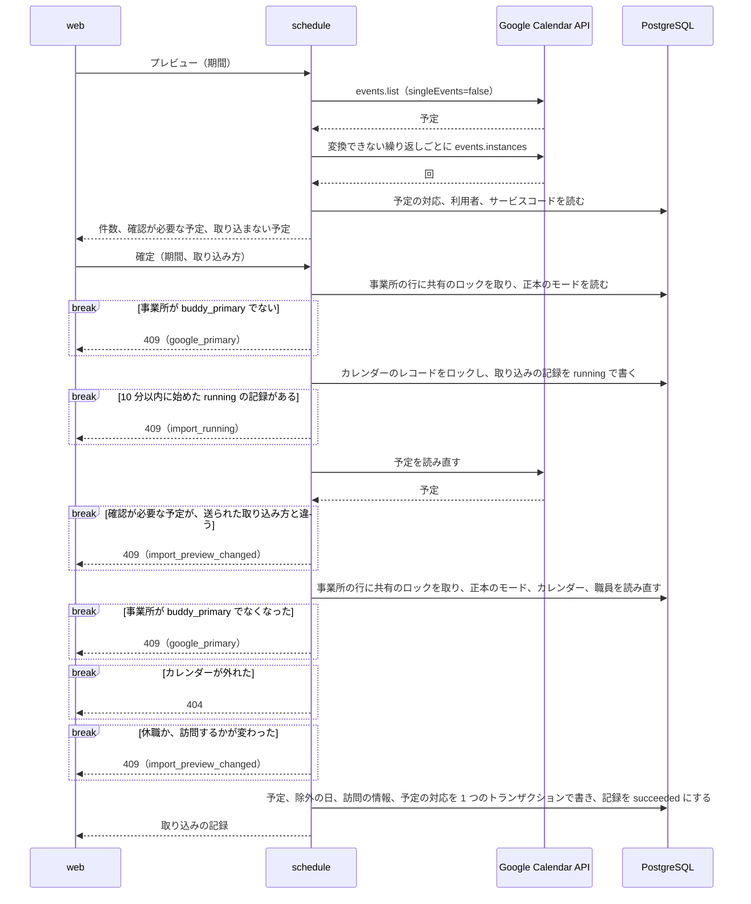
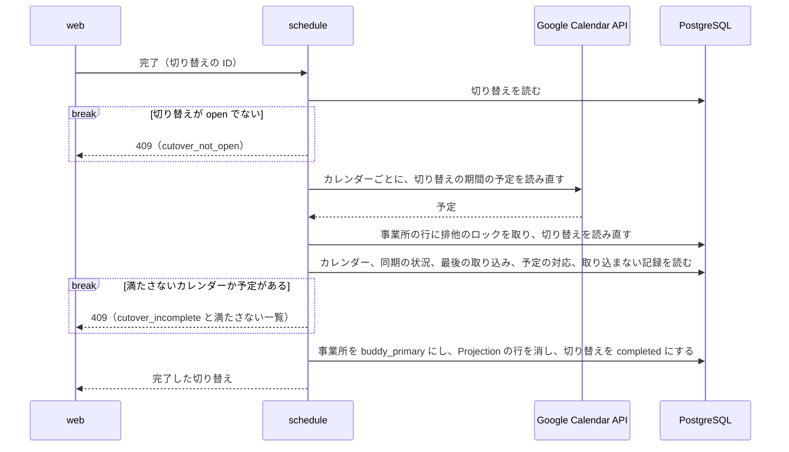
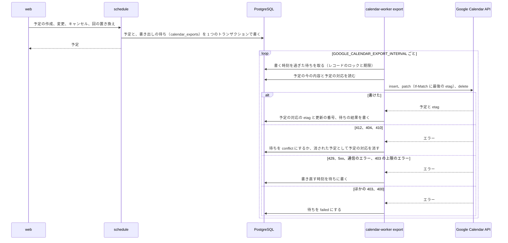
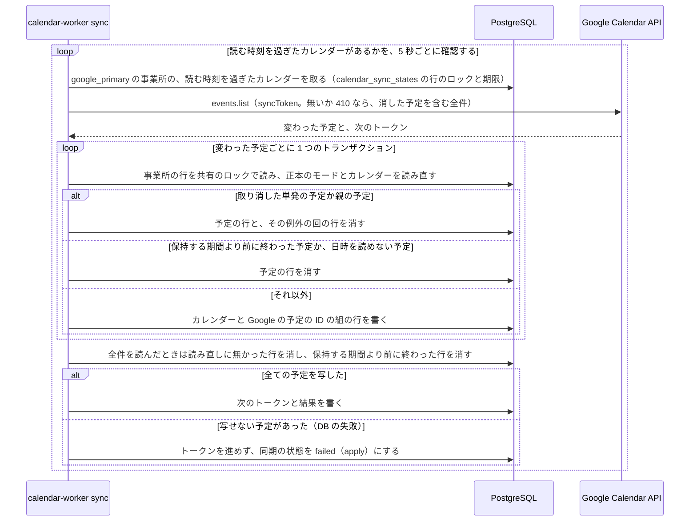
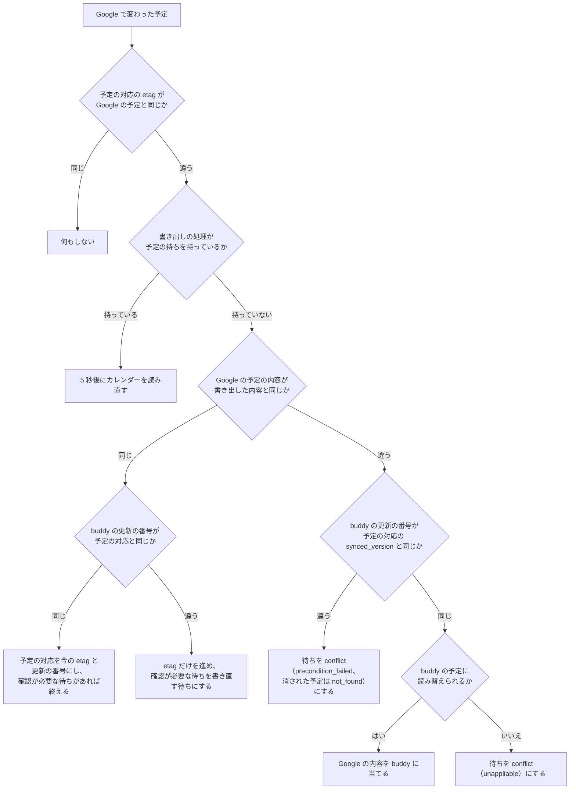
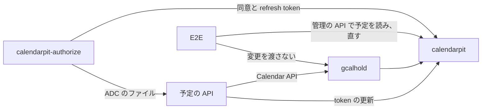

# Google カレンダーとの連携

## Overview

予定の API は、職員に結び付けた Google カレンダーと buddy の予定を、取り込み、書き出し、同期でつなぐ。
予定の API の全体の設計は [予定の管理の Design Doc](https://github.com/Fukuemon/buddy/blob/develop/services/schedule/DesignDoc.md) に、全体の中での責務と依存は [buddy Design Doc](https://github.com/Fukuemon/buddy/blob/develop/docs/design/DesignDoc.md) にある。

## Scope

持つもの

- 職員と Google カレンダーの結び付け
- Google カレンダーの予定の取り込み、buddy の予定の Google カレンダーへの書き出し、Google カレンダーの変更の buddy の予定への反映
- 事業所ごとのサービスアカウントでの Calendar API の呼び出し（`internal/gcal`）
- ローカル環境と E2E で Google Calendar API の代わりに動かすもの

持たないもの

- 予定、繰り返しの予定の規則。
  - [予定の管理の Design Doc](https://github.com/Fukuemon/buddy/blob/develop/services/schedule/DesignDoc.md) が持つ
- 職員の休職と退職の規則。
  - [職員の管理の Design Doc](https://github.com/Fukuemon/buddy/blob/develop/services/schedule/internal/features/staff/DesignDoc.md) が持つ

## Design

### 結び付け、取り込み、同期、書き出しを 4 つのパッケージに置く

連携のコードは、次の 4 つの機能のパッケージに分かれる。

- `calendar`: 3 つの機能が共有する記録と規則と、結び付けの操作
  - 結び付けたカレンダー（`ExternalCalendar`）、予定の対応（`EventLink`）、取り込みの記録（`ImportRun`）、書き出しの待ちの記録（`Export`、`Target`）
  - Google の口（`EventSource`、`EventWriter`、`Accounts`）と、外部の予定と buddy の予定を読み替える規則（`classify.go`、`recurrence.go`、`eventbody.go`）
  - 結び付けの操作（`ServiceAccount`、`List`、`Check`、`Link`、`Unlink`）
- `calendarimport`: 期間を決めた手動の取り込み（`Preview`、`Import`、`plan.go`）
- `calendarsync`: 変わった予定の取得（`Syncer`）、取った変更を当てる規則（`Applier`）、確認が必要な待ちを Google の内容で解く操作（`AcceptExport`）
  - `Applier` の実装は、Projection に写す `projectionApplier` と、buddy の予定に当てる `reconcileApplier` の 2 つ。
- `calendarexport`: 書き出しの待ちを積む `Outbox`、待ちを Google に書く `Exporter`、確認が必要な待ちの一覧と書き直し（`ListExportIssues`、`RetryExport`）

`calendarimport`、`calendarsync`、`calendarexport` は `calendar` だけを import し、互いには import しない。  
取り込みと同期が共有する読み替えの規則と、書き出しと同期が共有する待ちの記録を、`calendar` に置くためである。

- ADR-0005: [予定の API を機能ごとのパッケージに分け、Go の API の操作を使う依存だけを持つ型にし、ファイルの名前の末尾の語で役割を表す](https://github.com/Fukuemon/buddy/blob/develop/docs/adr/0005-schedule-api-packages.md)

カレンダーと予定の対応を読み書きするインターフェースは、使う側のパッケージが、使うメソッドだけを並べて持つ。

- `calendar` の `Repository` は、結び付けの操作が使う、結び付けたカレンダーの読み書きだけを持つ。
- `calendarimport` の `Calendars` は、取り込みの記録（`RunningSince`、`CreateRun`、`FinishRun`）と、予定の対応の読み取りと作成（`ListLinks`、`CreateLink`）を持つ。
- `calendarsync` の `Calendars` と、`calendarexport` の `ExportCalendars` と `ExporterCalendars` は、同期と書き出しが使う予定の対応の読み書きを持つ。
- `calendarsync` の `CalendarReader` は、同期が予定を当てる前にカレンダーを読み直す `Get` だけを持つ。
- `calendarsync` の `Projections` は、`projectionApplier` が使う参照のモデル（Projection）の書き込みだけを持つ。
- postgres の `CalendarRepository` は 1 つで、全てのインターフェースを満たす。

### Google カレンダーは事業所のサービスアカウントで読み書きする

予定の API は、Google Calendar API を、事業所ごとのサービスアカウントになりすました token で呼ぶ。  
職員は自分の事業所のアカウントにカレンダーを共有するので、ほかの事業所の職員が共有したカレンダーは、ID を入れても読めず、結び付けられない。

- ADR-0008: [Google カレンダーとの連携を事業所ごとの正本のモードで分け、職員のカレンダーを事業所ごとのサービスアカウントへの共有で読み書きする](https://github.com/Fukuemon/buddy/blob/876381365355f7e4dab03f6dfdb3d6fb8a9f6947/docs/adr/0008-google-calendar-sync.md)

- 組織の ID とサービスアカウントの対応は、運営側が設定のファイル（`GOOGLE_CALENDAR_SERVICE_ACCOUNTS_FILE`）で渡す。
  - 予定の API は、事業所の `facilities.org_id` で対応を引く。
- 事業所は、次のどちらかで決める。
  - リクエストの本文からは受けない。
  - リクエストを受ける操作: パスの事業所か、結び付けたカレンダーのレコードの事業所。パスの事業所は、認証のミドルウェアがトークンの職員の事業所と一致することを確認する
  - リクエストを受けない書き出しと増分の取得: カレンダーのレコードの事業所（`external_calendars.facility_id`）
- 対応の無い事業所と、組織に結び付けていない事業所のカレンダーの操作は、503 の `calendar_not_configured` を返す。
  - 書き出しは、書き直しの回数の上限まで待ちを残す。
- サービスアカウントごとの Calendar API のクライアントを起動のときに作り、token は有効期限まで使い回す。
- Application Default Credentials が事業所のサービスアカウントそのものとして動くときは、重ねてなりすまさず、その token を使う。
  - ローカルで検証の事業所のアカウントになりすました Application Default Credentials を使うと、サービスアカウント自身へのトークン作成者のロールが要るためである。
  - 見分けは、認証情報のファイルの `client_email`（キー）か、なりすます先の URL（なりすましと Workload Identity Federation）のメールアドレスで行う。メタデータサーバーの認証情報は、別のアカウントとみなす。
- 実際の Google Calendar API では、サービスアカウントが持つカレンダーに対して、取り込み、書き出し、増分の取得、確認が必要な予定の解き方が動く。
  - 職員が共有したカレンダーに「予定の変更」の権限で書けるかは、未確認である。確認するまで、本番で書き出しを有効にしない。
  - この確認は、PRD の [Open Questions](https://github.com/Fukuemon/buddy/blob/develop/docs/PRD.md#open-questions) にある。
  - 出典: [#180 の実際の API での確認](https://github.com/Fukuemon/buddy/issues/180#issuecomment-6333280999)
  - ADR-0008: [承認の条件](https://github.com/Fukuemon/buddy/blob/876381365355f7e4dab03f6dfdb3d6fb8a9f6947/docs/adr/0008-google-calendar-sync.md#承認の条件)
- token を作れないときのエラーの文は、状態コードだけを持つ。
  - IAM のレスポンスはなりすます先のリソースの名前を含むことがあり、サービスアカウントのメールアドレスをログに出さないためである。

### 連携の操作の権限

結び付け、取り込み、確認が必要な予定の操作は、全て職員の管理の権限（`staff.manage`）を求める。  
連携の 4 つのパッケージの操作は、始めに `principal.RequireStaffManage` で確認し、持たない職員を 403（`forbidden`）で拒む。  
ただし、職員が自分に結び付いたカレンダーを読む操作（`getMyExternalCalendar`）だけは、権限を求めない。下の [自分のカレンダーの連携の状態](#自分のカレンダーの連携の状態) にある。

- web は、`getMe` の権限で職員の管理の権限が無いと分かれば、カレンダーの連携、予定の取り込み、確認が必要な予定の画面で連携の API を呼ばず、権限が無いことを出す。
  - 画面の判定は表示のためだけで、拒むのは予定の API である。
- 画面を開いた後に権限を外された職員の操作は、予定の API が 403 で拒む。
  - web は、どの操作の 403 も「この操作をする権限がありません。」にする（`apps/web/src/features/calendar/lib/errorMessage.ts`）。

### カレンダーの結び付け

職員の管理の権限を持つ職員が、職員に Google カレンダーを結び付け、外す。  
画面の動きは、画面仕様書の [カレンダーの連携](https://github.com/Fukuemon/buddy/blob/develop/docs/screens/schedule-link_カレンダーの連携/index.md) にある。

- 画面は、開くと職員の一覧、結び付けたカレンダーの一覧、サービスアカウントのメールアドレス（`getCalendarServiceAccount`）を並べて読む。
  - メールアドレスが 503 の `calendar_not_configured` なら、結び付けの準備ができていないことを出し、ほかの失敗なら読み込みの失敗にする。
- 読めるかの確認（`createExternalCalendarCheck`）は、事業所のサービスアカウントで予定の一覧を 1 件だけ読む。
  - 予定は取り込まない。
  - Google が 403 か 404 を返せば 422 の `calendar_unreadable` に、Google に届かないかほかのエラーなら 502 の `calendar_unavailable` にする。
  - レスポンスとエラーの文に、Google のレスポンスの本文とカレンダーの ID を入れない。
- 結び付け（`createExternalCalendar`）は、職員が事業所にいて退職していないことを確認し、もう一度読めるかを確認してから書く。
  - 書く前に事業所の行に共有のロックを取り、職員を読み直す。確認の後に退職した職員へ結び付けないためである。
  - 結び付けられないときは、原因ごとに 409 の code を返す。
    - `staff_has_calendar`: 職員に外していないカレンダーがある
    - `calendar_taken`: カレンダーがほかの職員に結び付いている。外したカレンダーを含む
    - `calendar_already_linked`: カレンダーがその職員にすでに結び付いている
  - 外した同じカレンダーを同じ職員に結び付けると、外したレコードを使い直す。
- 外す（`removeExternalCalendar`）は、レコードを消さずに `disabled_at` を入れる。
  - 取り込んだ予定、予定の対応、取り込みの記録は残るので、結び付け直して同じ期間を取り込んでも、予定は重ならない。

#### 自分のカレンダーの連携の状態

職員は、画面仕様書の [自分の情報](https://github.com/Fukuemon/buddy/blob/develop/docs/screens/account-profile_自分の情報/index.md) で、自分に結び付いたカレンダーと、最も新しい取り込みを読む。  
結び付いたカレンダーの一覧（`listExternalCalendars`）は職員の管理の権限を求めるので、自分の分だけを返す操作を分けて足す。

- `GET /v1/me/external_calendar`（`getMyExternalCalendar`）は、トークンの職員に結び付いた、外していないカレンダーを返す。
  - レスポンスは `{ "external_calendar": ExternalCalendar | null }` にする。結び付いていなければ `null` を返し、404 にしない。結び付いていないことは、画面が出す状態の 1 つで、失敗ではないためである。
  - `ExternalCalendar` は、一覧と同じ形で、`last_import`（最も新しく始めた取り込み）を含む。
- 権限は求めない。トークンの職員の分だけを返し、職員の ID を引数に取らないので、ほかの職員のカレンダーは読めない。
  - 休職と退職の職員は、`getMe` と同じく、トークンの確認の段で 403 になる。
- `GET /v1/me` には足さない。`GET /v1/me` は、web が全ての画面の権限の確認で読み直すので、結び付けたカレンダーと取り込みの記録を読む分だけ重くなるためである。

### Google カレンダーの取り込み

職員の管理の権限を持つ職員が、職員に Google カレンダーを結び付け、期間を選んでプレビューし、確定して予定に取り込む（ADR-0008 の段階 1）。  
プレビューは `calendarimport` の `Preview` が、確定は `Import` が行う。  
画面の動きと、職員から見た取り込みの結果は、画面仕様書の [予定の取り込み](https://github.com/Fukuemon/buddy/blob/develop/docs/screens/schedule-import_予定の取り込み/index.md) と [カレンダーの連携](https://github.com/Fukuemon/buddy/blob/develop/docs/screens/schedule-link_カレンダーの連携/index.md) にある。

- ADR-0008: [Google カレンダーとの連携を事業所ごとの正本のモードで分け、職員のカレンダーを事業所ごとのサービスアカウントへの共有で読み書きする](https://github.com/Fukuemon/buddy/blob/develop/docs/adr/0008-google-calendar-sync.md)

次の図は、プレビューから確定までの呼び出しと、確定が何も書かずに返る道を示す。

#### プレビューと確定

プレビューの結果は保存しない。  
確定は Google の予定を読み直し、プレビューと同じ規則で読み替える。  
確認が必要な予定の集合かバージョン（まとめた予定の ID と etag から作る）が、送られた取り込み方と違えば、何も書かずに 409 を返す。

web は、プレビューの結果と選んだ取り込み方を画面の中だけで持つ。  
職員か期間を変えると捨て、確定には、プレビューした期間と、確認が必要な予定ごとの取り込み方（予定の ID と版）を送る。

同じカレンダーの取り込みは、1 つずつ行う。  
確定の始めにカレンダーのレコードに排他のロックを取り、10 分以内に始めた `running` の記録があれば 409 を返す。  
止まった取り込みが次の取り込みを止め続けないよう、10 分より前の `running` は数えない。

取り込みの確定は、予定の正本のモードが `buddy_primary` の事業所と、`open` の切り替えがある `google_primary` の事業所でだけ書く。  
切り替えの間の取り込みの規則は、[予定の正本の切り替え](#予定の正本の切り替え) にある。  
確定は、取り込みの記録を作るトランザクションの始めと、予定を書くトランザクションの始めの 2 回、事業所の行を共有のロックで読み、`schedule.RequireWritable` でモードを確認する。  
1 回目は、Google を読む前に、取り込みの記録を作らずに拒む。  
2 回目は、読み替えている間にモードが変わったときに、記録を `failed` にして何も書かない。  
切り替えの無い `google_primary` の事業所では 409（`google_primary`）を返す。  
プレビューは書かないので、モードによらず動く。

- ADR-0008: [Google カレンダーとの連携を事業所ごとの正本のモードで分け、職員のカレンダーを事業所ごとのサービスアカウントへの共有で読み書きする](https://github.com/Fukuemon/buddy/blob/develop/docs/adr/0008-google-calendar-sync.md)

取り込んだ Google の予定は、`external_event_links` の対応を持つ。  
対応のある予定は取り込み済みに数え、もう一度は書かない。

#### 繰り返しの読み替え

繰り返しは、親の予定の RRULE を buddy の規則（毎週の曜日、毎月の日付、毎月の第何週の曜日）に変換できれば、規則ごと取り込む。  
期間の外の回も繰り返しの予定に含まれる。

- Google が返した取り消した回は、除外の日にする。
- 期間の中の変えた回は、除外の日と、元の回の日付を持つ単発の予定にする。
- 前の取り込みで取り込んだ繰り返しにも、後の期間の取り消しと変更を反映する。

前の取り込みで回か例外の回だけを取り込んだ繰り返しは、規則に変換できる形でも回ごとにする。  
規則ごと作ると、前に取り込んだ回と重なるためである。

Google が変えた回を、元の日時と今の日時のどちらで期間に絞るかは、未確認である。  
今の日時で絞るとみなし、期間の前後 31 日を広げて例外の回を読み直し、元の日付が期間の中の回も読み替える。  
期間の中の回を期間の外へ動かしても、元の日に回が残らない。  
31 日より遠くへ動かした回は読めず、元の日に回が残る。  
Calendar API は元の日時で予定を絞れず、上限なしに探すと回ごとに API を呼ぶことになるためである。

変換できない繰り返し（隔週、複数の曜日、最終週など）は、events.instances で期間の中の回を読み、回ごとに単発の予定にする。  
回の対応は、回の ID で持つ。  
取り消した回は書かず、取り込まない予定にも数えない。

#### 日付と時刻

日付と時刻は Asia/Tokyo で読む。  
終了が開始の翌日で、長さが 24 時間未満の予定は、開始の日の予定に「終了が翌日か」の印（`ends_next_day`）を付けて取り込む。

- ADR-0013: [日をまたぐ予定を、開始の日の予定に「終了が翌日か」の印を付けて持ち、取り込み、カレンダー、照合で扱う](https://github.com/Fukuemon/buddy/blob/develop/docs/adr/0013-overnight-schedule.md)

印の付け方は次のとおり。

- 翌日の 0:00 に終わる予定（24:00 に終わる予定）も、終了の時刻を 0:00 にして印を付ける。
- 終了が開始の翌日より後の予定と、24 時間以上の予定は、取り込まない予定（`multi_day`）にする。
  - 分に丸めると終了の時刻が開始の時刻より前にならない予定は、24 時間とみなす。
- 繰り返しは、親の予定（最初の回）の印で取り込む。
  - Google の繰り返しの回は親と同じ長さなので、印が親と違う回は変えた回だけである。変えた回は、その回の印を持つ回の置き換えか、回ごとの単発の予定にする。

プレビューの確認が必要な予定と取り込まない予定は、印を `ends_next_day` で返す。  
web は、印の付いた予定と `multi_day` の予定の終了の時刻に「翌」を付ける。

#### タイトルと利用者

タイトルに `【` と `】` の両方を含む予定を訪問の予定にし、含まない予定は、タイトルをそのまま使った通常の予定にする。  
タイトルのサービス内容と利用者名は、照合の API と同じ規則で表記をそろえ、サービスコードと事業所の利用者を引く。  
利用者を 1 人に決められない予定は、プレビューで取り込み方を選ばせる。  
取り込んだ訪問の予定の主訪問者は、カレンダーを結び付けた職員である。

予定のタイトル、利用者名、カレンダーの ID は、取り込まない予定の一覧、エラーのメッセージ、ログに出さない。  
確認が必要な予定だけは、タイトルから読んだ利用者名とサービス内容を返す。

空き時間だけの共有（`freeBusyReader`）のカレンダーは、読めないとみなす（422 `calendar_unreadable`）。  
公式の文書は、空き時間だけの共有の `events.list` が `singleEvents=true` のように動き、繰り返しの親を返さないと書く。  
予定のタイトルを返さないことと、実際の API での振る舞いは未確認である。

- 出典: [Recurring events](https://developers.google.com/workspace/calendar/api/guides/recurringevents)

#### 休職、退職、訪問しない職員

休職の職員のカレンダーは、結び付けたまま取り込める。  
新しい予定は、取り込む予定と確認が必要な予定にせず、取り込まない予定（`staff_on_leave`）にする。  
前の取り込みで繰り返しのまま取り込んだ予定の、取り消した回と変えた回は、既に割り振った予定の変更なので、休職でも除外の日と回の置き換えにする。  
繰り返しの予定をほかの職員に割り振り直していれば、変えた回は新しい予定とみなし、取り込まない予定にする。

訪問しない職員（ADR-0002）のカレンダーも、休職と同じく扱う。  
新しい予定は、取り込まない予定（`staff_non_visiting`）にする。

退職した職員に結び付けようとすると 400 を返す。  
退職でカレンダーを外すようにする前に退職にした職員のカレンダーが残っていても、プレビューと確定は 404 を返す。

確定は、予定を書くトランザクションの始めに事業所の行に共有のロックを取り、カレンダーを外していないことと、職員の休職と訪問しない職員かがプレビューのために読み替えたときと同じことを確認する。

- 確定が読み替えてから書くまでの間に休職か復職になるか、訪問するかが変われば 409（`import_preview_changed`）を、退職してカレンダーが外れれば 404 を返し、何も書かない。
  - 確定は休職を読み直してから読み替えるので、プレビューの後、確定を押す前に変わった休職は、確定の読み替えに入る。
- 退職が先にコミットすれば確定は 404 になる。
  - 確定が先にコミットし、今日以降の予定を取り込んでいれば、退職はその予定が残るので 409 になる。

### 予定の正本の切り替え

Google カレンダーを正本にする事業所（`google_primary`）の予定を buddy に取り込み、正本を buddy（`buddy_primary`）に移す作業を、切り替え（`Cutover`）の記録で行う。  
切り替えの操作と記録は `calendarimport` に置き、最後のモードの変更だけを `organization` に頼む。  
決定の背景は ADR-0008 にあり、画面の動きは画面仕様書の [予定の正本の切り替え](https://github.com/Fukuemon/buddy/blob/develop/docs/screens/schedule-cutover_予定の正本の切り替え/index.md) にある。

- ADR-0008: [Google カレンダーとの連携を事業所ごとの正本のモードで分け、職員のカレンダーを事業所ごとのサービスアカウントへの共有で読み書きする](https://github.com/Fukuemon/buddy/blob/develop/docs/adr/0008-google-calendar-sync.md)

切り替えの操作は次の 4 つで、どれも職員の管理の権限（`staff.manage`）を求める。

- `StartCutover`（始める）: 事業所の行を排他のロックで取り、`google_primary` で、`open` の切り替えが無く、外していない全てのカレンダーの最後の同期が成功していることを確認して、`open` の切り替えを作る。
  - 取り込みの期間は、今の Asia/Tokyo の月の初日から先の全てにする。
- `GetCutover`（状況を読む）: `open` の切り替えと、カレンダーごとの同期の状況と、この切り替えで最後に成功した取り込みを返す。
- `CompleteCutover`（完了する）: 下の「完了の確認」をし、満たせば事業所を `buddy_primary` にし、事業所の Projection の行を消し、切り替えを `completed` にする。
- `CancelCutover`（やめる）: 事業所の行を排他のロックで取り、この切り替えの取り込みで作った予定、繰り返しの予定、訪問の情報、予定の対応を消して、切り替えを `canceled` にする。
  - モードは `google_primary` のままにする。

記録は 2 つのテーブルに持つ。

- `calendar_cutovers`: 事業所、状態（`open`、`completed`、`canceled`）、取り込みの期間の最初の日、始めた職員と時刻、終えた時刻。
  - `open` の行は、事業所ごとに一意の部分索引で 1 つまでにする。
- `calendar_cutover_skips`: 切り替えの取り込みで、確認が必要な予定に取り込まないを選んだ記録。
  - カレンダーの取り込みのたびに、そのカレンダーの記録を、その取り込みで選んだものに置き換える。

切り替えの取り込みの記録（`import_runs`）と、取り込みで作った予定の対応（`external_event_links`）は、切り替えの ID（`cutover_id`）を持つ。  
取り込みの記録の期間の終わり（`range_end`）は NULL にする。

#### 切り替えの取り込み

取り込みは、今の取り込みの操作（`Preview`、`Import`）を使う。  
事業所に `open` の切り替えがあれば、切り替えの取り込みの規則で読み替える。

- 期間は、切り替えの期間（最初の日から先の全て）だけを受ける。
  - Google の予定は `timeMax` を付けずに読む。ほかの期間は 400 を返す。
- 書き込みの確認は、`schedule.RequireWritable` の例外として、`open` の切り替えがある `google_primary` の事業所も通す（`requireImportable`）。
  - 確定は 2 回のトランザクションの始めで、事業所の行を共有のロックで読んでから `open` の切り替えを読む。2 回目に切り替えが終わっていれば 409（`cutover_not_open`）を返し、何も書かない。
- 繰り返しの予定は、回に展開しない。
  - buddy の規則に写せない繰り返しの予定は、確認が必要な予定（`recurrence_unsupported`）にし、取り込み方は取り込まないだけを受ける。
- 親の予定を規則のまま取り込まないとき（取り込まない予定、写せない予定、取り込まないを選んだ予定）は、その変えた回も取り込まない。
  - 繰り返しの一部だけを単発の予定にして移さないためである。
- 前の取り込みの後に Google で変わったか消えた予定は、buddy の写しを消し、Google の今の内容で取り込み直す（上書き）。
  - 予定の対応の etag と Google の etag が違うか、読み直した予定に無い対応を、食い違う対応にする。
  - 繰り返しの親か回の 1 つが食い違えば、親と回の全ての対応を食い違うものにする。回の置き換えは親の繰り返しの予定を指すので、親だけを取り込み直せないためである。
  - 切り替えの間は buddy から予定を書けないので、写しを消しても職員の変更は失われない。

#### 完了の確認

次の図は、完了が Google を読み直してから、事業所の行の排他のロックの中で確認し、満たさなければ何も書かずに返す道を示す。

カレンダーごとに、次の 3 つを確認する。

- この切り替えで取り込み（`not_imported`）、最後の取り込みの後に同期が成功している（`sync_stale`）。
- 読み直した予定を切り替えの取り込みの規則で読み替え、取り込む予定と除外の日が残っていない（`event_not_imported`）。
  - 確認が必要な予定は、取り込まないと決めた記録があり、記録のバージョンが今のバージョンと同じである（`needs_review`）。
- 予定の対応の etag と Google の etag が同じで（`changed`）、読み直した予定に無い対応が無い（`deleted`）。

満たさない一覧は、カレンダーの順に、カレンダーの中は日時の順（日時の無い予定は最後）に並べる。  
予定のタイトルは利用者名を含むので返さず、日時と理由だけを返す。

完了の後は、同期が事業所のカレンダーを読まなくなり、予定の変更を書き出すようになる。  
切り替えの取り込みで作った予定は、書き出しの待ちを持たない。  
Google の予定と同じ内容なので、完了の後に変えた予定から書き出す。

### Google カレンダーへの書き出し

buddy で作り、変え、キャンセルした予定を、予定の職員が結び付けた Google カレンダーに書く（ADR-0008 の段階 2）。  
Google カレンダーで直された予定は、書き出しでは buddy に当てず、確認が必要な予定に出す。  
Google カレンダーで変わった予定は、buddy の予定に当てない。  
同期は、buddy を予定の正本にする事業所のカレンダーを読まない（[Google カレンダーとの同期](#google-カレンダーとの同期)）。

次の図は、予定の操作が書き出しの待ちを積み、書き出しの Worker（`calendar-worker export`）が Google に書くまでを示す。  
Google の応答ごとの扱いは、[衝突とエラー](#衝突とエラー) の表にある。

#### 書き出しの待ちと処理

書き出しは、`GOOGLE_CALENDAR_EXPORT_ENABLED` が `true` のときだけ動く。  
`false` のときは待ちを積まず、書き出しの処理も動かさない。

予定の操作（`schedule` の `Create` など）は、予定を書くのと同じトランザクションで `calendarexport` の `Outbox` に待ちを積む。  
待ちを Google に書くのは、`calendarexport` の `Exporter` である。  
積むのは、予定の職員に外していないカレンダーがあるときと、予定の対応のカレンダーを外していないとき（職員を替えて、前のカレンダーの予定を消すとき）だけである。  
積むのは、予定の正本のモードが `buddy_primary` の事業所の予定だけである。  
予定の操作は `google_primary` の事業所で予定を書かないので、`Outbox` のモードの確認は、予定の操作のほかから呼ばれたときの守りになる。  
取り込みで書いた予定は積まない。  
カレンダーを結び付ける前に作った予定は書き出さない。  
結び付けた後にその予定を変えると書く。

待ちは予定ごとに終わっていないものを 1 つだけ持ち、積み直すと `revision` が増える。  
書くときは、積んだ時点ではなく書く時点の予定の内容を書く。  
書いている間に積み直されたら、結果によらず待ちを pending に戻して数え直し、もう一度書く。

書き出しの処理は、API と別のプロセスの `calendar-worker export` で動く。

- 待ちは `FOR UPDATE SKIP LOCKED` と期限（`locked_until`、2 分）で 5 件ずつ取り、1 件を 20 秒で打ち切るので、期限のうちに書き終える。
- 常駐の形では、取れるものが無くなるまで続けて取ってから、`GOOGLE_CALENDAR_EXPORT_INTERVAL` を待つ。
  - 待ちを取れなかったときは、間隔を待ってから取り直す。止める合図を受けたら、新しく取らない。
  - 常駐と 1 回の形の繰り返しは `cmd/calendar-worker` が持ち、`Exporter` は 1 回の取得と処理（`ExportDue`）だけを持つ。
  - ADR-0019: [Google カレンダーの書き出しと同期を、予定の API と同じイメージの Worker のコマンドで役割ごとに動かし、繰り返しを Worker のコマンドに集める](https://github.com/Fukuemon/buddy/blob/develop/docs/adr/0019-calendar-worker.md)
- 結果は、取ったときの回数（`attempts`）と比べて書き、期限が切れた後にほかの Worker が取り直した待ちを変えない。
  - 外部の API はトランザクションの外で呼ぶ。
- 止める合図で書けなかった待ちは、書こうとした回数に数えずに返す。
- 取った待ちの事業所が `buddy_primary` でなければ、Google に書かずに `conflict`（`not_buddy_primary`）にして保留にする。
  - 保留にした待ちは、要約のログの `held_count` に数え、書いていない待ちの滞留（`pending` だけを数える）には数えない。
  - 確認が必要な予定の一覧に出る。「buddy の内容で書き直す」を選んでも、事業所が `buddy_primary` になるまでは、また保留にする。

- ADR-0008: [Google カレンダーとの連携を事業所ごとの正本のモードで分け、職員のカレンダーを事業所ごとのサービスアカウントへの共有で読み書きする](https://github.com/Fukuemon/buddy/blob/develop/docs/adr/0008-google-calendar-sync.md)

予定の更新の番号（`version`）は、単発の予定の変更とキャンセル、繰り返しの予定の回の除外のたびに 1 つ増える。  
書いた後に、予定の対応（`external_event_links`）に Google の etag と更新の番号（`synced_version`）を書く。  
同期が、どちらの側が変わったかを比べるのに使う。

#### 書く先

書く先は、予定の職員（`staff_id`）が結び付けたカレンダーである。  
訪問の予定では、画面が主訪問者を予定の職員と同じにする。

- 予定の対応があり、職員のカレンダーが対応のカレンダーと同じなら、Google の予定を部分更新する。
  - 取り込んだ予定もこの形で更新する。
- キャンセルした予定と、職員を替えた予定は、対応の Google の予定を消し、対応も消す。
  - 職員を替えた予定は、新しい職員のカレンダーに作る。
- 対応のカレンダーを外していれば、そのカレンダーには書かない。
  - 外したカレンダーの予定は残る。
  - 職員に今のカレンダーがあれば、対応を消してそのカレンダーに作る。
  - キャンセルした予定と、職員に今のカレンダーが無い予定は、何も書かずに待ちを終える。確認が必要な予定の一覧で「buddy の内容で書き直す」を選んだ予定も同じで、外したカレンダーの予定を消さず、書き直さずに一覧から消える。
- 対応が無く、職員にカレンダーがあれば作る。

作る予定の ID は、buddy の予定の ULID を base32hex にした値にする。  
作った後に対応を書けずに書き直しても、Google の予定は 2 つにならない。  
同じ ID の予定があれば（409）、buddy の内容で更新する。

#### 書く内容

- Google の予定のタイトルは、訪問の予定なら `【サービス内容】利用者名`、通常の予定なら buddy の予定のタイトルである。
  - 照合の API が同じタイトルを読む。
- 日時は、タイムゾーン `Asia/Tokyo` とオフセットの無い日時で書く。
  - `extendedProperties.private` に buddy の予定の ID だけを置く。
- 終了が翌日の予定（`ends_next_day`）は、終了の日時を予定の日付の翌日から作る。
  - 繰り返しの予定では、最初の回の日付の翌日である。
- 説明は、buddy の予定に説明があるときだけ書く。
  - 取り込んだ予定の Google の説明を消さないためである。buddy で説明を消しても、Google の説明は残る。
- 参加者は書かず、通知を送らない（`sendUpdates=none`）。

#### 繰り返しの書き出し

buddy の繰り返しの規則は、全て RRULE に変換できる。  
規則に無い曜日と日は最初の回の日付から決め、終了日はその日の 23:59:59（Asia/Tokyo）を UTC にした `UNTIL` にする。  
除外の日は `EXDATE;TZID=Asia/Tokyo` にする。

回の置き換えは、Google の例外の回にせず、親の予定の `EXDATE` と、別の単発の予定にする。  
取り込んだ Google の例外の回が置き換えた日は、`EXDATE` にしない。  
`EXDATE` にすると、Google の例外の回が消えるためである。

#### 衝突とエラー

更新と削除には、予定の対応の etag を `If-Match` に付ける。  
削除は、キャンセルした予定と、職員を替えた予定の前のカレンダーの予定に行う。  
Google の応答ごとの待ちと予定の対応の扱いは、次のとおり。

| Google の応答 | 更新のとき | 削除のとき |
| --- | --- | --- |
| 412 | `events.get` で予定を読み、`status` が `cancelled` なら `conflict`（`not_found`）、ほかは `conflict`（`precondition_failed`） | `events.get` で予定を読み、`status` が `cancelled` なら消された予定として予定の対応を消し、職員を替えたときは新しいカレンダーに作る。ほかは `conflict`（`precondition_failed`） |
| 410 | `conflict`（`not_found`） | 消し終えたものとして、予定の対応を消す |
| 404 | `conflict`（`not_found`）。予定の対応は消さない | `conflict`（`not_found`）。予定の対応は消さない |
| 429、5xx、通信のエラー、403 の上限のエラー | 30 秒から倍にしながら書き直し、5 回で `failed`（`unavailable`） | 30 秒から倍にしながら書き直し、5 回で `failed`（`unavailable`） |
| ほかの 403 | 書き直さずに `failed`（`forbidden`） | 書き直さずに `failed`（`forbidden`） |
| 400 | `failed`（`rejected`） | `failed`（`rejected`） |

412 は、Google カレンダーで予定が変わったとみなし、書かない。  
Google は、消された予定に、消す前の etag を `If-Match` に付けた更新と削除を、410 でなく 412 で返す。  
そのため 412 を受けたら `events.get` で予定を読み、`status` が `cancelled` なら 410 と同じく消された予定として扱う。  
`events.get` が一時的なエラー（429、5xx、通信のエラー）で失敗したら書き直す。  
それ以外で読めないときは、412 のまま `precondition_failed` にする。

404 では予定の対応を消さない。  
カレンダーの共有が外れたときの 404 と、予定が無いときの 404 を見分けられないとみなし、対応を消すと、共有を戻した後に予定が 2 つになるためである。  
キャンセルの削除が 404 でも、対応を消さずに `conflict` にする。  
共有が外れたカレンダーの予定の更新と削除が 404 を返すかは、未確認である。

- 出典（消された予定への patch、update、delete、get の応答）: [#180 の実際の API での確認](https://github.com/Fukuemon/buddy/issues/180#issuecomment-6332187503)

`conflict` の待ちは、buddy で予定を変えても書かない。  
解き方は次のとおり。

- 職員の管理の権限を持つ職員が、確認が必要な予定の一覧から「buddy の内容で書き直す」を選ぶと、`If-Match` を付けずに書き直す。
- 消された予定は、`status` を `confirmed` にした部分更新で戻す。
  - 実際の API は、`If-Match` の無い patch を、消された予定にも 200 で返す。410 を受けたときは、予定の対応を消して作り直す。
- 単発の予定では「Google の内容に合わせる」も選べる（[Google カレンダーとの同期](#google-カレンダーとの同期)）。

`failed` の待ちは、buddy で予定を変えると数え直して書く。  
待ちのエラーは決まった値（`error_code`）だけを持ち、確認が必要な予定の一覧とログに、予定のタイトル、利用者名、カレンダーの ID を出さない。

### Google カレンダーとの同期

同期は、事業所の予定の正本のモードで、読むカレンダーと当て方を分ける。

- Google カレンダーを正本にする事業所（`google_primary`）では、職員が Google カレンダーで作り、変え、取り消した予定を、参照のモデル（Projection）に写す。
  - 予定の対応の有無によらず、Google で新しく作った予定も写す。buddy の予定のテーブルには書かない。
- buddy を正本にする事業所（`buddy_primary`）では、同期はカレンダーを読まない。
  - Google カレンダーでの変更は、buddy に取り込まない。
  - Google カレンダーで直された予定は、書き出しが `If-Match` の 412 で見つけ、確認が必要な予定に出す。
- 外部の変更を buddy の予定に当てる規則（`reconcileApplier`）は、どのモードの同期にも使わない。
  - 緊急の編集の要求で使い道を決めるまで、規則とテストを残す。
  - ADR-0008: [Google カレンダーとの連携を事業所ごとの正本のモードで分け、職員のカレンダーを事業所ごとのサービスアカウントへの共有で読み書きする](https://github.com/Fukuemon/buddy/blob/develop/docs/adr/0008-google-calendar-sync.md)

次の図は、同期の Worker（`calendar-worker sync`）が `google_primary` の事業所のカレンダーの変わった予定を読み、予定ごとに Projection に写すまでを示す。

#### 同期の処理

同期は、`GOOGLE_CALENDAR_SYNC_ENABLED` が `true` のときだけ動く。  
設定は、書き出し（`GOOGLE_CALENDAR_EXPORT_ENABLED`）を有効にしないと同期を有効にできない。  
この制約は、`buddy_primary` の事業所で Google の変更を buddy に当てていたときのものである。  
`google_primary` の事業所の同期は、書き出しを使わない。

同期の処理は、`calendarsync` の `Syncer` が変わった予定を読み、事業所の正本のモードの `Applier` が 1 つの予定ずつ当てる。  
モードと `Applier` の対応（`Appliers`）は、組み立て（`internal/assemble`）が決めて `Syncer` に渡す。  
組み立ては、`google_primary` に `projectionApplier` だけを渡し、`buddy_primary` には渡さない。  
同期の処理は、API と別のプロセスの `calendar-worker sync` で動く。

- ADR-0005: [予定の API を機能ごとのパッケージに分け、Go の API の操作を使う依存だけを持つ型にし、ファイルの名前の末尾の語で役割を表す](https://github.com/Fukuemon/buddy/blob/develop/docs/adr/0005-schedule-api-packages.md)

- 読む時刻（`next_sync_at`）を過ぎたカレンダーがあるかを 5 秒（間隔がそれより短ければ間隔）ごとに確認し、取れるものが無くなるまで続けて取る。
  - 確認の間隔と繰り返しは `cmd/calendar-worker` が持ち、`Syncer` は 1 回の取得と処理（`SyncDue`）だけを持つ。
  - 読み終えたカレンダーの読む時刻は、`GOOGLE_CALENDAR_SYNC_INTERVAL` の後である。
- `Applier` のあるモードの事業所の、外していないカレンダーを、`FOR UPDATE SKIP LOCKED` と期限（`locked_until`、6 分）で 5 件ずつ取り、1 件を 1 分で打ち切る。
  - `buddy_primary` の事業所のカレンダーは取らないので、Google を読まず、同期の状態も変えない。
  - 同期の滞留（`calendar sync backlog`）も、`Applier` のあるモードの事業所のカレンダーだけで数える。取らないカレンダーを数えると、滞留が増え続けるためである。
- 結果は、取ったときの期限と比べて書き、期限が切れた後にほかの Worker が取り直したカレンダーを変えない。

`events.list` に `syncToken` を付けて、前の後に変わった予定を、消した予定と繰り返しの例外の回を含めて読む（増分の取得）。  
トークンが無いときと、Google が 410 を返したときは、`showDeleted=true` で全ての予定を読み直す。  
`syncToken` と期間は一緒に渡せないので、カレンダー全体を読む。

予定ごとのトランザクションの始めに、事業所の行を共有のロックで読み、正本のモードを読む。  
カレンダーを取った後にモードが変わり、そのモードの `Applier` が無ければ、残りの予定を当てずに、トークンと状態を前のまま返す。  
モードの切り替えは同じ行に排他のロックを取るので、`buddy_primary` に切り替えた後に、Projection に写さない。

予定を当てられなかったときは、トークンを進めずに返し、次に同じ予定から読み直す。  
同期の状態は `failed`（`apply`）にする。

#### Projection に写す内容

Projection（`calendar_event_projections`）は、Google カレンダーの 1 つの予定を 1 行にし、結び付けたカレンダーの ID と Google の予定の ID の組で一意にする。  
同じ予定を何度読んでも、行を書き直すので、行は重ならない。  
保存する項目と保存しない項目は、ADR-0008 のとおりにする。

- 行は、写した時点のカレンダーの事業所と職員の ID を持つ。
- 新しい予定と変わった予定は、タイトル、開始と終了（日時か、終日の日付）、開始のタイムゾーン、繰り返しの規則、etag、Google での更新の時刻を書く。
- 取り消した単発の予定と繰り返しの親の予定は、行を消す。
  - 親の予定の行を消すときは、その例外の回の行も消す。
- 繰り返しの予定は展開せず、親の予定と例外の回を別の行に写す。
  - 例外の回は、親の予定の ID と元の開始の日時を持つ。
  - 取り消した回は、状態を `cancelled` にした行に写す。タイトルと日時は持たない。
- 日時を読めない予定は、写さずに前の行を消し、ほかの予定を写し続ける。
  - ログの `calendar projection skipped` に、事業所、カレンダー、Google の予定の ID だけを書き、タイトルと利用者名を書かない。

行を残す期間は、前々月の初日からにする。  
照合で前月の予定を読むためである。

- 行は、Asia/Tokyo で予定が終わる日（`last_end_date`）を持つ。
  - 繰り返しの予定は最後の回が終わる日、取り消した回は元の開始の日である。
  - 最後の回は、取り込みと同じ読み替えの規則（`calendar.RuleFromRecurrence`）で決め、規則に写せないときは RRULE の `UNTIL` で決める。
  - 終わりの無い繰り返しと、`UNTIL` の無い写せない繰り返し（`COUNT` など）は、終わる日を持たず、期間では消さない。
- 期間より前に終わった予定は、写さずに行を消す。
- カレンダーを読み終えるたびに、期間より前に終わった行を消す。
  - 変わった予定が無い回も消すのは、日がたつと、変わっていない予定の行も期間より前になるためである。
- 期間の終わり（3 か月後の月末）より後の予定も写す。
  - 増分の取得は変わっていない予定を返さないので、期間に入ったときに写せないためである。期間で絞って読むのは、Projection を読む側である。

トークンが無いか切れた（410）ときに全ての予定を読み直したら、カレンダーの行のうち、読み直しに無かった行を消す。  
増分の取得で取り消しを取りこぼした行は、これで消える。

#### Projection を読む側

Projection を読むのは、予定の表示の読み出し（`scheduleview` の `List`）だけである。  
読む手順は、[予定の管理の Design Doc の予定の一覧の読み元](https://github.com/Fukuemon/buddy/blob/develop/services/schedule/DesignDoc.md#予定の一覧の読み元) にある。

- 行を buddy の予定に読み替える規則は、取り込みと同じ `Classify` と `RuleFromRecurrence` を使う。
  - `calendar.ProjectionRules` が、行を Google の予定の形（`calendar.Event`）にして 2 つの規則を呼ぶ。`scheduleview` は `calendar` を import できないので、組み立ての場所がこの値を渡す。
  - 行の日時は DB から UTC で読むので、Asia/Tokyo のオフセットの日時にしてから規則に渡す。`RuleFromRecurrence` が、タイムゾーンの無い予定をオフセットで Asia/Tokyo かを確認するためである。
- 利用者名とサービス内容は、取り込みと同じ規則（`gcaltitle.NormalizeClient`、`ServiceKey`）でそろえて比べる。
- 一覧は、カレンダーごとの同期の状況（`calendar_sync_states` の最後の結果、`last_synced_at`、最後の失敗の理由）を一緒に返す。
  - `last_synced_at` は、変わった予定を最後まで読んで当てた同期のときだけ進む。

#### buddy の予定に当てる規則（使わない）

次の「当て方」「単発の予定に当てる内容」「繰り返しの予定に当てる内容」は、`reconcileApplier` の規則である。  
同期はどのモードでもこの規則を使わない。「Google の内容に合わせる」（`AcceptExport`）は、単発の予定に当てる規則を使う。

#### 当て方

単発の予定に Google の変更を当てるかは、次の順に決める。

- etag が同じ予定には、buddy が書いた変更が増分に戻ってきたとき（エコー）も当たる。
- 書き出しの処理が予定の待ちを持っている間（`locked_until` の前）に読み直すのは、etag を書く前のエコーを、両側の変更と見誤らないためである。
- 書き出した内容と比べるのは、タイトル、日付、時刻、終了が翌日かと、予定の職員のカレンダーである。
  - buddy の更新の番号が対応と違えば、比べない項目（説明、繰り返しの除外の日）に書き出していない buddy の変更がある。
- buddy の更新の番号が `synced_version` と同じなら、Google だけが変わったので、Google の内容を buddy に当てる。当てた予定は書き出しの待ちに積まない。
- 両方が変わったときは、待ちが無ければ足す。書いている処理の結果を捨てさせるため、`revision` を 1 つ増やす。
- 読み替えられないときは、職員が Google で読み替えられる形に直すと、次の同期で当てて、待ちを終える。

#### 単発の予定に当てる内容

- 日付と時刻は、取り込みと同じ規則で読む。
  - Google で翌日に終わる 24 時間未満の予定に変えた予定には印を付け、日をまたがない予定に戻した予定からは印を外して当てる。
  - 終日の予定、2 日以上にわたる予定と 24 時間以上の予定、長さが 0 の予定は読み替えられない。
  - 職員、説明、予定の種類は変えない。訪問の予定と通常の予定は入れ替えない。
- 通常の予定は、Google の予定のタイトルを buddy の予定のタイトルにする。
- 訪問の予定は、Google の予定のタイトルのサービス内容と利用者名が前と同じなら訪問の情報を残す。
  - 違えば取り込みと同じ規則でサービスコードと利用者を引いて、訪問の情報を作り直す。主訪問者、同行者、訪問の区分は前のままにする。
  - 利用者を 1 人に引けなければ読み替えられない。
- Google で消された予定は、理由を「Google カレンダーで消されました」にしてキャンセルする。
  - buddy でキャンセルした予定を Google で戻しても、buddy には戻さない（読み替えられない）。

#### 繰り返しの予定に当てる内容

予定の対応が無く、親の予定の対応が繰り返しの予定を指す例外の回は、buddy の回の変更として当てる。

- 元の日付が規則の回に当たらない取り消しは何もせず、変更は `conflict`（`unappliable`）にする。
- 取り消した回は除外の日にする。
- 変えた回は、元の回を除外し、元の回の日付を持つ単発の予定を作って、例外の回との対応を書く。
- 当てる前に親の予定の対応が buddy と同じ（`synced_version` が更新の番号と同じ）なら、対応の `synced_version` も進め、当てた変更を buddy の変更と見誤らないようにする。

buddy でもその回を除外していれば、変えた回は両方が変わったので、繰り返しの予定の待ちを `conflict`（`precondition_failed`）にする。  
取り消した回は、buddy がその回を置き換え、親の予定の `EXDATE` をまだ書き出していない（親の対応の `synced_version` が更新の番号と違う）ときだけ `conflict` にし、書き出した後なら何もしない。  
書き出した親の `EXDATE` が、取り消した回として戻ってくることがあるためである。

親の予定そのもの（規則、時刻、タイトル）の変更と削除は、buddy に当てない。  
書き出した内容と同じでなければ、`conflict`（`unappliable`、消されたときは `not_found`。buddy でも変えていれば `precondition_failed`）にする。  
規則は、両方を `RecurrenceOf` で同じ形にしてから比べる。  
`EXDATE` は比べない。  
Google で取り消した回は親の `EXDATE` ではなく例外の回で来るので、buddy の除外の日と親の `EXDATE` は一致しないためである。

#### 当てない予定と、職員の退職

`reconcileApplier` は、予定の対応の無い予定を当てない。  
Google で新しく作った予定は、取り込みで buddy に移す。  
休職の職員の新しい予定も、`reconcileApplier` では作らない。

同期は、予定ごとのトランザクションの始めに、事業所の行に共有のロックを取ってから、カレンダーを外していないかと、カレンダーの職員が退職していないかを読み直す。  
どちらかなら、残りの予定を当てずに、トークンと状態を前のまま返す。  
退職は同じ行に排他のロックを取ってカレンダーを外すので、カレンダーを取った後に職員が退職しても、退職した職員の予定に外部の変更を当てず、Projection にも写さない。

#### 確認が必要な待ちの解き方

「buddy の内容で書き直す」（`createCalendarExportRetry`）は、書き出しと同じく `If-Match` を付けずに書き直す。

「Google の内容に合わせる」（`createCalendarExportAcceptance`）は、`calendarsync` の `AcceptExport` が、同期と同じ当てる規則で行う。  
予定の正本のモードが `buddy_primary` の事業所では、Google の内容を当てずに 409（`export_not_acceptable`）を返す。  
`buddy_primary` の事業所は buddy が正本で、Google カレンダーでの変更を予定に取り込まないためである。  
マネージャーは、buddy の内容で書き直す。  
モードは、予定の行をロックした後に、事業所の行を共有のロックで読んで確認する。

- ADR-0008: [Google カレンダーとの連携を事業所ごとの正本のモードで分け、職員のカレンダーを事業所ごとのサービスアカウントへの共有で読み書きする](https://github.com/Fukuemon/buddy/blob/develop/docs/adr/0008-google-calendar-sync.md)

単発の予定で、理由が `precondition_failed` か `not_found` の待ちだけに使える。  
buddy でキャンセルした予定には使えない（`acceptable` が false）。  
Google の今の予定を `events.get` で読み、buddy の予定に当てて、待ちを終える（`succeeded`）。  
読み替えられなければ 409（`external_change_unappliable`）を返す。

- Google が予定を `status` が `cancelled` で返したときと、予定に 404 か 410 を返し、カレンダーは読めるときは、予定が消されたとみなしてキャンセルする。
  - 実際の API は、消された予定の `events.get` に 200 と `cancelled` を返す。403 は消されたとみなさない。
  - キャンセルした予定は、職員を替えていても書き出し直さない。
- Google を読む時間の上限は 20 秒である。
- 予定の行をロックしてから Google の予定を読む。
- buddy で職員を替えた予定は、合わせた後に書き出しの待ちを積み直し、今の職員のカレンダーへ移させる。
- 予定の対応のカレンダーを外していれば、409（`export_not_acceptable`）を返す。
  - 予定の職員が退職していても同じである。
  - 予定の行をロックした後に事業所の行に共有のロックを取り、カレンダーと予定の職員を読み直してから当てる。退職でカレンダーが外れた後に、退職した職員の予定を今日以降へ動かさないためである。

#### 同期の状態

カレンダーの同期の状態（`calendar_sync_states`）は、最後の結果（`never`、`succeeded`、`failed`）と、失敗の理由を決まった値（`unreadable`、`unavailable`、`apply`）で持つ。  
ログと理由に、予定のタイトル、利用者名、カレンダーの ID を出さない。  
同期の状態の行は、モードによらず、外していない全てのカレンダーに足す。  
`buddy_primary` の事業所のカレンダーは同期が取らないので、行は前の結果のままになる。

### ローカル環境と E2E の Google カレンダー

compose と E2E では、Google Calendar API の代わりに [calendarpit](https://calendarpit.dev/ja/)（MIT）を動かす。  
イメージは版と digest で固定する。  
職員のカレンダーと予定は `compose/calendarpit/fixture.json` にある。  
シードの 3 つ目の事業所（`google_primary`）の岡田 葵には、calendarpit のカレンダー `aoi.okada@example.com` を結び付けてある。  
同期の Worker は、起動するとこのカレンダーの予定を Projection に写す。  
予定は fixture に置かず、確認するテストが作る。

- calendarpit は、全ての Calendar API の要求に bearer token を求め、token の利用者が持つカレンダーだけを読ませる。
  - サービスアカウントの token は出さない。
  - compose の `calendarpit-authorize` が、fixture の利用者 `schedule` として同意を通す。取った refresh token を、`authorized_user` の Application Default Credentials のファイルに書く。
- E2E は、calendarpit の管理の API（`/__calendarpit/calendars/{id}/events`）で、予定の API が書いた予定を読む。
  - 職員が Google で予定を直したときの代わりに、同じ API で予定を直す。手で確認するときは、calendarpit の管理の画面を使う。

calendarpit 0.9.5 と本物の振る舞いの比べ方は、次のとおり。

| 振る舞い | 本物の側 | calendarpit の側 |
| --- | --- | --- |
| events の list、get、insert、patch、delete、instances の、予定の API が使う項目 | 公式の文書。予定の API の実装が出典に従う | 予定の API のクライアントを向けて、期待どおりに動いた。公式の文書と直接は並べていない |
| 期間に回の無い繰り返しの親を `singleEvents=false` の list が返さない | 実際の API | 同じ |
| `syncToken` の増分で、回の変更、親の除外の日、親の削除のときに返る予定 | 実際の API | 未確認。増分が、作った予定、変えた予定、消した回を返すことだけを見た |
| `syncToken` が切れたときの 410 | 公式の文書 | 同じ |
| 消した予定に、消す前の etag を `If-Match` に付けた patch、update、delete の 412。`If-Match` の無い delete の 410。消した予定の get の `cancelled` | 実際の API | 同じ |
| 消した予定と同じ ID の insert の 409 | 公式の文書。実際の API では未確認 | 同じ |
| `fields` の指定と、知らない query の項目 | 公式の文書 | 400 で拒む。予定の API は `fields` を付けない |

- 出典（実際の API）: [#180 の実際の API での確認](https://github.com/Fukuemon/buddy/issues/180#issuecomment-6332187503)

calendarpit で足りない振る舞いと、その扱い

| 足りない振る舞い | 扱い |
| --- | --- |
| Google の変更を、増分の取得に渡さずに止める操作 | 中継の `cmd/gcalhold` で補う。E2E が `POST /hold` で止めている間は、`syncToken` を付けた `events.list` に、変わった予定が無いと答える。calendarpit のトークンは使っても消えないので、止めるのをやめた後に止めていた間の変更が返る。buddy と Google の両方で変わった予定を、決まった順で作るために要る |
| サービスアカウント、カレンダーの共有と、共有の権限（閲覧だけ、空き時間だけ） | 残す。fixture の利用者 1 人が職員のカレンダーを全て持つ。書けないカレンダーと `freeBusyReader` は、`gcaltest` のユニットテストで確認する |
| 事業所ごとのサービスアカウントのなりすまし（ADR-0008） | 残す。なりすましを作るときは、`GOOGLE_CALENDAR_ENDPOINT` のときになりすまさず、ADC のファイルの token を全ての事業所に使う |
| 403 の rate limit と 5xx | 残す。`gcaltest` の `Failures` と `Status` で確認する |
| 1 つのカレンダーの予定の取得の失敗 | 中継の `cmd/gcalhold` で補う。E2E が `POST /fail` で失敗させている間は、そのカレンダーの `events.list` に 503 を返す。同期の失敗を予定のカレンダーの画面で確認するために要る |

- Go のユニットテストは、`gcaltest` のフェイクのまま置き換えない。
  - テストの中で誤りの応答とトークンの切れを作れ、Docker が要らないためである。
- calendarpit の `syncToken` は、workspace 全体で 100 個までで、古いものから消える。
  - 消えたトークンには 410 を返すので、予定の API は全ての予定を読み直す。

## Interface

- 連携の API のパスは `openapi.yaml` に、エラーのコードは [予定の管理の Design Doc の Interface](https://github.com/Fukuemon/buddy/blob/develop/services/schedule/DesignDoc.md#interface) にある。
- 環境変数は [README](https://github.com/Fukuemon/buddy/blob/develop/services/schedule/README.md) にある。
