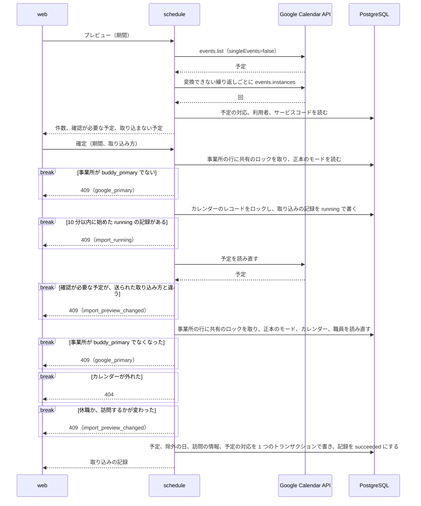
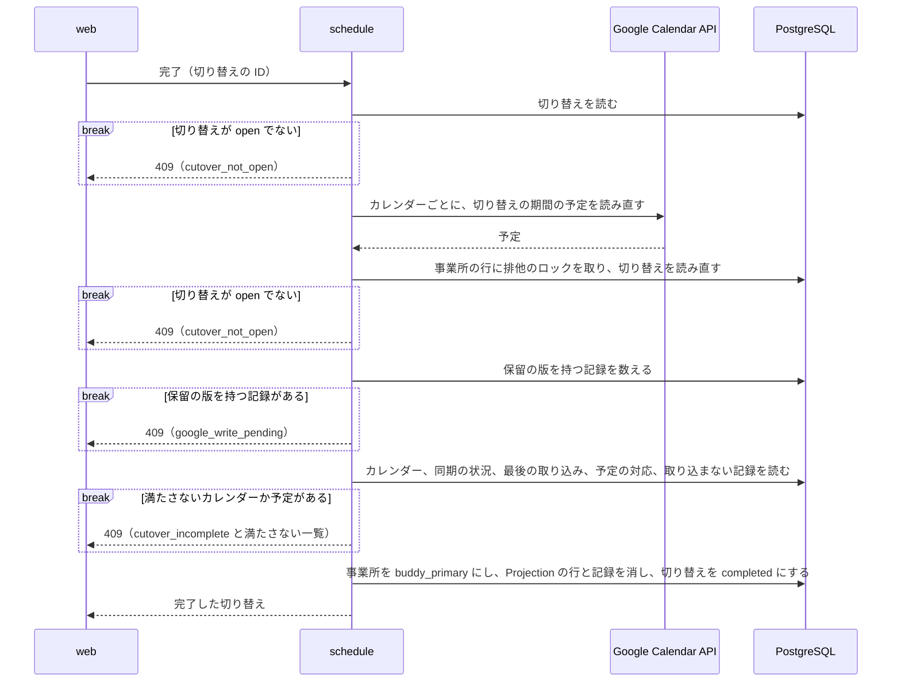
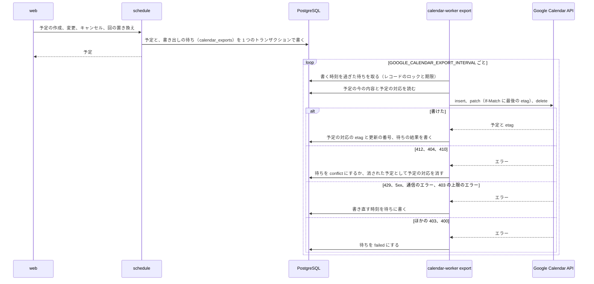
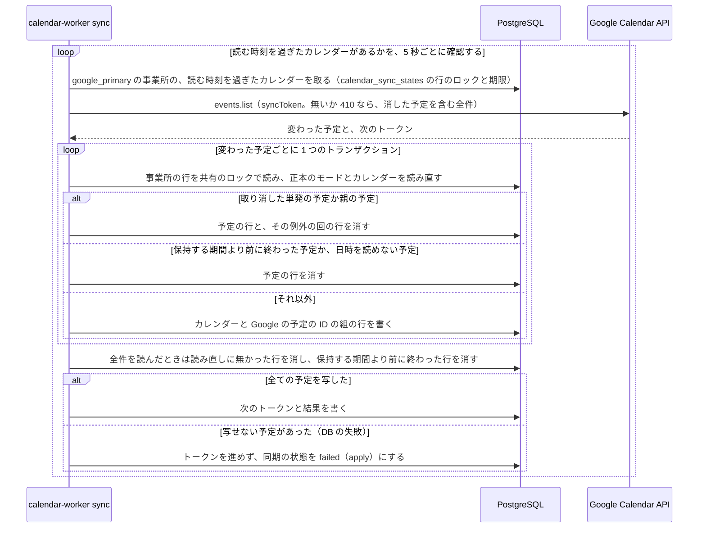
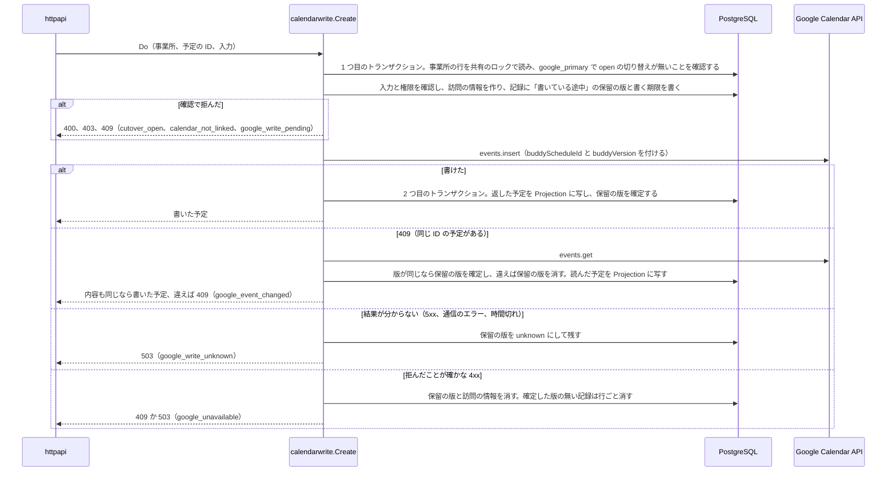
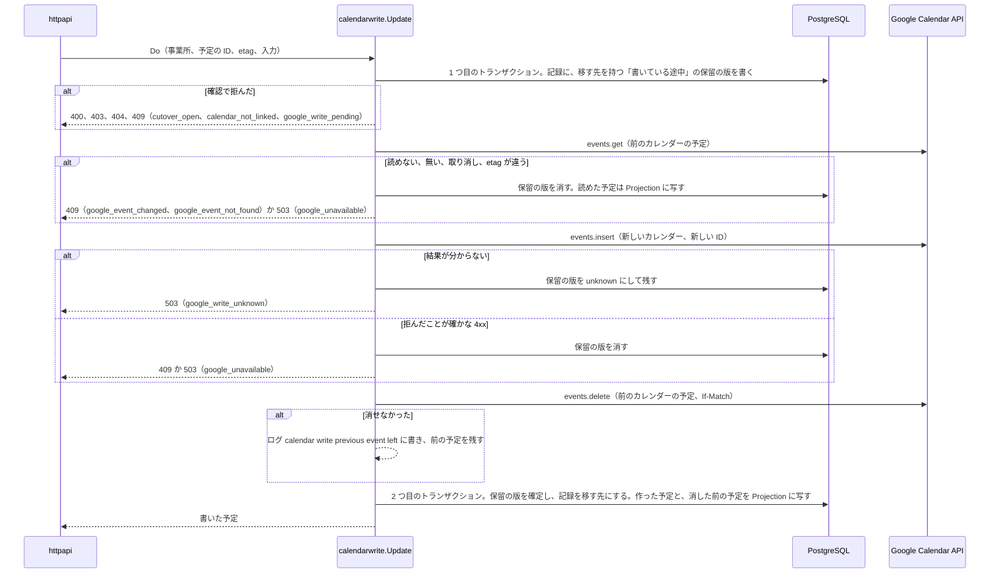
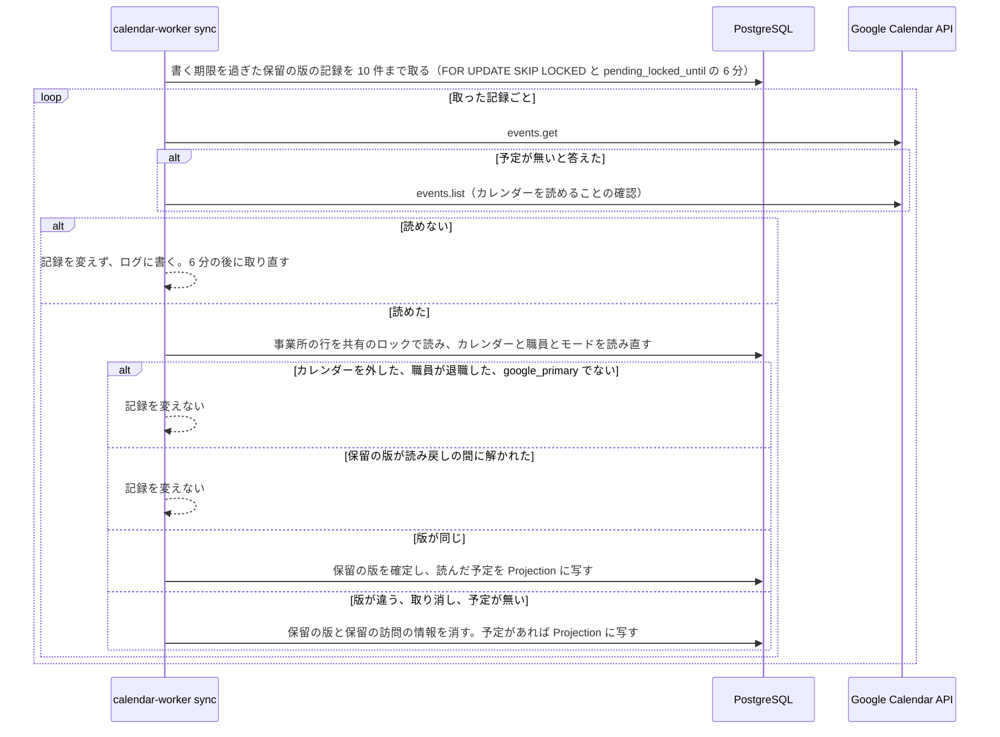
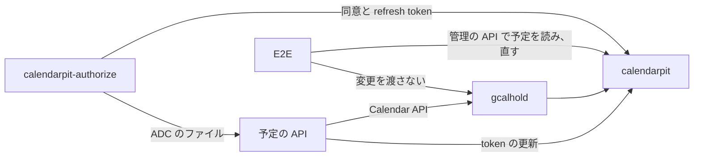

# Google カレンダーとの連携

## Overview

予定の API は、職員に結び付けた Google カレンダーと buddy の予定を、取り込み、書き出し、同期でつなぐ。
予定の API の全体の設計は [予定の管理の Design Doc](https://github.com/Fukuemon/buddy/blob/develop/services/schedule/DesignDoc.md) に、全体の中での責務と依存は [buddy Design Doc](https://github.com/Fukuemon/buddy/blob/develop/docs/design/DesignDoc.md) にある。

## Scope

持つもの

- 職員と Google カレンダーの結び付け
- Google カレンダーの予定の取り込み、buddy の予定の Google カレンダーへの書き出し、Google カレンダーの変更の buddy の予定への反映
- `google_primary` の事業所で、buddy で作り、変え、取り消す予定の Google カレンダーへの書き込み
- 事業所ごとのサービスアカウントでの Calendar API の呼び出し（`internal/gcal`）
- ローカル環境と E2E で Google Calendar API の代わりに動かすもの

持たないもの

- 予定、繰り返しの予定の規則。
  - [予定の管理の Design Doc](https://github.com/Fukuemon/buddy/blob/develop/services/schedule/DesignDoc.md) が持つ
- 職員の休職と退職の規則。
  - [職員の管理の Design Doc](https://github.com/Fukuemon/buddy/blob/develop/services/schedule/internal/features/staff/DesignDoc.md) が持つ

## Design

### 結び付け、取り込み、同期、書き出しを 4 つのパッケージに置く

連携のコードは、次の 4 つの機能のパッケージに分かれる。

- `calendar`: 3 つの機能が共有する記録と規則と、結び付けの操作
  - 結び付けたカレンダー（`ExternalCalendar`）、予定の対応（`EventLink`）、取り込みの記録（`ImportRun`）、書き出しの待ちの記録（`Export`、`Target`）
  - Google カレンダーに書いた予定の記録（`EventRecord`）と、保留の版を確定するか消す規則（`LockPending`、`ConfirmPending`、`RejectPending`）。書き込み（`calendarwrite`）と同期（`calendarsync`）が使う
  - Google の口（`EventSource`、`EventWriter`、`Accounts`）と、外部の予定と buddy の予定を読み替える規則（`classify.go`、`recurrence.go`、`eventbody.go`）
  - 結び付けの操作（`ServiceAccount`、`List`、`Check`、`Link`、`Unlink`）
- `calendarimport`: 期間を決めた手動の取り込み（`Preview`、`Import`、`plan.go`）
- `calendarsync`: 変わった予定の取得（`Syncer`）と、取った変更を当てる規則（`Applier`）
  - `Applier` の実装は、Projection に写す `projectionApplier` だけである。
- `calendarexport`: 書き出しの待ちを積む `Outbox`、待ちを Google に書く `Exporter`、確認が必要な待ちの一覧と書き直し（`ListExportIssues`、`RetryExport`）

`google_primary` の事業所で buddy から Google カレンダーに書く操作は、5 つ目のパッケージ `calendarwrite` に置く（[Google カレンダーへの書き込み](#google-カレンダーへの書き込み)）。

`calendarimport`、`calendarsync`、`calendarexport` は `calendar` だけを import し、互いには import しない。  
取り込みと同期が共有する読み替えの規則と、書き出しと同期が共有する待ちの記録を、`calendar` に置くためである。

- ADR-0021: [予定の API を機能ごとのパッケージに分ける](https://github.com/Fukuemon/buddy/blob/develop/docs/adr/0021-schedule-api-packages.md)

カレンダーと予定の対応を読み書きするインターフェースは、使う側のパッケージが、使うメソッドだけを並べて持つ。

- `calendar` の `Repository` は、結び付けの操作が使う、結び付けたカレンダーの読み書きだけを持つ。
- `calendarimport` の `Calendars` は、取り込みの記録（`RunningSince`、`CreateRun`、`FinishRun`）と、予定の対応の読み取りと作成（`ListLinks`、`CreateLink`）を持つ。
- `calendarexport` の `ExportCalendars` と `ExporterCalendars` は、書き出しが使う予定の対応の読み書きを持つ。
- `calendarsync` の `CalendarReader` は、同期が予定を当てる前にカレンダーを読み直す `Get` だけを持つ。
- `calendarsync` の `Projections` は、`projectionApplier` が使う参照のモデル（Projection）の書き込みだけを持つ。
- `calendarsync` の `PendingRecords` は、記録の読み書き（`calendar.EventRecords`）と、読み戻しが記録を取る `ClaimExpired` と `Release` を持つ。
- postgres の `CalendarRepository` は 1 つで、全てのインターフェースを満たす。

### Google カレンダーは事業所のサービスアカウントで読み書きする

予定の API は、Google Calendar API を、事業所ごとのサービスアカウントになりすました token で呼ぶ。  
職員は自分の事業所のアカウントにカレンダーを共有するので、ほかの事業所の職員が共有したカレンダーは、ID を入れても読めず、結び付けられない。

- ADR-0030: [職員のカレンダーを、事業所ごとのサービスアカウントへの共有で読み書きする](https://github.com/Fukuemon/buddy/blob/develop/docs/adr/0030-google-calendar-service-accounts.md)

- 組織の ID とサービスアカウントの対応は、運営側が設定のファイル（`GOOGLE_CALENDAR_SERVICE_ACCOUNTS_FILE`）で渡す。
  - 予定の API は、事業所の `facilities.org_id` で対応を引く。
- 事業所は、次のどちらかで決める。
  - リクエストの本文からは受けない。
  - リクエストを受ける操作: パスの事業所か、結び付けたカレンダーのレコードの事業所。パスの事業所は、認証のミドルウェアがトークンの職員の事業所と一致することを確認する
  - リクエストを受けない書き出しと増分の取得: カレンダーのレコードの事業所（`external_calendars.facility_id`）
- 対応の無い事業所と、組織に結び付けていない事業所のカレンダーの操作は、503 の `calendar_not_configured` を返す。
  - 書き出しは、書き直しの回数の上限まで待ちを残す。
- サービスアカウントごとの Calendar API のクライアントを起動のときに作り、token は有効期限まで使い回す。
- Application Default Credentials が事業所のサービスアカウントそのものとして動くときは、重ねてなりすまさず、その token を使う。
  - ローカルで検証の事業所のアカウントになりすました Application Default Credentials を使うと、サービスアカウント自身へのトークン作成者のロールが要るためである。
  - 見分けは、認証情報のファイルの `client_email`（キー）か、なりすます先の URL（なりすましと Workload Identity Federation）のメールアドレスで行う。メタデータサーバーの認証情報は、別のアカウントとみなす。
- 実際の Google Calendar API では、サービスアカウントが持つカレンダーに対して、取り込み、書き出し、増分の取得、確認が必要な予定の解き方が動く。
  - 職員が共有したカレンダーに「予定の変更」の権限で書けるかは、未確認である。確認するまで、本番で書き出しを有効にしない。
  - この確認は、PRD の [Open Questions](https://github.com/Fukuemon/buddy/blob/develop/docs/PRD.md#open-questions) にある。
  - 出典: [#180 の実際の API での確認](https://github.com/Fukuemon/buddy/issues/180#issuecomment-6333280999)
  - ADR-0030: [承認の条件](https://github.com/Fukuemon/buddy/blob/develop/docs/adr/0030-google-calendar-service-accounts.md#承認の条件)
- token を作れないときのエラーの文は、状態コードだけを持つ。
  - IAM のレスポンスはなりすます先のリソースの名前を含むことがあり、サービスアカウントのメールアドレスをログに出さないためである。

### 連携の操作の権限

結び付け、取り込み、確認が必要な予定の操作は、全て職員の管理の権限（`staff.manage`）を求める。  
連携の 4 つのパッケージの操作は、始めに `principal.RequireStaffManage` で確認し、持たない職員を 403（`forbidden`）で拒む。  
ただし、職員が自分に結び付いたカレンダーを読む操作（`getMyExternalCalendar`）だけは、権限を求めない。下の [自分のカレンダーの連携の状態](#自分のカレンダーの連携の状態) にある。

- web は、`getMe` の権限で職員の管理の権限が無いと分かれば、カレンダーの連携、予定の取り込み、確認が必要な予定の画面で連携の API を呼ばず、権限が無いことを出す。
  - 画面の判定は表示のためだけで、拒むのは予定の API である。
- 画面を開いた後に権限を外された職員の操作は、予定の API が 403 で拒む。
  - web は、どの操作の 403 も「この操作をする権限がありません。」にする（`apps/web/src/features/calendar/lib/errorMessage.ts`）。

### カレンダーの結び付け

職員の管理の権限を持つ職員が、職員に Google カレンダーを結び付け、外す。  
画面の動きは、画面仕様書の [カレンダーの連携](https://github.com/Fukuemon/buddy/blob/develop/docs/screens/schedule-link_カレンダーの連携/index.md) にある。

- 画面は、開くと職員の一覧、結び付けたカレンダーの一覧、サービスアカウントのメールアドレス（`getCalendarServiceAccount`）を並べて読む。
  - メールアドレスが 503 の `calendar_not_configured` なら、結び付けの準備ができていないことを出し、ほかの失敗なら読み込みの失敗にする。
- 読めるかの確認（`createExternalCalendarCheck`）は、事業所のサービスアカウントで予定の一覧を 1 件だけ読む。
  - 予定は取り込まない。
  - Google が 403 か 404 を返せば 422 の `calendar_unreadable` に、Google に届かないかほかのエラーなら 502 の `calendar_unavailable` にする。
  - レスポンスとエラーの文に、Google のレスポンスの本文とカレンダーの ID を入れない。
- 結び付け（`createExternalCalendar`）は、職員が事業所にいて退職していないことを確認し、もう一度読めるかを確認してから書く。
  - 書く前に事業所の行に共有のロックを取り、職員を読み直す。確認の後に退職した職員へ結び付けないためである。
  - 結び付けられないときは、原因ごとに 409 の code を返す。
    - `staff_has_calendar`: 職員に外していないカレンダーがある
    - `calendar_taken`: カレンダーがほかの職員に結び付いている。外したカレンダーを含む
    - `calendar_already_linked`: カレンダーがその職員にすでに結び付いている
  - 外した同じカレンダーを同じ職員に結び付けると、外したレコードを使い直す。
- 外す（`removeExternalCalendar`）は、レコードを消さずに `disabled_at` を入れる。
  - 取り込んだ予定、予定の対応、取り込みの記録は残るので、結び付け直して同じ期間を取り込んでも、予定は重ならない。

#### 自分のカレンダーの連携の状態

職員は、画面仕様書の [自分の情報](https://github.com/Fukuemon/buddy/blob/develop/docs/screens/account-profile_自分の情報/index.md) で、自分に結び付いたカレンダーと、最も新しい取り込みを読む。  
結び付いたカレンダーの一覧（`listExternalCalendars`）は職員の管理の権限を求めるので、自分の分だけを返す操作を分けて足す。

- `GET /v1/me/external_calendar`（`getMyExternalCalendar`）は、トークンの職員に結び付いた、外していないカレンダーを返す。
  - レスポンスは `{ "external_calendar": ExternalCalendar | null }` にする。結び付いていなければ `null` を返し、404 にしない。結び付いていないことは、画面が出す状態の 1 つで、失敗ではないためである。
  - `ExternalCalendar` は、一覧と同じ形で、`last_import`（最も新しく始めた取り込み）を含む。
- 権限は求めない。トークンの職員の分だけを返し、職員の ID を引数に取らないので、ほかの職員のカレンダーは読めない。
  - 休職と退職の職員は、`getMe` と同じく、トークンの確認の段で 403 になる。
- `GET /v1/me` には足さない。`GET /v1/me` は、web が全ての画面の権限の確認で読み直すので、結び付けたカレンダーと取り込みの記録を読む分だけ重くなるためである。

### Google カレンダーの取り込み

職員の管理の権限を持つ職員が、職員に Google カレンダーを結び付け、期間を選んでプレビューし、確定して予定に取り込む（ADR-0029 の取り込み）。  
プレビューは `calendarimport` の `Preview` が、確定は `Import` が行う。  
画面の動きと、職員から見た取り込みの結果は、画面仕様書の [予定の取り込み](https://github.com/Fukuemon/buddy/blob/develop/docs/screens/schedule-import_予定の取り込み/index.md) と [カレンダーの連携](https://github.com/Fukuemon/buddy/blob/develop/docs/screens/schedule-link_カレンダーの連携/index.md) にある。

- ADR-0029: [Google カレンダーとの連携を、事業所ごとの正本のモードで分ける](https://github.com/Fukuemon/buddy/blob/develop/docs/adr/0029-google-calendar-sync.md)

次の図は、プレビューから確定までの呼び出しと、確定が何も書かずに返る道を示す。

#### プレビューと確定

プレビューの結果は保存しない。  
確定は Google の予定を読み直し、プレビューと同じ規則で読み替える。  
確認が必要な予定の集合かバージョン（まとめた予定の ID と etag から作る）が、送られた取り込み方と違えば、何も書かずに 409 を返す。

web は、プレビューの結果と選んだ取り込み方を画面の中だけで持つ。  
職員か期間を変えると捨て、確定には、プレビューした期間と、確認が必要な予定ごとの取り込み方（予定の ID と版）を送る。

同じカレンダーの取り込みは、1 つずつ行う。  
確定の始めにカレンダーのレコードに排他のロックを取り、10 分以内に始めた `running` の記録があれば 409 を返す。  
止まった取り込みが次の取り込みを止め続けないよう、10 分より前の `running` は数えない。

取り込みの確定は、予定の正本のモードが `buddy_primary` の事業所と、`open` の切り替えがある `google_primary` の事業所でだけ書く。  
切り替えの間の取り込みの規則は、[予定の正本の切り替え](#予定の正本の切り替え) にある。  
確定は、取り込みの記録を作るトランザクションの始めと、予定を書くトランザクションの始めの 2 回、事業所の行を共有のロックで読み、`schedule.RequireWritable` でモードを確認する。  
1 回目は、Google を読む前に、取り込みの記録を作らずに拒む。  
2 回目は、読み替えている間にモードが変わったときに、記録を `failed` にして何も書かない。  
切り替えの無い `google_primary` の事業所では 409（`google_primary`）を返す。  
プレビューは書かないので、モードによらず動く。

- ADR-0026: [予定の書き込みのモデルを schedule に、読み取りのモデルを scheduleview に置く](https://github.com/Fukuemon/buddy/blob/develop/docs/adr/0026-schedule-write-read-models.md)
- ADR-0031: [事業所の予定の正本を、期間のある切り替えの記録で Google カレンダーから buddy へ移す](https://github.com/Fukuemon/buddy/blob/develop/docs/adr/0031-calendar-cutover.md)

取り込んだ Google の予定は、`external_event_links` の対応を持つ。  
対応のある予定は取り込み済みに数え、もう一度は書かない。

#### 繰り返しの読み替え

繰り返しは、親の予定の RRULE を buddy の規則（毎週の曜日、毎月の日付、毎月の第何週の曜日）に変換できれば、規則ごと取り込む。  
期間の外の回も繰り返しの予定に含まれる。

- Google が返した取り消した回は、除外の日にする。
- 期間の中の変えた回は、除外の日と、元の回の日付を持つ単発の予定にする。
- 前の取り込みで取り込んだ繰り返しにも、後の期間の取り消しと変更を反映する。

前の取り込みで回か例外の回だけを取り込んだ繰り返しは、規則に変換できる形でも回ごとにする。  
規則ごと作ると、前に取り込んだ回と重なるためである。

Google が変えた回を、元の日時と今の日時のどちらで期間に絞るかは、未確認である。  
今の日時で絞るとみなし、期間の前後 31 日を広げて例外の回を読み直し、元の日付が期間の中の回も読み替える。  
期間の中の回を期間の外へ動かしても、元の日に回が残らない。  
31 日より遠くへ動かした回は読めず、元の日に回が残る。  
Calendar API は元の日時で予定を絞れず、上限なしに探すと回ごとに API を呼ぶことになるためである。

変換できない繰り返し（隔週、複数の曜日、最終週など）は、events.instances で期間の中の回を読み、回ごとに単発の予定にする。  
回の対応は、回の ID で持つ。  
取り消した回は書かず、取り込まない予定にも数えない。

#### 日付と時刻

日付と時刻は Asia/Tokyo で読む。  
終了が開始の翌日で、長さが 24 時間未満の予定は、開始の日の予定に「終了が翌日か」の印（`ends_next_day`）を付けて取り込む。

- ADR-0033: [日をまたぐ予定を、開始の日の予定に「終了が翌日か」の印を付けて持ち、取り込み、カレンダー、照合で扱う](https://github.com/Fukuemon/buddy/blob/develop/docs/adr/0033-overnight-schedule.md)

印の付け方は次のとおり。

- 翌日の 0:00 に終わる予定（24:00 に終わる予定）も、終了の時刻を 0:00 にして印を付ける。
- 終了が開始の翌日より後の予定と、24 時間以上の予定は、取り込まない予定（`multi_day`）にする。
  - 分に丸めると終了の時刻が開始の時刻より前にならない予定は、24 時間とみなす。
- 繰り返しは、親の予定（最初の回）の印で取り込む。
  - Google の繰り返しの回は親と同じ長さなので、印が親と違う回は変えた回だけである。変えた回は、その回の印を持つ回の置き換えか、回ごとの単発の予定にする。

プレビューの確認が必要な予定と取り込まない予定は、印を `ends_next_day` で返す。  
web は、印の付いた予定と `multi_day` の予定の終了の時刻に「翌」を付ける。

#### タイトルと利用者

タイトルに `【` と `】` の両方を含む予定を訪問の予定にし、含まない予定は、タイトルをそのまま使った通常の予定にする。  
タイトルのサービス内容と利用者名は、照合の API と同じ規則で表記をそろえ、サービスコードと事業所の利用者を引く。  
利用者を 1 人に決められない予定は、プレビューで取り込み方を選ばせる。  
取り込んだ訪問の予定の主訪問者は、カレンダーを結び付けた職員である。

予定のタイトル、利用者名、カレンダーの ID は、取り込まない予定の一覧、エラーのメッセージ、ログに出さない。  
確認が必要な予定だけは、タイトルから読んだ利用者名とサービス内容を返す。

空き時間だけの共有（`freeBusyReader`）のカレンダーは、読めないとみなす（422 `calendar_unreadable`）。  
公式の文書は、空き時間だけの共有の `events.list` が `singleEvents=true` のように動き、繰り返しの親を返さないと書く。  
予定のタイトルを返さないことと、実際の API での振る舞いは未確認である。

- 出典: [Recurring events](https://developers.google.com/workspace/calendar/api/guides/recurringevents)

#### 休職、退職、訪問しない職員

休職の職員のカレンダーは、結び付けたまま取り込める。  
新しい予定は、取り込む予定と確認が必要な予定にせず、取り込まない予定（`staff_on_leave`）にする。  
前の取り込みで繰り返しのまま取り込んだ予定の、取り消した回と変えた回は、既に割り振った予定の変更なので、休職でも除外の日と回の置き換えにする。  
繰り返しの予定をほかの職員に割り振り直していれば、変えた回は新しい予定とみなし、取り込まない予定にする。

訪問しない職員（ADR-0006）のカレンダーも、休職と同じく扱う。  
新しい予定は、取り込まない予定（`staff_non_visiting`）にする。

退職した職員に結び付けようとすると 400 を返す。  
退職でカレンダーを外すようにする前に退職にした職員のカレンダーが残っていても、プレビューと確定は 404 を返す。

確定は、予定を書くトランザクションの始めに事業所の行に共有のロックを取り、カレンダーを外していないことと、職員の休職と訪問しない職員かがプレビューのために読み替えたときと同じことを確認する。

- 確定が読み替えてから書くまでの間に休職か復職になるか、訪問するかが変われば 409（`import_preview_changed`）を、退職してカレンダーが外れれば 404 を返し、何も書かない。
  - 確定は休職を読み直してから読み替えるので、プレビューの後、確定を押す前に変わった休職は、確定の読み替えに入る。
- 退職が先にコミットすれば確定は 404 になる。
  - 確定が先にコミットし、今日以降の予定を取り込んでいれば、退職はその予定が残るので 409 になる。

### 予定の正本の切り替え

Google カレンダーを正本にする事業所（`google_primary`）の予定を buddy に取り込み、正本を buddy（`buddy_primary`）に移す作業を、切り替え（`Cutover`）の記録で行う。  
切り替えの操作と記録は `calendarimport` に置き、最後のモードの変更だけを `organization` に頼む。  
決定の背景は ADR-0031 にあり、画面の動きは画面仕様書の [予定の正本の切り替え](https://github.com/Fukuemon/buddy/blob/develop/docs/screens/schedule-cutover_予定の正本の切り替え/index.md) にある。

- ADR-0031: [事業所の予定の正本を、期間のある切り替えの記録で Google カレンダーから buddy へ移す](https://github.com/Fukuemon/buddy/blob/develop/docs/adr/0031-calendar-cutover.md)

切り替えの操作は次の 4 つで、どれも職員の管理の権限（`staff.manage`）を求める。

- `StartCutover`（始める）: 事業所の行を排他のロックで取り、確認を満たせば `open` の切り替えを作る。
  - 確認するのは、`google_primary` で、`open` の切り替えと保留の版を持つ記録が無く、外していない全てのカレンダーの最後の同期が成功していることである。
  - 取り込みの期間は、今の Asia/Tokyo の月の初日から先の全てにする。
- `GetCutover`（状況を読む）: `open` の切り替えと、カレンダーごとの同期の状況と、この切り替えで最後に成功した取り込みを返す。
- `CompleteCutover`（完了する）: 事業所の行を排他のロックで取って、保留の版を持つ記録が無いことを確認する。
  - 次に下の「完了の確認」をし、満たせば事業所を `buddy_primary` にし、事業所の Projection の行と記録を消し、切り替えを `completed` にする。
- `CancelCutover`（やめる）: 事業所の行を排他のロックで取り、この切り替えの取り込みで作った予定、繰り返しの予定、訪問の情報、予定の対応を消して、切り替えを `canceled` にする。
  - モードは `google_primary` のままにする。

記録は 2 つのテーブルに持つ。

- `calendar_cutovers`: 事業所、状態（`open`、`completed`、`canceled`）、取り込みの期間の最初の日、始めた職員と時刻、終えた時刻。
  - `open` の行は、事業所ごとに一意の部分索引で 1 つまでにする。
- `calendar_cutover_skips`: 切り替えの取り込みで、確認が必要な予定に取り込まないを選んだ記録。
  - カレンダーの取り込みのたびに、そのカレンダーの記録を、その取り込みで選んだものに置き換える。

切り替えの取り込みの記録（`import_runs`）と、取り込みで作った予定の対応（`external_event_links`）は、切り替えの ID（`cutover_id`）を持つ。  
取り込みの記録の期間の終わり（`range_end`）は NULL にする。

`open` の切り替えは、自動の期限では終わらない。マネージャーが完了するか、やめるまで `open` のままになる。  
放置を防ぐ運用は、[基盤と運用](https://github.com/Fukuemon/buddy/blob/develop/context/operations.md#switching-a-facility-to-buddy) にある。

#### 切り替えと buddy からの書き込みの順序

切り替えの取り込みは、`open` の間に buddy から Google カレンダーへの書き込みが止まっていることを前提にする。  
2 つの操作は、事業所の行のロックで次のとおり並べる。

- `calendarwrite` の作成、変更、取り消しは、手順 1 で事業所の行を共有のロックで読み、`open` の切り替えがあれば、Google に書かずに 409（`cutover_open`）を返す。
  - 繰り返しの予定の作成、回の置き換え（`changeOccurrence`）、一覧の回の ID での変更と取り消しも同じである。
- `StartCutover` と `CompleteCutover` は、事業所の行を排他のロックで取った後に、事業所の記録（`calendar_event_records`）のうち保留の版を持つものを数える。
  - 1 件でもあれば、何も書かずに 409（`google_write_pending`）を返す。
  - 排他のロックを取った後は、新しい書き込みが `open` の切り替えを見て拒まれる。ロックより前の書き込みは、保留の版を残している。
  - 完了の確認の etag の比べ方は、まだ Google に届いていない書き込みを見つけられない。保留の版で、処理中の書き込みを数える。
- マネージャーは、保留の版が確定するか消えるまで待ってから、もう一度始めるか完了する。結果が分からない保留の版は、同期の読み戻しが解く。

- ADR-0031: [事業所の予定の正本を、期間のある切り替えの記録で Google カレンダーから buddy へ移す](https://github.com/Fukuemon/buddy/blob/develop/docs/adr/0031-calendar-cutover.md)

予定の一覧（`listSchedules`）は、`google_primary` の事業所で、`open` の切り替えを `cutover` に返す。  
画面は、「切り替え中」と、始めた職員と始めた時刻を出し、buddy から予定を変えられないことを示す。

- `cutover` は、始めた時刻（`started_at`）、始めた職員の ID（`started_by`）と名前（`started_by_name`）、取り込みの期間の最初の日を持つ。
  - 職員の ID と名前は、同期の状況（`calendar_syncs`）の `staff_id` と `staff_name` と同じ形にする。
- 始めた職員が休職か退職していても、名前をそのまま返す。職員を退職にしても、名前は残るためである。
- 予定の一覧を読める全ての職員に、始めた職員の名前を返す。予定の閲覧の権限では絞らない。
- `buddy_primary` の事業所では、`open` の切り替えが無いので、`cutover` は常に `null` である。
- 画面は、`cutover` が `null` でない間、予定の作成、変更、キャンセルの操作を閉じる（[画面からの書き込み](#画面からの書き込み)）。

#### 切り替えの取り込み

取り込みは、今の取り込みの操作（`Preview`、`Import`）を使う。  
事業所に `open` の切り替えがあれば、切り替えの取り込みの規則で読み替える。

- 期間は、切り替えの期間（最初の日から先の全て）だけを受ける。
  - Google の予定は `timeMax` を付けずに読む。ほかの期間は 400 を返す。
- 書き込みの確認は、`schedule.RequireWritable` の例外として、`open` の切り替えがある `google_primary` の事業所も通す（`requireImportable`）。
  - 確定は 2 回のトランザクションの始めで、事業所の行を共有のロックで読んでから `open` の切り替えを読む。2 回目に切り替えが終わっていれば 409（`cutover_not_open`）を返し、何も書かない。
- 予定の API の記録が、Google が受けたと分かった版の訪問の情報を持つ予定は、タイトルを読み替えずに、記録の訪問の情報の訪問の予定にする。
  - 利用者、主訪問者、同行者、サービスコード、訪問の区分を写した、新しい訪問の情報を作る。記録が指す訪問の情報を予定に指させると、切り替えをやめるときに予定と一緒に消せないためである。
  - タイトルが記録の訪問の情報と食い違う予定（一覧の `title_mismatch`）と、タイトルを読めない予定も、記録の訪問の情報を使い、確認が必要な予定にしない。ADR-0029 は、記録の訪問の情報を訪問の情報の正本にするためである。
  - 主訪問者は記録の訪問の情報のとおりにし、予定の職員はカレンダーの職員のままにする。
  - 利用の終了の利用者の過去の予定は、タイトルを読み替える取り込みと同じく、入力のエラーになる。
  - 確定した版の無い記録（保留の版だけの記録）は使わず、タイトルを読み替える。開始と完了が保留の版を拒むので、取り込みの時点ではこの記録は無い。
  - 日時を読めない予定と終日の予定は、記録があっても取り込まない。
  - プレビューと完了の確認も、同じ規則で読み替える。
  - 繰り返しの予定の親の記録の訪問の情報は、繰り返しの予定に使う。自分の確定した記録を持たない例外の回も、親の予定の記録の訪問の情報を使う。一覧（[Projection を読む側](#projection-を読む側)）と同じ規則である。
    - 訪問の情報を持たない確定した記録（通常の予定）を持つ例外の回は、タイトルを読み替える。
- 繰り返しの予定は、回に展開しない。
  - buddy の規則に写せない繰り返しの予定は、確認が必要な予定（`recurrence_unsupported`）にし、取り込み方は取り込まないだけを受ける。
- 親の予定を規則のまま取り込まないとき（取り込まない予定、写せない予定、取り込まないを選んだ予定）は、その変えた回も取り込まない。
  - 繰り返しの一部だけを単発の予定にして移さないためである。
- 前の取り込みの後に Google で変わったか消えた予定は、buddy の写しを消し、Google の今の内容で取り込み直す（上書き）。
  - 予定の対応の etag と Google の etag が違うか、読み直した予定に無い対応を、食い違う対応にする。
  - 繰り返しの親か回の 1 つが食い違えば、親と回の全ての対応を食い違うものにする。回の置き換えは親の繰り返しの予定を指すので、親だけを取り込み直せないためである。
  - 切り替えの間は buddy から予定を書けないので、写しを消しても職員の変更は失われない。

#### 完了の確認

次の図は、完了が Google を読み直してから、事業所の行の排他のロックの中で確認し、満たさなければ何も書かずに返す道を示す。

カレンダーごとに、次の 3 つを確認する。

- この切り替えで取り込み（`not_imported`）、最後の取り込みの後に同期が成功している（`sync_stale`）。
- 読み直した予定を切り替えの取り込みの規則で読み替え、取り込む予定と除外の日が残っていない（`event_not_imported`）。
  - 確認が必要な予定は、取り込まないと決めた記録があり、記録のバージョンが今のバージョンと同じである（`needs_review`）。
- 予定の対応の etag と Google の etag が同じで（`changed`）、読み直した予定に無い対応が無い（`deleted`）。

満たさない一覧は、カレンダーの順に、カレンダーの中は日時の順（日時の無い予定は最後）に並べる。  
予定のタイトルは利用者名を含むので返さず、日時と理由だけを返す。

完了は、Projection の行を消すのと同じトランザクションで、事業所の記録（`calendar_event_records`）を全て消す。  
記録の確定した版と保留の版が指していた訪問の情報は、どの予定、繰り返しの予定、記録も指さなくなったものだけを消す。  
`buddy_primary` の後は記録を誰も読まず、記録の訪問の情報は切り替えの取り込みが buddy の予定に写してあるためである。  
保留の版があって 409（`google_write_pending`）で止まったときと、完了の確認を満たさないときは、何も消さない。

完了の後は、同期が事業所のカレンダーを読まなくなり、予定の変更を書き出すようになる。  
切り替えの取り込みで作った予定は、書き出しの待ちを持たない。  
Google の予定と同じ内容なので、完了の後に変えた予定から書き出す。

### Google カレンダーへの書き出し

buddy で作り、変え、キャンセルした予定を、予定の職員が結び付けた Google カレンダーに書く（ADR-0029 の書き出し）。  
Google カレンダーで直された予定は、書き出しでは buddy に当てず、確認が必要な予定に出す。  
Google カレンダーで変わった予定は、buddy の予定に当てない。  
同期は、buddy を予定の正本にする事業所のカレンダーを読まない（[Google カレンダーとの同期](#google-カレンダーとの同期)）。

次の図は、予定の操作が書き出しの待ちを積み、書き出しの Worker（`calendar-worker export`）が Google に書くまでを示す。  
Google の応答ごとの扱いは、[衝突とエラー](#衝突とエラー) の表にある。

#### 書き出しの待ちと処理

書き出しは、`GOOGLE_CALENDAR_EXPORT_ENABLED` が `true` のときだけ動く。  
`false` のときは待ちを積まず、書き出しの処理も動かさない。

予定の操作（`schedule` の `Create` など）は、予定を書くのと同じトランザクションで `calendarexport` の `Outbox` に待ちを積む。  
待ちを Google に書くのは、`calendarexport` の `Exporter` である。  
積むのは、予定の職員に外していないカレンダーがあるときと、予定の対応のカレンダーを外していないとき（職員を替えて、前のカレンダーの予定を消すとき）だけである。  
積むのは、予定の正本のモードが `buddy_primary` の事業所の予定だけである。  
予定の操作は `google_primary` の事業所で予定を書かないので、`Outbox` のモードの確認は、予定の操作のほかから呼ばれたときの守りになる。  
取り込みで書いた予定は積まない。  
カレンダーを結び付ける前に作った予定は書き出さない。  
結び付けた後にその予定を変えると書く。

待ちは予定ごとに終わっていないものを 1 つだけ持ち、積み直すと `revision` が増える。  
書くときは、積んだ時点ではなく書く時点の予定の内容を書く。  
書いている間に積み直されたら、結果によらず待ちを pending に戻して数え直し、もう一度書く。

書き出しの処理は、API と別のプロセスの `calendar-worker export` で動く。

- 待ちは `FOR UPDATE SKIP LOCKED` と期限（`locked_until`、2 分）で 5 件ずつ取り、1 件を 20 秒で打ち切るので、期限のうちに書き終える。
- 常駐の形では、取れるものが無くなるまで続けて取ってから、`GOOGLE_CALENDAR_EXPORT_INTERVAL` を待つ。
  - 待ちを取れなかったときは、間隔を待ってから取り直す。止める合図を受けたら、新しく取らない。
  - 常駐と 1 回の形の繰り返しは `cmd/calendar-worker` が持ち、`Exporter` は 1 回の取得と処理（`ExportDue`）だけを持つ。
  - ADR-0032: [Google カレンダーの書き出しと同期を、予定の API と同じイメージの Worker のコマンドで役割ごとに動かし、繰り返しを Worker のコマンドに集める](https://github.com/Fukuemon/buddy/blob/develop/docs/adr/0032-calendar-worker.md)
- 結果は、取ったときの回数（`attempts`）と比べて書き、期限が切れた後にほかの Worker が取り直した待ちを変えない。
  - 外部の API はトランザクションの外で呼ぶ。
- 止める合図で書けなかった待ちは、書こうとした回数に数えずに返す。
- 取った待ちの事業所が `buddy_primary` でなければ、Google に書かずに `conflict`（`not_buddy_primary`）にして保留にする。
  - 保留にした待ちは、要約のログの `held_count` に数え、書いていない待ちの滞留（`pending` だけを数える）には数えない。
  - 確認が必要な予定の一覧に出る。「buddy の内容で書き直す」を選んでも、事業所が `buddy_primary` になるまでは、また保留にする。

- ADR-0029: [Google カレンダーとの連携を、事業所ごとの正本のモードで分ける](https://github.com/Fukuemon/buddy/blob/develop/docs/adr/0029-google-calendar-sync.md)

予定の更新の番号（`version`）は、単発の予定の変更とキャンセル、繰り返しの予定の回の除外のたびに 1 つ増える。  
書いた後に、予定の対応（`external_event_links`）に Google の etag と更新の番号（`synced_version`）を書く。  
同期が、どちらの側が変わったかを比べるのに使う。

#### 書く先

書く先は、予定の職員（`staff_id`）が結び付けたカレンダーである。  
訪問の予定では、画面が主訪問者を予定の職員と同じにする。

- 予定の対応があり、職員のカレンダーが対応のカレンダーと同じなら、Google の予定を部分更新する。
  - 取り込んだ予定もこの形で更新する。
- キャンセルした予定と、職員を替えた予定は、対応の Google の予定を消し、対応も消す。
  - 職員を替えた予定は、新しい職員のカレンダーに作る。
- 対応のカレンダーを外していれば、そのカレンダーには書かない。
  - 外したカレンダーの予定は残る。
  - 職員に今のカレンダーがあれば、対応を消してそのカレンダーに作る。
  - キャンセルした予定と、職員に今のカレンダーが無い予定は、何も書かずに待ちを終える。確認が必要な予定の一覧で「buddy の内容で書き直す」を選んだ予定も同じで、外したカレンダーの予定を消さず、書き直さずに一覧から消える。
- 対応が無く、職員にカレンダーがあれば作る。

作る予定の ID は、buddy の予定の ULID を base32hex にした値にする。  
作った後に対応を書けずに書き直しても、Google の予定は 2 つにならない。  
同じ ID の予定があれば（409）、buddy の内容で更新する。

#### 書く内容

- Google の予定のタイトルは、訪問の予定なら `【サービス内容】利用者名`、通常の予定なら buddy の予定のタイトルである。
  - 照合の API が同じタイトルを読む。
- 日時は、タイムゾーン `Asia/Tokyo` とオフセットの無い日時で書く。
  - `extendedProperties.private` に buddy の予定の ID だけを置く。
- 終了が翌日の予定（`ends_next_day`）は、終了の日時を予定の日付の翌日から作る。
  - 繰り返しの予定では、最初の回の日付の翌日である。
- 説明は、buddy の予定に説明があるときだけ書く。
  - 取り込んだ予定の Google の説明を消さないためである。buddy で説明を消しても、Google の説明は残る。
- 参加者は書かず、通知を送らない（`sendUpdates=none`）。

#### 繰り返しの書き出し

buddy の繰り返しの規則は、全て RRULE に変換できる。  
規則に無い曜日と日は最初の回の日付から決め、終了日はその日の 23:59:59（Asia/Tokyo）を UTC にした `UNTIL` にする。  
除外の日は `EXDATE;TZID=Asia/Tokyo` にする。

回の置き換えは、Google の例外の回にせず、親の予定の `EXDATE` と、別の単発の予定にする。  
取り込んだ Google の例外の回が置き換えた日は、`EXDATE` にしない。  
`EXDATE` にすると、Google の例外の回が消えるためである。

#### 衝突とエラー

更新と削除には、予定の対応の etag を `If-Match` に付ける。  
削除は、キャンセルした予定と、職員を替えた予定の前のカレンダーの予定に行う。  
Google の応答ごとの待ちと予定の対応の扱いは、次のとおり。

| Google の応答 | 更新のとき | 削除のとき |
| --- | --- | --- |
| 412 | `events.get` で予定を読み、`status` が `cancelled` なら `conflict`（`not_found`）、ほかは `conflict`（`precondition_failed`） | `events.get` で予定を読み、`status` が `cancelled` なら消された予定として予定の対応を消し、職員を替えたときは新しいカレンダーに作る。ほかは `conflict`（`precondition_failed`） |
| 410 | `conflict`（`not_found`） | 消し終えたものとして、予定の対応を消す |
| 404 | `conflict`（`not_found`）。予定の対応は消さない | `conflict`（`not_found`）。予定の対応は消さない |
| 429、5xx、通信のエラー、403 の上限のエラー | 30 秒から倍にしながら書き直し、5 回で `failed`（`unavailable`） | 30 秒から倍にしながら書き直し、5 回で `failed`（`unavailable`） |
| ほかの 403 | 書き直さずに `failed`（`forbidden`） | 書き直さずに `failed`（`forbidden`） |
| 400 | `failed`（`rejected`） | `failed`（`rejected`） |

412 は、Google カレンダーで予定が変わったとみなし、書かない。  
Google は、消された予定に、消す前の etag を `If-Match` に付けた更新と削除を、410 でなく 412 で返す。  
そのため 412 を受けたら `events.get` で予定を読み、`status` が `cancelled` なら 410 と同じく消された予定として扱う。  
`events.get` が一時的なエラー（429、5xx、通信のエラー）で失敗したら書き直す。  
それ以外で読めないときは、412 のまま `precondition_failed` にする。

`gcal.Writer` は、Google が書き込みを拒んだことが確かなエラーと、書いたかが分からないエラーを分けて返す（ADR-0029）。

- 5xx、通信のエラー、時間切れは `calendar.ErrOutcomeUnknown` で返す。Google が書いた後に、応答だけが失われたことがあるためである。
- 429 と 403 の上限のエラーは `calendar.ErrUnavailable` で返す。
- 412 の後の `events.get` が失敗したときは、書き込みが 412 で拒まれているので、`ErrUnavailable` で返す。
- 書き出しは、どちらのエラーでも同じく書き直す。書いたかが分からない作成を書き直すと、同じ予定の ID の作成が 409 になり、buddy の内容で書き直してから対応を作る。

404 では予定の対応を消さない。  
カレンダーの共有が外れたときの 404 と、予定が無いときの 404 を見分けられないとみなし、対応を消すと、共有を戻した後に予定が 2 つになるためである。  
キャンセルの削除が 404 でも、対応を消さずに `conflict` にする。  
共有が外れたカレンダーの予定の更新と削除が 404 を返すかは、未確認である。

- 出典（消された予定への patch、update、delete、get の応答）: [#180 の実際の API での確認](https://github.com/Fukuemon/buddy/issues/180#issuecomment-6332187503)

`conflict` の待ちは、buddy で予定を変えても書かない。  
解き方は次のとおり。

- 職員の管理の権限を持つ職員が、確認が必要な予定の一覧から「buddy の内容で書き直す」を選ぶと、`If-Match` を付けずに書き直す。
- 消された予定は、`status` を `confirmed` にした部分更新で戻す。
  - 実際の API は、`If-Match` の無い patch を、消された予定にも 200 で返す。410 を受けたときは、予定の対応を消して作り直す。

`failed` の待ちは、buddy で予定を変えると数え直して書く。  
待ちのエラーは決まった値（`error_code`）だけを持ち、確認が必要な予定の一覧とログに、予定のタイトル、利用者名、カレンダーの ID を出さない。

### Google カレンダーとの同期

同期は、事業所の予定の正本のモードで、読むカレンダーと当て方を分ける。

- Google カレンダーを正本にする事業所（`google_primary`）では、職員が Google カレンダーで作り、変え、取り消した予定を、参照のモデル（Projection）に写す。
  - 予定の対応の有無によらず、Google で新しく作った予定も写す。buddy の予定のテーブルには書かない。
- buddy を正本にする事業所（`buddy_primary`）では、同期はカレンダーを読まない。
  - Google カレンダーでの変更は、buddy に取り込まない。
  - Google カレンダーで直された予定は、書き出しが `If-Match` の 412 で見つけ、確認が必要な予定に出す。
- 同期は、どのモードでも、外部の変更を buddy の予定のテーブルに当てない。
  - ADR-0029: [Google カレンダーとの連携を、事業所ごとの正本のモードで分ける](https://github.com/Fukuemon/buddy/blob/develop/docs/adr/0029-google-calendar-sync.md)

次の図は、同期の Worker（`calendar-worker sync`）が `google_primary` の事業所のカレンダーの変わった予定を読み、予定ごとに Projection に写すまでを示す。

#### 同期の処理

同期は、`GOOGLE_CALENDAR_SYNC_ENABLED` が `true` のときだけ動く。  
設定は、書き出し（`GOOGLE_CALENDAR_EXPORT_ENABLED`）を有効にしないと同期を有効にできない。  
この制約は、`buddy_primary` の事業所で Google の変更を buddy に当てていたときのものである。  
`google_primary` の事業所の同期は、書き出しを使わない。

同期の処理は、`calendarsync` の `Syncer` が変わった予定を読み、事業所の正本のモードの `Applier` が 1 つの予定ずつ当てる。  
モードと `Applier` の対応（`Appliers`）は、組み立て（`internal/assemble`）が決めて `Syncer` に渡す。  
組み立ては、`google_primary` に `projectionApplier` だけを渡し、`buddy_primary` には渡さない。  
同期の処理は、API と別のプロセスの `calendar-worker sync` で動く。

- ADR-0021: [予定の API を機能ごとのパッケージに分ける](https://github.com/Fukuemon/buddy/blob/develop/docs/adr/0021-schedule-api-packages.md)

- 読む時刻（`next_sync_at`）を過ぎたカレンダーがあるかを 5 秒（間隔がそれより短ければ間隔）ごとに確認し、取れるものが無くなるまで続けて取る。
  - 確認の間隔と繰り返しは `cmd/calendar-worker` が持ち、`Syncer` は 1 回の取得と処理（`SyncDue`）だけを持つ。
  - 読み終えたカレンダーの読む時刻は、`GOOGLE_CALENDAR_SYNC_INTERVAL` の後である。
- `Applier` のあるモードの事業所の、外していないカレンダーを、`FOR UPDATE SKIP LOCKED` と期限（`locked_until`、6 分）で 5 件ずつ取り、1 件を 1 分で打ち切る。
  - `buddy_primary` の事業所のカレンダーは取らないので、Google を読まず、同期の状態も変えない。
  - 同期の滞留（`calendar sync backlog`）も、`Applier` のあるモードの事業所のカレンダーだけで数える。取らないカレンダーを数えると、滞留が増え続けるためである。
- 結果は、取ったときの期限と比べて書き、期限が切れた後にほかの Worker が取り直したカレンダーを変えない。

`events.list` に `syncToken` を付けて、前の後に変わった予定を、消した予定と繰り返しの例外の回を含めて読む（増分の取得）。  
トークンが無いときと、Google が 410 を返したときは、`showDeleted=true` で全ての予定を読み直す。  
`syncToken` と期間は一緒に渡せないので、カレンダー全体を読む。

予定ごとのトランザクションの始めに、事業所の行を共有のロックで読み、正本のモードを読む。  
カレンダーを取った後にモードが変わり、そのモードの `Applier` が無ければ、残りの予定を当てずに、トークンと状態を前のまま返す。  
モードの切り替えは同じ行に排他のロックを取るので、`buddy_primary` に切り替えた後に、Projection に写さない。

予定を当てられなかったときは、トークンを進めずに返し、次に同じ予定から読み直す。  
同期の状態は `failed`（`apply`）にする。

#### Projection に写す内容

Projection（`calendar_event_projections`）は、Google カレンダーの 1 つの予定を 1 行にし、結び付けたカレンダーの ID と Google の予定の ID の組で一意にする。  
同じ予定を何度読んでも、行を書き直すので、行は重ならない。  
保存する項目と保存しない項目は、ADR-0029 のとおりにする。

Projection を書くのは、同期と予定の API の書き込みの 2 つで、書く順は決まらない。  
そのため、行を書き直すのは、行の Google での更新の時刻（`google_updated_at`）が無いか、書く予定の更新の時刻の方が新しいときだけにする（`PutCalendarEventProjection` の条件）。  
後から届いた古い内容で、新しい内容を上書きしないためである。
Google は、取り消した予定に ID のほかを返さないことがある。更新の時刻の無い取り消しは、同期が Google を読み始めた時刻を更新の時刻にして書く。取り消しは読み始める前に起きているので、この時刻より後の Google の変更は、取り消しの後の変更である。読み終えてから当てるまでの時刻を使うと、その間に Google で戻した予定を古い変更とみなすので使わない。

- 行は、写した時点のカレンダーの事業所と職員の ID を持つ。
- 新しい予定と変わった予定は、タイトル、開始と終了（日時か、終日の日付）、開始のタイムゾーン、繰り返しの規則、etag、Google での更新の時刻を書く。
- 取り消した単発の予定と繰り返しの親の予定は、行を消さず、状態を `cancelled` にした行に写す。タイトル、日時、繰り返しの規則は持たない。
  - 行を消すと、予定の API の書き込みが、取り消す前に Google から受けた古い内容で予定を戻すためである。
  - 親の予定の例外の回の行は、取り消した回の行にする（元の開始と終わる日は残す）。取り消しの行の終わる日は取り消しを写した日なので、読む期間の外になった親の行で例外の回を隠せないためである。
- 繰り返しの予定は展開せず、親の予定と例外の回を別の行に写す。
  - 例外の回は、親の予定の ID と元の開始の日時を持つ。
  - 取り消した回は、状態を `cancelled` にした行に写す。タイトルと日時は持たない。
- 日時を読めない予定は、写さずに前の行を消し、ほかの予定を写し続ける。
  - ログの `calendar projection skipped` に、事業所、カレンダー、Google の予定の ID だけを書き、タイトルと利用者名を書かない。

行を残す期間は、前々月の初日からにする。  
照合で前月の予定を読むためである。

- 行は、Asia/Tokyo で予定が終わる日（`last_end_date`）を持つ。
  - 繰り返しの予定は最後の回が終わる日、取り消した回は元の開始の日である。
  - 取り消した単発の予定と親の予定は、取り消しを写した日である。Google は取り消した予定の日時を返さないことがあるためである。
  - 最後の回は、取り込みと同じ読み替えの規則（`calendar.RuleFromRecurrence`）で決め、規則に写せないときは RRULE の `UNTIL` で決める。
  - 終わりの無い繰り返しと、`UNTIL` の無い写せない繰り返し（`COUNT` など）は、終わる日を持たず、期間では消さない。
- 期間より前に終わった予定は、写さずに行を消す。
- カレンダーを読み終えるたびに、期間より前に終わった行を消す。
  - 変わった予定が無い回も消すのは、日がたつと、変わっていない予定の行も期間より前になるためである。
- 期間の終わり（3 か月後の月末）より後の予定も写す。
  - 増分の取得は変わっていない予定を返さないので、期間に入ったときに写せないためである。期間で絞って読むのは、Projection を読む側である。

トークンが無いか切れた（410）ときに全ての予定を読み直したら、カレンダーの行のうち、読み直しに無かった行を消す。  
増分の取得で取り消しを取りこぼした行は、これで消える。

#### Projection を読む側

Projection を読むのは、予定の表示の読み出し（`scheduleview` の `List` と `GetProjected`）と、予定の API の書き込み（`calendarwrite`）である。  
読む手順は、[予定の管理の Design Doc の予定の一覧の読み元](https://github.com/Fukuemon/buddy/blob/develop/services/schedule/DesignDoc.md#予定の一覧の読み元) にある。

- `cancelled` の行と、`cancelled` の親の例外の回は、一覧に出さない。
- 行を buddy の予定に読み替える規則は、取り込みと同じ `Classify` と `RuleFromRecurrence` を使う。
  - `calendar.ProjectionRules` が、行を Google の予定の形（`calendar.Event`）にして 2 つの規則を呼ぶ。`scheduleview` は `calendar` を import できないので、組み立ての場所がこの値を渡す。
  - 行の日時は DB から UTC で読むので、Asia/Tokyo のオフセットの日時にしてから規則に渡す。`RuleFromRecurrence` が、タイムゾーンの無い予定をオフセットで Asia/Tokyo かを確認するためである。
- 利用者名とサービス内容は、取り込みと同じ規則（`gcaltitle.NormalizeClient`、`ServiceKey`）でそろえて比べる。
- 一覧は、カレンダーごとの同期の状況（`calendar_sync_states` の最後の結果、`last_synced_at`、最後の失敗の理由）を一緒に返す。
  - `last_synced_at` は、変わった予定を最後まで読んで当てた同期のときだけ進む。

記録（`calendar_event_records`）に確定した訪問の情報がある予定は、その訪問の情報（利用者、主訪問者、同行者、サービスコード、訪問の区分）を返す。  
記録が無い予定は、タイトルを読み替える。

- 訪問の情報は、確定した版（`visit_info_id`）だけを使う。
  - 保留の版は、Google が受けたかが分からない内容だからである。保留中の予定への書き込みは、409（`google_write_pending`）で拒む。
  - 確定した版の無い記録（作成の結果を待つ記録）と、訪問の情報を持たない記録（通常の予定）は、記録が無い予定と同じくタイトルを読み替える。
- タイトルの利用者名かサービス内容が訪問の情報と違うときは、訪問の情報を返し、確認が必要な理由 `title_mismatch` を付ける。
  - タイトルが訪問の形でない（「カンファレンス」や読めないタイトル）ときも、`title_unreadable` でなく `title_mismatch` にする。
  - 規則に写せない繰り返しの予定は、`recurrence_unsupported` を `title_mismatch` より先にする。
- 訪問の情報の主訪問者が、予定のカレンダーの職員と違っても、理由を付けず、記録のとおり返す。buddy_primary の予定と同じ扱いである。
- 通常の予定として書いた予定のタイトルを、Google で訪問の形に変えたときは、記録に訪問の情報が無いので、Google で作った予定と同じくタイトルを読み替える。
- 繰り返しの予定の展開した回は、親の予定の記録の訪問の情報を返す。
  - 例外の回は、回の記録の確定した版があればその訪問の情報を返し、無ければ親の予定の記録の訪問の情報を返す。訪問の情報は親の予定の記録に持ち、例外の回で変えたときだけ回の記録を足すためである（ADR-0029）。

#### 職員の退職と同期

同期は、予定ごとのトランザクションの始めに、事業所の行に共有のロックを取ってから、カレンダーを外していないかと、カレンダーの職員が退職していないかを読み直す。  
どちらかなら、残りの予定を当てずに、トークンと状態を前のまま返す。  
退職は同じ行に排他のロックを取ってカレンダーを外すので、カレンダーを取った後に職員が退職しても、退職した職員の予定を Projection に写さない。

#### 予定の API が書いた予定の保留の版

同期は、予定の API が Google に書いた予定の保留の版を、増分で読んだ予定で確定し、書く期限を過ぎた保留の版を読み戻して確定するか消す。  
規則、件数の上限、周期、ログは、[同期での保留の版の確定と読み戻し](#同期での保留の版の確定と読み戻し) にある。

#### 同期の状態

カレンダーの同期の状態（`calendar_sync_states`）は、最後の結果（`never`、`succeeded`、`failed`）と、失敗の理由を決まった値（`unreadable`、`unavailable`、`apply`）で持つ。  
ログと理由に、予定のタイトル、利用者名、カレンダーの ID を出さない。  
同期の状態の行は、モードによらず、外していない全てのカレンダーに足す。  
`buddy_primary` の事業所のカレンダーは同期が取らないので、行は前の結果のままになる。

### Google カレンダーへの書き込み

`google_primary` の事業所では、予定の API は職員が buddy で作り、変え、取り消す予定を、リクエストの中で Google カレンダーに書く。  
書く操作は機能のパッケージ `calendarwrite` に置く。  
`httpapi` の予定の作成、変更、取り消しの API は、事業所のモードで `schedule` か `calendarwrite` を呼ぶ。  
呼び分ける API は、単発の予定の `createSchedule`、`updateSchedule`、`cancelSchedule` の 3 つと、繰り返しの予定の 3 つである。  
繰り返しの予定の API は、`createRecurringSchedule`、`changeOccurrence`、`changeRecurringRule` である。  
単発の予定は、`calendarwrite.Create` が作り、`calendarwrite.Update` が変え、`calendarwrite.Cancel` が取り消す。  
`updateSchedule`、`cancelSchedule`、`getSchedule` のパスは事業所を持たないので、`httpapi` は認証した職員の事業所のモードで呼び分ける。  
予定がほかの事業所のものなら、認証のミドルウェアが予定の ID から事業所を引いて 403 を返す。

- ADR-0029: [Google カレンダーとの連携を、事業所ごとの正本のモードで分ける](https://github.com/Fukuemon/buddy/blob/develop/docs/adr/0029-google-calendar-sync.md)

`calendarwrite` は `calendar` まで import し、`calendarimport`、`calendarsync`、`calendarexport` を import しない。  
入力と権限は、作成では `schedule.PrepareSchedule` で、変更では `schedule.PrepareChange` で確認し、`schedule.Create` と `schedule.Update` と同じ規則を当てる。  
予定の職員のカレンダーに書き、カレンダーの職員を予定の職員とみなす。  
予定の職員に外していないカレンダーが無ければ、Google に書かずに 409（`calendar_not_linked`）を返す。  
Google の予定の本文は書き出しと同じ `calendar.ScheduleBody` で作り、訪問の予定のタイトルは `【サービス内容】利用者名` にする。  
Projection の行は、同期と同じ `calendar.ProjectionOf` で作る。

#### 記録のテーブル

`calendar_event_records` は、buddy から書いた Google の予定の 1 つを 1 行にし、訪問の情報と書き込みの保留の版を持つ。  
主キーは buddy の予定の ID で、画面が作成のリクエストの `id` に付ける ULID である。  
Google の予定の ID は、この ID から `calendar.EventIDOf` で決め、カレンダーとの組を一意にする。  
通常の予定も、保留の版を持つために行を作り、訪問の情報を持たない。  
Google で作った予定を buddy で初めて変えると、その予定の一覧での ID を主キーにして行を作る。Google の予定の ID は Google が決めたままである。

| カラム | 持つもの |
| --- | --- |
| `external_calendar_id`、`external_event_id` | Google が受けたと分かった版の予定の場所。主訪問者を替えて予定を移すと変わる |
| `visit_info_id`、`version` | Google が受けたと分かった版と、その版の訪問の情報。`version` が 0 の行は、まだ作成を Google が受けたと分かっていない |
| `pending_version`、`pending_state`、`pending_visit_info_id`、`pending_deadline` | 保留の版、状態（`writing` か `unknown`）、その版の訪問の情報、書く期限。保留が無ければ全て NULL |
| `pending_external_calendar_id`、`pending_external_event_id` | 予定を別のカレンダーに移す保留の版の、移す先。移さない書き込みと、保留が無い行は NULL。版を確定すると `external_calendar_id` と `external_event_id` に移す |
| `pending_locked_until` | 同期が保留の版を読み戻す間、ほかの Worker に記録を渡さない期限。保留の版を解いても NULL に戻さない |

Google の予定の `extendedProperties.private` には、buddy の予定の ID（`buddyScheduleId`）と保留の版（`buddyVersion`）を置く。  
訪問の情報は `visit_infos` の行で持ち、`visit.Writer.Create` で作る。  
`visit_infos` の行は、予定、繰り返しの予定、記録のどれも指さなくなったときに消す（`DeleteIfUnused`）。

#### Projection の予定の ID

一覧（`listSchedules`）が返す ID、作成の応答の ID、`getSchedule`、`updateSchedule`、`cancelSchedule` が受ける ID は、同じ値にする。  
buddy で作った予定を作った後に一覧から開いて変えられ、一覧を読み直しても 1 つの予定の ID は変わらない。

- 記録が指す予定は、記録の主キー（buddy の予定の ID）を ID にする。
  - 一覧は、Projection の行に、行のカレンダーと Google の予定の ID の組で記録を結び付けて読む。
  - 主訪問者を替えて予定を移しても、記録の主キーは変わらないので、ID も変わらない。
- 記録の無い予定は、結び付けたカレンダーの ID と Google の予定の ID から作る値を ID にする（`scheduleview.ProjectedScheduleID`）。
  - SHA-256 の先頭の 128 ビットを、ULID と同じ 26 文字の Crockford の Base32 にする。パスの ID の形の確認（ULID）を通る。
  - Google の予定の ID は ULID の形でなく、同じ予定を招待した職員のカレンダーに同じ ID の予定ができるので、カレンダーの ID も含める。
  - DB の関数 `projected_schedule_id` が同じ値を返し、式の索引で 1 件を引く。2 つが同じ値を返すことは、リポジトリのテストで確認する。
- 記録の無い予定の `ProjectedScheduleID` が、ほかの予定を指す記録の主キーと同じときは、`scheduleview.DetachedScheduleID` を ID にする。
  - Google で作った予定を buddy で変えると、記録の主キーはその予定の `ProjectedScheduleID` になる。予定を移した後に前の予定を消せなかったとき、前のカレンダーに残った予定は記録を持たず、移した予定と同じ ID になるためである。
  - Google の予定の ID に使われない文字（0x01）と固定の語を Google の予定の ID に足して作る。DB の関数 `detached_schedule_id` が同じ値を返し、式の索引で引く。
  - 移した予定の記録が残る間、残った予定の ID は変わらない。
- 繰り返しの予定の展開した回の ID は、カレンダー、親の予定の Google の予定の ID、回の元の日付から作る（`scheduleview.OccurrenceScheduleID`）。
  - 記録の無い例外の回の行も、同じ値を ID にする。回を Google の例外の回に変えても、一覧での ID は変わらない。
  - DB の関数 `occurrence_schedule_id` が同じ値を返し、例外の回の行の式の索引で 1 件を引く。元の日付は、元の開始の時刻の Asia/Tokyo の日付である。
  - 例外の回の記録の主キーも、この ID にする。
  - 記録の無い例外の回の行の `OccurrenceScheduleID` が、ほかの予定を指す記録の主キーと同じときは、`scheduleview.DetachedOccurrenceScheduleID` を ID にする。回を別の職員のカレンダーに移した後に元の回を消せなかったとき、元のカレンダーに残った回が、移した予定と同じ ID になるためである。
  - 変えていない回を移した後に元の回を消せなかったときは、展開した回の `OccurrenceScheduleID` を主キーに持つ記録が、移した予定を指す。この展開した回にも、`DetachedOccurrenceScheduleID` を ID にする。記録で決めるので、読む日付の範囲に移した予定が入らなくても、ID は変わらない。
  - `DetachedScheduleID` と同じく、Google の予定の ID に使われない文字（0x01）と固定の語を親の予定の ID に足して作る。DB の関数 `detached_occurrence_schedule_id` が同じ値を返し、式の索引で引く。
- 展開した回の `etag` は、親の予定の `etag` にする。Projection は回ごとの行を持たないためである。

1 件の読み出し（`scheduleview.GetProjected`）は、ID が記録の主キーなら記録が指す行を引く。  
記録の主キーでなければ、記録の無い行を、一覧と同じ規則で決めた ID で引く。  
引く ID は、`projected_schedule_id`、`detached_schedule_id`、`occurrence_schedule_id`、`detached_occurrence_schedule_id` の 4 つである。  
どの行にも当たらなければ、事業所の繰り返しの予定の親を、Projection を保持する期間の中で展開し、同じ ID の回を返す。  
閲覧の判定と事業所の分離は一覧と同じで、カレンダーの職員を予定の職員とみなす。  
取り消した予定と繰り返しの予定の親は返さない。  
認証のミドルウェアは、予定の ID の事業所を、buddy の予定、記録の主キー、一覧での ID の 4 つの関数の順に引く。  
引いた事業所が職員の事業所と違えば、403 を返す。  
展開した回の ID は親を展開しないと引けないので、ミドルウェアは引かず、予定の API が職員の事業所の中で回を引く。

#### 書き込みの手順

次の図は、単発の予定の作成で、2 つのトランザクションと Google の呼び出しの順を示す。

- Google の呼び出しは、トランザクションの外で行う。
  - 保留の版を書いた後は、リクエストが取り消されても、Google の結果を記録に残すまで続ける。
- 同じ ID の予定があるときは、読んだ etag で上書きしない。
  - 最初の作成の後に Google で変えた内容を、職員に知らせずに失うためである。
- 同じ予定の ID で送り直したときは、記録の状態で扱いを分ける。
  - 保留の版が「書いている途中」で、書く期限を過ぎていなければ、409（`google_write_pending`）で拒む。
  - 確定した版だけを持つ記録では、Google に作らずに予定を読んで比べ、入力の訪問の情報は使わない。
  - ほかの保留の版がある記録では、Google に作る前に予定を読み（`events.get`）、最初の書き込みが届いたかで分ける。
    - 保留の版の訪問の情報は変えず、送り直しの入力から作った訪問の情報は、最初の書き込みが届かないと分かったときだけ使う。Google が受けた版の訪問の情報を失わないためである。

保留の版がある記録への送り直しは、読んだ Google の予定で次のとおり扱う。

- buddy の予定の ID と版が保留の版と同じなら、保留の版の訪問の情報で確定し、Projection に写す。
  - 送り直しの内容も同じなら成功を返し、違えば 409（`google_event_changed`）を返す。
- buddy の予定の ID が違えば、保留の版はそのままにし、409（`conflict`）を返す。
- 版が違うか、予定が取り消されていれば、Projection に写して 409（`google_event_changed` か `google_event_not_found`）を返す。
  - 書く期限を過ぎていれば、保留の版を消す。作成なので、記録と保留の版の訪問の情報も消す。
- 予定が無ければ、書く期限で分ける。
  - 書く期限を過ぎていれば、最初の書き込みは届かない。保留の版を消し、送り直しの入力の訪問の情報で次の番号の保留の版を書いて、作り直す。
  - 書く期限の前なら、最初の書き込みが届く途中のことがあるので、409（`google_write_pending`）を返す。
- 読めなければ、保留の版はそのままにし、503（`google_write_unknown`）を返す。
- 読んでいる間に、ほかの送り直しが保留の版を解いていれば、記録を変えずに 409（`google_write_pending`）を返す。

応答の予定は、入力と Google が返した予定から作る。  
応答の予定の ID は buddy の予定の ID で、`source` は `google_calendar` にする。

#### 変更と取り消し

`calendarwrite.Update` は単発の予定を変え、作成と同じ手順 1 から 5 と保留の版で書く。  
画面は、読んだ予定の `etag` をリクエストに付ける。`getSchedule`、`listSchedules`、書いた応答の予定が `etag` を返す。  
`google_primary` では `etag` が必須で、`buddy_primary` では読まない。  
予定の API は、`etag` を `If-Match` に付けて Google の予定を部分更新する（`events.patch`）。

- 記録に保留の版があれば、Google に書かずに 409（`google_write_pending`）で拒む。
  - 予定の ID で書き込みを見分けられない変更には、作成の送り直しの扱いを当てない。
- 記録の無い予定（Google で作った予定）を変えると、手順 1 で、一覧での ID を主キーにし、確定した版を 0 にした記録を作る。
  - 訪問の情報を足して保存すると、保留の版の訪問の情報になり、Google が受けると確定する。
  - Google が拒めば、記録ごと消し、Google で作った予定の扱いに戻る。
- 確定した版のある記録では、版を 1 つ進めた保留の版を書く。拒まれたら保留の版を消し、確定した版の訪問の情報に戻す。
- 読んだ後に Google で予定が変わっていれば（412）、Google は書き込みを受けない。予定の API は、保留の版を消し、Google の今の予定を読んで Projection に写し、409（`google_event_changed`）を返す。
- 繰り返しの予定の親は、409（`conflict`）で拒む。例外の回の変更は、[繰り返しの予定の書き込み](#繰り返しの予定の書き込み) にある。

`calendarwrite.Cancel` は、`etag` を `If-Match` に付けて Google の予定を消す（`events.delete`）。

- 消せたら、Google の予定を読み、Projection の行を取り消しの状態にする。読めなければ、取り消しの行は同期が写す。
  - Google が取り消した予定の更新の時刻を返さなければ、同期と同じく、読み始めた時刻を更新の時刻にする（`calendar.StampCancellation`）。時刻の無い取り消しでは、Projection の行を書き直せないためである。
- 消した予定の記録と、その訪問の情報を消す。ADR-0029 の、Google で取り消した予定の訪問の情報の行は消す規則に従う。
- 取り消しの理由は、Google の予定に書く項目が無く、記録も消すので保存しない。応答のキャンセルの ID は、予定の ID と同じにする。
- 保留の版は書かない。Google の予定の `extendedProperties.private` に版を置けないためである。結果が分からないときは 503（`google_write_unknown`）を返し、同期が取り消しを写す。
- 記録に保留の版があれば、409（`google_write_pending`）で拒む。412 は変更と同じく扱う。
- 繰り返しの予定の親は、409（`conflict`）で拒む。例外の回を消すと、Google はその回を取り消した例外の回にし、ほかの回は残る。

#### 繰り返しの予定の書き込み

繰り返しの予定は、Google の繰り返しの予定の形で書く。  
`buddy_primary` の書き出しの、親の予定の `EXDATE` と別の単発の予定にする形は使わない。  
訪問の情報は親の予定の記録に持ち、例外の回で訪問の情報を変えたときだけ回の記録を足す。

- ADR-0029: [Google カレンダーとの連携を、事業所ごとの正本のモードで分ける](https://github.com/Fukuemon/buddy/blob/develop/docs/adr/0029-google-calendar-sync.md)

`calendarwrite.CreateRecurring` は、繰り返しの予定を、書き出しと同じ RRULE の繰り返しの予定（`calendar.RecurringBody`）として、予定の職員のカレンダーに 1 つ作る。

- 入力と規則は `schedule.PrepareRecurring` で確認し、`schedule.CreateRecurring` と同じ規則を当てる。
- `createRecurringSchedule` のリクエストの `id` を記録の主キーにし、Google の予定の ID はこの ID から `calendar.EventIDOf` で決める。
  - `google_primary` の事業所では `id` が必須で、`buddy_primary` の事業所では読まない。
- 書き込みの手順、保留の版、送り直し、エラーと応答は、単発の予定の作成と同じにする。
  - `extendedProperties.private` には、単発の予定と同じく buddy の予定の ID（`buddyScheduleId`）と保留の版（`buddyVersion`）を置く。同期が、単発の予定と同じ規則で保留の版を確定するためである。

1 回だけの変更と取り消しは、次の 2 つの API で受ける。

- `updateSchedule` と `cancelSchedule` は、一覧の回の ID と、親の予定の `etag` で受ける。
  - `calendarwrite.Update` と `calendarwrite.Cancel` は、ID が Projection の行に当たらなければ、事業所の繰り返しの予定の親を、Projection を保持する期間の中で展開して回を引く。
  - 変更は `ChangeOccurrence` と、取り消しは `CancelOccurrence` と同じ手順で書く。
- `changeOccurrence` は、パスの繰り返しの予定の ID（記録の主キーか、親の一覧での ID）と `original_date` で受ける。リクエストに `etag` が無いので、親の予定の `etag` は比べない。

`calendarwrite.ChangeOccurrence` は、1 回だけの変更を Google の例外の回として書く。

- `events.instances` で、元の規則で `original_date` に始まる回を引き、回の予定を部分更新する（`events.patch`）。親の予定の `EXDATE` は変えない。
- 画面が送った親の予定の `etag` は、親の予定を `events.get` で読み直して比べる。違えば回に書かず、読んだ親を Projection に写して 409（`google_event_changed`）を返す。
  - 回の予定の `If-Match` には、`events.instances` で読んだ回の `etag` を付け、親の予定の `etag` を付けない。公式の文書は、変えていない回の `etag` が親の予定の `etag` と同じかを書いていないためである。
  - 出典: [Events: instances](https://developers.google.com/workspace/calendar/api/v3/reference/events/instances)
  - 引いた回のタイトル、開始、長さが、親の予定を展開した回と違えば、一覧で読んだ後に Google で回が変わったとみなし、回に書かずに読んだ回を Projection に写して 409（`google_event_changed`）を返す。取り消しも同じである。
    - タイトル、開始、長さのほかの項目（説明、参加者など）だけを Google で変えた回は、見分けられない。変えていない回とみなし、buddy からの変更で上書きし、取り消しで消す。
- 回の訪問の情報は、親の予定の記録の確定した版を引き継ぐ。
  - 回で訪問の情報を変えたときだけ回の記録を作り、単発の予定の変更と同じく保留の版を書く。親の予定の保留の版とは別に持つ。
  - 訪問の情報を変えない回は、記録も保留の版も書かない。DB に残す訪問の情報が無いので、Google の結果が分からなくても失うものが無いためである。
  - 回の訪問の情報を親の予定の訪問の情報に戻す操作は持たない。
- 親の予定の記録に保留の版があれば、409（`google_write_pending`）で拒む。例外の回を `updateSchedule` で変えるときと、`cancelSchedule` で取り消すときも同じである。
- 同じ回を 2 回変えるときは、2 回目を 409（`conflict`）で拒む。`buddy_primary` の、同じ日を 2 回置き換えない規則に合わせる。変えた回は、一覧の回の ID の `updateSchedule` で変える。
- 書き込みの手順、409 と 503 の扱いは、単発の予定の変更と同じにする。
- Google で変えた回（例外の回）の変更と取り消しは、`calendarwrite.Update` と `calendarwrite.Cancel` が、単発の予定と同じく一覧での ID と、例外の回の `etag` で受ける。
  - 例外の回は、一覧と 1 件の読み出しで、親の予定の `etag` ではなく例外の回の `etag` を返す。例外の回は Google に自分の予定を持ち、自分の `etag` で比べると、親の予定の変更で書き込みを拒まずに済むためである。

回の予定の職員（主訪問者）を替えると、元のカレンダーの回を取り消し、新しい職員のカレンダーに単発の予定を作る。  
手順は、[主訪問者を替えるときの移し方](#主訪問者を替えるときの移し方) と同じである。

- 回の予定を読んで `etag` を比べ、新しい職員のカレンダーに新しい ULID の ID で作ってから、回の予定を `If-Match` を付けて消す。Google は、消した回を取り消した例外の回にする。
- 回の記録が無ければ、訪問の情報によらず、回の一覧での ID を主キーにした記録を作り、移す先を保留の版に持つ。確定すると、記録は作った単発の予定を指す。
  - 作った単発の予定の一覧での ID は、記録の主キー（回の一覧での ID）である。回を移しても ID は変わらない。
  - 元の回を消せなかったときは、単発の予定を移すときと同じく、作った予定で保留の版を確定し、元の回を残す。
- 残った元の回には、移した単発の予定と別の一覧での ID（`scheduleview.DetachedOccurrenceScheduleID`）を付ける。回の記録の主キーが、移した単発の予定を指すためである。
  - 変えた回を移したときは、残った例外の回の行に付ける。変えていない回を移したときは、親を展開した回のうち、回の一覧での ID を主キーに持つ記録の確定した版が、その回の親の例外の回でない予定を指す回に付ける。
    - 指す予定が例外の回かは、記録が指す予定の Projection の行の、繰り返しの親の Google の予定の ID で見分ける。カレンダーでは比べない。別の職員へ移した回を元の職員へ戻すと、記録は元のカレンダーの単発の予定を指すためである。Google の回の予定の ID の形にも頼らない。
    - 保留の版だけを持つ記録（訪問の情報を初めて変える書き込みや、移す書き込みの結果が分からない記録）の回は、元の ID のままにし、書き込みを 409（`google_write_pending`）で拒む。
  - 職員は、残った元の回を一覧から開き、`updateSchedule` で変え、`cancelSchedule` で取り消せる。残った元の回を変えても、一覧での ID は変わらない。
  - 同じ回を 2 回変えると 409（`conflict`）にする規則は、残った元の回には当てない。残った元の回は、移した単発の予定と別の回として扱う。

`calendarwrite.CancelOccurrence` は、1 回だけの取り消しを、`events.instances` で引いた回の予定を消して書く（`events.delete`）。  
Google はその回を取り消した例外の回にし、親の予定の `EXDATE` とほかの回は変わらない。  
親の予定の `etag` の比べ方と、親の予定の記録に保留の版があるときの 409（`google_write_pending`）は、`ChangeOccurrence` と同じである。  
保留の版は、単発の予定の取り消しと同じく書かない。  
取り消した回は、`events.instances` が返さないので、もう一度変えるか取り消すと 400 を返す。

`calendarwrite.ChangeRule` は、繰り返しの規則を、適用の日以降の回について変える。  
当て方は、`buddy_primary` と同じく `schedule.PlanRuleChange` が決める（[予定の管理の Design Doc の繰り返しの予定](https://github.com/Fukuemon/buddy/blob/develop/services/schedule/DesignDoc.md#繰り返しの予定)）。

- ADR-0037: [繰り返しの予定の規則の変更を、適用の日以降の回にだけ当て、繰り返しの予定を適用の日で分ける](https://github.com/Fukuemon/buddy/blob/develop/docs/adr/0037-recurring-rule-change.md)

- 親の予定の引き方、権限、親の記録に保留の版があるときの 409（`google_write_pending`）、`etag` の比べ方は、`ChangeOccurrence` と同じである。`etag` は必須で、分けるときと作り直すときは新しい親の `id` も必須である。
- 親の予定は、取り込みと同じ規則（`calendar.RuleFromRecurrence`、`calendar.Classify`）で buddy の繰り返しの予定に写す。写せない親は 409（`conflict`）で拒む。
- Google に書く順は、例外の回の作り直し、新しい親の作成、元の親の書き換えか削除である。
  - 新しい親の作成を元の親より先にするのは、元の親に書けなかったときに、同じ `id` の送り直しで、新しい親を重ねずにやり直せるためである。作成の手順、保留の版、送り直しは `CreateRecurring` と同じである。
  - 新しい親の時刻、タイトル、説明、訪問の情報は、親の予定と親の記録の確定した版から写す。訪問の情報の行は新しく作る。
  - 元の親の回を置き換えた日に新しい規則が当たれば、その日を新しい親の `EXDATE` にする。置き換えた日は、元の親の回の一覧での ID（`scheduleview.OccurrenceScheduleID`）の記録があるかで決める。作り直した例外の回と別の職員に移した回は記録を持ち、取り消した回は記録を持たない。記録で決めるので、送り直しても同じ `EXDATE` になる。
  - 新しい親の入力（利用の終了の利用者など）は、Google に書く前に、戻すトランザクションの中で同じ規則で確認する。例外の回を作り直した後に、入力のエラーで止まらないためである。
  - 元の親に書けずに 409 か 503 を返したときは、新しい親と元の親が両方残り、適用の日以降の回が重なる。画面は、親の予定を読み直し、同じ `id` で送り直す。`id` を作り直すと、新しい親が 2 つになる。
  - 手順の間は、親の予定に排他を取らない。手順の途中に同じ親の回を変えると、その回は作り直されないことがある。

| 当て方 | Google に書くもの |
| --- | --- |
| 分ける（`RuleChangeSplit`） | 新しい親を作り、元の親の RRULE の `UNTIL` を適用の日の前の日にする。元の親の `EXDATE` は残す |
| 書き換える（`RuleChangeInPlace`） | 新しい親を作り、元の親を消す。応答の ID は新しい親の ID になる |
| 終了日だけ（`RuleChangeEndDate`） | 元の親の RRULE の `UNTIL` だけを書き換える。`id` は読まない |

- 書き換えるときも新しい親を作るのは、取り消した例外の回を新しい規則に引き継がないためである。元の親の RRULE を書き換えたときに Google が取り消した例外の回を残すかは、公式の文書に無い。残すと、同じ日時の新しい規則の回が隠れる。
- 境界の日（分けるときは適用の日、終了日だけのときは新しい終了日の翌日）以降の変えた例外の回は、同じカレンダーの単発の予定に作り直してから消す。手順は [主訪問者を替えるときの移し方](#主訪問者を替えるときの移し方) と同じである。
  - 例外の回は、`events.list`（`singleEvents=false`）で、Projection を保持する期間の中を読む。buddy で変えられる回は、この期間の中にあるためである。`events.instances` は、回を変えたかを返さないので使わない。期間の外へ動かした例外の回は、作り直さない。
  - 取り消した例外の回には、何もしない。
- 元の親に書くときの `If-Match` は、例外の回を作り直したときは、親を読み直した `etag` にする。公式の文書は、例外の回を消すと親の `etag` が変わるかを書いていないためである。読み直した親のタイトル、説明、繰り返しの規則、開始と終了が最初に読んだ親と違えば、409（`google_event_changed`）を返す。
- 元の親の書き換えと削除には、保留の版を書かない。訪問の情報を変えないので、結果が分からなくても失うものが無いためである。結果が分からないときは 503（`google_write_unknown`）を返す。

次の操作は持たない。

- 繰り返しの予定の全体の取り消しと、全体の予定の職員を替える移し方。`buddy_primary` に対応する操作が無いためである。親への `updateSchedule` と `cancelSchedule` は 409（`conflict`）で拒む。
- 繰り返しの予定の 1 件の読み出し。`getRecurringSchedule` は buddy の繰り返しの予定のテーブルだけを読み、`google_primary` の事業所では 404 を返す。

#### 主訪問者を替えるときの移し方

予定の職員（主訪問者）を替えると、新しい職員のカレンダーに予定を作り直し、前の職員のカレンダーの予定を消す。  
`events.move` は使わない。  
繰り返しの規則の変更で、例外の回を同じカレンダーの単発の予定に作り直すときも、同じ手順を使う。作る先は新しい ID の予定で、記録と一覧での ID の扱いは同じである。記録の無い例外の回には、親の訪問の情報を写した新しい行を持たせる。

- calendarpit 0.9.5 は `events.move` に 501 を返し、`gcaltest` も答えない。E2E と単体テストで確認できない。
- `events.move` は予定の内容を変えないので、移した後に部分更新が要り、2 回の書き込みになる。公式の文書は `events.move` の `If-Match` を書いていない。
  - 出典: [Events: move](https://developers.google.com/workspace/calendar/api/v3/reference/events/move)

移す先の Google の予定の ID は、新しい ULID から `calendar.EventIDOf` で作る。  
同じカレンダーに戻すとき、Google は消した予定と同じ ID の作成を 409 で拒むためである。  
移す先は保留の版に持ち（`pending_external_calendar_id`、`pending_external_event_id`）、確定すると記録のカレンダーと Google の予定の ID を移す先にする。  
記録の主キーは変わらない。

次の図は、予定を移す変更で、Google の呼び出しの順と、保留の版の扱いを示す。

- 前の予定を作る前に読み、`etag` を比べる。読んだ後に Google で変わっていれば、どちらのカレンダーにも書かない。
- 前の予定を消せなかったときは、作った予定で保留の版を確定し、前の予定を残す。前の予定は記録を持たない Google の予定として一覧に出て、職員が取り消せる。
- 作成の結果が分からず、同期が移す先の予定で保留の版を確定したときも、前の予定は残る。

#### 書く期限

1 回の Google の呼び出しは 20 秒（`calendarwrite.CallTimeout`）で打ち切り、結果が分からないとみなす。  
書く期限は、保留の版を書いた時刻の 2 分後（`calendarwrite.WriteDeadline`）にする。  
手順 1 の後に Google を呼び、2 つ目のトランザクションを終えるまでを、呼び出しの上限の 4 回分に余裕を足して収める。  
呼ぶ回数は、作成で 2 回（作成と読み出し）、予定を移す変更で 4 回（読み出し、作成、削除、読み出し）までである。  
書く期限を過ぎた「書いている途中」の保留の版は、予定の API が手順 3 から 5 のどれにも進まずに止まったものとみなし、「結果が分からない」と同じく扱う。

#### 同期での保留の版の確定と読み戻し

予定の API が解けなかった保留の版は、同期（`calendar-worker sync`）が確定するか消す。  
確定と消す規則は `calendar` の `ConfirmPending` と `RejectPending` にあり、予定の API の書き込みと同期が同じ規則を使う。  
`calendarsync` は `calendarwrite` を import できないためである。

- ADR-0029: [Google カレンダーとの連携を、事業所ごとの正本のモードで分ける](https://github.com/Fukuemon/buddy/blob/develop/docs/adr/0029-google-calendar-sync.md)

同期の増分は、読んだ予定を Projection に写すのと同じトランザクションで、保留の版を確定する。

- 予定の `extendedProperties.private` の `buddyScheduleId` の記録が、このカレンダーのこの予定に保留の版を書く記録で、`buddyVersion` が保留の版と同じなら確定する。
  - 予定を移す保留の版では、移す先のカレンダーと Google の予定の ID で比べる。読み戻しも、移す先の予定を読む。
  - 確定は、保留の訪問の情報を確定した訪問の情報に移し、前の訪問の情報を使われていなければ消す。
  - 書く期限の前でも確定する。予定の API の 2 つ目のトランザクションは、保留の版が解かれていれば記録を変えない。
- 版が違うか、予定が取り消されていれば、保留の版を消さない。
  - 増分の読み取りは、予定の API が Google に書く前のことがあるためである。

書く期限を過ぎた保留の版は、同期の読み戻し（`Syncer.ReadBackDue`）が `events.get` で予定を読み、次のとおり解く。  
「結果が分からない」と、書く期限を過ぎた「書いている途中」の両方を読み戻す。

- `buddyScheduleId` と `buddyVersion` が保留の版と同じなら確定し、読んだ予定を Projection に写す。
- 版か `buddyScheduleId` が違うか、予定が取り消されていれば、保留の版を消し、読んだ予定を Projection に写す。
  - 取り消された予定は、Google が受けた版とみなさない。保留の版の内容は、Google の予定に残っていないためである。
  - `buddyScheduleId` が違う予定は、この記録の書き込みが届いていない。保留の版を残すと、解く手順が無くなる。
- 予定が無ければ、保留の版を消す。
  - Google は、カレンダーを読めないときも 404 を返す。そのため、予定が無いと答えたときは、カレンダーを読めることを確認してから消す。
- 保留の版を消すと、保留の訪問の情報も、使われていなければ消す。
  - 確定した版の無い記録（作成）は、Google が作成を受けていないので記録ごと消す。確定した版のある記録は、保留のカラムだけを消す。
- 読めないときは、記録を変えず、後で取り直す。

次の図は、読み戻しの 1 回で、記録を取ってから保留の版を解くまでを示す。

- 読み戻しは、同期の役割の 1 回ごとに、`SyncDue` の後に呼ぶ。同期と同じ周期で動く。
- 1 回に取る記録は 10 件までにし、1 件を 30 秒で打ち切る。
- 取った記録は、`pending_locked_until` の 6 分の間、ほかの Worker に渡さない。
  - Google の呼び出しはトランザクションの外で行うので、行のロックだけでは同じ記録を 2 つの Worker が読むことを防げないためである。
  - 読めなかった記録は、6 分の後に取り直す。
  - 止める合図で解けなかった記録は、`pending_locked_until` を戻し、次に起動したときにすぐ取る。
- 外したカレンダーの記録と、`google_primary` でない事業所の記録は取らない。
  - 同期がそのカレンダーの変更を当てないのと同じ扱いにする。保留の版と訪問の情報は残る。
  - カレンダーを外すようにする前の予定の API で退職にした職員の記録は、取っても変えない。
- 読み戻しの間に、予定の API の送り直しが保留の版を解いていれば、記録を変えない。
  - 読み戻しは、取ったときと同じ保留の版の番号を持つ記録だけを解く。送り直しが番号を進めた保留の版は消さない。
- 結果ごとの数は、要約のログ `calendar pending readback batch` に書く。項目は、同期の要約と同じ名前にする。
- 1 つの記録の失敗は、`calendar pending readback failed` に、事業所、カレンダー、Google の予定の ID だけを書く。タイトルと利用者名を書かない。

#### エラーと応答

作成と変更の、`EventWriter` のエラーと応答の対応は次のとおり。取り消しは、保留の版の列のほかは同じである。

| `EventWriter` のエラー | 応答 | 保留の版 |
| --- | --- | --- |
| 無し | 201（変更は 200）と書いた予定 | 確定する |
| `ErrEventExists` | Google の予定の ID と版と内容が同じなら 201、版か内容が違えば 409（`google_event_changed`）、ID が違えば 409（`conflict`） | 版が同じなら確定し、違えば消す |
| `ErrOutcomeUnknown` | 503（`google_write_unknown`） | 「結果が分からない」にして残す |
| `ErrUnavailable` | 503（`google_unavailable`） | 消す |
| `ErrEventChanged` | 409（`google_event_changed`）。変更と取り消しでは、Google の今の予定を読んで Projection に写す | 消す |
| `ErrEventGone` | 409（`google_event_not_found`）。変更と取り消しでは、Google の予定を読み、Projection の行を取り消しの状態にする | 消す |
| `ErrEventNotFound` | 409（`google_event_not_found`）。Projection の行を変えない | 消す |
| `ErrUnwritable` | 409（`google_calendar_unwritable`） | 消す |
| `ErrEventRejected` | 409（`google_event_rejected`） | 消す |

`ErrEventExists` の後の読み出しが失敗したときは、保留の版を「結果が分からない」にして残し、503（`google_write_unknown`）を返す。  
サービスアカウントの設定が無い事業所では、保留の版を書かずに 503（`calendar_not_configured`）を返す。  
書き出しのフラグ（`GOOGLE_CALENDAR_EXPORT_ENABLED`）を無効にした環境では、サービスアカウントのスコープが読むだけの `calendar.readonly` になる。  
そのため、Google は書き込みを 403 で拒み、予定の API は 409（`google_calendar_unwritable`）を返して保留の版を消す。  
`google_primary` の事業所から予定を書く環境では、書き出しのフラグを有効にする。

#### 画面からの書き込み

web は、`google_primary` の事業所でも、`buddy_primary` の事業所と同じ予定の作成、編集、詳細の画面で、予定を作成、変更、キャンセルさせる。  
画面の動きは、画面仕様書の [予定の作成](https://github.com/Fukuemon/buddy/blob/develop/docs/screens/schedule-new_予定の作成/index.md)、[予定の編集](https://github.com/Fukuemon/buddy/blob/develop/docs/screens/schedule-edit_予定の編集/index.md)、[予定の詳細](https://github.com/Fukuemon/buddy/blob/develop/docs/screens/schedule-detail_予定の詳細/index.md) にある。

- 作成のフォームを開いたときに、予定の ID（ULID）を 1 つ作り、`createSchedule` の `id` に送る。
  - 送り直しでも同じ ID を送るので、503（`google_write_unknown`）の後に「作成」を押し直すと、予定の API は同じ予定として扱う。
- 変更とキャンセルでは、編集のフォームかキャンセルのモーダルを開いたときに読んだ予定の `etag` を送る。
- 409（`google_event_changed`）では、入力を残し、予定を読み直して、フォームの上に最新の日時、タイトル、予定の職員を出す。送る `etag` は、読み直した予定のものに置き換える。
- 409（`google_write_pending`）では、文を出して入力を残す。予定を自動で読み直さない。
- 503（`google_write_unknown`）では、作成なら同じ ID で送り直せることを、変更とキャンセルなら予定を開き直すことを示す。
- ほかの code では、code ごとに 1 文を出して入力を残す。文は `apps/web/src/features/schedule/lib/errorMessage.ts` にある。
- 繰り返しの予定を作る画面は作らない。一覧の回は、単発の予定と同じく変更とキャンセルを開く。
- 訪問の予定の主訪問者も変えられる。新しい主訪問者にカレンダーが無ければ、予定の API が返す 409（`calendar_not_linked`）の文を出す。
- Google カレンダーで作った予定も変えられる。繰り返しの規則を buddy で表せない予定（`recurrence_unsupported`）だけ、変更とキャンセルを閉じる。
- 操作を出す権限は、`buddy_primary` の事業所と同じく、予定の職員を編集できるか（`canEditScheduleOf`）で決める。
- カレンダーで読んだ予定の一覧の `cutover` が `null` でなければ、作成、変更、キャンセルの操作を閉じる。
  - 作成と編集の URL を直接開いたときは、保存で予定の API が返す 409（`cutover_open`）の文を出す。
- キャンセルの理由は、詳細の「予定をキャンセル」で開くモーダルで入れる。`google_primary` の事業所では、Google の予定を消し、理由を保存しない。Google カレンダーの予定には、理由を書く場所が無いためである。

### ローカル環境と E2E の Google カレンダー

compose と E2E では、Google Calendar API の代わりに [calendarpit](https://calendarpit.dev/ja/)（MIT）を動かす。  
イメージは版と digest で固定する。  
職員のカレンダーと予定は `compose/calendarpit/fixture.json` にある。  
シードの 3 つ目の事業所（`google_primary`）の岡田 葵には、calendarpit のカレンダー `aoi.okada@example.com` を結び付けてある。  
同期の Worker は、起動するとこのカレンダーの予定を Projection に写す。  
予定は fixture に置かず、確認するテストが作る。

- calendarpit は、全ての Calendar API の要求に bearer token を求め、token の利用者が持つカレンダーだけを読ませる。
  - サービスアカウントの token は出さない。
  - compose の `calendarpit-authorize` が、fixture の利用者 `schedule` として同意を通す。取った refresh token を、`authorized_user` の Application Default Credentials のファイルに書く。
- E2E は、calendarpit の管理の API（`/__calendarpit/calendars/{id}/events`）で、予定の API が書いた予定を読む。
  - 職員が Google で予定を直したときの代わりに、同じ API で予定を直す。手で確認するときは、calendarpit の管理の画面を使う。

calendarpit 0.9.5 と本物の振る舞いの比べ方は、次のとおり。

| 振る舞い | 本物の側 | calendarpit の側 |
| --- | --- | --- |
| events の list、get、insert、patch、delete、instances の、予定の API が使う項目 | 公式の文書。予定の API の実装が出典に従う | 予定の API のクライアントを向けて、期待どおりに動いた。公式の文書と直接は並べていない |
| 期間に回の無い繰り返しの親を `singleEvents=false` の list が返さない | 実際の API | 同じ |
| `syncToken` の増分で、回の変更、親の除外の日、親の削除のときに返る予定 | 実際の API | 未確認。増分が、作った予定、変えた予定、消した回を返すことだけを見た |
| `syncToken` が切れたときの 410 | 公式の文書 | 同じ |
| 消した予定に、消す前の etag を `If-Match` に付けた patch、update、delete の 412。`If-Match` の無い delete の 410。消した予定の get の `cancelled` | 実際の API | 同じ |
| 消した予定と同じ ID の insert の 409 | 公式の文書。実際の API では未確認 | 同じ |
| `fields` の指定と、知らない query の項目 | 公式の文書 | 400 で拒む。予定の API は `fields` を付けない |
| `events.move` | 公式の文書 | 501 を返す。予定の API は使わない |

- 出典（実際の API）: [#180 の実際の API での確認](https://github.com/Fukuemon/buddy/issues/180#issuecomment-6332187503)

calendarpit で足りない振る舞いと、その扱い

| 足りない振る舞い | 扱い |
| --- | --- |
| Google の変更を、増分の取得に渡さずに止める操作 | 中継の `cmd/gcalhold` で補う。E2E が `POST /hold` で止めている間は、`syncToken` を付けた `events.list` に、変わった予定が無いと答える。calendarpit のトークンは使っても消えないので、止めるのをやめた後に止めていた間の変更が返る。buddy と Google の両方で変わった予定を、決まった順で作るために要る |
| サービスアカウント、カレンダーの共有と、共有の権限（閲覧だけ、空き時間だけ） | 残す。fixture の利用者 1 人が職員のカレンダーを全て持つ。書けないカレンダーと `freeBusyReader` は、`gcaltest` のユニットテストで確認する |
| 事業所ごとのサービスアカウントのなりすまし（ADR-0030） | 残す。なりすましを作るときは、`GOOGLE_CALENDAR_ENDPOINT` のときになりすまさず、ADC のファイルの token を全ての事業所に使う |
| 403 の rate limit と 5xx | 残す。`gcaltest` の `Failures` と `Status` で確認する |
| 1 つのカレンダーの予定の取得の失敗 | 中継の `cmd/gcalhold` で補う。E2E が `POST /fail` で失敗させている間は、そのカレンダーの `events.list` に 503 を返す。同期の失敗を予定のカレンダーの画面で確認するために要る |

- Go のユニットテストは、`gcaltest` のフェイクのまま置き換えない。
  - テストの中で誤りの応答とトークンの切れを作れ、Docker が要らないためである。
- calendarpit の `syncToken` は、workspace 全体で 100 個までで、古いものから消える。
  - 消えたトークンには 410 を返すので、予定の API は全ての予定を読み直す。

## Interface

- 連携の API のパスは `openapi.yaml` に、エラーのコードは [予定の管理の Design Doc の Interface](https://github.com/Fukuemon/buddy/blob/develop/services/schedule/DesignDoc.md#interface) にある。
- 環境変数は [README](https://github.com/Fukuemon/buddy/blob/develop/services/schedule/README.md) にある。
